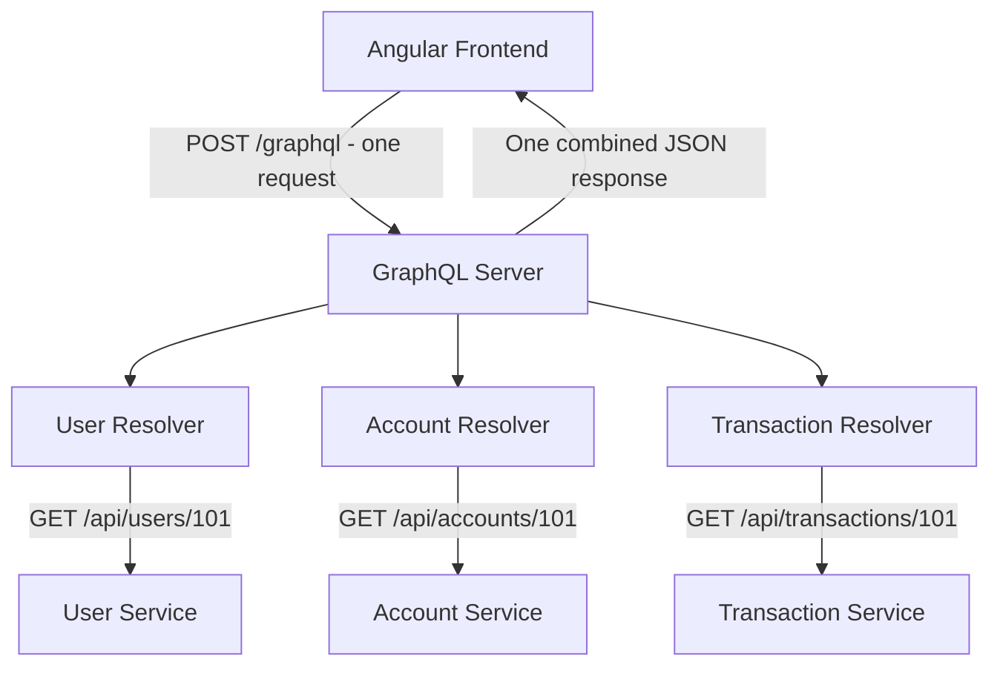
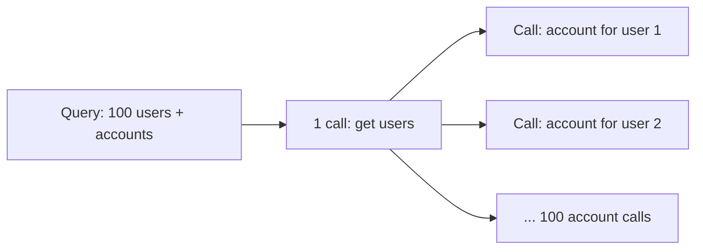
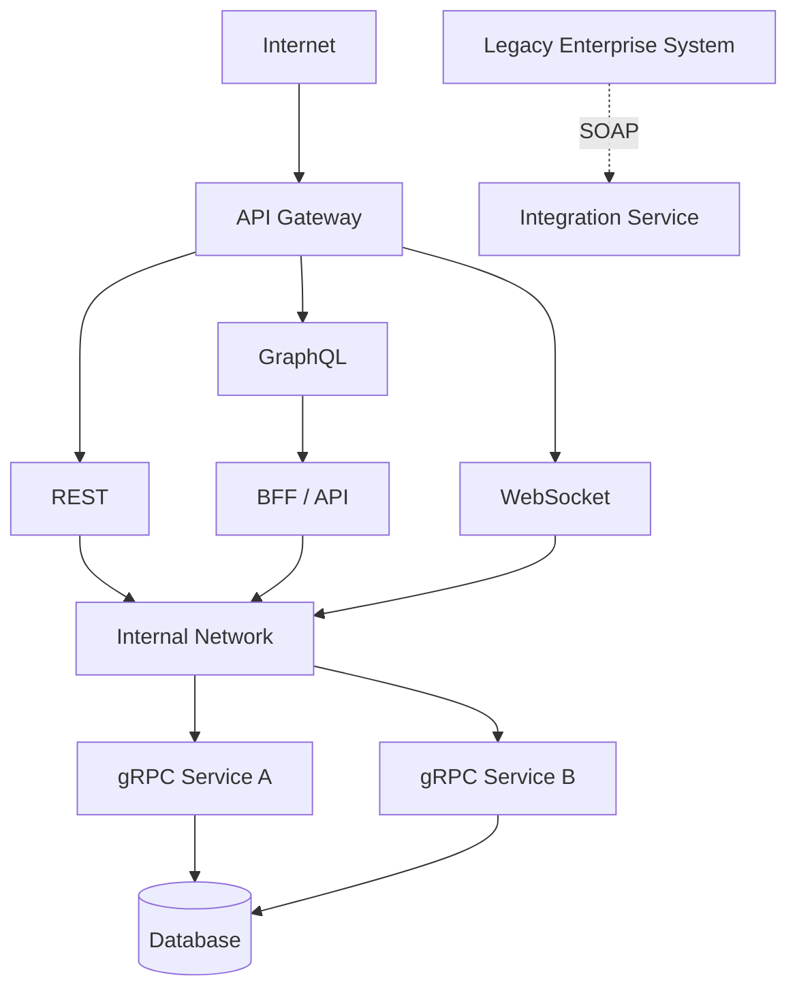
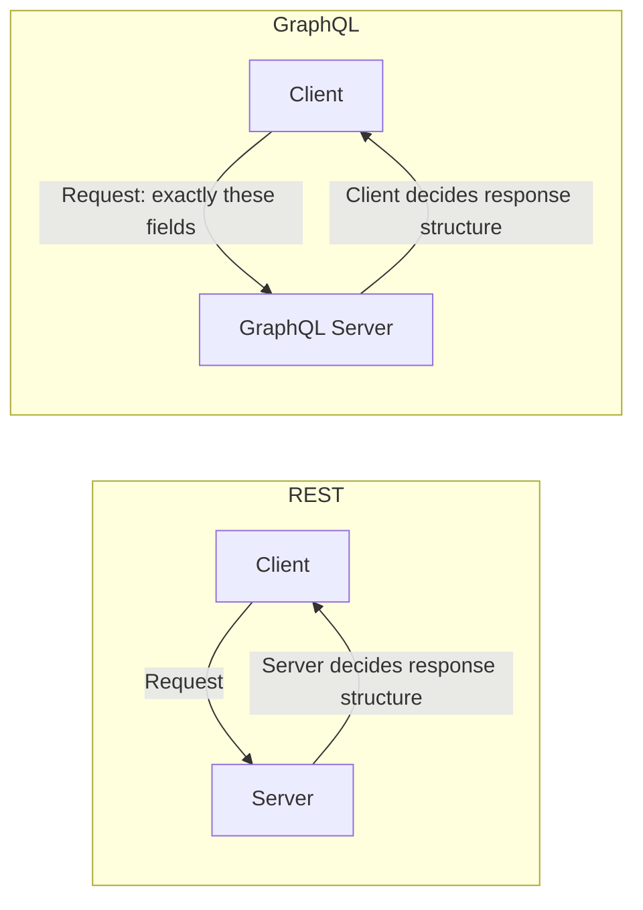
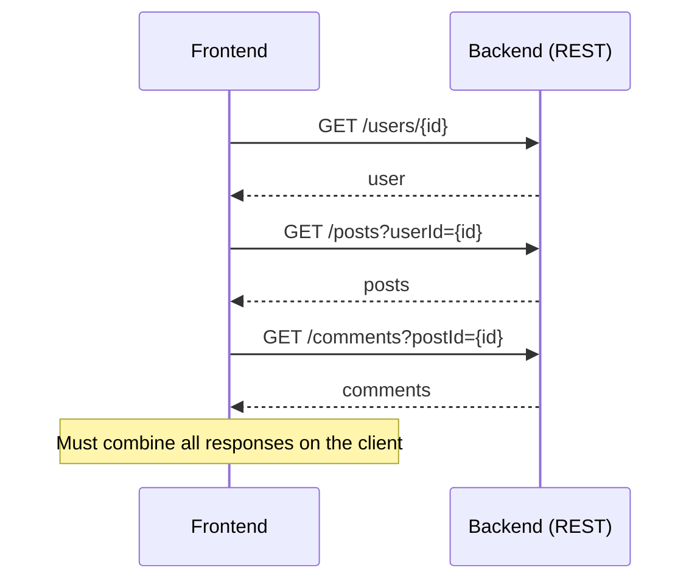
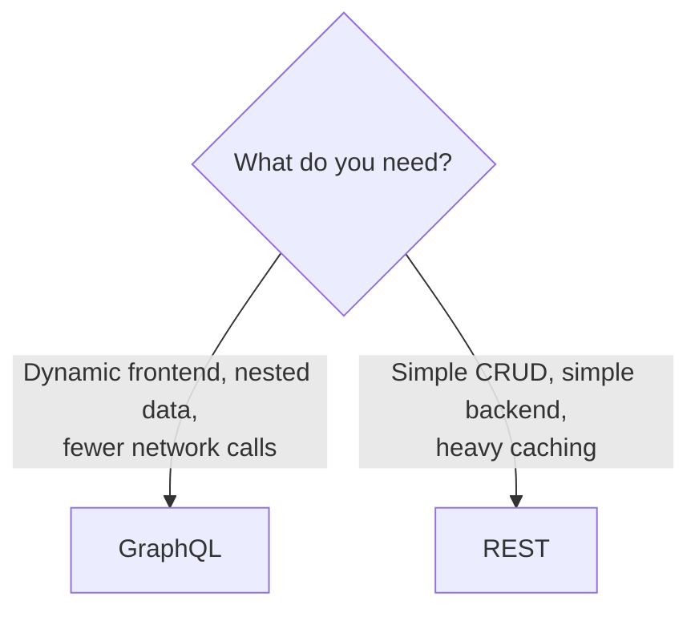
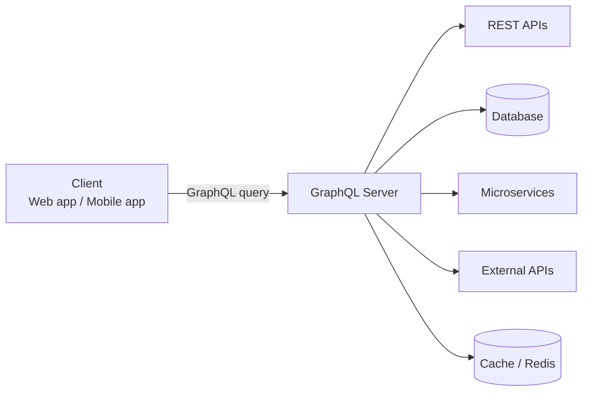
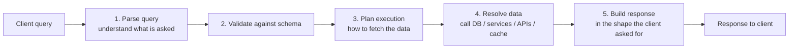
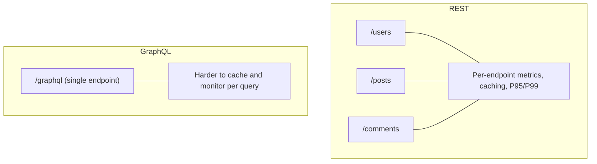

# GraphQL

> *Compiled from all markdown files in this folder: [`README.md`](README.md), [`System_Design_API_Fundamentals_Part1.md`](System_Design_API_Fundamentals_Part1.md), [`System_Design_API_Fundamentals_Part2.md`](System_Design_API_Fundamentals_Part2.md) and [`GraphQL_vs_REST_Performance.md`](GraphQL_vs_REST_Performance.md).*

**GraphQL** is an API query language and runtime developed by **Meta** to overcome REST's limitations of **over-fetching** and **under-fetching**. It lets the client request precisely the fields it needs, across multiple entities, in a **single round-trip**.

**In one line:** GraphQL = client-controlled data.

---

## 1. Where GraphQL Fits in API Evolution

```
   1990s - 2000s            2000s - Present             2015+                 2015+               Real-Time
+-----------------+      +--------------------+      +-------------+      +-------------+      +---------------+
|    SOAP API     | ---> |      REST API      | ---> | GraphQL API | ---> |  gRPC API   | ---> | WebSocket API |
| (XML, Strict)   |      | (~90% Web Traffic) |      | (Query Opt) |      | (HTTP/2,PB) |      | (Bi-directional)|
+-----------------+      +--------------------+      +-------------+      +-------------+      +---------------+
```

---

## 2. Why GraphQL? (Limitations of REST)

REST powers ~90% of web APIs, but at scale it shows constraints:

| REST Limitation | Description |
| :--- | :--- |
| **Over-fetching** | REST returns fixed-schema payloads; clients (especially mobile) receive unnecessary fields. |
| **Under-fetching** | Related entities require multiple round-trip calls. |
| **High latency / overhead** | JSON over HTTP/1.1 means repetitive parsing, bulky headers, uncompressed payloads. |
| **Rigid CRUD resource model** | Pure resource modeling does not map cleanly to complex workflows. |

**GraphQL emerged to solve over-fetching and under-fetching on client-to-server networks.**

---

## 3. How GraphQL Works

**Communication style:** Request → Response, usually over HTTP/HTTPS, with a JSON response.

```
Client ─────────► GraphQL
     "Give me exactly this"

Client ◄───────── GraphQL
       requested data
```

Instead of several REST calls, the client sends **one query** to a single endpoint (`POST /graphql`):

```graphql
query {
  user(id: "101") {
    name
    email
    accounts {
      accountNumber
      balance
    }
    recentTransactions {
      amount
      date
    }
  }
}
```

The GraphQL server runs **resolvers**, each of which may call a downstream REST API or database, combines the results, and returns only the requested fields.



> **Key point:** One frontend request does not mean one backend request. The GraphQL server may still call multiple REST APIs. The difference is *where* the coordination happens and *how* it is executed.

---

## 4. REST vs GraphQL: The Performance Question

> If GraphQL still calls REST APIs on the backend, and they take the same time, why would GraphQL be faster?

**GraphQL does not automatically make data fetching faster.** The real advantage comes from **reducing the number of network requests**, **fetching only required fields**, and **combining data from multiple services efficiently**.


### Scenario: Profile page needing user, account and transactions (3 APIs, 200 ms each)

```
GET /api/users/101
GET /api/accounts/101
GET /api/transactions/101
```

| Approach | Approx. time |
| :--- | :--- |
| Frontend calls REST **sequentially** | ~600 ms + overhead |
| Frontend calls REST **in parallel** (`forkJoin` / `Promise.all`) | ~200 ms + overhead |
| GraphQL calls REST **in parallel** | ~200 ms + gateway overhead |

> REST does not require sequential calls. If the frontend already uses `Promise.all()`, GraphQL may not be faster; it adds a network hop and resolver overhead.

### A. Direct REST: Sequential Calls


### B. GraphQL: Parallel Downstream Calls


### C. Combined Comparison


### Phase-by-Phase Execution Comparison

| Phase | Direct Sequential REST (client-driven) | GraphQL Gateway (parallelized) | Why GraphQL can win |
| :--- | :--- | :--- | :--- |
| **Request** | 3 separate HTTP requests over public internet | 1 HTTP request | Eliminates multiple network handshakes |
| **Execution** | Client waits 200 ms → 200 ms → 200 ms | Server fires all 3 concurrently over fast internal network | Backend wait drops from 600 ms to 200 ms |
| **Processing** | Browser parses 3 JSON payloads | Server filters fields and shapes one JSON | Heavy work on server, not client device |
| **Response** | 3 payloads over mobile/wifi | 1 optimised payload | Saves bandwidth; faster rendering |

### Does the Internal Network Make GraphQL Faster?
Sometimes, but not guaranteed:
- A mobile client on public endpoints faces high latency; a GraphQL server on a private data-center network has near-zero internal latency.
- The GraphQL server must still **wait for downstream services**. If one takes 500 ms to query a database, GraphQL in front does not remove that 500 ms.
- A resolver may call another **sequentially** if data dependencies require it. Parallelism depends on the implementation.

---

## 5. Where GraphQL Provides Real Benefit

1. **Reducing frontend round trips:** one request instead of three avoids multiple TCP/TLS handshakes, especially on slow mobile networks.
2. **Avoiding over-fetching:** a dashboard needing only name and balance requests exactly those fields.
3. **Parallel orchestration and batching:** the server can fetch independent data concurrently and batch repeated lookups, *if* resolvers and data sources are designed for it.
4. **Developer ergonomics:** one flexible endpoint, with the client choosing the shape of the data.

---

## 6. Pitfalls of GraphQL

### The N+1 Problem
A poorly designed GraphQL server can be *slower* than direct REST calls:

> Fetching 100 users, then making one separate account request per user, results in **101 backend calls**.



**Solutions:**
- **DataLoader:** batches and deduplicates requests within a single execution tick.
- **Better query design:** join data at the source where possible.

### Payload Reduction Is Not Automatic
GraphQL lets the client select fields, but the **server must implement that selection efficiently**. If a resolver fetches a large REST response and discards most of it, the server still pays the cost of downloading and processing it. The client receives less, but the system may not transfer less unless downstream APIs support field-level filtering too.

### Other Considerations
- Complex queries and resolver execution can increase server processing time.
- Parallelism is not automatic; it depends on the dependency graph.
- Adds an extra layer (hop) compared with calling REST directly.

---

## 7. GraphQL vs REST Comparison

| Dimension | REST | GraphQL |
| :--- | :--- | :--- |
| **Endpoints** | Many, one per resource (`/users`, `/accounts`) | Typically a single `/graphql` endpoint |
| **Data shape** | Fixed by server | Chosen by client |
| **Over/under-fetching** | Common | Avoided by field selection |
| **Round trips** | Multiple for related data | Often one |
| **Protocol** | HTTP/1.1 or HTTP/2 | Usually HTTP/HTTPS |
| **Data format** | JSON, XML | JSON |
| **Streaming** | Usually non-streaming | Usually non-streaming; subscriptions can stream updates |
| **Caching** | Leverages native HTTP caching | More complex |
| **Best for** | Web/mobile APIs, simple and widely supported | Flexible frontend APIs |

---

## 8. GraphQL vs Other API Technologies

**Who initiates communication?**

```
REST        Client ──► Server      Server normally waits for a request.
GraphQL     Client ──► GraphQL     Client says exactly what it wants.
gRPC        Service A ──► Service B   Service-to-service RPC.
WebSocket   Client ◄══► Server     Either side can send anytime.
SOAP        Client ── XML ──► SOAP Service   Formal enterprise messaging.
```

| Technology | Communication | Protocol | Data Format | Best For | Main Strength |
| :--- | :--- | :--- | :--- | :--- | :--- |
| REST | Request → Response | HTTP/1.1 or HTTP/2 | JSON, XML | Web/mobile APIs | Simple and widely supported |
| SOAP | Request → Response | Usually HTTP/HTTPS | XML | Enterprise systems | Strong standards and contracts |
| **GraphQL** | Request → Response | Usually HTTP/HTTPS | JSON | Flexible frontend APIs | Client chooses required data |
| gRPC | Request → Response / Streaming | HTTP/2 | Protocol Buffers | Microservices | Fast and strongly typed |
| WebSockets | Persistent, bidirectional | HTTP handshake, then WebSocket over TCP | Text/binary | Real-time apps | Server pushes updates immediately |

**Why it impacts speed:** GraphQL reduces over-fetching and extra API calls, but complex queries and resolver execution can increase server processing time.

> The underlying protocol alone does not determine speed. Payload size, network latency, serialization, server processing, connection reuse and workload all matter.

---

## 9. GraphQL in a Practical Architecture

GraphQL commonly sits behind an API gateway as a **BFF (Backend for Frontend)**, while internal services talk via gRPC.



**Realistic choice for an Angular + Node.js/FastAPI microservices app:**

```
Angular
   │
   ├── REST / GraphQL ──► API/BFF
   │
   └══ WebSocket ═══════► Real-time Gateway

API/BFF
   │
   ├── gRPC ──► User Service
   ├── gRPC ──► Order Service
   ├── gRPC ──► Payment Service
   │
   └── REST ──► External APIs
```

---

## 10. Course Notes: GraphQL (API Part 3)

> *Added from the System Design course video on GraphQL (API Part 3). The series so far: Part 1 covered APIs and SOAP, Part 2 covered REST, and Part 3 covers GraphQL, which came about because of REST's challenges.*

### 10.1 What Is GraphQL?
- GraphQL is an **API query language** and runtime, created by **Meta** (Facebook).
- It is similar in spirit to SQL: SQL is the query language for databases, GraphQL is the query language for APIs.
- Its main advantage: **it allows the client to ask for exactly what it wants.**

### 10.2 Why Meta Built It
Large tech companies (Google, Meta, LinkedIn, the "torch bearers of tech") don't just pick from existing market options when they face a problem. If REST or SOAP doesn't solve the problem, they build a new solution.

| Approach | Behavior |
| :--- | :--- |
| Typical company | Benchmarks the available options and picks the best one |
| Tech-first company | If no existing option solves the problem, builds a new one (here, GraphQL) |

### 10.3 Who Decides the Response Structure?



| | REST | GraphQL |
| :--- | :--- | :--- |
| **Who decides the response structure** | **Server** | **Client** |
| **Effect** | Every client gets the same fixed structure | Client gets only the data and format it asks for |

GraphQL gives the **client more power**.

---

## 11. The Two REST Challenges GraphQL Solves

### 11.1 Challenge 1: Over-fetching
**Over-fetching = extra data**, which leads to over-processing and more load.

In REST, the response structure is decided by the server. Whether Client 1, Client 2 or Client 3 calls, all receive the **same structure**.

**Example:** the frontend needs only the user's **name**. The backend response contains:

```json
{
  "id": 101,
  "name": "Piyali",
  "email": "...",
  "followers": 1200,
  "posts": [ ... ],
  "settings": { ... }
}
```

Because the REST response structure is fixed, the client still has to **receive and process the entire response**, even though it only needed `name`.

### 11.2 Challenge 2: Under-fetching / Multiple Round Trips
Suppose the frontend needs **user info, post info and comment info**. These are different resources, so REST needs separate calls:



- Multiple API calls mean **more network bandwidth, more processing and more time**.
- The client then has to **combine** the results.
- REST says every resource needs its own API and RESTful URI, so fetching several resources means several calls.
- This is especially expensive for **mobile or small applications**.

### 11.3 How GraphQL Solves Both
GraphQL makes the client **super powerful**: the client gets **exactly what it needs**.

```graphql
query {
  user(id: "101") {
    name
    posts {
      title
    }
  }
}
```

The response contains only the user's name and the titles of their posts.

| Problem | Result with GraphQL |
| :--- | :--- |
| Over-fetching | Gone, since only requested fields come back |
| Under-fetching | Gone, since GraphQL collects the resources internally and returns them in a single call |
| Extra processing | Reduced on the client |
| Multiple API calls | Replaced by one call |

> If you want the client side to be faster and more responsive, GraphQL is the approach to use.

### 11.4 Why the World Adopted It
- The performance difference between REST and GraphQL matters mostly when the application is **very large**. If a frontend makes 100 to 200 API calls at scale, the difference becomes visible.
- **For a basic, small application, go with REST.**
- For big applications at the scale of **Meta or Instagram**, the frontend may call **hundreds of APIs** to load its data.
- REST's problems at that scale: too many requests and responses, unnecessary payload, and **slow mobile performance**.
- Mobile is the most impacted: today **80% to 90% of application consumers are mobile-first**.
- The frontend also depends on whatever response structure the backend gives it.

---

## 12. When to Use GraphQL vs REST

| Situation | Better choice |
| :--- | :--- |
| **Dynamic frontend needs** | GraphQL |
| **Deeply nested relationships**, where one call replaces many | GraphQL (minimizes network calls from frontend to backend) |
| **Mobile-first apps** needing a fast, responsive client | GraphQL |
| **Public, simple CRUD API** (create, read, update, delete on resources) | REST |
| **Simple backend** | REST |
| **Heavy caching requirements** | REST (caching is a challenge in GraphQL; see section 14) |



---

## 13. How GraphQL Architecture Works

### 13.1 GraphQL Is a Middle Layer
GraphQL sits **between your frontend and your services or databases**. To build a GraphQL API, you add a **GraphQL server** in the middle.



The data sources the GraphQL server can fetch from:
- A database
- Other microservices (exposed through REST APIs, or maybe GraphQL)
- External APIs
- A cache or Redis

### 13.2 Steps Inside the GraphQL Server



| Step | What happens |
| :--- | :--- |
| 1. **Parse** | The query is parsed to understand what the client wants |
| 2. **Validate** | The query is validated against the **schema** (in GraphQL you define a schema for your data) |
| 3. **Plan execution** | Decide how to execute it and how to fetch the data |
| 4. **Resolve** | Fetch the data from the sources |
| 5. **Build response** | Convert the data into the form the client asked for |

You are still fetching the same data, but an **additional layer** converts it into the form the client needs. Before, the client had to make 10 calls. Now the client makes **one call**, and the **GraphQL server does the heavy lifting** to return the data in the client's required format.

> **Why use GraphQL?** When you want to make the client **powerful**: the client gets **exactly what it wants**.

---

## 14. Challenges of GraphQL (from the Course)

Every technology has challenges, and these motivate the next API styles (gRPC, WebSockets).

| # | Challenge | Explanation |
| :--- | :--- | :--- |
| 1 | **Backend becomes more complex** | The extra GraphQL layer in the backend makes the backend more complicated, so you need to be more skilled to build it |
| 2 | **N+1 query problem** | A client makes one query, but the server may trigger **multiple fetch requests** to the backend. You see one call, but the **load on the backend can increase many times** |
| 3 | **Harder caching** | In REST, every resource has a fixed URI, so it is easy to cache. In GraphQL the **endpoint is the same for all queries**, so caching becomes very tough |
| 4 | **Query complexity attacks** | A single query can contain many **nested requests**. Because of nesting, a query can become very complicated and expensive to execute |
| 5 | **Harder monitoring** | With one endpoint for everything, you cannot easily monitor different data or client requests separately |

### Why monitoring is harder
- In **REST**, each resource has its own endpoint, so you can monitor how many calls arrive, how many fail, and the **P95 / P99 latencies** per endpoint.
- In **GraphQL**, every call hits the **same endpoint**, so per-operation monitoring is more challenging.



> Despite these challenges, the world uses GraphQL because it makes the **client super powerful**: the client gets what it needs, as much as it needs. To make the **frontend and mobile faster**, GraphQL is the approach to go for.

---

## 15. Interview Questions on GraphQL

1. What is GraphQL, and who created it?
2. Who decides the response structure in REST vs GraphQL?
3. What are over-fetching and under-fetching? Give an example.
4. How does GraphQL solve both problems?
5. Why does GraphQL matter most for mobile and large-scale apps?
6. When would you choose REST over GraphQL?
7. Describe the steps inside a GraphQL server (parse, validate, plan, resolve, build response).
8. What is the N+1 query problem, and how can you mitigate it? (See section 6: DataLoader and better query design.)
9. Why is caching harder in GraphQL than in REST?
10. What is a query complexity attack, and how can you guard against it (for example with depth or cost limits)?
11. Why is monitoring harder with a single endpoint?

---

## 16. Summary

| Question | Answer |
| :--- | :--- |
| Does GraphQL make individual REST APIs faster? | **No.** Backend processing time is unchanged. |
| Does GraphQL reduce frontend HTTP requests? | **Yes**, often to one. |
| Does GraphQL automatically parallelize resolver calls? | **Only if implemented that way.** |
| Is GraphQL always faster than REST? | **No.** Well-designed REST with parallel calls is comparable. |
| Where does GraphQL clearly win? | Mobile clients, over-fetching, orchestrating multiple services, developer ergonomics. |

> **Think of GraphQL as an API layer that changes how the client requests and receives data, not as a replacement for the underlying data sources.**
>
> Performance depends on network round trips, concurrency, payload size, caching, batching, and backend response times.

### Key Takeaways
1. Created by Meta to fix REST's over-fetching and under-fetching.
2. One query, one endpoint, exactly the fields requested.
3. It typically wraps REST/gRPC/database sources via resolvers.
4. Watch for the N+1 problem; use DataLoader and good query design.
5. Use GraphQL for flexible frontend APIs; use REST as the default for simple web APIs, gRPC for internal service-to-service calls.
