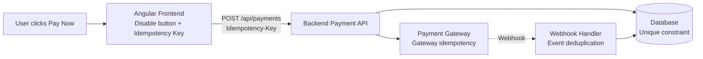
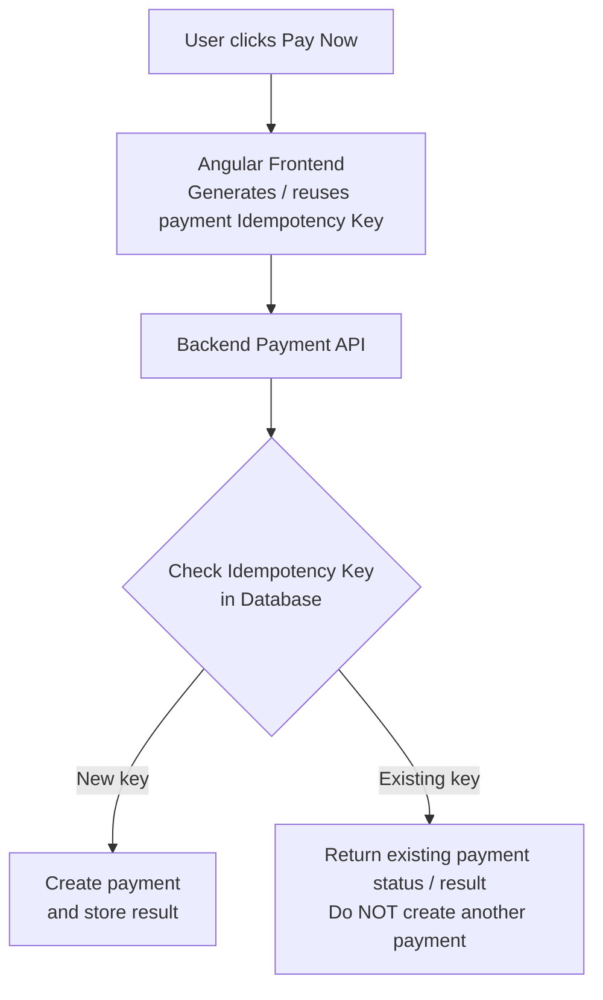
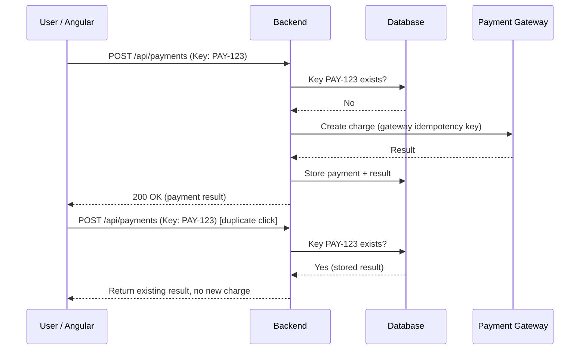
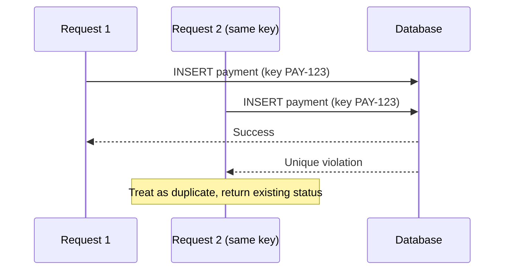
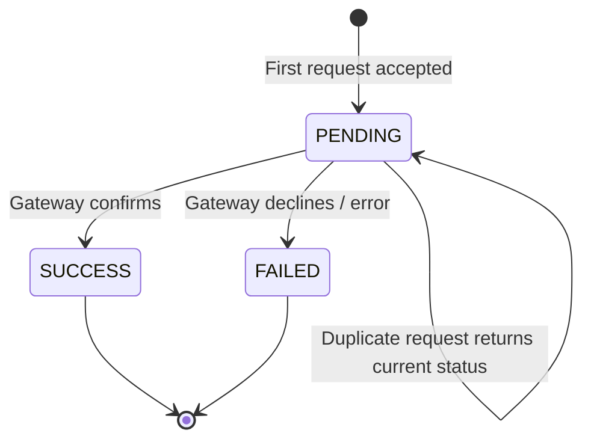

# Preventing a Payment Button from Being Clicked Multiple Times

> **Question:** How do you prevent a **Pay Now** button from being clicked multiple times, so the user isn't charged more than once?
>
> Related: [`REST_API.md`](REST_API.md) (idempotency of HTTP verbs, section 12 payment example) · [`REST.md`](REST.md)

---

## 1. Core Idea

In a production payment application, protect against duplicate clicks at **both the frontend and the backend**.

> **Disabling the button prevents accidental clicks in the UI, but Idempotency Keys prevent duplicate payments at the backend.**

| Layer | Role |
| :--- | :--- |
| Frontend button disabling | **User-experience** protection |
| Backend idempotency | **Business-level** duplicate payment protection |
| Database constraints + gateway idempotency | **Production-level** reliability |

Architecture used here: **Angular + Backend + Payment Gateway**.



---

## 2. Frontend: Disable the Button After the First Click

When the user clicks **Pay Now**:
1. Set `isPaymentProcessing = true`.
2. Disable the **Pay Now** button immediately.
3. Send the payment request to the backend.
4. Keep the button disabled while payment is processing.
5. Re-enable it only when the operation reaches an appropriate **terminal state**.

### Angular example

```typescript
isPaymentProcessing = false;

makePayment() {
  if (this.isPaymentProcessing) {
    return;
  }

  this.isPaymentProcessing = true;

  this.paymentService.makePayment().subscribe({
    next: (response) => {
      console.log('Payment successful', response);
      this.isPaymentProcessing = false;
    },
    error: (error) => {
      console.error('Payment failed', error);
      this.isPaymentProcessing = false;
    }
  });
}
```

### HTML

```html
<button
  [disabled]="isPaymentProcessing"
  (click)="makePayment()">

  {{ isPaymentProcessing ? 'Processing...' : 'Pay Now' }}

</button>
```

### Button states

| State | Button label | Enabled? |
| :--- | :--- | :--- |
| Idle | `Pay Now` | Yes |
| Processing | `Processing...` | **No** |
| Success / Failed (terminal) | `Pay Now` (or a result screen) | Yes / navigate away |

### Why frontend protection is NOT sufficient

This is only the **first level** of protection. Duplicate requests can still occur when:
- The user **refreshes** the browser.
- The **network retries** the request.
- The user opens **multiple browser tabs**.
- Someone sends the API request directly using **Postman**.
- The browser sends the **same request twice**.

Therefore, backend protection is required.

---

## 3. Backend: Implement Idempotency Keys

This is the **most important production-level solution**.

When a user initiates a payment, generate a **unique idempotency key** for that payment attempt.

```http
POST /api/payments
Idempotency-Key: payment-12345
Content-Type: application/json
```

```json
{
  "orderId": "ORD-1001",
  "amount": 5000,
  "currency": "INR"
}
```

The backend stores the idempotency key **and the payment result**.

### How it works



### Example: repeated clicks, one payment

| Request | Idempotency Key | Backend action |
| :--- | :--- | :--- |
| First click | `PAY-123` | Create payment |
| Second click | `PAY-123` | Return existing result / status |
| Third click | `PAY-123` | Return existing result / status |
| Fourth click | `PAY-123` | Return existing result / status |

**Only one payment is created** for that logical payment attempt.



---

## 4. Database: Maintain Payment Status

A production payment system maintains a payment record:

| Payment ID | Order ID | Amount | Status |
| :--- | :--- | :--- | :--- |
| PAY-101 | ORD-1001 | ₹5,000 | `SUCCESS` |
| PAY-102 | ORD-1002 | ₹2,000 | `PENDING` |
| PAY-103 | ORD-1003 | ₹1,000 | `FAILED` |

Also maintain a **unique constraint** on the idempotency key, **scoped appropriately** to the customer or merchant.

```sql
CREATE TABLE payments (
    payment_id VARCHAR(100) PRIMARY KEY,
    order_id VARCHAR(100) NOT NULL,
    idempotency_key VARCHAR(255) NOT NULL,
    amount DECIMAL(12,2) NOT NULL,
    status VARCHAR(20) NOT NULL,

    UNIQUE (idempotency_key)
);
```

> **Concurrency warning:** the backend must handle concurrent requests **atomically**. Simply *checking* the database and then *inserting* a record is **not enough**, because two requests might pass the check simultaneously. Rely on the unique constraint (insert and catch the conflict) or a transaction / lock.



---

## 5. What If the Payment Is Still Processing?

An important production scenario:

1. User clicks **Pay Now**.
2. Backend sends the payment request to the gateway.
3. Payment gateway is processing the transaction.
4. User clicks **Pay Now** again.

The backend must **not** initiate another payment. Instead, it returns the existing payment's status:

```json
{
  "paymentId": "PAY-101",
  "status": "PENDING",
  "message": "Payment is being processed"
}
```

The frontend can display:

> *Your payment is being processed. Please do not retry.*

If the **network times out**, the frontend should **check the existing payment status** using the same payment attempt (same idempotency key / payment ID) rather than blindly creating another payment.



---

## 6. Complete Production-Level Approach

| Layer | Protection | Purpose |
| :--- | :--- | :--- |
| **Angular Frontend** | Disable button | Prevent accidental multiple clicks |
| **Frontend** | Generate / reuse Idempotency Key | Identify the same payment attempt |
| **Backend API** | Idempotency validation | Prevent duplicate payment processing |
| **Database** | Unique constraint + transaction | Handle concurrent requests safely |
| **Payment Gateway** | Gateway-supported idempotency | Prevent duplicate charges at the gateway |
| **Webhook Handler** | Event deduplication | Prevent duplicate processing of payment notifications |

> **Recommendation:** for a banking or payment application, implement **all** of these protections rather than relying only on disabling the button.

---

## 7. Interview-Ready Answer

> "I protect against duplicate payments in layers. On the frontend, I disable the Pay Now button immediately and show a processing state, which prevents accidental clicks. But that's only user-experience protection, since refreshes, retries, multiple tabs, or direct API calls can still send duplicates.
>
> The real protection is an **idempotency key**: the client generates a unique key per payment attempt and sends it in the request. The backend stores the key with the payment result, so repeated requests with the same key return the existing result or status instead of charging again. I enforce a **unique constraint** on the key in the database and handle concurrent requests atomically, and I use the payment gateway's own idempotency support too. If a payment is still pending, duplicates just get the pending status back. Finally, I **deduplicate webhook events** so notifications don't get processed twice."

---

## 8. Key Takeaways

1. **Frontend button disabling = user-experience protection**, not a guarantee.
2. **Backend idempotency = business-level duplicate payment protection.**
3. **Database unique constraint + transaction, and gateway idempotency = production-level reliability.**
4. A **check-then-insert** is not atomic; handle concurrency with a unique constraint or transaction.
5. For in-flight payments, **return the existing `PENDING` status** instead of creating another payment.
6. After a timeout, **check the status** of the same attempt; never blindly create a new payment.
7. **Deduplicate webhook events** as well.
8. `POST` is generally non-idempotent; an **idempotency key** is what makes repeated `POST` requests safe.
