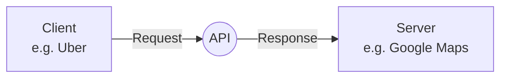
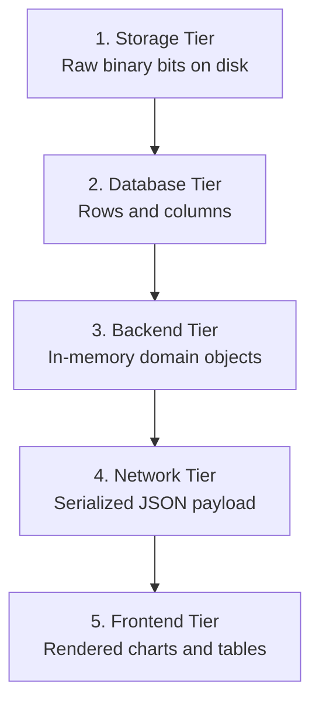
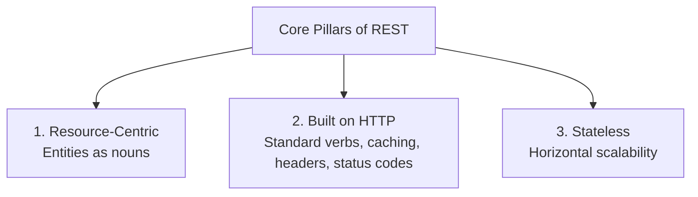
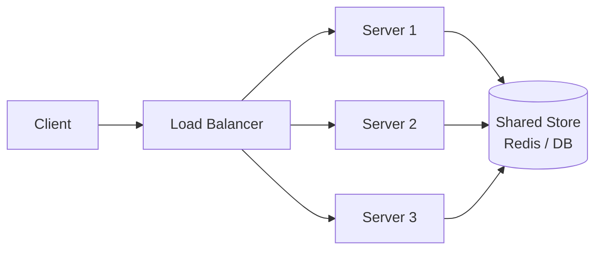
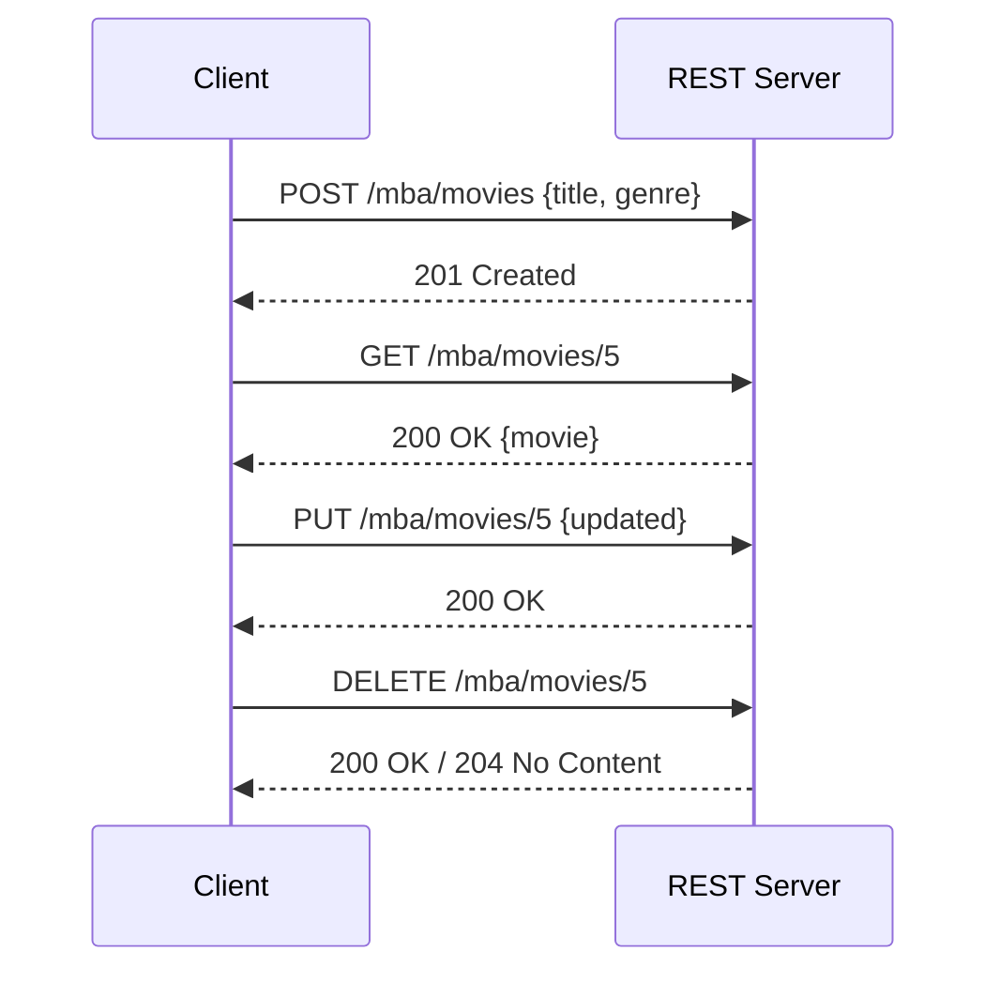
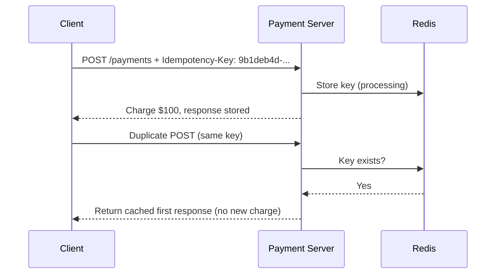
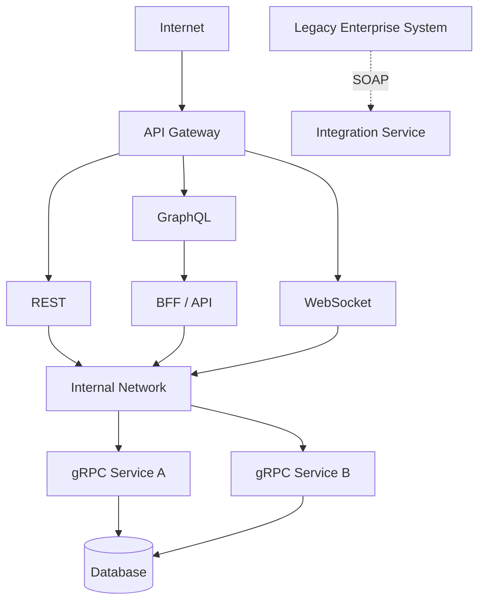

# REST (Representational State Transfer)

> *Compiled from all markdown files in this folder: [`README.md`](README.md), [`System_Design_API_Fundamentals_Part1.md`](System_Design_API_Fundamentals_Part1.md), [`System_Design_API_Fundamentals_Part2.md`](System_Design_API_Fundamentals_Part2.md) and [`GraphQL_vs_REST_Performance.md`](GraphQL_vs_REST_Performance.md).*

**REST** models an application as a collection of **Resources** whose **state representations** are transferred across tiers of a system. It is built on HTTP, is stateless by design, and powers ~90% of web and enterprise APIs today.

**In one line:** REST = resources.

---

## 1. API Basics (Context)

An **API (Application Programming Interface)** is a communication contract that lets two software applications interact and exchange data over a network.



**Restaurant analogy:** Client = customer, Kitchen = server/backend, **API = waiter** who carries the order and returns the food.

An API defines four things:
1. Which requests are allowed (endpoints, methods).
2. What data must be sent (parameters, headers, payload schema).
3. What response comes back (status codes, payload structure).
4. Rules of communication (HTTP/HTTPS, authentication, JSON/XML encoding).

APIs are **technology agnostic**: a Java/React client can talk to a Python/Go/C++ server as long as both follow the agreed format.

| Entity | Role |
| :--- | :--- |
| **Client** | Requester; initiates the request |
| **Server** | Responder; processes and returns the response |
| **Network** | Transport medium |

---

## 2. Why REST? (The Transition from SOAP)

Before REST, enterprises relied on **SOAP**. As internet and mobile traffic exploded, SOAP's bottlenecks appeared:

1. **Slow execution:** heavy serialization/deserialization overhead.
2. **Expensive bandwidth:** large XML envelopes.
3. **High complexity:** rigid WSDL contracts and complicated tooling.
4. **Inflexible coupling:** tied exclusively to XML.

| | SOAP (Rigid & Heavy) | REST (Flexible & Lightweight) |
| :--- | :--- | :--- |
| **Format** | Exclusively XML | JSON (default), XML, Plain Text, YAML, HTML |
| **Payload** | Verbose envelopes | Compact key-value pairs |
| **Result** | High bandwidth, slow mobile performance | Fast, developer-friendly, ~90% of web APIs |

```json
{
  "userId": 1001
}
```
REST/JSON needs only this, where SOAP needs a full XML envelope with header and body boilerplate.

---

## 3. What is REST? Representational State Transfer

The underlying business data (**State**) stays constant, but as it travels from disk to the user's browser its **Representation** is continually **Transferred** and transformed.



---

## 4. Core Architectural Pillars



1. **Resource-centric:** everything is a resource (Users, Movies, Bookings, Orders), treated as **nouns**, not verbs.
2. **Built on HTTP/HTTPS:** reuses HTTP for transport, caching, headers and status codes.
3. **Stateless by design:** no session state is pinned to server memory; any server behind a load balancer can handle any request.

### Why Stateless Scales Horizontally

| | Stateful | Stateless (REST) |
| :--- | :--- | :--- |
| **Server memory** | Holds client session/context | Holds nothing between requests |
| **Request needs** | Relies on prior requests | Carries all context (auth token, IDs, payload) |
| **Scaling** | Sticky sessions; single point of failure | Add servers freely behind a load balancer |
| **State lives in** | Server instance | External stores (Redis, distributed DBs) |



**Gated community analogy:** a guard who memorizes plate numbers is a bottleneck. Many guards sharing one logbook can be added at will.

**Stateless use cases:** social media feeds, e-commerce search/catalog/checkout, cloud microservices.

---

## 5. RESTful URIs

A **URI (Uniform Resource Identifier)** is the unambiguous address of a resource.

```
Physical:  Earth -> Asia -> India -> Karnataka -> Bangalore -> Sun City -> House #10
Digital:   Host IP (121.0.4.9) -> Port (8080) -> App Context (/mba) -> Resource (/movies)
```

- **URL:** the colloquial term (browser navigation).
- **URI:** the formal term used in API contracts.

---

## 6. CRUD and HTTP Verbs

$$\text{RESTful API} = \text{HTTP Verb (Action)} + \text{URI (Resource Address)}$$

| CRUD Operation | HTTP Verb | Purpose |
| :--- | :--- | :--- |
| **Create** | `POST` | Create a new resource |
| **Read** | `GET` | Fetch existing resource(s) |
| **Update** | `PUT` / `PATCH` | Replace / modify a resource |
| **Delete** | `DELETE` | Remove a resource |

### Example: Movie Booking App (`MBA`)
Host `121.1.1.9`, port `8080`, context `mba`, resource `movies`.

| Operation | Request |
| :--- | :--- |
| Create | `POST http://121.1.1.9:8080/mba/movies` (JSON body: title, genre, runtime) |
| Read all | `GET /mba/movies` |
| Read by ID (path param) | `GET /mba/movies/5` |
| Filter (query param) | `GET /mba/movies?actor=ShahRukh&language=Hindi` |
| Update | `PUT /mba/movies/5` (JSON body with updated attributes) |
| Delete | `DELETE /mba/movies/5` |

- **Path parameter** (`/movies/{id}`) identifies one exact item.
- **Query parameter** (`?key=value`) filters, sorts, or paginates.



---

## 7. Two Golden Rules of URI Design

| Rule | Correct | Incorrect |
| :--- | :--- | :--- |
| **1. Resources are plural nouns** | `/movies`, `/users`, `/orders` | `/movie`, `/user`, `/order` |
| **2. No verbs in the path** | `POST /movies` | `GET /createMovie`, `POST /deleteMovie/5` |

Formatting: use lowercase, and hyphens for multi-word resources (e.g. `/movie-tickets`).

### Practical Exercise: Vehicle Management System (`VMS`)
Host `121.9.8.7`, port `7070`, app `vms`, version `v1`, resource `vehicles`.

| Operation | Verb | URI |
| :--- | :--- | :--- |
| Create | `POST` | `http://121.9.8.7:7070/vms/v1/vehicles` |
| Read all | `GET` | `http://121.9.8.7:7070/vms/v1/vehicles` |
| Read by ID | `GET` | `http://121.9.8.7:7070/vms/v1/vehicles/{id}` |
| Search/filter | `GET` | `http://121.9.8.7:7070/vms/v1/vehicles?type=sedan` |
| Update | `PUT` | `http://121.9.8.7:7070/vms/v1/vehicles/{id}` |
| Delete | `DELETE` | `http://121.9.8.7:7070/vms/v1/vehicles/{id}` |

---

## 8. Idempotency

An operation is **idempotent** if making the same request once or *N* times produces the same server state with no unintended side effects.

$$f(f(x)) = f(x)$$

| HTTP Verb | Idempotent? | Reasoning |
| :--- | :--- | :--- |
| `GET` | **Yes** | Read-only; no state change |
| `PUT` | **Yes** | Overwrites with the supplied payload; final state is identical |
| `DELETE` | **Yes** | First call deletes; later calls find it gone (404) with no new side effect |
| `POST` | **No** | Creates a new resource on every call |

### The Double-Click Payment Problem
A user clicks "Pay Now" ($100) three times. Without idempotency handling, `POST /api/v1/payments` runs three times and **$300** is deducted.

**Solution: Idempotency Key**

1. The client generates a unique UUID before sending the request.
2. The server stores the key in a cache (like Redis) during processing.
3. Duplicate requests with the same key are rejected or served the first response.

---

## 9. REST vs Other API Styles

**Who initiates communication?**
```
REST       Client ─────────► Server   (request)
           Client ◄───────── Server   (response)
           Server normally waits for a request.
```

| Technology | Communication | Protocol | Data Format | Best For | Main Strength |
| :--- | :--- | :--- | :--- | :--- | :--- |
| **REST** | Request → Response | HTTP/1.1 or HTTP/2 | JSON, XML | Web/mobile APIs | Simple and widely supported |
| **SOAP** | Request → Response | Usually HTTP/HTTPS | XML | Enterprise systems | Strong standards and contracts |
| **GraphQL** | Request → Response | Usually HTTP/HTTPS | JSON | Flexible frontend APIs | Client chooses required data |
| **gRPC** | Request → Response / Streaming | HTTP/2 | Protocol Buffers | Microservices | Fast and strongly typed |
| **WebSockets** | Persistent, bidirectional | HTTP handshake, then WebSocket over TCP | Text/binary | Real-time apps | Server can push updates |

**Speed note for REST:** JSON parsing and HTTP overhead can add latency; HTTP/2 multiplexing and caching can improve performance. The protocol alone does not decide speed; payload size, latency, serialization, server processing, connection reuse and workload all matter.

| Dimension | Stateless / REST | SOAP |
| :--- | :--- | :--- |
| State | Stateless by architectural constraint | Protocol-level contract |
| Data format | Predominantly JSON | Strict XML |
| Scalability | Cloud-native, internet-scale | Heavyweight |
| Primary fit | Modern web and enterprise services (~90%) | Legacy banking, telecom |

---

## 10. Limitations of REST

1. **High latency and overhead:** JSON over HTTP/1.1 means repetitive text parsing, bulky headers and uncompressed payloads.
2. **Over-fetching and under-fetching:** fixed-schema payloads give mobile clients unneeded fields, or force multiple round trips for related entities.
3. **Rigid CRUD resource model:** pure resource modeling does not map cleanly to RPC, event streams or complex transactional workflows.

**Industry response:**
- **GraphQL** addresses over-fetching and under-fetching.
- **gRPC** (HTTP/2 + Protocol Buffers) is used for high-performance internal microservice communication (Google, Netflix, Microsoft, LinkedIn).

### REST vs GraphQL: Performance Example
A profile page needs user, account and transaction data (3 APIs, 200 ms each).

```
GET /api/users/101
GET /api/accounts/101
GET /api/transactions/101
```

| Approach | Approx. time |
| :--- | :--- |
| REST, sequential calls | ~600 ms + overhead |
| REST, parallel (`forkJoin` / `Promise.all`) | ~200 ms + overhead |
| GraphQL calling REST in parallel | ~200 ms + gateway overhead |

- REST does **not** require sequential calls. If the frontend already uses `Promise.all()`, GraphQL may not be faster, and it adds a network hop and resolver overhead.
- GraphQL does not make the underlying REST APIs faster. It helps by reducing frontend round trips (valuable on mobile/high-latency networks), avoiding over-fetching, and orchestrating parallel/batched backend calls.
- Pitfall: the **N+1 problem** (100 users plus one account request each = 101 backend calls), mitigated with DataLoader and better query design.

---

## 11. REST in a Practical Architecture

REST is typically one part of a larger system, not the only protocol.



For an Angular + Node.js/FastAPI microservices app: Angular uses **REST/GraphQL** to the API/BFF and **WebSocket** for real-time; the BFF uses **gRPC** between internal services and **REST** to external APIs; **SOAP** only for legacy bank/insurance APIs.

---

## 12. Quick Summary Cheat Sheet

| Feature | Key Rule / Principle |
| :--- | :--- |
| **Paradigm** | Resource-centric; representation of state transferred across tiers |
| **Data format** | Predominantly JSON |
| **Transport** | HTTP/HTTPS; inherently stateless |
| **URI naming** | Plural nouns, no verbs, lowercase with hyphens |
| **Read** | `GET` with path params (`/movies/{id}`) or query params (`/movies?actor=SRK`) |
| **Write** | `POST` (create), `PUT`/`PATCH` (update), `DELETE` (remove) |
| **Idempotent verbs** | `GET`, `PUT`, `DELETE` |
| **Non-idempotent** | `POST` (use Idempotency Keys for critical operations like billing) |
| **Limitations** | Latency/overhead, over/under-fetching, rigid CRUD model |
| **Good default for** | Standard web and mobile APIs |
