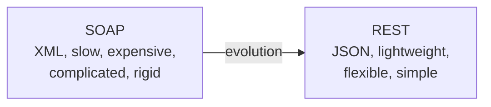
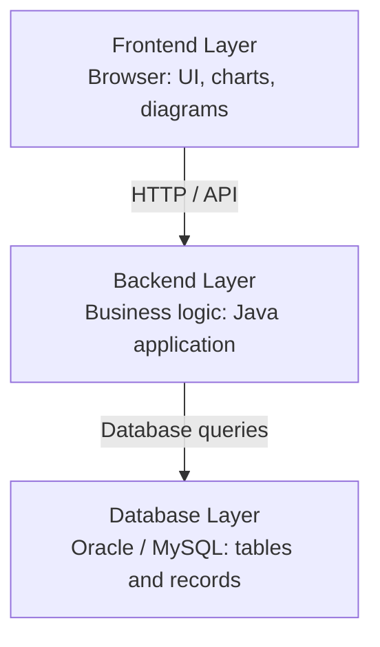
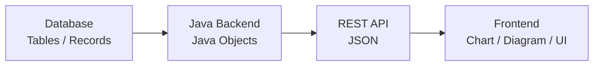
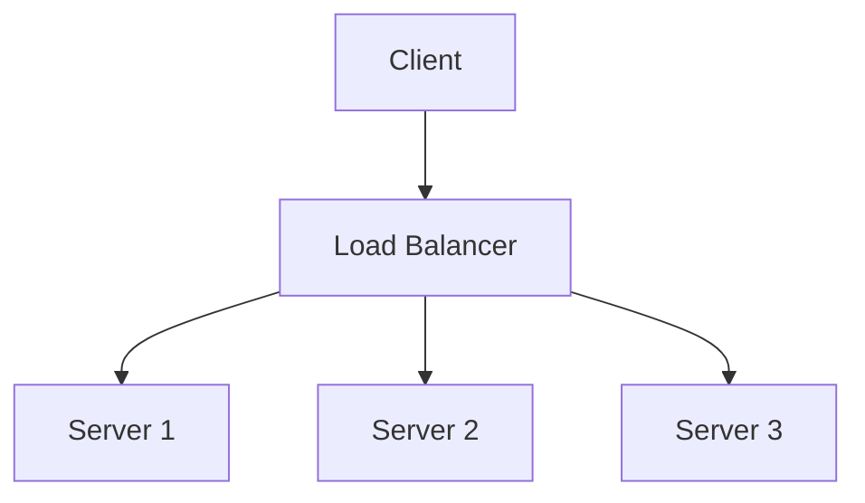
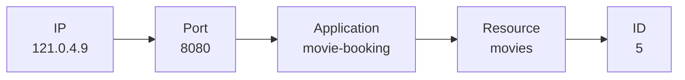
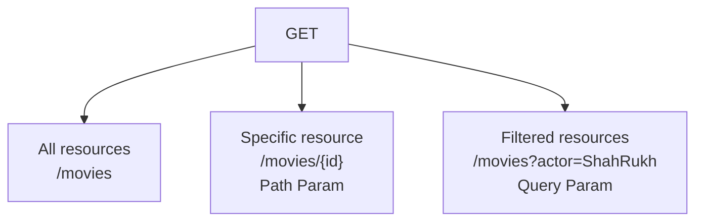
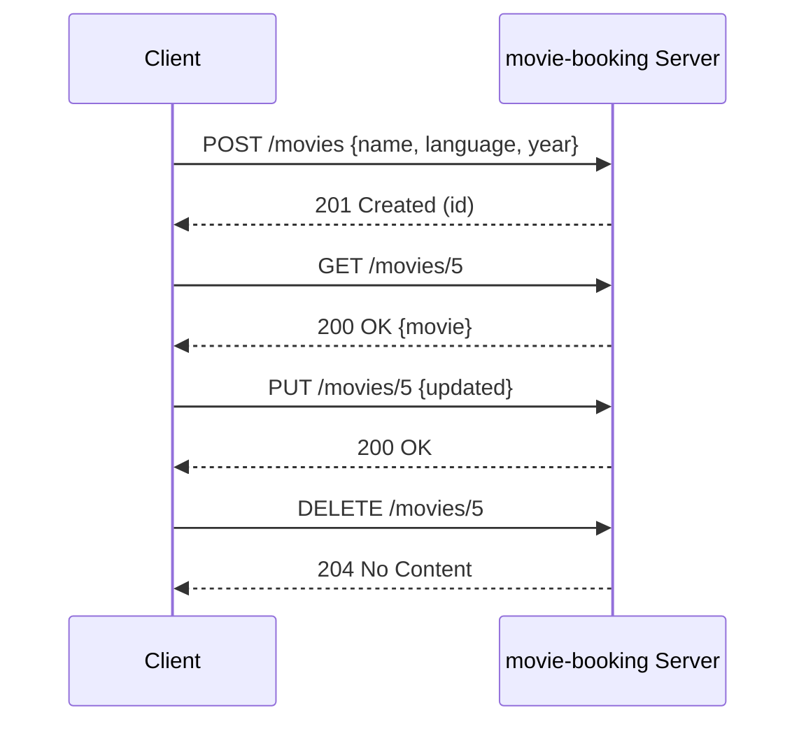
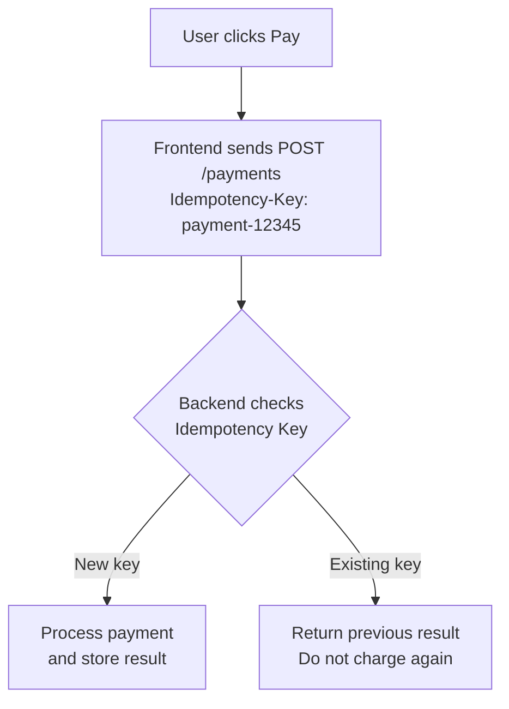
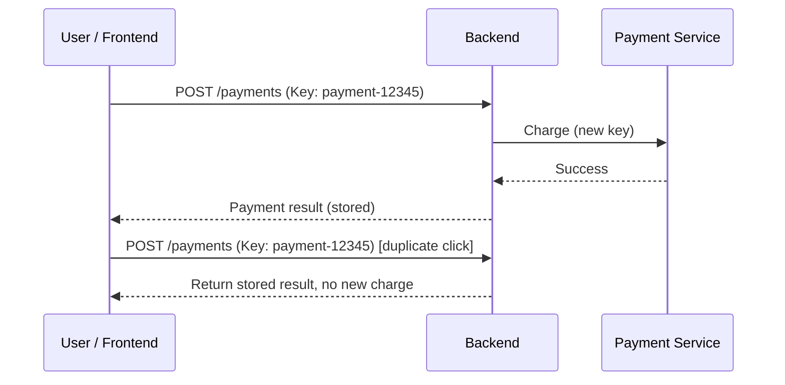

# REST API

> *Notes from the System Design course, **API Part 2** (video transcript). Part 1 covered what an API is and SOAP. Part 2 is fully about REST APIs.*
>
> Related: [`REST.md`](REST.md) · [`SOAP.md`](SOAP.md) · [`GraphQL.md`](GraphQL.md) · [`REST_API_Video_Notes.md`](REST_API_Video_Notes.md)

---

## Table of Contents

| Time | Topic |
| :--- | :--- |
| 0:16 | Introduction |
| 1:46 | Why REST? |
| 6:14 | What exactly is REST? |
| 8:08 | Understanding REST through a web application |
| 11:13 | Two important characteristics of REST |
| 14:05 | What is a RESTful URI? |
| 19:39 | CRUD operations and HTTP verbs |
| 21:23 | Example: Movie Booking Application |
| 32:39 | REST API design rules |
| 33:45 | Assignment: Vehicle Management System |
| 35:12 | What is an idempotent API? |
| 39:31 | Payment API and idempotency |
| 42:08 | Challenges of REST |
| 43:23 | What comes next |
| End | Quick revision and technical corrections |

---

## 1. Introduction (0:16)

- This is the **System Design course**, part of an "ultimate placement preparation course".
- Two systems have been designed so far. The last was the **Rate Limiter**.
- Before the third system, there are a few additional sessions on **APIs**.
  - **API Part 1:** What is an API? What is SOAP? Other basic concepts.
  - **API Part 2 (this video):** the API almost the entire world uses today, the **REST API**.
- Questions covered: What is a REST API? How do we build it? How do we use it?

> Almost everyone has worked with REST, but there are many intricate details behind it. These notes aim to build a strong understanding of RESTful APIs.

---

## 2. Why REST? Why Was It Needed? (1:46)

*Necessity is the mother of invention.* Before REST, we had **SOAP**.

### Our definition of speed changes
- In college, a computer with 256 MB RAM felt fast.
- Today, a laptop or phone with 2 GB RAM feels extremely slow.
- As technology evolves, **our definition of speed changes**. SOAP seemed great at first, but limitations appeared with heavy usage.

### The four problems with SOAP (it works with XML)

| # | Problem | Description |
| :--- | :--- | :--- |
| 1 | **Slow** | XML messages are relatively large and need extra processing |
| 2 | **Expensive** | Larger messages consume more network bandwidth, increasing cost |
| 3 | **Complicated** | Additional protocols, structures and processing requirements |
| 4 | **Not flexible** | More rigid in communication format and structure |

### How REST helps
REST said: *"If you adopt me, I will help you overcome these limitations."*

- SOAP is strongly associated with XML. **REST is not restricted to XML.**
- REST can work with different data formats:
  - XML
  - Plain text
  - **JSON** (the most commonly used)
- **JSON** is lightweight and relatively easy to read and process.

| REST provides |
| :--- |
| Lightweight data exchange |
| More flexibility in data formats |
| Simpler communication |
| Less overhead in many common use cases |

Even today, a very large percentage of APIs are RESTful.



---

## 3. What Exactly Is REST? (6:14)

In interviews, almost everyone says "yes" to *"Do you know REST?"*, but few can explain **what it means**. The goal is to understand it from the fundamentals.

### Full form

> **REST = Representational State Transfer**

REST is based on one core concept: **Resources**.

REST says that the **representation of a resource's state can be transferred** from one system or application to another.

---

## 4. Understanding REST Through a Web Application (8:08)

A typical web application has three layers:



A user wants to see some data as diagrams:
1. The frontend calls the backend.
2. The backend queries the database.
3. The database returns the requested data.
4. The backend processes the data.
5. The frontend receives the data and displays it as a diagram.

### The same data, different representations

| Layer | Representation |
| :--- | :--- |
| **Disk (hardware)** | Binary: 0s and 1s |
| **Database (Oracle / MySQL)** | Tables / records |
| **Backend (Java)** | Java objects |
| **REST API** | JSON |
| **Frontend** | Chart / diagram / UI |



The underlying information is the same, but its **representation changes** as it moves between layers. This is what **Representational State Transfer** refers to.

> At its core, REST enables two applications to communicate by **transferring representations of resources**.

---

## 5. Two Important Characteristics of REST (11:13)

### 5.1 REST is resource-oriented
A **resource** is essentially **data**. The entire REST architecture revolves around resources, for example:
- Movies
- Users
- Products
- Orders
- Payments

### 5.2 REST is built on top of HTTP
When Application 1 and Application 2 communicate, the communication layer uses **HTTP**. REST leverages HTTP to transfer data between clients and servers.

### REST and statelessness
- HTTP is a **stateless** protocol, and REST APIs are designed around stateless communication.
- **Stateless** means each request carries the information the server needs to process it. The server does not need to remember the previous request's application-level session state.
- If a client sends 100 requests, each one independently carries the required context (for example, authentication information).

### Why statelessness supports scalability



- Any server can process an independent request, provided the required state and data are available.
- A request need not go to the same backend server every time.
- This makes **horizontal scaling easier**, so REST is naturally suited to scalable applications.

---

## 6. What Is a RESTful URI? (14:05)

### URI

> **URI = Uniform Resource Identifier**

### Real-world analogy: an address
To meet someone (for dinner, to give a gift, or anything else), you first need their **address**:

`Earth → Asia → India → Karnataka → Bangalore → A particular locality → A particular building`

### Finding a resource inside a computer
A Movie Booking System has a movie called **Sholay**. To update or delete it, we need its exact address.

| Step | What | Example |
| :--- | :--- | :--- |
| 1 | **IP address**: identifies the computer on the network | `121.0.4.9` |
| 2 | **Port number**: identifies the application on that computer | `8080` |
| 3 | **Application name** | `movie-booking` |
| 4 | **Resource name** | `movies` |
| 5 | **Resource identifier**: the particular movie (Sholay, ID 5) | `5` |

Complete example URI:

```
http://121.0.4.9:8080/movie-booking/movies/5
```



### URI vs URL

| Term | Meaning |
| :--- | :--- |
| **URI** (Uniform Resource Identifier) | Identifies a resource |
| **URL** (Uniform Resource Locator) | Identifies a resource **and** provides its location or access mechanism |

A URL is a **type of** URI. In everyday web development, website addresses are called URLs. In API development, we usually talk about resource **URIs** and **endpoints**.

> URIs are treated as lowercase by convention, and it is good practice to always write them in lowercase.

---

## 7. CRUD Operations and HTTP Verbs (19:39)

We need the address of a resource because we want to **perform operations** on it. There are four fundamental operations:

| Letter | Operation |
| :--- | :--- |
| **C** | Create |
| **R** | Read |
| **U** | Update |
| **D** | Delete |

These are **CRUD** operations. In REST, we perform them using **HTTP methods (verbs)**.

> **A RESTful API needs two things:**
> 1. **URI**: identifies *which resource*.
> 2. **HTTP method**: defines *what operation* to perform.

---

## 8. Example: Movie Booking Application (21:23)

| Property | Value |
| :--- | :--- |
| Application | `movie-booking` |
| Resource | `movies` |
| IP address | `121.1.9` *(as stated in the video; a full IPv4 address has four parts)* |
| Port | `8080` |

Base URI:

```
http://121.1.9:8080/movie-booking/movies
```

### 8.1 Create a movie: `POST`

```http
POST http://121.1.9:8080/movie-booking/movies
```

Request body:
```json
{
  "name": "Sholay",
  "language": "Hindi",
  "year": 1975
}
```

`POST` is generally used to create a new resource. The server creates it and typically returns its identifier.

### 8.2 Read / search movies: `GET` (25:36)

**Scenario A: fetch all movies**
```http
GET /movie-booking/movies
```

**Scenario B: fetch a specific movie (path parameter)**
```http
GET /movie-booking/movies/5
```
Generalized:
```http
GET /movie-booking/movies/{id}
```
`{id}` is a placeholder whose value could be 2, 5, 10, 100, and so on. This is a **Path Parameter**.

**Scenario C: filter movies (query parameters)**
```http
GET /movie-booking/movies?actor=ShahRukh
GET /movie-booking/movies?language=Hindi
```
The part after `?` contains **query parameters**.



### Path parameters vs query parameters

| Feature | Path Parameter | Query Parameter |
| :--- | :--- | :--- |
| **Purpose** | Identify a specific resource | Filter, sort or customize results |
| **Location** | Part of the URL path | After `?` |
| **Example** | `/movies/5` | `/movies?actor=ShahRukh` |
| **Common usage** | Fetch a movie by ID | Search movies by actor or language |

### 8.3 Update a movie: `PUT` (30:32)

```http
PUT /movie-booking/movies/5
```
Request body:
```json
{
  "name": "Sholay",
  "language": "Hindi",
  "year": 1976
}
```
`PUT` generally **replaces** a resource with the supplied representation.

### 8.4 Delete a movie: `DELETE` (31:51)

```http
DELETE /movie-booking/movies/5
```

### Complete CRUD API summary

| CRUD Operation | HTTP Method | REST API |
| :--- | :--- | :--- |
| Create | `POST` | `POST /movies` |
| Read all | `GET` | `GET /movies` |
| Read one | `GET` | `GET /movies/{id}` |
| Update | `PUT` | `PUT /movies/{id}` |
| Delete | `DELETE` | `DELETE /movies/{id}` |



---

## 9. Important REST API Design Rules (32:39)

### Rule 1: Resource names should be nouns, and generally plural

| Correct | Avoid |
| :--- | :--- |
| `/movies` | `/getMovies` |
| `/users` | `/createUser` |
| `/products` | `/deleteProduct` |
| `/orders` | |

A resource represents an **entity**, not an action.

### Rule 2: Avoid verbs in RESTful URIs
The **URI** identifies the resource. The **HTTP method** defines the action.

```http
# Correct
GET    /movies
POST   /movies
PUT    /movies/5
DELETE /movies/5

# Avoid
GET  /getMovies
POST /createMovie
POST /deleteMovie/5
```

> Breaking these will not make the code fail, but they are standard conventions to follow, especially when working in large companies.

---

## 10. Assignment: Vehicle Management System (33:45)

| Property | Value |
| :--- | :--- |
| Application name | VMS |
| IP address | `121.9.8.7` |
| Port number | `7070` *(the transcript shows `77070`, which is not a valid port; the intended value appears to be `7070`)* |
| API version | `v1` |
| Resource | `vehicles` |

**Task:** design four REST APIs to create, read, update and delete vehicle data.

### Suggested solution

| Operation | Method | URI |
| :--- | :--- | :--- |
| Create | `POST` | `http://121.9.8.7:7070/vms/v1/vehicles` |
| Read all | `GET` | `http://121.9.8.7:7070/vms/v1/vehicles` |
| Read one | `GET` | `http://121.9.8.7:7070/vms/v1/vehicles/{id}` |
| Update | `PUT` | `http://121.9.8.7:7070/vms/v1/vehicles/{id}` |
| Delete | `DELETE` | `http://121.9.8.7:7070/vms/v1/vehicles/{id}` |

*(The video leaves this as homework; the solution above is added for reference.)*

---

## 11. What Is an Idempotent API? (35:12)

> **Idempotent:** calling the operation once or multiple times has the **same intended effect on the server**. Whether you call it once, 50 times, or 5 million times, the final state of the resource stays the same.

### 11.1 `GET`: idempotent
```http
GET /movies/1
```
Once, 100 times or 1,000 times, it returns the same movie (assuming the underlying data has not changed).

### 11.2 `PUT`: idempotent
```http
PUT /users/1
{ "name": "Rahul" }
```
The first call changes the name to Rahul. Repeating the exact same request keeps the name as Rahul, even after 1,000 calls.

### 11.3 `DELETE`: idempotent
```http
DELETE /movies/5
```
- 1st call: deletes the movie (for example, `204 No Content`).
- 2nd and 3rd calls: the movie no longer exists (for example, `404 Not Found`).
- The resource remains deleted, so the **final server state is the same**.

### 11.4 `POST`: generally non-idempotent
```http
POST /movies
```
Every call can create something new (Movie 1, then Movie 2, then Movie 3).

### Idempotency summary

| HTTP Method | Idempotent? | Reason |
| :--- | :--- | :--- |
| `GET` | Yes | Retrieves data without changing server state |
| `PUT` | Yes | Repeating the same update produces the same final state |
| `DELETE` | Yes | The resource remains deleted |
| `POST` | Generally **No** | Repeated requests can create multiple resources |

> **Interview concept:** `GET`, `PUT` and `DELETE` are idempotent. `POST` is generally non-idempotent.

---

## 12. Real-World Example: Payment API and Idempotency (39:31)

A payment is commonly implemented with `POST`:

```http
POST /payments
```

**Scenario:** On MakeMyTrip, you click **Pay** once and the payment succeeds. You accidentally click it three more times. If the backend processes every `POST` independently, you could **pay multiple times for the same transaction**.

### Solution: Idempotency Key

The frontend generates a unique key for a payment attempt:

```http
POST /payments
Idempotency-Key: payment-12345
```

The backend stores the key with the payment result. If the same key arrives again, the backend **does not charge again**; it returns the previously stored result.





> This is a very important production-level concept.

---

## 13. Challenges of REST (42:08)

REST provides flexibility, scalability and relatively simple communication, but it has limitations. Speed is relative: what was fast yesterday feels slow today.

| # | Challenge | Explanation |
| :--- | :--- | :--- |
| 1 | **Can be slow in certain scenarios** | HTTP with JSON payloads; frequent communication or complex data retrieval means repeated requests and larger payloads add overhead |
| 2 | **Can be rigid in certain scenarios** | Resource-oriented design with standard HTTP methods; some needs (real-time communication, streaming, multiple related queries, complex interactions) fit less well |
| 3 | **Resource-oriented** | Not the most natural fit for every operation; complex operations spanning multiple resources can be hard to model as resource endpoints |

---

## 14. What Comes Next (43:23)

- The industry has explored other API approaches for different requirements.
- The **next video** covers the newer forms of APIs used by companies like **Google, Microsoft and LinkedIn**, how they work, and why they are used (see [`GraphQL.md`](GraphQL.md)).

---

## 15. Quick Revision: REST API Interview Notes

| Concept | Explanation |
| :--- | :--- |
| **REST** | Representational State Transfer |
| **Resource** | Data/entity exposed through an API |
| **URI** | Uniform Resource Identifier |
| **URL** | Uniform Resource Locator; a type of URI |
| **HTTP** | Communication protocol used by REST APIs |
| **JSON** | Common data exchange format |
| **Stateless** | Each request carries the context needed for processing |
| **CRUD** | Create, Read, Update, Delete |
| **POST** | Generally creates a resource |
| **GET** | Retrieves resources |
| **PUT** | Replaces a resource |
| **PATCH** | Partially updates a resource |
| **DELETE** | Deletes a resource |
| **Path Parameter** | Identifies a particular resource |
| **Query Parameter** | Filters or customizes results |
| **Idempotency** | Repeating an operation has the same intended effect on server state |

---

## 16. Important Technical Corrections for Interview Preparation

Some explanations in the original video are simplified. These distinctions matter in production and in interviews:

1. **REST is not simply JSON over HTTP.** REST is an architectural style defined by constraints. JSON is a common representation format, but REST can also use XML and other formats.
2. **REST is not automatically stateless just because HTTP is stateless.** Statelessness is an explicit REST architectural constraint. The server must not depend on stored client session context between requests.
3. **REST does not guarantee better performance than SOAP.** Performance depends on payload size, serialization, transport, processing and implementation. SOAP can also use different transport and optimization mechanisms.
4. **PUT vs PATCH:** `PUT` generally replaces the resource representation, whereas `PATCH` applies a partial modification.
5. **Idempotency does not mean an identical response every time.** It means the intended server-side effect is the same. For example, `DELETE` may return `204` first and `404` later.
6. **POST is not inherently always non-idempotent.** It is *generally* non-idempotent, but an implementation can make repeated `POST` requests safe using an idempotency key.
7. **RESTful URIs do not have to use plural nouns.** Plural nouns are a common convention, not a mandatory REST constraint.
8. **A URI is not necessarily a complete absolute address with an IP and port.** It can be a relative reference, and a URL can use a domain name instead of an IP address.
9. **REST is not inherently scalable just because it is stateless.** Statelessness makes horizontal scaling easier, but database bottlenecks, caching, load balancing and other architectural decisions also matter.
10. **REST has six architectural constraints:**

| # | Constraint | Meaning |
| :--- | :--- | :--- |
| 1 | **Client-Server** | Separation of client (UI) and server (data/logic) |
| 2 | **Statelessness** | Each request is self-contained; no server-side client session |
| 3 | **Cacheability** | Responses declare whether they can be cached |
| 4 | **Uniform Interface** | Consistent resource identification and manipulation through representations |
| 5 | **Layered System** | Client cannot tell whether it talks to the end server or an intermediary (proxy, gateway, load balancer) |
| 6 | **Code on Demand** *(optional)* | Server may send executable code to extend client functionality |

These distinctions will help you answer REST API questions more accurately in system design interviews.

---

## 17. Interview Questions to Practice

1. What is the full form of REST, and what does it mean?
2. Why was REST introduced when SOAP already existed?
3. Why is a REST API considered stateless, and how does that help horizontal scaling?
4. What is the difference between a URI and a URL?
5. Path parameter vs query parameter: when do you use each?
6. Why should resource names be nouns, and why avoid verbs in URIs?
7. Which HTTP methods are idempotent? Why is `POST` generally not?
8. How would you prevent duplicate payments if a user clicks Pay multiple times?
9. What is the difference between `PUT` and `PATCH`?
10. What are the six REST architectural constraints?
11. What are the main challenges of REST?
