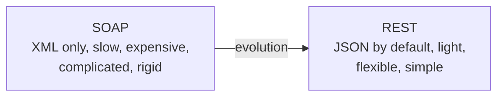
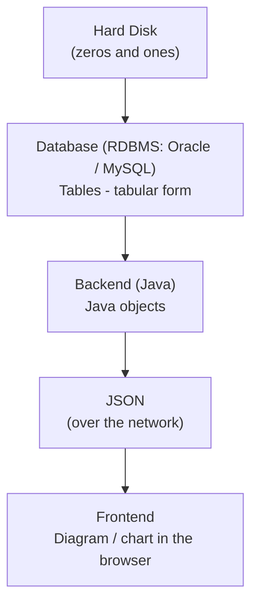
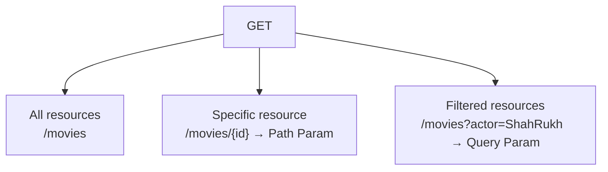
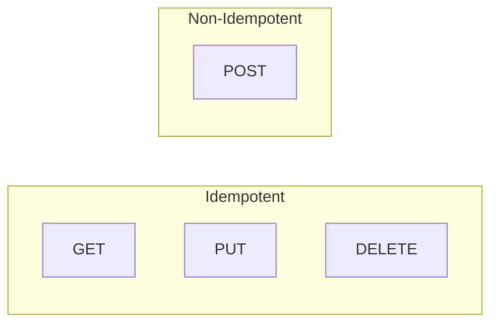

# REST API – Video Notes (System Design Course, API Part 2)

> *Structured notes from the video transcript (Hindi/English mix) on REST APIs. This is Part 2 of the API series: Part 1 covered what an API is and SOAP; this part is fully about REST.*
>
> Related: [`REST.md`](REST.md) · [`SOAP.md`](SOAP.md) · [`System_Design_API_Fundamentals_Part2.md`](System_Design_API_Fundamentals_Part2.md)

---

## 1. Why REST? (Necessity is the mother of invention)

Before REST, the world used **SOAP**. People loved it at first, but expectations change over time.

**Analogy:** In college the speaker's computer had 256 MB RAM and felt fast. Today even a mobile with 2 GB RAM feels slow. The *definition of speed changes* as technology evolves.

SOAP works only with **XML**, which led to these problems:

| # | SOAP Problem | Reason |
| :--- | :--- | :--- |
| 1 | **Slow** | XML parsing and serialization overhead |
| 2 | **Expensive** | Larger payloads mean more network bandwidth |
| 3 | **Complicated** | Heavy contracts and tooling |
| 4 | **Not flexible** | Rigidly tied to XML ("SOAP never leaves its relationship with XML") |

### How REST fixed them
- REST is **flexible**: it can work with XML, plain text, or **JSON**.
- By default the standard of transfer in REST is **JSON**.
- **JSON is lightweight**, so it is faster and cheaper, less complicated, and flexible because different formats can be used.
- Result: people moved to REST, and today **~90% of APIs are RESTful APIs**.



---

## 2. What is REST?

> Many candidates say "Yes, I know REST" in interviews, but few can explain what it **means**. Know the full form and the idea behind it.

**REST = Representational State Transfer**

- REST depends on a core concept: **Resources**.
- The *representation of state* keeps being **transferred** from one medium (layer) to another.

### Example: a web application

A user queries data and wants to see it as diagrams. The call goes Frontend → Backend → Database.



| Layer | Representation of the same data |
| :--- | :--- |
| Hard disk | 0s and 1s |
| Database | Tables (rows/columns) |
| Backend | Java objects |
| Network | JSON |
| Frontend | Diagram |

The data is the **same**, but as it moves from one layer to another its **representation is transferred**. This phenomenon is **REST**.

At its core: when you have two applications (App 1 and App 2), they should be able to **communicate**, and the core thing being transferred is the **resource**.

---

## 3. Two Core Properties of REST

1. **At the core of REST is the Resource.**
   - A resource is nothing but **data**.
   - The whole of REST is focused around resources.
   - In REST, a resource is a **noun** (why is covered in the URI rules below).
2. **REST is built on top of HTTP.**
   - App 1 and App 2 communicate over the network using **HTTP**.
   - REST leverages HTTP to transfer data between the client and the server.

### Consequence: REST is stateless
- HTTP is **stateless**, so a REST API is also a **stateless API**.
- (Covered in the previous video: stateful vs stateless APIs and the advantages of stateless.)
- Because REST is built on HTTP and is stateless, it **leads to scalability**. Applications using REST are natively built to scale.

---

## 4. URI (Uniform/Unique Resource Identifier)

When talking about RESTful APIs you always talk about the **RESTful URI**. First, understand **URI**.

### Real-world analogy: absolute address
If you want to meet someone (dinner, gift, or otherwise), you must know exactly where they live:

`Earth → Asia → India → Karnataka → Bangalore → Sun City → ...`

That is an **absolute address**, so there is no confusion.

### Same idea inside a computer
Take a *Movie Booking Application* with a movie called *Sholay*. To create, update, or delete it you must know its exact address.

```
Computer (IP address)  →  Application (port number)  →  App name  →  Resource  →  Item
   121.0.4.9                  8080                          mba          movies      sholay / id
```

- Every computer has a unique **IP address**.
- A computer runs thousands of processes (Facebook, Chrome, Java apps), and each application occupies a **port number** that identifies it (e.g. `8080`).
- Inside the application there are resources, such as `movies`.

```
121.0.4.9:8080/mba/movies/...
```

This absolute address of a resource is the **URI**.

### URI vs URL
- Practically little difference.
- In a **browser**, when opening a website, we say **URL**.
- In **API / app-to-app communication**, we say **URI**.
- The URI tells you **the address of the resource**, meaning where the resource sits.

### URI is case-insensitive
For standardization, **always write URIs in lowercase**.

---

## 5. CRUD and HTTP Verbs

The address alone is not enough. We want to do something with the data. Any operation on data falls into one of four categories:

| Letter | Operation | Meaning |
| :--- | :--- | :--- |
| **C** | Create | Add new data |
| **R** | Read | Fetch data |
| **U** | Update | Modify data |
| **D** | Delete | Remove data |

These are called **CRUD operations**, and we achieve them using **HTTP verbs**.

> **A RESTful API needs two things:**
> 1. **URI** gives the *address*.
> 2. **HTTP verb** defines the *action*.

| CRUD | HTTP Verb |
| :--- | :--- |
| Create | `POST` |
| Read | `GET` |
| Update | `PUT` |
| Delete | `DELETE` |

---

## 6. Building RESTful APIs: Movie Booking Application (MBA)

Assume the app runs on IP `121.1.1.9`, port `8080`, app name `mba`, resource `movies`.

### 6.1 Create a movie: `POST`
```
POST  http://121.1.1.9:8080/mba/movies
```
- The URI says where the resource is: which machine, which port, which app, which resource.
- The verb `POST` says the action is **create**.

### 6.2 Read / search movies: `GET`

Three variations:

**a) Get all movies**
```
GET  http://121.1.1.9:8080/mba/movies
```

**b) Get a specific movie by ID: Path Parameter**
```
GET  http://121.1.1.9:8080/mba/movies/5
```
Generalized form:
```
GET  http://121.1.1.9:8080/mba/movies/{id}
```
`{id}` is a **placeholder**. Its value can be 2, 5, 10, 100, and so on. Because it is parameterized, it is called a **Path Param**.

**c) Filter: Query Parameter**
```
GET  http://121.1.1.9:8080/mba/movies?actor=ShahRukh
```
Everything after `?` is a **Query Param**. Use it to filter (e.g. by actor or by language = Hindi).



### 6.3 Update a movie: `PUT`
```
PUT  http://121.1.1.9:8080/mba/movies/5
```
`POST` is for creation; `PUT` is for update.

### 6.4 Delete a movie: `DELETE`
```
DELETE  http://121.1.1.9:8080/mba/movies/5
```

### Summary

| Operation | HTTP Verb | RESTful URI |
| :--- | :--- | :--- |
| Create | `POST` | `/mba/movies` |
| Read all | `GET` | `/mba/movies` |
| Read one (Path Param) | `GET` | `/mba/movies/{id}` |
| Filter (Query Param) | `GET` | `/mba/movies?actor=ShahRukh` |
| Update | `PUT` | `/mba/movies/{id}` |
| Delete | `DELETE` | `/mba/movies/{id}` |

---

## 7. Two Important Rules for RESTful URIs

Beginners often miss these. Breaking them will not make the code fail, but these are **standards** to follow if you want to work in big companies.

1. **Resources must always be Nouns and Plural.**
   - Correct: `/movies`
   - Incorrect: `/movie`
2. **There should be NO verbs in the RESTful URI.**
   - The action is expressed by the HTTP verb, not the URL.
   - Incorrect: `/createMovie`, `/deleteMovie`

---

## 8. Assignment from the Video: Vehicle Management System

**Given:**
- Application: Vehicle Management System (VMS)
- Machine IP: `121.9.8.7`
- Port: `7070`
- API version: `v1`

**Task:** Write 4 RESTful APIs (create, read, update, delete).

**Solution (for resource `vehicles`):**

| Operation | Verb | URI |
| :--- | :--- | :--- |
| Create | `POST` | `http://121.9.8.7:7070/vms/v1/vehicles` |
| Read | `GET` | `http://121.9.8.7:7070/vms/v1/vehicles/{id}` |
| Update | `PUT` | `http://121.9.8.7:7070/vms/v1/vehicles/{id}` |
| Delete | `DELETE` | `http://121.9.8.7:7070/vms/v1/vehicles/{id}` |

---

## 9. Idempotent APIs

> A very frequently asked **interview question**.

### Definition
An **idempotent API** is one where calling it **once, 50 times, or 5 million times gives the same result**. In technical terms, there should be **no side effects**.

### Checking each verb

| Verb | Idempotent? | Why |
| :--- | :--- | :--- |
| `GET` | **Yes** | Fetching movie ID 1 once or 1000 times returns the same movie |
| `PUT` | **Yes** | Changing a name once or 1000 times leaves the same final result |
| `DELETE` | **Yes** | The first call deletes. Later calls find nothing left to delete, so nothing new or wrong happens |
| `POST` | **No** | Every call creates something new, so results differ each time |



### Why `POST` being non-idempotent is a risk: the payment example
Imagine paying through a payment service (e.g. MakeMyTrip's **Pay** button). A payment is a **create** operation, so it uses `POST`, and `POST` has side effects.

- If you press the Pay button **once**, payment happens once.
- If you accidentally press it **5 times**, you could end up paying 5 times for the same transaction.

**Thinking question from the video:** How do we handle accidental multiple clicks on the Pay button, so that only one payment occurs? The video leaves this as a discussion prompt.

> **Common industry answer:** use an **Idempotency Key**. The client sends a unique ID per payment attempt, and the server rejects or de-duplicates repeated requests carrying the same key. See [`REST.md`](REST.md#8-idempotency) for the details.

---

## 10. Challenges / Limitations of REST

REST has been the "hero" and ~90% of people still use it, but it is also criticized. As the speaker said earlier, **speed is relative**: what was fast yesterday feels slow today.

| # | Challenge | Meaning |
| :--- | :--- | :--- |
| 1 | **Slow** | Compared to SOAP it was fast, but by today's standards it is considered slow |
| 2 | **Rigid** | Rigid by today's standards |
| 3 | **Only for resources** | Not flexible beyond resource-based operations |

The world has already moved on to a **new form of API** to fix these. Top companies like **Google, Microsoft and LinkedIn** have moved beyond REST and use the latest APIs. That is the topic of the **next video**.

---

## 11. Key Takeaways

1. REST came to fix SOAP's problems: slow, expensive, complicated, rigid.
2. **REST = Representational State Transfer**: the representation of a resource's state is transferred between layers (disk → table → object → JSON → UI).
3. The **resource** (data) is the core of REST, and REST is **built on HTTP**, which makes it **stateless** and therefore **scalable**.
4. **RESTful API = URI (address) + HTTP verb (action).**
5. **CRUD** maps to `POST`, `GET`, `PUT`, `DELETE`.
6. Use a **Path Param** for a specific item (`/movies/{id}`) and a **Query Param** for filtering (`?actor=...`).
7. URI rules: **plural nouns, no verbs, lowercase**.
8. `GET`, `PUT`, `DELETE` are **idempotent**; `POST` is **not**, so handle duplicate submissions (e.g. payments) carefully.
9. REST's limits (speed, rigidity, resource-only) led to newer API styles (next video).

---

## 12. Interview Questions to Practice

1. What is the full form of REST and what does it mean?
2. Why was REST needed when SOAP already existed?
3. Why is a REST API stateless, and how does that help scalability?
4. What is the difference between URI and URL?
5. Path param vs query param?
6. Why should resources be plural nouns, and why no verbs in the URI?
7. Which HTTP verbs are idempotent? Why isn't `POST`?
8. How would you prevent duplicate payments when a user clicks Pay multiple times?
9. What are the current challenges of REST?

---

*Source: video transcript pasted by the user (System Design course, API Part 2 – REST).*
