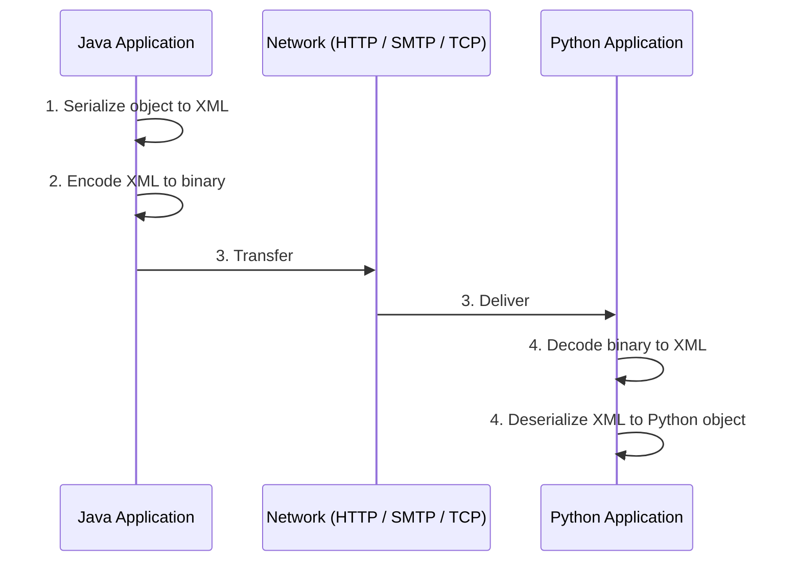
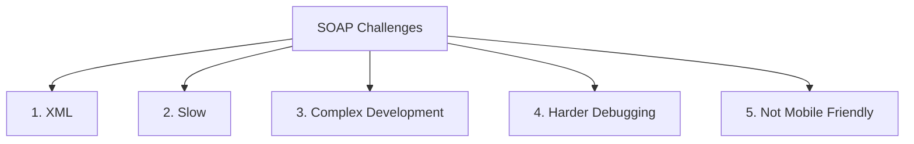

# SOAP (Simple Object Access Protocol)

> *Compiled from [`System_Design_API_Fundamentals_Part1.md`](System_Design_API_Fundamentals_Part1.md) (Sections 4 and 6), [`System_Design_API_Fundamentals_Part2.md`](System_Design_API_Fundamentals_Part2.md) (Section 1) and [`README.md`](README.md).*

**SOAP** is one of the earliest standardized protocols designed for cross-language enterprise communication. It exchanges strictly structured **XML** messages between systems and is largely associated with legacy banking and enterprise systems.

---

## 1. Where SOAP Fits in API Evolution

```
   1990s - 2000s            2000s - Present             2015+                 2015+               Real-Time
+-----------------+      +--------------------+      +-------------+      +-------------+      +---------------+
|    SOAP API     | ---> |      REST API      | ---> | GraphQL API | ---> |  gRPC API   | ---> | WebSocket API |
| (XML, Strict)   |      | (~90% Web Traffic) |      | (Query Opt) |      | (HTTP/2,PB) |      | (Bi-directional)|
+-----------------+      +--------------------+      +-------------+      +-------------+      +---------------+
```

- Early enterprise standard using XML payloads.
- Very strict, heavy, and verbose.
- Communication style: **Request → Response**.

```
Client ── XML Request ──► SOAP Service
Client ◄─ XML Response ── SOAP Service
```

The key distinction is its formal XML-based messaging and enterprise standards, rather than being primarily about real-time communication.

---

## 2. How SOAP Works

```
       SOAP Data Flow & Serialization Pipeline

   [ Java Application ]                  [ Python Application ]
            |                                      ^
   (Java In-Memory Object)                (Python In-Memory Object)
            |                                      |
            v                                      |
     Serialization                          Deserialization
            |                                      |
            v                                      |
      [ XML Payload ]                        [ XML Payload ]
            |                                      ^
            v                                      |
     [ Binary (0/1) ]                       [ Binary (0/1) ]
            \                                      /
             ====== ( Network Transfer ) ==========
```



1. **Object Serialization:** The source system converts its native language object (e.g., a Java object) into structured **XML**.
2. **Binary Encoding:** The XML text is converted into binary (0s and 1s) for network transmission.
3. **Network Transport:** Transferred over HTTP, SMTP, or TCP.
4. **Deserialization:** The receiving system decodes the binary back to XML, and parses the XML into its native target language object (e.g., a Python object).

---

## 3. Why SOAP Was Built

- **Cross-Language Interoperability:** Before SOAP, integrating a C++ application with a Java or Python application was extremely difficult.
- **Enterprise Reliability & Standards:** Provided formal WS-Security, WS-ReliableMessaging, and ACID-compliant distributed transaction guarantees.
- **Formal Contracts:** Used **WSDL (Web Services Description Language)** to strictly define schemas and operations.

---

## 4. Real-World / Historical Enterprise Use Cases

- Core Banking & Financial Transaction Systems
- Telecommunications Infrastructure
- Government Enterprise Portals
- Enterprise Resource Planning (ERP) Systems

> SOAP remains useful when enterprise contracts and WS-\* standards are important.

---

## 5. Example: SOAP Request Message

```xml
<!-- SOAP XML: ~90% boilerplate just to pass a single userId -->
<soapenv:Envelope xmlns:soapenv="http://schemas.xmlsoap.org/soap/envelope/" xmlns:user="http://example.com/user">
   <soapenv:Header/>
   <soapenv:Body>
      <user:GetUserRequest>
         <user:userId>1001</user:userId>
      </user:GetUserRequest>
   </soapenv:Body>
</soapenv:Envelope>
```

The same request in modern REST JSON:

```json
{
  "userId": 1001
}
```

---

## 6. Limitations & Decline of SOAP

```
+------------------------------------------------------------------------------------+
|                               WHY THE INDUSTRY MOVED AWAY FROM SOAP                |
+------------------------------------------------------------------------------------+
| 1. Extreme Verbosity   | XML envelopes contain ~90% repetitive boilerplate tags.   |
| 2. High Latency / Slow | Heavy payload size and expensive XML parsing CPU overhead.|
| 3. High Complexity     | Rigid WSDL contracts requiring specialized tooling.       |
| 4. Difficult Debugging | Complex, multi-layered XML schema validation errors.      |
| 5. Not Mobile-Friendly | Unsuitable for low-bandwidth, battery-constrained devices.|
+------------------------------------------------------------------------------------+
```

As distributed internet traffic and mobile usage exploded, developers discovered SOAP's core bottlenecks:

1. **Slow Execution:** Heavy serialization/deserialization overhead.
2. **Expensive Bandwidth:** Massive XML envelope sizes increased network payload costs.
3. **High Complexity:** Rigid contracts (WSDL) and complicated tooling.
4. **Inflexible Coupling:** Rigidly tied to XML.

---

## 7. Challenges of SOAP



### 1. XML
- SOAP is **tied exclusively to XML**; no other data format is supported.
- XML envelopes are verbose: ~90% of a message can be repetitive boilerplate tags (`Envelope`, `Header`, `Body`, namespaces) just to carry a single value like `userId`.
- Larger messages mean higher bandwidth cost.

### 2. Slow
- Heavy payload size increases transfer time.
- Expensive XML parsing and serialization/deserialization add CPU overhead and latency.
- WS-\* security standards can add further processing cost.

### 3. Complex Development
- Rigid **WSDL** contracts must be defined and maintained.
- Requires specialized tooling and generated client stubs.
- Strict schemas and namespaces make even small changes heavy to implement and version.

### 4. Harder Debugging
- Multi-layered XML structure (Envelope, Header, Body, Fault) is hard to read by eye.
- Complex XML schema validation errors are difficult to trace.
- Binary-encoded, verbose payloads are harder to inspect than compact JSON.

### 5. Not Mobile Friendly
- Large payloads consume scarce bandwidth on low-bandwidth networks.
- Heavy XML parsing drains CPU and battery on constrained devices.
- This drove the shift to lightweight **REST + JSON** for web and mobile.

| # | Challenge | Impact |
| :--- | :--- | :--- |
| 1 | **XML** | Verbose, rigidly coupled to one format |
| 2 | **Slow** | High latency from payload size and parsing overhead |
| 3 | **Complex development** | WSDL contracts and specialized tooling |
| 4 | **Harder debugging** | Layered XML and schema validation errors |
| 5 | **Not mobile friendly** | Bandwidth and battery cost on mobile devices |

---

## 8. SOAP vs. REST

```
+-----------------------------------------------------------------------------------+
|                              SOAP vs. REST EVOLUTION                              |
+-----------------------------------------------------------------------------------+
|  SOAP (Rigid & Heavy):                                                            |
|  - Inflexible: Exclusively tied to XML.                                           |
|  - Result: High bandwidth consumption, slow mobile performance.                   |
|                                                                                   |
|  REST (Flexible & Lightweight):                                                   |
|  - Format Agnostic: Supports JSON (default), XML, Plain Text, YAML, HTML.         |
|  - Lightweight JSON: Compact key-value pairs with minimal syntactic overhead.     |
|  - Result: Fast data transmission, developer-friendly, powers ~90% of web APIs.   |
+-----------------------------------------------------------------------------------+
```

| Dimension | SOAP APIs | REST APIs |
| :--- | :--- | :--- |
| **State Storage** | Protocol-level contract | Stateless by architectural constraint |
| **Request Independence** | Typically request-reply | Every request is self-contained |
| **Data Format** | Strict XML | Predominantly JSON |
| **Scalability** | Heavyweight | Cloud-native, internet-scale |
| **Primary Fit** | Legacy Banking, Telecom | Modern Web & Enterprise Services (~90%) |

---

## 9. SOAP vs. Other API Technologies

| Technology | Communication | Underlying Protocol | Data Format | Data Streaming | Best For | Main Strength |
| :--- | :--- | :--- | :--- | :--- | :--- | :--- |
| **SOAP** | Request → Response | Usually HTTP/HTTPS; other transports are possible | XML | Usually non-streaming | Enterprise systems | Strong standards and contracts |
| **REST** | Request → Response | HTTP/1.1 or HTTP/2 | JSON, XML | Usually non-streaming; streaming is possible | Web/mobile APIs | Simple and widely supported |
| **GraphQL** | Request → Response | Usually HTTP/HTTPS | JSON | Usually non-streaming; subscriptions can stream | Flexible frontend APIs | Client chooses required data |
| **gRPC** | Request → Response / Streaming | HTTP/2 | Protocol Buffers (binary) | Unary and streaming modes | Microservices | Fast and strongly typed |
| **WebSockets** | Persistent, bidirectional | HTTP handshake, then WebSocket protocol over TCP | Text (often JSON) or binary | Full-duplex | Real-time apps | Server can push updates immediately |

**Why it impacts speed:** Verbose XML messages and XML parsing add processing overhead, and WS-\* security can add more cost.

> **Note:** The underlying protocol alone does not determine speed. Payload size, network latency, serialization, server processing, connection reuse, and workload all matter.

---

## 10. Key Takeaways

1. SOAP = **enterprise contract**: strict XML messaging defined by WSDL.
2. Strengths: cross-language interoperability, WS-\* security/reliability standards, formal contracts.
3. Weaknesses: verbosity, parsing overhead, complexity, hard debugging, poor mobile fit.
4. The industry moved to **REST + JSON** for lightweight, flexible, developer-friendly web and mobile integration.
5. SOAP still appears in legacy banking, telecom, government, and ERP systems.
