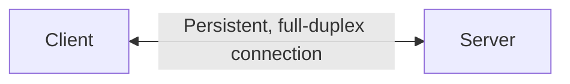
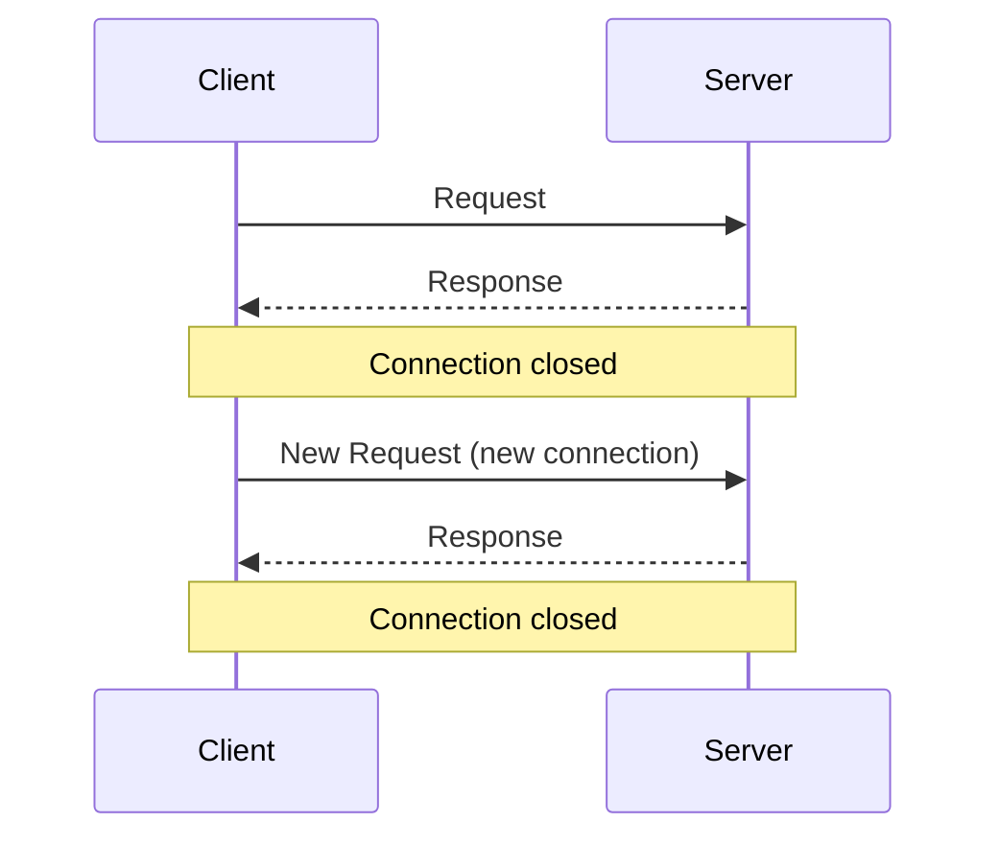
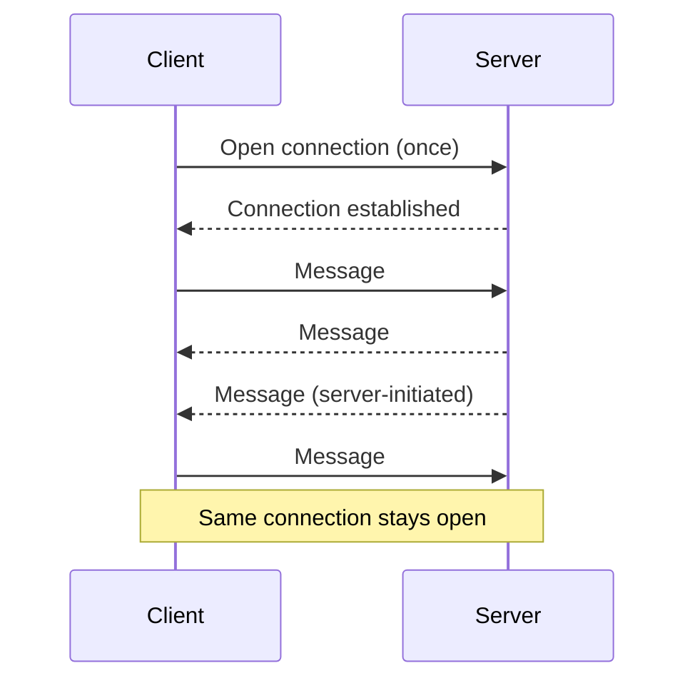
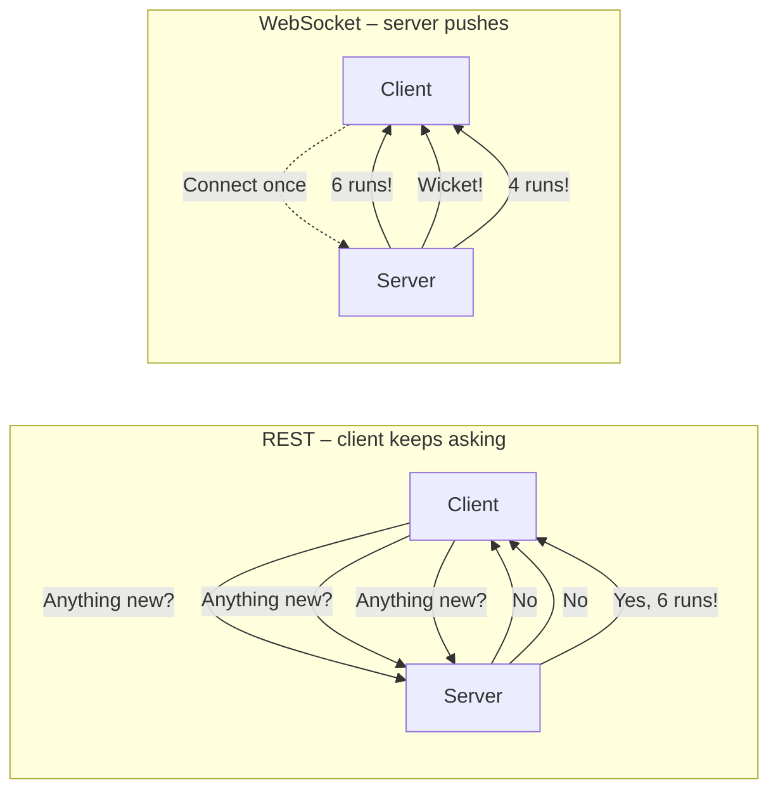
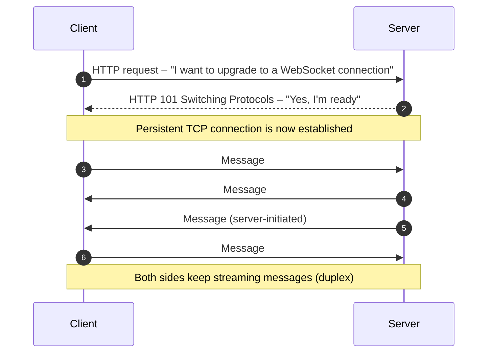
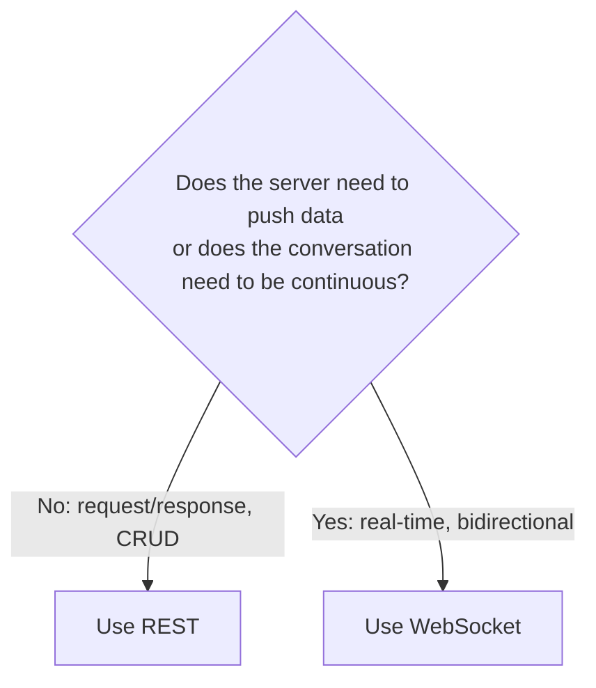
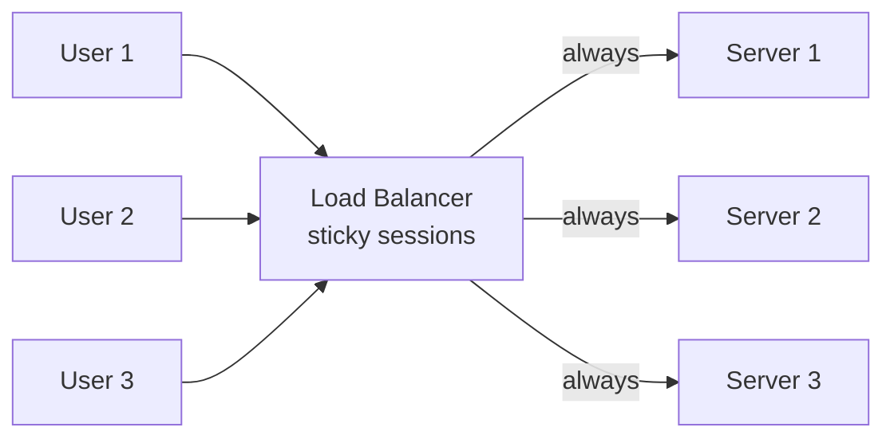

# System Design – API Part 5: Understanding WebSockets

> *Previous parts: [`SOAP.md`](SOAP.md), [`REST.md`](REST.md), [`GraphQL.md`](GraphQL.md), [`gRPC-Notes.md`](gRPC-Notes.md).*

## Table of Contents

1. [Introduction](#1-introduction)
2. [What Is a WebSocket?](#2-what-is-a-websocket)
3. [REST vs WebSocket – The Core Difference](#3-rest-vs-websocket--the-core-difference)
4. [Why Were WebSockets Needed?](#4-why-were-websockets-needed)
5. [How WebSockets Work](#5-how-websockets-work)
6. [Use Cases of WebSockets](#6-use-cases-of-websockets)
7. [REST vs WebSocket: When Should You Use Each?](#7-rest-vs-websocket-when-should-you-use-each)
8. [Challenges of WebSockets](#8-challenges-of-websockets)
9. [Conclusion](#9-conclusion)
10. [Quick Revision – WebSocket Interview Notes](#10-quick-revision--websocket-interview-notes)

---

## 1. Introduction

This is part of the System Design course (Ultimate Placement Course). APIs are a common building block in every system, and the series has already covered:

1. SOAP
2. REST
3. GraphQL
4. gRPC

Today's session (**API Part 5**) is the conclusion of the API topic: **persistent connections, i.e. WebSockets**.

---

## 2. What Is a WebSocket?

A **WebSocket** is a communication protocol that provides:

- **Real-time** communication
- **Bidirectional** communication
- **Full-duplex** communication

### Simple explanation

Take two applications: a **client** (Application 1) and a **server** (Application 2).

- In normal HTTP/REST, the client sends a **request** and the server sends back a **response**. Only the client can start the conversation.
- With a WebSocket set up between them:
  - **Bidirectional:** the client can send messages to the server, **and** the server can send messages to the client.
  - **Full-duplex:** both can send messages **at the same time**.
  - **Real-time:** messages are exchanged instantly, without waiting for a new request.



The connection is **long-lived** (also called a **persistent connection**), so both sides keep exchanging messages over it.

> **One-liner:** *A WebSocket is a communication protocol that enables real-time, bidirectional communication where client and server can both send messages to each other over one persistent connection.*

---

## 3. REST vs WebSocket – The Core Difference

### REST

- The client sends a request, the server sends a response, and then the **connection closes**.
- It happens **one time per exchange**.

**Real-life analogy – a letter:** you write a letter, the postman delivers it, your friend reads it, and that exchange is complete. To say something else you must write another letter.



### WebSocket

- The connection between client and server stays **open and consistent**.
- Messages are exchanged **continuously**, not just once.

**Real-life analogy – a phone call:** you dial once, the connection is set up, and you can talk for hours on the same call without dialling again.



> Whenever a connection is **persistent and long-term**, and **both client and server can send messages at the same time**, call it a **WebSocket connection**.

---

## 4. Why Were WebSockets Needed?

REST already allows a client to call the server whenever it needs data, so why was something else needed?

### The restriction in REST

> In REST, the server responds **only when the client asks**.

What if:

- the server wants to send data **on its own**, or
- the client wants the server to **keep sending data** without asking repeatedly?

### Example – live cricket score (Cricinfo)

You have Cricinfo open in the browser. You do not want to refresh the page every time to learn who hit a six or a four. You want the browser to stay open and **update automatically for every ball and every over**.

For that, the **server must be able to call the client** and push data. That is why WebSockets are needed.

### What happens without it

If the server cannot push data, the client has to keep asking: *"Is there a new message? Any update? Any notification?"*

- Many **unnecessary calls** are made just to check whether new data exists.
- This **increases the load on the server**.

WebSockets let the **server send data to the client on its own** and solve this problem.



---

## 5. How WebSockets Work

### Step-by-step



1. **Step 1 – Handshake request (over HTTP):** the client makes an HTTP request asking the server to **upgrade** the connection to a WebSocket: *"I want to create a WebSocket connection with you. Can you help upgrade it?"*
2. **Step 2 – Server acknowledgement:** if the server supports WebSockets, it replies *"Yes, acknowledged, I'm ready to create a WebSocket connection."*
3. **Step 3 – Persistent TCP connection:** a **consistent, persistent TCP connection** is set up.
4. **Step 4 – Duplex streaming:** now **both** client and server can send messages at any time. This is the **duplex connection**, and they keep streaming messages to each other.

### In technical terms

```http
GET /chat HTTP/1.1
Host: example.com
Upgrade: websocket
Connection: Upgrade
Sec-WebSocket-Key: dGhlIHNhbXBsZSBub25jZQ==
Sec-WebSocket-Version: 13
```

```http
HTTP/1.1 101 Switching Protocols
Upgrade: websocket
Connection: Upgrade
Sec-WebSocket-Accept: s3pPLMBiTxaQ9kYGzzhZRbK+xOo=
```

- The URL scheme is `ws://` (plain) or `wss://` (secure, over TLS).
- After the `101` response, the connection stops speaking HTTP and exchanges lightweight WebSocket **frames**.

> **Interview tip:** if an interviewer asks *"What is a WebSocket and how does it work internally?"*, draw this handshake diagram (HTTP upgrade request → server acknowledgement → persistent TCP connection → duplex messaging).

---

## 6. Use Cases of WebSockets

A WebSocket fits any application where **client and server need to communicate continuously and non-stop**.

| Use case | Why WebSocket? |
| :--- | :--- |
| **Chat applications** (WhatsApp, Messenger) | Two people exchange many messages over a long period; one connection serves the whole conversation |
| **Multiplayer games** (e.g. PUBG) | Many players continuously exchange game state and actions with each other |
| **Stock market / trading apps** | Prices keep fluctuating; the server must push the updated price to the client without being asked |
| **Live scores** (cricket, football) | Every ball or goal is pushed to the browser automatically |
| **Collaborative editing** (Google Docs) | Many people edit the same document; changes must reach everyone instantly over a persistent connection |

> These are also **prominent system design interview problems**. If asked to design a chat app, a multiplayer game, a stock-market app, or a collaborative editing tool, you should immediately know the underlying communication protocol is a **WebSocket**.

---

## 7. REST vs WebSocket: When Should You Use Each?

Interviewers often ask: *"REST is simple and everyone knows it. Why not just use REST everywhere?"*

| Aspect | REST | WebSocket |
| :--- | :--- | :--- |
| **State** | Stateless | Stateful |
| **Communication model** | Request → Response, repeated | Continuous communication |
| **Underlying protocol** | HTTP based | Persistent socket connection (upgraded from HTTP) |
| **Connection** | Opened and closed for each request | Opened once, stays open |
| **Who can initiate?** | Only the client | Both client and server |
| **Power balance** | Client has the power to call | Both are equally powerful |
| **Scaling** | Easy to scale | Harder to scale |
| **Best for** | CRUD APIs | Real-time apps (chat, live data) |

### Advantages of WebSocket

- No need to call the API repeatedly (for example, two people chatting).
- The client does not keep hitting the server.
- New connection requests do not have to be created each time; one TCP connection is used.
- Efficient and optimal for real-time communication.

### Trade-off

- Because it is stateful, it is **not as easily scalable** (see the challenges below).



---

## 8. Challenges of WebSockets

> The grass is not always greener. WebSockets have real challenges.

### 8.1 Stateful connections / scalability is harder

Once a connection is created between a client and a server, it is **stateful**. If one server receives too many messages and cannot process them all, you cannot simply move that connection elsewhere or spin up another server for it. **Scaling is harder** than for stateless REST.

### 8.2 Load balancing complexity

A load balancer normally distributes calls across multiple servers. With WebSockets the connection is persistent: if a user is connected to Server 1, all of their messages must keep going to **that same server**. This needs **sticky sessions (sticky load balancing)**, which is more complicated.



### 8.3 Memory consumption

Every persistent connection holds resources (connection state, buffers, file descriptors). WebSockets are more **memory intensive** than short-lived HTTP calls.

### 8.4 Connection management is tougher

- You must maintain the connection through the handshake lifecycle.
- You must keep checking **heartbeats** (ping/pong) to confirm the client and server are healthy.
- If a side is unhealthy or the connection drops, you must send a **reconnection** request.

### 8.5 Firewall and proxy issues

Corporate firewalls and proxies can block WebSocket connections. You may need to **whitelist** them, which becomes another connection blocker.

### 8.6 Harder horizontal scaling

As already noted, horizontally scaling stateful, long-lived connections is harder.

### Summary of challenges

| Challenge | Impact |
| :--- | :--- |
| Stateful connections | Hard to scale |
| Load balancing | Needs sticky sessions |
| Memory consumption | Many open connections use a lot of memory |
| Connection management | Heartbeats, reconnection logic |
| Firewalls and proxies | Connections may be blocked until whitelisted |
| Horizontal scaling | More complex than stateless REST |

Every system has its advantages and challenges. As a software developer, engineer, or system designer, knowing both lets you make the right **trade-off** about which API style to use in which case.

---

## 9. Conclusion

- This session concludes the **API** topic. The series covered **SOAP, REST, GraphQL, gRPC, and WebSockets**.
- APIs are something every software engineer, AI engineer, full-stack developer, or forward-deployed engineer must understand, especially in the **system design round**, where you will be asked which API you would use.
- **Next topic:** designing a new system, the **Distributed Cache**. The approach will be: problem statement → functional requirements → non-functional requirements → scale estimation → required concepts → full design, the same way it is asked in interviews.

---

## 10. Quick Revision – WebSocket Interview Notes

### What is a WebSocket?
A communication protocol for **real-time, bidirectional, full-duplex** communication over a **persistent connection**.

### How does it work?
1. Client sends an **HTTP upgrade request**.
2. Server replies **101 Switching Protocols** (acknowledgement).
3. A **persistent TCP connection** is established.
4. Both sides **stream messages** in both directions.

### REST vs WebSocket in one line each
- **REST:** like writing a **letter**. One request, one response, then done.
- **WebSocket:** like a **phone call**. Dial once, talk continuously.

### Why use it?
So the **server can push data** to the client without the client repeatedly asking, which also reduces unnecessary load.

### When to use it?
Chat apps, multiplayer games, stock market tickers, live scores, collaborative editing.

### Challenges
Stateful, harder to scale, sticky load balancing, memory heavy, connection management (heartbeats, reconnection), firewall/proxy blocking.

### Choosing between REST and WebSocket
- **CRUD APIs** → REST
- **Real-time apps** → WebSocket
