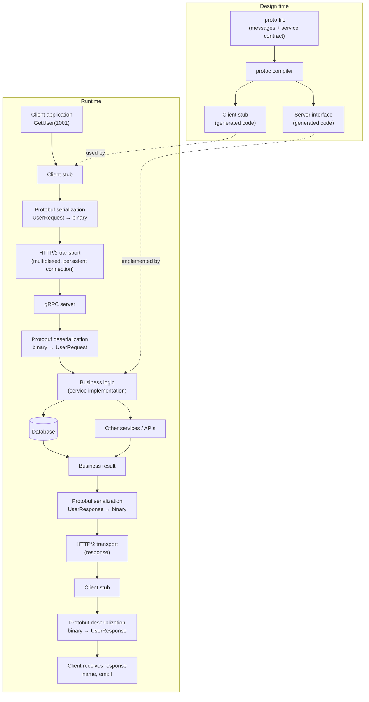
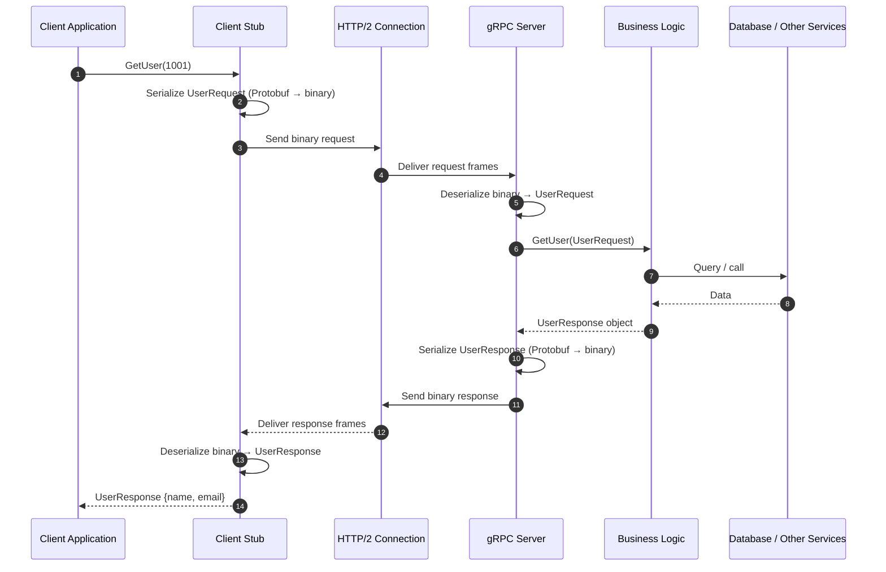

# System Design – API Part 4: Understanding gRPC

> *Previous parts: [`SOAP.md`](SOAP.md), [`REST.md`](REST.md), [`GraphQL.md`](GraphQL.md). A condensed version of these notes is in [`gRPC.md`](gRPC.md).*

## Table of Contents

1. [Introduction](#1-introduction)
2. [Introduction to gRPC](#2-introduction-to-grpc)
3. [Difference Between REST and gRPC](#3-difference-between-rest-and-grpc)
4. [Why Was gRPC Created?](#4-why-was-grpc-created)
5. [Core Technologies Behind gRPC](#5-core-technologies-behind-grpc)
6. [gRPC Architecture and Workflow](#6-grpc-architecture-and-workflow)
7. [Why Is gRPC Faster Than REST?](#7-why-is-grpc-faster-than-rest)
8. [Types of gRPC Communication](#8-types-of-grpc-communication)
9. [Use Cases of gRPC](#9-use-cases-of-grpc)
10. [REST vs gRPC: When Should You Use Each?](#10-rest-vs-grpc-when-should-you-use-each)
11. [Challenges of gRPC](#11-challenges-of-grpc)
12. [Conclusion](#12-conclusion)
13. [Quick Revision – gRPC Interview Notes](#13-quick-revision--grpc-interview-notes)

---

## 1. Introduction

This is part of the System Design course (part of the Ultimate Placement Course for 2026). Two systems have already been designed. APIs are a common concept used when designing almost every system, so the course goes deeper into them.

API types covered so far:

1. SOAP
2. REST
3. GraphQL

Today's session (**API Part 4**) covers the next, more advanced form of API: **gRPC**.

---

## 2. Introduction to gRPC

**gRPC** stands for **Google Remote Procedure Call**. It is a **high-performance API framework developed by Google**.

Google engineers were working with distributed systems and microservices architectures. They observed that when two internal systems communicated using REST APIs, communication took considerable time and consumed significant network bandwidth. It was becoming relatively slow. To address these problems they developed gRPC.

---

## 3. Difference Between REST and gRPC

### How REST works

REST feels like **sending an HTTP request to a URL** (GET, POST, PUT). For example, to create a user you make a POST request and send a payload containing the user's information.

Common characteristics of REST:

- A URL
- HTTP methods
- A request body
- JSON as the data format

### How gRPC works

gRPC feels like **simply calling a function**. It looks like one function calling another function, except that the second function is running on another server.

```
CreateUser("Vishwa")
```

Intuitively, gRPC makes it look as though the client is calling a function that is running on another machine.

| Aspect | REST | gRPC |
| :--- | :--- | :--- |
| **Feels like** | HTTP request to a URL | Function call to another machine |
| **Key elements** | URL, HTTP methods, request body | Method name + typed arguments |
| **Data format** | JSON | Protocol Buffers |

---

## 4. Why Was gRPC Created?

A new technology is usually created because of a problem with an existing one. Google engineers working with large distributed systems and microservices found these problems when using REST between microservices.

### Problems with REST in large distributed systems

1. **JSON becomes relatively heavy**
   JSON was considered lightweight compared with the XML used in SOAP. In large systems where many microservices communicate continuously, it can become heavy. *In the IT industry, everything is relative - something lightweight today might become heavy when the system grows.*

2. **Slower serialization**
   Serialization means converting data into a format that can be transmitted over a network, typically bytes (binary data). Example: JavaScript objects / JSON → bytes → network. Larger payloads make serialization and deserialization slower.

3. **Higher bandwidth consumption**
   Larger JSON payloads consume more network bandwidth. With many microservices communicating continuously, this increases network usage and infrastructure cost.

4. **Inefficient microservice communication**
   The result:
   - Increased latency
   - Higher network costs
   - Slower communication
   - Inefficient resource utilization

Google engineers decided to build an alternative to address these challenges - **gRPC**.

---

## 5. Core Technologies Behind gRPC

gRPC is built on three concepts.

### 5.1 HTTP/2 – Transport Layer

gRPC uses HTTP/2 as its transport layer. REST commonly uses HTTP/1.1 (although REST can also use HTTP/2).

Important HTTP/2 features:

- **Multiplexing** - multiple streams share a single connection
- **Header compression**
- **Persistent connections**
- **Server push** (an HTTP/2 capability, although not a core gRPC feature)

```
Client                  Server
   |                       |
   |------ Request ------->|
   |<----- Response -------|
   |                       |
```

This communication happens over HTTP/2.

### 5.2 Protocol Buffers (Protobuf)

| API style | Data format |
| :--- | :--- |
| SOAP | XML |
| REST | JSON |
| gRPC | **Protocol Buffers** |

Protobuf is a **compact binary serialization format**. Advantages:

- Smaller payload sizes
- Efficient serialization
- Faster data processing in many scenarios
- Reduced network bandwidth consumption

### 5.3 RPC Model – Remote Procedure Call

RPC makes communication between services look like calling a function on another machine. When a client calls a server it appears as though the client is simply invoking a function; the actual function executes remotely on the server.

### Summary of the three pillars

1. **HTTP/2** for transport
2. **Protocol Buffers** for data serialization
3. **Remote Procedure Calls** for service communication

---

## 6. gRPC Architecture and Workflow

### Step 1: Create a `.proto` file

To define a gRPC service, first create a `.proto` file, e.g. `user.proto`. It defines:

1. **Request structure**
2. **Response structure**
3. **Service methods**

- `UserRequest` message contains: user ID (with its data type and field definition).
- `UserResponse` message contains: name, email ID.
- `UserService` contains methods such as `GetUser`, `CreateUser`, `UpdateUser`.

The `.proto` file is therefore the **communication contract** between client and server.

```protobuf
syntax = "proto3";

message UserRequest {
  int32 user_id = 1;
}

message UserResponse {
  string name  = 1;
  string email = 2;
}

service UserService {
  rpc GetUser    (UserRequest) returns (UserResponse);
  // CreateUser, UpdateUser ... are defined similarly
}
```

### Step 2: Generate client-side and server-side code

Both the client application and the server application need code generated from the same `.proto` definition. This is done with the **Protocol Buffer Compiler (`protoc`)**.

Depending on the language you can generate code for Java, Python, Node.js and other supported languages. `protoc` generates:

- **Client stubs**
- **Server-side service interfaces and supporting code**

You don't need to manually write all the communication-related code.

### Step 3: Client invokes a function

The client application already has the generated gRPC client stub. It simply invokes a method such as:

```
GetUser(1001)
```

`GetUser` is the method defined in the `.proto` file; `1001` is the user ID.

### Step 4: Serialization using Protobuf

The request object is serialized:

```
UserRequest {
    user_id: 1001
}
```

Protobuf converts this into a **compact binary representation**, generally much smaller than the equivalent JSON.

### Step 5: Send the request over HTTP/2

The binary data is transmitted over HTTP/2, which provides persistent connections, header compression and multiplexing.

### Step 6: Server receives and processes the request

The gRPC server receives the request, deserializes it and executes the business logic. It might:

- Query a database
- Call another remote service
- Invoke another API
- Perform calculations

### Step 7: Server serializes the response

```
UserResponse {
    name: "Vishwa"
    email: "vishwa@example.com"
}
```

The response is converted into compact binary using Protocol Buffers.

### Step 8: Send response back to the client

The serialized response travels back over HTTP/2. The client receives the binary data, deserializes it and gets a structured object.

### Complete gRPC communication flow

```
       CLIENT APPLICATION
                |
         GetUser(1001)
                |
                v
          CLIENT STUB
                |
                v
       PROTOBUF SERIALIZATION
                |
                v
          HTTP/2 TRANSPORT
                |
                v
          GRPC SERVER
                |
                v
       PROTOBUF DESERIALIZATION
                |
                v
          BUSINESS LOGIC
                |
          +-----+------+
          |            |
          v            v
       DATABASE    OTHER SERVICES
          |            |
          +-----+------+
                |
                v
          BUSINESS RESULT
                |
                v
       PROTOBUF SERIALIZATION
                |
                v
          HTTP/2 TRANSPORT
                |
                v
          CLIENT STUB
                |
                v
       PROTOBUF DESERIALIZATION
                |
                v
         CLIENT RESPONSE
```

#### Mermaid diagram – end-to-end flow (design time + runtime)



#### Mermaid diagram – sequence view



### If you remember only three things

1. The transport layer uses **HTTP/2**.
2. Data is serialized using **Protocol Buffers** instead of the usual JSON approach.
3. Communication looks like a **remote function call**.

These are the core concepts a software developer should understand, even when not directly developing gRPC applications.

---

## 7. Why Is gRPC Faster Than REST?

### 7.1 Protocol Buffers instead of JSON

JSON is text-based and carries field names and other textual information:

```json
{
  "user_id": 1001,
  "name": "Vishwa"
}
```

Protobuf converts data into a compact binary representation, which is generally much more lightweight. As a result:

- Less data is transmitted
- Serialization can be more efficient
- Less network bandwidth is consumed
- Network transfer can be faster

### 7.2 HTTP/2 optimizations

HTTP/2 is an improved version of HTTP providing multiplexing, header compression and persistent connections, which reduce communication overhead.

### 7.3 Strongly typed contracts

Request and response structures are defined in advance in the `.proto` file, so both client and server know the expected data structure.

In REST you send the field name every time:

```json
{
  "name": "Vishwa"
}
```

In gRPC the schema already defines the field structure and **field numbers**. The binary representation encodes the field using its field number and value rather than repeating the full field name. This reduces payload size.

### 7.4 Automatic code generation

`protoc` generates client and server code, making it easier to maintain consistent contracts across services and supported programming languages.

### 7.5 Streaming support

gRPC supports streaming through HTTP/2, with four communication patterns (see next section).

---

## 8. Types of gRPC Communication

There are four types.

### 8.1 Unary RPC (Request–Response)

The simplest form, very similar to normal REST request–response. **One request → One response.**

```
       CLIENT                  SERVER
          |                       |
          |------ Request ------->|
          |                       |
          |<----- Response -------|
          |                       |
```

### 8.2 Server Streaming RPC

Client sends one request; the server continuously sends multiple responses. **One request → Multiple responses.**

```
       CLIENT                  SERVER
          |                       |
          |------ Request ------->|
          |                       |
          |<----- Response 1 -----|
          |<----- Response 2 -----|
          |<----- Response 3 -----|
          |                       |
```

Examples: live stock prices, application logs, notifications, live cricket scores (e.g. Cricbuzz continuously pushing updates).

### 8.3 Client Streaming RPC

The client continuously sends multiple messages; the server eventually sends one response. **Multiple requests → One response.**

```
       CLIENT                  SERVER
          |                       |
          |------ Request 1 ----->|
          |------ Request 2 ----->|
          |------ Request 3 ----->|
          |                       |
          |<----- Response -------|
          |                       |
```

The client maintains a long-lived streaming connection and continuously sends data. Examples: large file / video uploads (sent in chunks), telemetry data collection, continuous data ingestion.

### 8.4 Bidirectional Streaming RPC

Once the connection is established, both sides continuously exchange data. **Multiple requests ↔ Multiple responses.**

```
       CLIENT                  SERVER
          |                       |
          |------ Message 1 ----->|
          |<----- Message 1 ------|
          |------ Message 2 ----->|
          |<----- Message 2 ------|
          |------ Message 3 ----->|
          |<----- Message 3 ------|
          |                       |
```

Examples: live chat applications, multiplayer games, real-time AI systems.

### Summary

1. Unary RPC
2. Server Streaming RPC
3. Client Streaming RPC
4. Bidirectional Streaming RPC

---

## 9. Use Cases of gRPC

The instructor mentioned that while working at LinkedIn, they started moving away from relying entirely on REST and began adopting gRPC.

### 9.1 Microservices Architecture

Many small services communicate continuously; gRPC makes this more efficient.

```
          API Gateway
               |
       +-------+-------+
       |       |       |
       v       v       v
     User   Payment  Order
    Service Service Service
       |       |       |
       +-------+-------+
               |
        Other Services
```

### 9.2 High-Performance Systems

When you want to:

- Reduce network bandwidth consumption
- Improve communication efficiency
- Reduce serialization overhead
- Support high-throughput systems

### 9.3 Polyglot Systems

Systems with multiple technologies and languages, e.g. one service in Java, another in Python, another in Node.js, with different databases. Code can be generated from a common `.proto` contract, making cross-language communication easier.

### 9.4 Streaming Systems

Two-way communication or continuous data transmission; data can be streamed in chunks instead of sent in one request.

---

## 10. REST vs gRPC: When Should You Use Each?

Designing a system in 2026 with many technology options:

| Scenario | Recommended approach |
| :--- | :--- |
| Internal microservice communication | gRPC |
| Browser calling public APIs | REST |
| Real-time streaming | gRPC |
| High-throughput systems | gRPC |
| Mobile-to-backend communication | gRPC can be useful |
| Public third-party APIs | REST |

### Reasoning

- **Internal microservices** - gRPC is often a strong choice. REST is still widely used, but gRPC gives more efficient service-to-service communication.
- **Browser calling public APIs** - REST is generally more straightforward because native browser support for gRPC is limited. gRPC-Web or a proxy can enable it, but adds considerations.
- **Real-time streaming** - gRPC supports efficient streaming.
- **High-throughput systems** - gRPC can be beneficial.
- **Mobile-to-backend** - can make sense, particularly when bandwidth efficiency and streaming matter.
- **Public third-party APIs** - you don't know who will call your API, in which language, with which tools, or how they will integrate. REST has broad tooling and ecosystem support.

### Practical thumb rule

If you are building **internal applications, internal microservices, or distributed systems where performance is important**, consider **gRPC**. For **public APIs and conventional browser-based communication**, REST is often more practical.

---

## 11. Challenges of gRPC

### 11.1 Browser Support

Native gRPC support in browsers is limited. A browser cannot simply talk to a standard gRPC server like a REST API; you may need gRPC-Web or a proxy.

### 11.2 Debugging Complexity

Client stubs and server-side supporting code are auto-generated, so you need to figure out where the problem is:

- Client-side code
- Generated stubs
- Network communication
- Server-side implementation

Not as straightforward as debugging a conventional REST request.

### 11.3 Learning Curve

Slightly more complicated than REST. You need to understand:

- Protocol Buffers
- `.proto` files
- Client stubs
- Server implementations
- HTTP/2
- Streaming patterns

### 11.4 Not Human-Readable

Protobuf serializes into binary, so payloads cannot be read directly like JSON:

```json
{
  "user_id": 1001,
  "name": "Vishwa"
}
```

Inspecting network payloads may require specialized tools.

### 11.5 API Gateway Complexity

Integrating gRPC with API gateways and other infrastructure adds complexity; the gateway must support gRPC and HTTP/2 functionality.

### 11.6 Versioning Complexity

Changes to `.proto` contracts require care. You must maintain compatibility between different client and server versions; changes to fields, field numbers and message structures must follow Protobuf compatibility guidelines.

---

## 12. Conclusion

- gRPC is a slightly complicated API technology, but important to understand for modern system design.
- Just as REST became the standard for API development, gRPC is increasingly being adopted for internal service communication.
- As browser support and the ecosystem improve, more developers may adopt it.

**Follow-ups from the video**

- Read about how **HTTP/2 is better than HTTP/1.1** (assignment).
- Try building a small gRPC application. The instructor offered a practical gRPC project video (as was done earlier for GraphQL) if viewers ask for it.

---

## 13. Quick Revision – gRPC Interview Notes

| Topic | Key takeaway |
| :--- | :--- |
| Full form | Google Remote Procedure Call |
| Developed by | Google |
| Transport protocol | HTTP/2 |
| Serialization | Protocol Buffers (Protobuf) |
| Communication model | Remote Procedure Call |
| Contract definition | `.proto` file |
| Code generation | `protoc` compiler |
| Client-side component | Client stub |
| Server-side component | Generated service code and implementation |
| Main advantage | Efficient service-to-service communication |
| Streaming | Unary, Server, Client, Bidirectional |

### Four types of gRPC communication

| Type | Request | Response |
| :--- | :--- | :--- |
| Unary RPC | One | One |
| Server Streaming | One | Multiple |
| Client Streaming | Multiple | One |
| Bidirectional Streaming | Multiple | Multiple |

### REST vs gRPC – Practical selection

| Requirement | Preferred technology |
| :--- | :--- |
| Public APIs | REST |
| Browser applications | REST (or gRPC-Web where appropriate) |
| Internal microservices | gRPC |
| High-performance communication | gRPC |
| Real-time streaming | gRPC |
| Third-party integrations | REST |
| Polyglot microservices | gRPC |

> **Important technical clarification:** These are the lecturer's recommendations, not absolute rules. REST can use HTTP/2, and gRPC is not automatically faster in every scenario. Actual performance depends on payload size, network conditions, serialization, implementation, and workload.

For system design learning, the most important takeaway is understanding how gRPC enables efficient communication between distributed microservices using **HTTP/2, Protocol Buffers, and RPC**.
