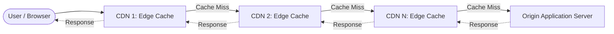
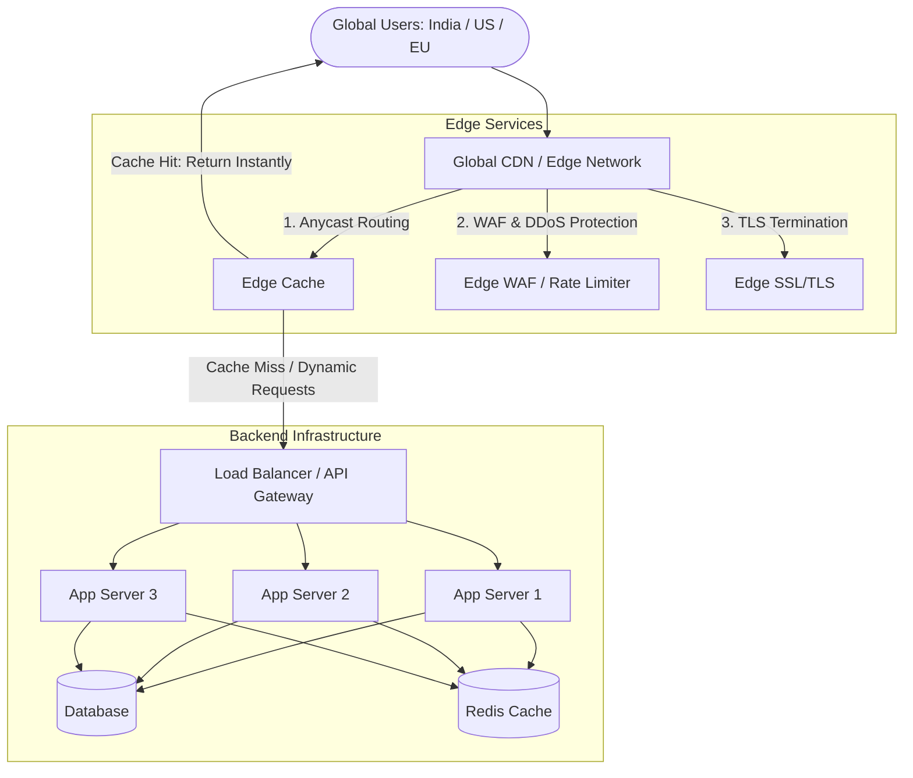
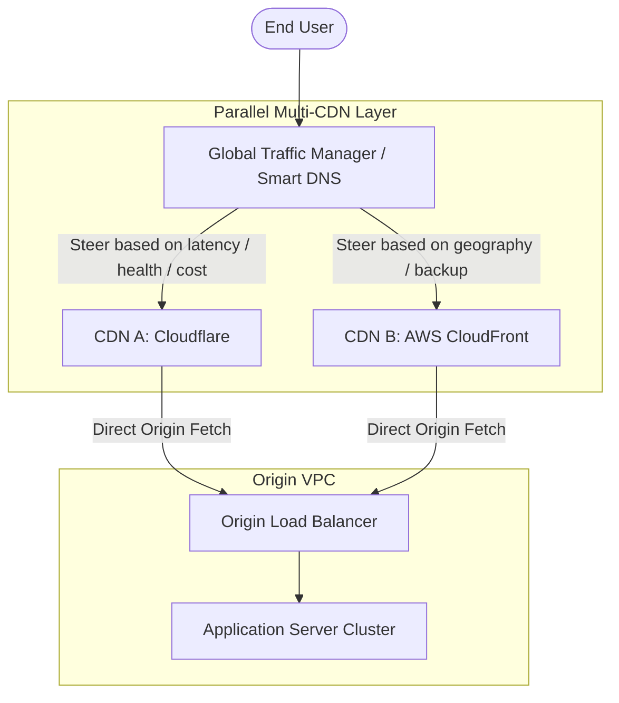
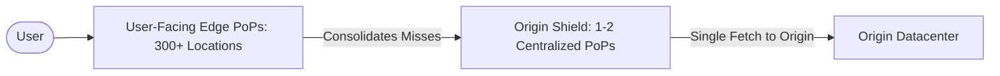

# Chaining Multiple CDNs vs. Parallel Multi-CDN Architectures

---

## 📌 Executive Overview

A common system design question arises when scaling web applications:

> **"If we can chain or tier multiple Load Balancers (Global LB → Regional LB → Instance LB), can we chain multiple CDNs sequentially (`User → CDN 1 → CDN 2 → … → CDN N → Origin`)? Or should multiple CDNs only be deployed in parallel?"**

**Short Answer:**  
Chaining multiple CDNs in a **serial request path** is generally an anti-pattern because it multiplies latency, compounds failure points, inflates egress costs, and complicates cache invalidation without providing proportional benefits. 

However, **parallel Multi-CDN routing** (using an intelligent Global Traffic Manager) and **purpose-driven tiered caching (Origin Shielding)** are valid, production-grade architectural patterns.

---

## 🚫 1. The Anti-Pattern: Chaining Multiple CDNs Sequentially

### The Proposed Serial Chain Architecture



### Request Flow Walkthrough
1. A user requests `https://example.com/products`.
2. The request hits **CDN 1**. If the asset is missing, it forwards the request to **CDN 2**.
3. If missing at **CDN 2**, it continues hop-by-hop down the chain until reaching the origin server.
4. The response traverses backward through every layer, populating multiple intermediate caches along the way.

---

## ⚠️ 2. Why Chaining CDNs Sequentially is Usually a Bad Idea

### 1. Increased Latency (The Opposite of a CDN's Purpose)
CDNs exist to minimize latency by terminating connections close to the end user. Serial chaining introduces significant overhead:
* **Multiple Network Hops & Routing Overhead**: Every intermediate proxy adds transit time across autonomous systems (ASNs).
* **TLS Termination & Re-encryption**: Each hop must inspect, terminate, or re-encrypt TLS connections unless persistent connections and HTTP/2/3 connection pooling are perfectly maintained.
* **Cumulative Cache Miss Latency**: When a cache miss occurs, the cumulative delay (Time to First Byte - TTFB) grows linearly with each additional layer.

### 2. Cache Invalidation & Consistency Nightmares
* **Stale Content Skew**: If you update an asset or HTML document at the origin, you must dispatch purge requests across $N$ distinct CDN providers.
* **Cascade Failure**: If CDN 2 fails to purge an asset (due to API rate limits or network lag), CDN 1 will fetch and re-cache the stale copy from CDN 2, indefinitely serving outdated content until the TTL expires.

### 3. Compounded Points of Failure
In a sequential chain, availability follows the multiplicative rule:
$$\text{Total Availability} = A_{\text{CDN 1}} \times A_{\text{CDN 2}} \times \dots \times A_{\text{CDN N}}$$
If any single CDN in the chain suffers a DNS outage, BGP route leak, or misconfiguration, the entire request pipeline fails unless complex automated bypass routing is engineered.

### 4. Exploding Egress & Bandwidth Costs
Most cloud providers and CDNs bill for outbound bandwidth (data egress):
* The origin server pays egress to send data to CDN $N$.
* CDN $N$ charges egress to forward to CDN $N-1$.
* CDN 1 charges egress to deliver to the client.
* **Result**: You pay bandwidth fees multiple times for the exact same byte of data.

### 5. Stripped Headers, Security Context, and WAF Conflicts
* **Client IP Obfuscation**: Managing header chains like `X-Forwarded-For` and `True-Client-IP` becomes messy, impairing geo-location tracking, rate limiting, and fraud detection at the backend.
* **WAF Collisions**: If multiple CDNs run Web Application Firewalls (WAF), optimization transformations or header rewrites applied by CDN 1 may trigger false-positive security blocks at CDN 2.

---

## 🛠️ 3. Technical Precision: Nuances to Keep in Mind

| Common Assumption | Production Reality & Precise Explanation |
| :--- | :--- |
| **"Every hop requires a new DNS lookup"** | Not necessarily. CDN-to-CDN upstream connections reuse cached DNS records and persistent connection pools. |
| **"Every hop requires a fresh TLS handshake"** | Connection reuse, TLS session tickets, and HTTP/2 / HTTP/3 keep-alive streams reduce handshake overhead between fixed edge proxies. |
| **"Cache invalidation is impossible"** | It is manageable using atomic versioned URLs (`bundle.v2.js`), short TTLs, or surrogate keys, but multi-vendor purge API orchestration remains brittle. |
| **"You always pay multiple egress fees"** | Direct peering agreements, cloud partner programs (e.g., Cloudflare Bandwidth Alliance), or collocated points of presence can reduce some cross-egress fees. |

---

## 🏗️ 4. Recommended Architectures

### A. Standard Production Architecture: Single CDN + Multi-AZ Infrastructure

For 95% of web applications, a single well-configured CDN paired with load-balanced application servers provides optimal performance, low cost, and high reliability.



---

### B. Parallel Multi-CDN (Resilience & Traffic Steering)

When multi-CDN is genuinely needed, deploy them in **parallel**, not in a series. A Global Traffic Manager (GTM) or intelligent DNS steers users to the optimal CDN.



---

### C. Legitimate Sequential Layering: CDN + Origin Shield

Sequential layering is justified only when each tier has a **distinct, specialized role**—such as a user-facing Edge PoP backed by a dedicated **Origin Shield**.



* **Role of Edge PoP**: Low latency connection close to the end user.
* **Role of Origin Shield**: Collapses simultaneous cache misses across worldwide edge PoPs into a single origin request (request collapsing), protecting backend databases from cache stampedes.

---

## ⚖️ 5. Multiple Load Balancers vs. Multiple CDNs

Why is hierarchical layering standard for Load Balancers, while CDNs prefer parallel routing?

```
┌─────────────────────────────────────────────────────────────────────────────┐
│                       Multiple LBs vs Multiple CDNs                         │
├────────────────────────────────┬────────────────────────────────────────────┤
│ Hierarchical Load Balancing    │ Parallel Multi-CDN                         │
│                                │                                            │
│            [User]              │                   [User]                   │
│              │                 │                     │                      │
│              ▼                 │                     ▼                      │
│     [Global DNS / GSLB]        │          [Global Traffic Manager]          │
│              │                 │                 │        │                 │
│              ▼                 │                 ▼        ▼                 │
│     [Regional Load Balancer]   │             [CDN A]    [CDN B]             │
│              │                 │                 │        │                 │
│              ▼                 │                 └────┬───┘                 │
│     [Internal Application LB]  │                      ▼                     │
│              │                 │             [Origin Load Balancer]         │
│              ▼                 │                      │                     │
│      [Service Instances]       │                      ▼                     │
│                                │             [Application Servers]          │
└────────────────────────────────┴────────────────────────────────────────────┘
```

| Dimension | Multiple Load Balancers (Hierarchical) | Multiple CDNs (Parallel vs Chained) |
| :--- | :--- | :--- |
| **Arrangement** | Hierarchical (Global → Regional → Local) | Parallel (Choice between A or B); Rarely chained |
| **Primary Job** | Stepwise traffic routing and fault isolation | Caching and delivering static/dynamic content |
| **Statefulness** | Stateless packet/request proxying | Heavy stateful caching (storage, TTLs, invalidation) |
| **Failover Penalty** | Zero cache cold-start penalty | Cache fragmentation, lower hit ratios on cold paths |
| **Why it Works** | Each layer addresses a different networking scope | Parallel routing gives redundancy without multi-hop delay |

---

## 📋 6. Summary Comparison Matrix

| Architecture | Setup | Best Used For | Drawbacks |
| :--- | :--- | :--- | :--- |
| **Single CDN** | `User → CDN → Origin` | 95% of standard web applications, APIs, SaaS. | Single vendor dependency. |
| **Parallel Multi-CDN** | `User → DNS/RUM → CDN A or CDN B → Origin` | High-bandwidth streaming (Netflix), cross-border compliance (China), enterprise failover. | Cache fragmentation, loss of volume tier discounts. |
| **Origin Shielding** | `User → Edge PoP → Origin Shield → Origin` | High-traffic media sites protecting origin from cache stampedes. | Slight latency addition on initial cold cache miss. |
| **Serial Chained CDNs** | `User → CDN 1 → CDN 2 → … → CDN N → Origin` | ❌ **Anti-pattern** (rarely justifiable). | High latency, multi-egress costs, cache invalidation nightmares, compounded SPOFs. |

---

## 🎯 7. Interview-Ready Response

> *"Chaining multiple CDNs sequentially in a single request path is generally an anti-pattern because it adds cumulative network latency, creates duplicate cache invalidation hurdles, multiplies data egress costs, and compounds failure dependencies.*
> 
> *While hierarchical tiers work well for **Load Balancers** (because they are stateless and distribute traffic across progressive scopes like global to regional), **CDNs** are stateful caching layers. When we need multi-CDN benefits—such as vendor redundancy or specialized geographic coverage—we deploy them **in parallel** using an intelligent Global Traffic Manager with DNS or RUM steering, rather than chaining them in series."*
