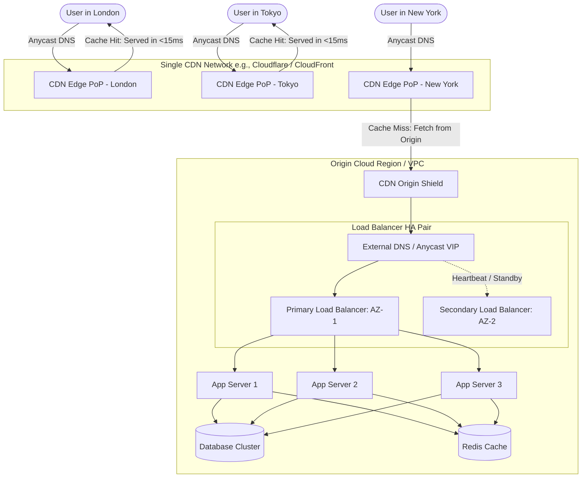
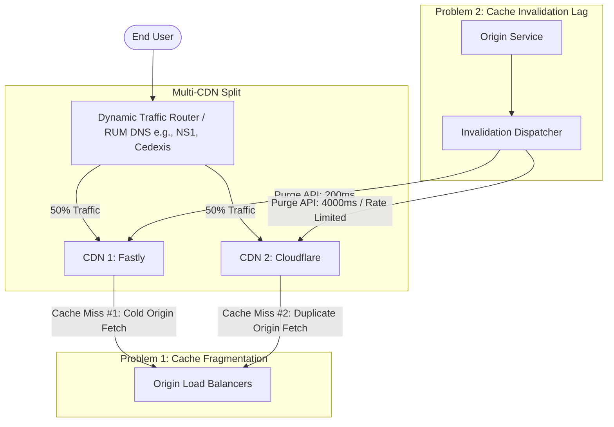

# Multiple Load Balancers vs. Multiple CDNs: System Design Deep Dive

---

## 📌 The Core Question

> **"If deploying multiple Load Balancers is standard industry best practice for high availability, why don't we routinely configure multiple CDNs (Multi-CDN) for our web applications?"**

At first glance, both components seem to perform similar roles: handling client traffic and distributing requests to prevent server overload. However, their underlying architecture, failure domains, statefulness, and operational complexities are fundamentally different.

---

## 🧭 The Core Mental Model

1. **A Load Balancer is a Local Traffic Coordinator**:
   - Manages traffic within a specific datacenter, Virtual Private Cloud (VPC), or availability zone.
   - It is largely **stateless**—it inspects and routes packets to compute nodes.
   - Adding a second or third load balancer removes Single Points of Failure (SPOFs) at near-zero operational penalty.

2. **A Single CDN is ALREADY a Global Mesh of Thousands of Load Balancers**:
   - A single CDN provider (e.g., Cloudflare, Akamai, AWS CloudFront, Fastly) already operates hundreds of **Points of Presence (PoPs)** and tens of thousands of edge proxy servers worldwide.
   - A CDN is deeply **stateful** (maintaining gigabytes-to-terabytes of cached static/dynamic data at the edge).
   - Splitting traffic across multiple CDNs fragments the cache layer, hurts cache hit ratios, complicates invalidation, and increases origin load.

---

## 🔍 Structural Comparison: Load Balancer vs. CDN

| Dimension | Load Balancer (LB) | Content Delivery Network (CDN) |
| :--- | :--- | :--- |
| **Geographic Scope** | Regional / Datacenter / VPC | Global (Distributed across 300+ cities worldwide) |
| **Primary Goal** | Distribute compute load & handle backend node failures | Reduce user-perceived latency & offload static/dynamic content |
| **Internal Scale** | 2 to 10 instances / VIPs managed by your team | Tens of thousands of edge servers managed by the CDN vendor |
| **Statefulness** | Stateless (Routes TCP/HTTP requests without storing payloads) | Highly stateful (Maintains edge disk/memory cache with TTLs) |
| **Failover Impact** | Seamless; zero cold-start or cache-miss penalty | Severe cache fragmentation, cache cold-start, duplicate origin hits |
| **DNS / Routing** | Simple DNS A/AAAA record, Anycast VIP, or AWS Route 53 | Complex Geo-DNS, Anycast, or Real User Monitoring (RUM) steering |
| **Cost Dynamics** | Low fixed cost per LB instance | High volume-tiered egress bandwidth pricing |

---

## 🏗️ Architecture Diagrams

### 1. Standard Production Architecture: Single Global CDN + Multi-AZ Load Balancers



---

### 2. Multi-CDN Architecture: The Hidden Friction Points



---

## ⚡ Why Multiple Load Balancers are Easy & Mandatory

1. **Local Redundancy Without Data Divergence**:
   - Load balancers forward incoming traffic without storing large blobs of application data.
   - When an active load balancer fails, the backup (configured via Keepalived, VRRP, or cloud-native ALBs across Availability Zones) takes over instantly without dropping sessions or invalidating cached assets.
2. **Horizontal Compute Scaling**:
   - As traffic scales from 10k to 10M requests/sec, scaling load balancers horizontally (using ECMP or DNS round-robin) smoothly distributes traffic among worker instances.
3. **Contained Cost & Configuration**:
   - Internal load balancers do not incur tiered bandwidth penalties or multi-vendor API synchronization complexities.

---

## ⚠️ Why Multiple CDNs (Multi-CDN) Introduce Significant Challenges

### 1. Cache Fragmentation & Reduced Cache Hit Ratio (CHR)
* **Single CDN**: When User A in Frankfurt requests `/asset.js`, it is fetched once and cached at the Frankfurt PoP. User B in Frankfurt gets a 100% cache hit.
* **Multi-CDN**: If User A is routed to CDN 1 and User B is routed to CDN 2, **both CDNs must fetch `/asset.js` from your origin server independently**.
* **Impact**: Total cache hit ratio drops, origin database and compute load doubles, and egress bandwidth costs rise.

### 2. Cache Purge & Invalidation Synchronization
* When a product price, image, or dynamic configuration changes at the origin, you must purge all edge caches.
* With multiple CDNs:
  - Each vendor provides different purge APIs, rate limits, and propagation latencies (e.g., Fastly purges in ~150ms via soft purge; other CDNs can take several seconds).
  - If a purge call fails on CDN B, users routed to CDN B receive stale content while users on CDN A receive updated content.

### 3. Edge Compute & Feature Incompatibility
* Modern architectures run compute at the edge (e.g., authentication, geo-headers, image optimization, A/B testing):
  - **Cloudflare**: Workers (V8 JavaScript isolate engine)
  - **AWS CloudFront**: Lambda@Edge (Node.js/Python) or CloudFront Functions
  - **Fastly**: Compute@Edge (WebAssembly/Rust/Go)
* Running multi-CDN means maintaining and testing **multiple separate codebases** for edge logic.

### 4. Loss of Bandwidth Volume Discounts
* CDN billing models offer deep discounts as aggregate data egress increases:
  - **Single CDN (1 PB/month)**: \$0.015 per GB.
  - **Split CDN (500 TB on CDN A + 500 TB on CDN B)**: Both fall into the \$0.035 per GB tier.
* Result: Infrastructure costs can increase by 30%–60% for identical traffic volumes.

### 5. Routing Complexity & DNS Latency
* To steer traffic across multiple CDNs dynamically, you must implement:
  - **Real User Monitoring (RUM)** probes embedded in client browsers (e.g., Cisco ThousandEyes, Cedexis, NS1).
  - Dynamic DNS response rewriting based on live network health.
* This adds extra DNS lookup latency, third-party subscription costs, and a new SPOF at the DNS routing layer.

---

## 🏢 When IS a Multi-CDN Architecture Justified?

Despite the complexity, top-tier global platforms adopt Multi-CDN under specific technical constraints:

```
┌────────────────────────────────────────────────────────────────────────────────────────┐
│                          Legitimate Multi-CDN Use Cases                                │
├───────────────────────────────┬────────────────────────────────────────────────────────┤
│ Scenario                      │ Justification                                          │
├───────────────────────────────┼────────────────────────────────────────────────────────┤
│ 1. Massive Video Streaming    │ Netflix, YouTube, and Disney+ stream multi-terabits    │
│    (HLS / DASH)               │ per second. No single CDN vendor possesses sufficient  │
│                               │ egress capacity in every city simultaneously.          │
├───────────────────────────────┼────────────────────────────────────────────────────────┤
│ 2. Sovereign / China Delivery │ Western CDNs have limited reach inside mainland China  │
│    (Cross-Border Regulatory)  │ due to firewall and ICP licensing. Companies use       │
│                               │ Alibaba/Tencent Cloud CDN inside China + Cloudflare    │
│                               │ globally.                                              │
├───────────────────────────────┼────────────────────────────────────────────────────────┤
│ 3. Critical Disaster Recovery │ Financial platforms (Bloomberg, Visa) cannot tolerate  │
│    (High-SLA 99.999% uptime)  │ even a 15-minute global CDN outage (e.g., Fastly 2021  │
│                               │ or Cloudflare BGP route leaks).                        │
├───────────────────────────────┼────────────────────────────────────────────────────────┤
│ 4. Multi-Cloud Egress Cost    │ Serving AWS S3 assets via CloudFront (zero egress fee) │
│    Optimization               │ and Azure Blob assets via Azure CDN.                   │
└───────────────────────────────┴────────────────────────────────────────────────────────┘
```

---

## 📊 Summary Comparison: Multi-LB vs. Multi-CDN

| Factor | Multiple Load Balancers (Multi-LB) | Multiple CDNs (Multi-CDN) |
| :--- | :--- | :--- |
| **Default Recommendation** | ✅ **Standard for almost all production apps** | ⚠️ **Specialized for high-bandwidth/enterprise apps** |
| **Purpose** | Eliminate internal SPOF, scale backend compute | Prevent single vendor global downtime, maximize regional speed |
| **Cache Impact** | None (stateless routing) | Negative (cache fragmentation, lower hit ratio, double origin hits) |
| **Purge Coordination** | Not applicable | High complexity (multi-vendor API dispatch & monitoring) |
| **Edge Compute** | Unified at backend application layer | Disparate runtimes (V8 vs Lambda vs WASM) |
| **Cost Impact** | Negligible / Linear | Significant (loss of tiered pricing discounts) |

---

## 🎯 Interview Takeaway & Quick Answer

> *"In system design, we use **multiple Load Balancers** because they are local, stateless components where redundancy prevents single-node failure without side effects.*  
>  
> *In contrast, a **single CDN** is already a globally distributed fleet of thousands of edge load balancers. Deploying **multiple CDNs** splits the cache layer, lowers the cache hit ratio, doubles origin load during cold starts, complicates cache invalidation, and removes tiered pricing discounts. Unless we are building multi-terabit video streaming platforms or navigating regional regulatory barriers (such as mainland China), a single tier-1 CDN paired with Multi-AZ Load Balancers is the optimal design."*
