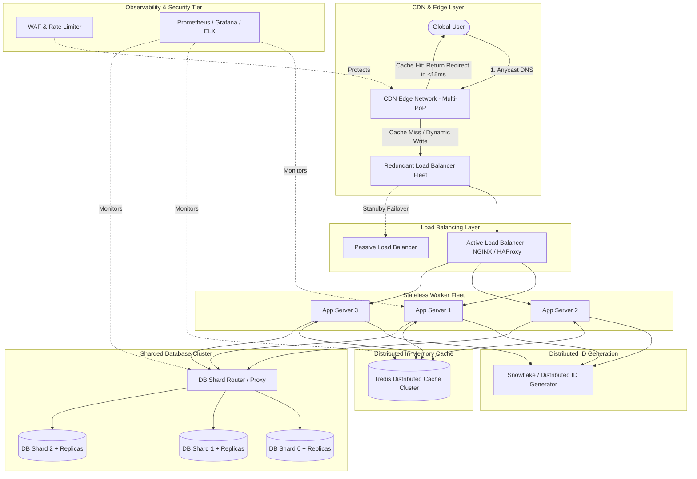
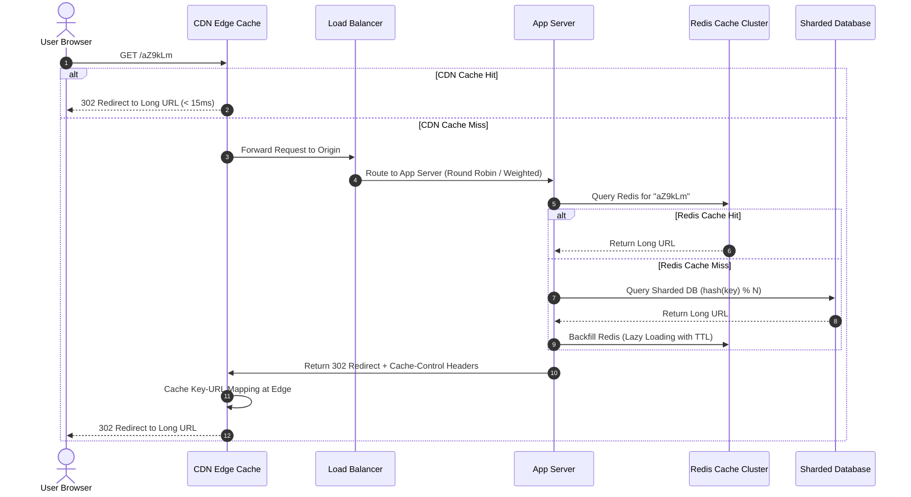
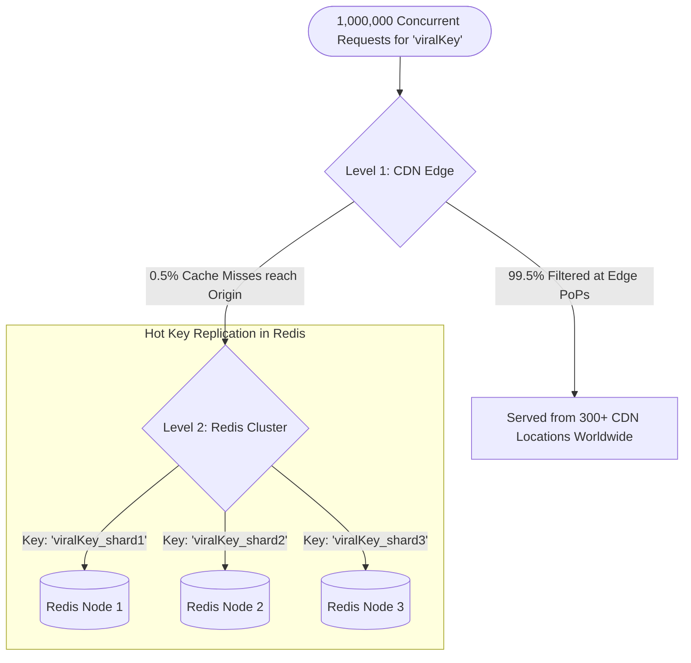

# Production-Scale System Architecture: URL Shortener, CDN & Infrastructure Deep Dive

---

## 📌 Executive Summary

Building a production-ready system capable of handling **100 Million writes/day** and **1 Billion reads/day** requires a resilient, multi-tiered architecture. At this scale, treating failure as an inevitability and designing for **graceful degradation** is essential.

This document details the complete end-to-end architecture, from the edge CDN down to the sharded database layer, covering data flow, scaling strategies, failure recovery, the hot-key dilemma, abuse prevention, and observability.

---

## 📊 Scale & Capacity Estimates

```
┌──────────────────────────────┬──────────────────────────────┬──────────────────────────────┐
│ Metric                       │ Daily Volume                 │ Average QPS (Queries / Sec)  │
├──────────────────────────────┼──────────────────────────────┼──────────────────────────────┤
│ ✍️ Write Requests (Create)    │ 100 Million writes / day     │ ~1,160 QPS (Peak: ~3,000)    │
│ 📖 Read Requests (Redirect)  │ 1 Billion reads / day        │ ~11,600 QPS (Peak: ~35,000)  │
│ ⚖️ Read to Write Ratio       │ 10 : 1 (Read-Heavy System)   │ —                            │
└──────────────────────────────┴──────────────────────────────┴──────────────────────────────┘
```

A single application server and standalone database will immediately buckle under this load due to CPU exhaustion, socket starvation, memory limits, and disk I/O bottlenecks.

---

## 🏗️ Complete End-to-End System Architecture



---

## 🔄 Request Lifecycle: Write Path vs. Read Path

### 1. Write Path Flow (`POST /api/v1/shorten`)

```
User (Long URL) 
   │
   ▼
[Load Balancer] ─────────► [App Server]
                              │
                              ├─► 1. Calls [Distributed Snowflake ID Generator] ──► Returns Unique 64-bit ID
                              ├─► 2. Encodes ID using Base62 (e.g., ID 1253075780457789440 → "aZ9kLm")
                              ├─► 3. Computes DB Shard = Hash(ShortID) % ShardCount
                              └─► 4. Writes Record to Target DB Shard [(ShortID, LongURL, UserID, CreatedAt, TTL)]
                                      │
                                      ▼
                        Returns Short URL ("https://short.ly/aZ9kLm") to User
```

*Note: Writes bypass the CDN cache and flow directly through the load balancer to the application server and persistent storage.*

---

### 2. Read Path Flow (`GET /{shortKey}`)



---

## 🗄️ Database Scaling: Hash-Based Sharding & Replication

To store billions of URL records without creating a database bottleneck, data is partitioned across multiple database shards.

$$\text{Shard ID} = \text{hash}(\text{Short ID}) \pmod{\text{Total Number of Shards}}$$

```
                               ┌────────────────────────────────────────────────────────┐
                               │                    Incoming Short ID                   │
                               └──────────────────────────┬─────────────────────────────┘
                                                          │
                                            ┌─────────────┴─────────────┐
                                            ▼                           ▼
                                    ["aZ9kLm"]                     ["k8P2xQ"]
                                            │                           │
                                     hash("aZ9kLm") % 3          hash("k8P2xQ") % 3
                                            │ = 0                       │ = 2
                                            ▼                           ▼
                                  ┌───────────────────┐       ┌───────────────────┐
                                  │    DB Shard 0     │       │    DB Shard 2     │
                                  ├───────────────────┤       ├───────────────────┤
                                  │ Primary (Read/W)  │       │ Primary (Read/W)  │
                                  │ Replica 1 (Read)  │       │ Replica 1 (Read)  │
                                  │ Replica 2 (Read)  │       │ Replica 2 (Read)  │
                                  └───────────────────┘       └───────────────────┘
```

### Why Hash-Based Sharding?
1. **Uniform Distribution**: Prevents data skews and hotspots by distributing records evenly across all physical instances.
2. **Replication for Fault Tolerance**: Each primary shard replicates asynchronously to 2+ read replicas. If a primary shard crashes, a replica is automatically promoted to primary via consensus (e.g., Raft / ZooKeeper / Orchestrator).

---

## 📈 The 5-Layer Scaling Strategy

```
┌──────────────────────────────────────────────────────────────────────────────┐
│                      5-Layer Scaling Strategy Framework                      │
├───────┬──────────────────────────┬───────────────────────────────────────────┤
│ Layer │ Component                │ Scaling Mechanism                         │
├───────┼──────────────────────────┼───────────────────────────────────────────┤
│ 1     │ Database Layer           │ Hash-based Sharding + Read Replicas       │
├───────┼──────────────────────────┼───────────────────────────────────────────┤
│ 2     │ Caching Layer            │ Distributed Redis Cluster (LRU Eviction)  │
├───────┼──────────────────────────┼───────────────────────────────────────────┤
│ 3     │ Compute Tier             │ Horizontal Stateless App Servers + LBs    │
├───────┼──────────────────────────┼───────────────────────────────────────────┤
│ 4     │ Edge Network             │ Global CDN Edge PoPs (Latency & IO Cut)   │
├───────┼──────────────────────────┼───────────────────────────────────────────┤
│ 5     │ Core Services            │ Decoupled Distributed Snowflake ID Gen   │
└───────┴──────────────────────────┴───────────────────────────────────────────┘
```

---

## 🛡️ Failure Handling & Controlled Degradation

> *"A junior engineer hopes a system never fails. A staff engineer assumes every component will fail and designs for controlled, graceful degradation."*

| Failed Component | Immediate Impact | Mitigation & Recovery Architecture |
| :--- | :--- | :--- |
| **CDN Edge Down** | Increased latency; traffic cascades to origin origin servers. | Anycast DNS automatically routes users to adjacent healthy CDN PoPs; origin auto-scales compute workers. |
| **Load Balancer Down** | Single point of failure if standalone. | Active-Passive / Active-Active LB pairing via VRRP / Keepalived / AWS Multi-AZ ALB. |
| **App Server Crash** | Slight capacity reduction; remaining servers absorb load. | LB health checks detect failure within 2s and stop forwarding traffic; Auto-Scaling Group (ASG) spawns new node. |
| **Redis Node Failure** | Temporary cache misses; database query load spikes. | Redis Sentinel / Redis Cluster auto-failover to replica; local in-memory fallback (Caffeine cache) to prevent stampede. |
| **ID Generator Node Down**| Loss of one ID worker machine. | Snowflake uses independent 10-bit Worker IDs; surviving nodes continue generating unique collision-free IDs without quorum lag. |
| **Database Shard Crash** | Read/write outage for $1/N$ of keys. | Automated failover promoting secondary replica to primary within seconds. Zero data loss with synchronous replication. |

---

## 🔥 The Hot-Key (Celebrity URL) Problem

### The Challenge
When a viral news link or celebrity tweet points to a single short URL, millions of requests hit that exact same key simultaneously. If cached on a single Redis node, that node's CPU and network interface become saturated, leading to node failure.



### Two-Tier Hot-Key Mitigation:
1. **Edge Absorption (CDN Layer)**: The CDN serves 99%+ of reads for popular keys directly from local edge caches, shielding the origin entirely.
2. **Key Replication across Redis Nodes**: For hot keys that reach the internal cache, the application writes duplicate keys (`key_0`, `key_1`, ..., `key_M`) across multiple Redis instances and load-balances read queries randomly across them.

---

## 🔒 Security & Abuse Prevention

1. **Rate Limiting (e.g., Token Bucket / Leaky Bucket)**:
   - Max 30 URL creation requests per minute per authenticated user / IP address.
   - Prevents database exhaustion from malicious scraping or spam bots.
2. **Domain & IP Blacklisting**:
   - Inspect long URLs against Google Safe Browsing / PhishTank APIs before creating mappings to block phishing and malware domains.
3. **CAPTCHA Integration**:
   - Trigger CAPTCHA verification when anomalous request bursts or non-human interaction patterns are detected.
4. **HTTPS Encryption & Default Expiration**:
   - Enforce TLS 1.3 across all communication.
   - Enforce default TTL (e.g., 2–5 years) to purge abandoned records from active storage to cold archives (S3 / Glacier).

---

## 📊 Observability & System Telemetry

To ensure high availability and diagnose production incidents quickly, track these core telemetry signals:

```
┌──────────────────────────────────────────────────────────────────────────────┐
│                    Key Production Observability Metrics                      │
├──────────────────────────┬───────────────────────────────────────────────────┤
│ Metric                   │ Diagnostic Purpose                                │
├──────────────────────────┼───────────────────────────────────────────────────┤
│ QPS (Queries/Sec)        │ Measures real-time traffic volume (Read vs Write) │
│ Cache Hit Rate (CHR)     │ Ensures >90% of reads are served from cache       │
│ DB Query Latency         │ Pinpoints unindexed queries or slow disk I/O      │
│ P90 / P95 / P99 Latency  │ Identifies tail latency experienced by users      │
│ HTTP 4xx / 5xx Error Rate│ Detects broken services, bad builds, or DDoS      │
│ Shard Data Imbalance     │ Detects non-uniform hash distributions            │
│ ID Collision Rate        │ Validates correctness of distributed ID generator │
└──────────────────────────┴───────────────────────────────────────────────────┘
```

**Standard Observability Tech Stack**:
- **Metrics Collection**: Prometheus / Datadog
- **Dashboards**: Grafana
- **Distributed Tracing**: OpenTelemetry / Jaeger
- **Log Aggregation**: ELK Stack (Elasticsearch, Logstash, Kibana) / Grafana Loki

---

## 🎯 Summary: The Golden Rule of System Design

```
             ┌──────────────────────────────────────────────┐
             │  "System Design is the art of optimizing     │
             │   an application layer by layer."            │
             └──────────────────────┬───────────────────────┘
                                    │
    ┌───────────────────────────────┴───────────────────────────────┐
    ▼                                                               ▼
[Top-Down: Edge & Networking]                       [Bottom-Up: Compute & Storage]
• Global CDN Edge PoPs                              • Sharded Databases + Replicas
• Anycast DNS Routing                               • Distributed Redis Caching
• Multi-AZ Load Balancers                           • Stateless Worker Fleets
• Edge WAF & Rate Limiters                          • Decoupled ID Generation
```
