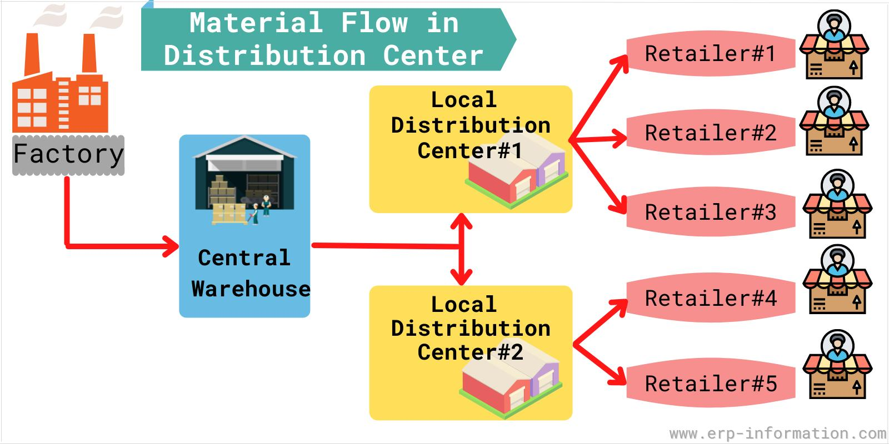
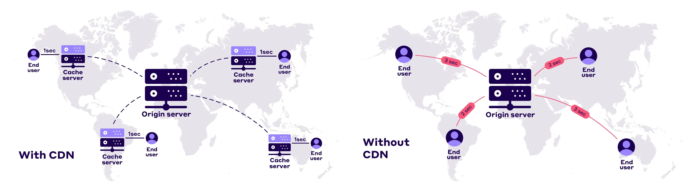
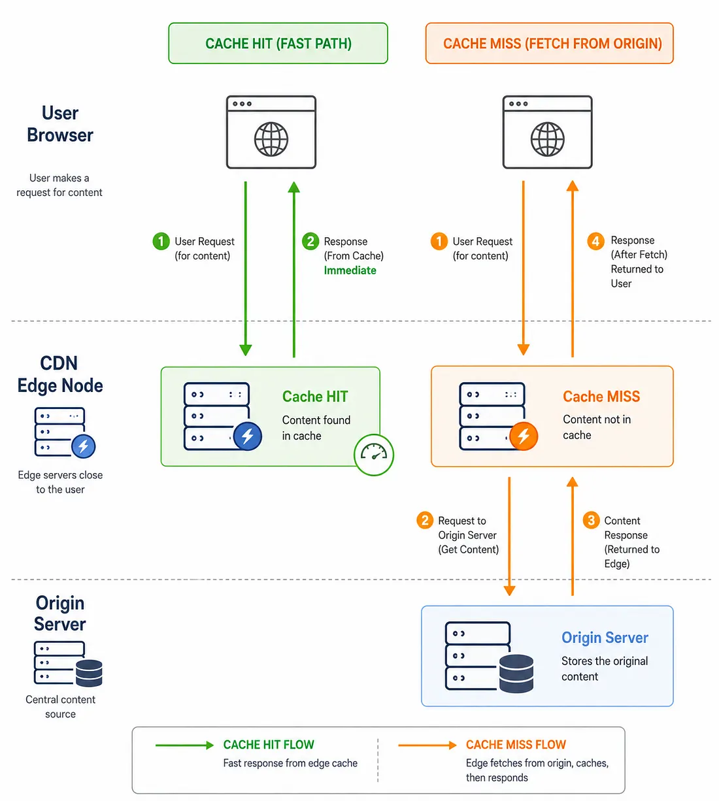
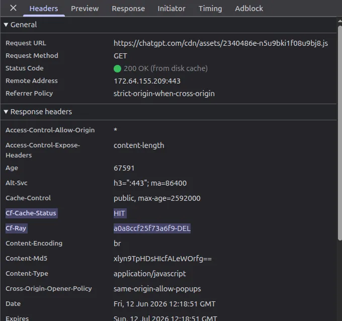

# Content Delivery Networks (CDN) — Complete System Design Study Notes

- 📖 [Production-Scale URL Shortener & CDN Infrastructure Deep Dive](./Production_URL_Shortener_Architecture.md)
- 📖 [Chaining Multiple CDNs vs. Parallel Multi-CDN Architectures](./Chaining_Multiple_CDNs_vs_Multi_CDN.md)
- 📖 [Multiple Load Balancers vs. Multiple CDNs (Deep Dive)](./Multiple_Load_Balancers_vs_Multiple_CDNs.md)
- 📖 [How Does a CDN Provide Services Other Than Caching?](./CDN_Uses.md)
- 📖 [CDN In-Depth Guide](./info.md)

## Tutorials
1. **What is CDN | Content Delivery Network**: https://www.youtube.com/watch?v=4pd5FgTluCM&t=2s
2. **Lec-4 : Content Delivery Network (CDN) | How it works**: https://www.youtube.com/watch?v=ouqqU0FJjhQ
3. **System Design - Part 9 | Message Queue and CDN**: https://www.youtube.com/watch?v=G2xEnPugNoo&list=PLFdAYMIVJQHOWJgRrjv_RH-ng95B2h3ON&index=10

---

Let's learn CDN from a system architect's perspective, starting with the basics and gradually moving towards enterprise-level architecture and interview questions.

These notes follow the comprehensive lecture structure, explained with practical examples, request flows, and architecture diagrams.

---

# Chapter 1 — Introduction to CDN

## 1. What is a Content Delivery Network?

A **Content Delivery Network (CDN)** is a globally distributed network of servers that delivers content to users from locations geographically closer to them.

Instead of every user requesting content directly from one central server, a CDN stores copies of frequently requested content at distributed locations called **Edge Locations (Points of Presence / PoPs)**.

**A Content Delivery Network (CDN) speeds up websites using three main parts.** 
- The origin server stores the master files.
- Edge servers sit close to users globally.
- The cache is the temporary storage on those edge servers that holds copies of files for fast delivery.

**Origin Server**
- Acts as the primary, central source of truth for a website or app.
- Holds original code, databases, media, and dynamic files.
- Handles complex requests that cannot be pre-made or saved.

**Edge Server**
- Placed at the outer edge of the internet, physically close to users.
- Intercepts user requests to cut down data travel distance and time.
- Fetches data from the origin server only when necessary.

**Cache**
- Saved copies of static files (images, CSS, JS) kept inside edge servers.
- Cache hit: The edge server finds the requested file in its cache and sends it instantly.
- Cache miss: The edge server lacks the file, pulls it from the origin server, saves a copy, and hands it to the user.

The basic definition everyone has heard is:
```
"Cache static data, but don't cache dynamic data."
```


### Real-World Example: Video Streaming
Imagine you are watching a video on a streaming platform:
- The original video is stored on an origin server in the **USA**.
- You are watching from **Kolkata, India**.
- **Without a CDN:** Your request travels all the way to the USA (~14,000 km round trip), creating substantial delay and buffering.
- **With a CDN:** The video is delivered from a local edge server located close to Kolkata.

This drastically reduces network round-trip time (RTT) and delivers a smooth viewing experience.

### The Bookstore Warehouse Analogy
Imagine you run 100 bookstores across the country:
- Instead of maintaining a single central warehouse and shipping every single book from it, you set up regional distribution hubs near clusters of bookstores.
- Local customers get their books quickly from the nearby hub.
- Only when a regional hub runs out of stock does it contact the central warehouse.



A CDN operates on this exact principle for digital assets (images, CSS, JavaScript, videos, fonts, and API data).

---

## 2. Why Do We Need a CDN?

Before CDNs existed, every client request had to travel directly to the origin server.



This creates three major problems:

### Problem 1: Distance Creates Latency
- Network signals travel through fiber-optic cables at approximately $200,000\text{ km/s}$ (sub-light speed).
- When a user in India communicates with a server in the USA, data traverses thousands of kilometers and dozens of intermediate routers.
- Round-trip latency can easily exceed $200\text{ ms}$ for a single request.
- A modern web page requires dozens of requests (HTML, CSS bundles, JS bundles, images, fonts). Cumulative network delay significantly degrades user experience.

> **Solution:** Serve content from geographically closer edge servers (reducing latency from $\approx 200\text{ ms}$ to $< 20\text{ ms}$).

### Problem 2: Origin Server Becomes a Bottleneck
- Imagine 1 million users accessing the application simultaneously during a flash sale or breaking news event.
- Without a CDN, all 1 million requests hit the origin server directly.
- The origin's CPU, memory, connection pools, and network interfaces get overwhelmed, leading to server crashes or high 5xx error rates.

> **Solution:** CDN edge servers absorb and serve the vast majority of incoming traffic, shielding the origin.

### Problem 3: Increased Origin Bandwidth Consumption & Cost
- Static assets like high-resolution images, video files, JS bundles, and CSS stylesheets make up over $80\%$ of typical web payload size.
- If 1 million users repeatedly download the same 5 MB banner image from the origin, the origin must transfer 5 Terabytes of redundant data.
- Cloud origin bandwidth egress is expensive.

> **Solution:** Cache reusable content at the edge and serve it repeatedly with zero origin bandwidth cost.

---

## 3. Problems vs. CDN Solutions

| Problem | CDN Solution |
| :--- | :--- |
| **High Latency** | Serve content closer to users from edge servers |
| **Origin Overload** | Offload traffic to edge locations (Origin Offloading) |
| **High Bandwidth Consumption** | Cache reusable assets at the edge |
| **Traffic Spikes** | Globally distribute requests across thousands of servers |
| **Regional Outages / Failures** | Automatically reroute requests to healthy edge nodes |
| **Security Threats** | Filter malicious traffic, mitigate DDoS, and terminate TLS at the edge |

> **Key Rule:** A CDN is not just a caching layer. It is a **performance, scalability, availability, and security layer**.

---

# Chapter 2 — CDN Architecture Overview

A CDN consists of three key architectural components:


```
+-------------------------------------------------------------------------+
|                              CDN ARCHITECTURE                           |
|                                                                         |
|   [ User in Asia ]  ---------> ( Edge PoP - Asia )                      |
|                                         | (Cache Miss)                  |
|   [ User in Europe ] --------> ( Edge PoP - Europe ) ---> [ ORIGIN ]    |
|                                         | (Cache Miss)   [ SERVER ]     |
|   [ User in US ]    ---------> ( Edge PoP - US )                        |
+-------------------------------------------------------------------------+
```

### 1. Origin Server
- The original source of truth where primary application code, databases, media files, and APIs live.
- The CDN does **not** replace the origin server; it minimizes direct traffic reaching it.

### 2. Edge Servers (Points of Presence / PoPs)
- Edge servers reside in distributed data centers located in major metropolitan areas around the world.
- Responsibilities:
  - Store cached copies of assets.
  - Terminate client TLS connections.
  - Serve content with ultra-low latency.
  - Execute edge logic and security rules.

### 3. Request Routing System
When a user types a URL, how does the CDN pick the right edge server?
The CDN request routing system uses **Anycast DNS**, Geo-DNS, or latency-based routing taking into account:
- **Geographic proximity**
- **Network latency & round-trip time**
- **Network congestion & BGP routing paths**
- **Server health and current load**

> *Important:* The physically nearest server is not always the fastest. Network congestion and route availability are factored in real time.

---

# Chapter 3 — How CDN Works: Step-by-Step Request Lifecycle

Let's understand the complete request flow when a user requests an asset (e.g., `https://example.com/images/logo.png`).



### 1. Complete Request Flow
1. **User sends request:** Browser initiates an HTTPS request for `logo.png`.
2. **Routing:** DNS resolves the domain to the nearest/best CDN Edge IP.
3. **Cache Inspection:** The edge server checks its local storage for `logo.png`.
4. **Cache Hit:** If found and fresh, edge returns it directly to the user (sub-millisecond lookup).
5. **Cache Miss:** If not found or expired, edge sends an origin request to fetch `logo.png`.
6. **Origin Response:** Origin server sends the image and cache-control headers back to edge.
7. **Edge Caching:** Edge stores a copy in local memory/disk according to TTL policies.
8. **Client Delivery:** Edge returns the image to the user.

---

### 2. Cache Hit

A **Cache Hit** occurs when the requested content is already available and valid in the edge server's cache.

```
Browser  ----( 1. GET /logo.png )---->  CDN Edge Server (Found in Cache!)
Browser  <---( 2. 200 OK + Image )----  CDN Edge Server
                                        (Origin NOT contacted)
```

**Advantages:**
- Ultra-low latency (often $<10\text{ ms}$).
- Zero origin CPU or bandwidth consumption.
- Maximum throughput.



---

### 3. Cache Miss

A **Cache Miss** occurs when requested content is not present or has expired in the edge server's cache.

```
Browser  --( 1. GET /new-image.png )-->  CDN Edge Server
                                              |
                                              | ( 2. Origin Fetch )
                                              v
                                         Origin Server
                                              |
                                              | ( 3. Return Content )
                                              v
Browser  <--( 5. 200 OK + Image )------  CDN Edge Server
                                         ( 4. Stores copy in Cache )
```

**Subsequent Requests:**
Every subsequent user in that region requesting `/new-image.png` will now trigger a **Cache Hit**.

---

### 4. Cache Hit vs. Cache Miss

| Feature | Cache Hit | Cache Miss |
| :--- | :--- | :--- |
| **Content in Edge Cache** | Yes | No |
| **Origin Server Contacted** | No | Yes |
| **Response Latency** | Substantially faster ($5\text{--}20\text{ ms}$) | Slower ($100\text{--}300\text{ ms}$) |
| **Origin Load** | None (Offloaded) | Incurred for this request |
| **Data Source** | Edge RAM / SSD | Origin backend / Object Store |

> **Interview Insight:** If 1 million users in different regions request the same new image simultaneously, each distinct edge PoP experiences its own initial cache miss. Once each PoP caches it, subsequent regional requests become cache hits.

---

# Chapter 4 — Additional Capabilities of Modern CDNs

Modern CDNs provide much more than basic caching.


### 1. Caching
Storing static assets (images, CSS, JS, video chunks, PDF documents) at edge PoPs worldwide.

### 2. Traffic Distribution & High Availability
- Distributes millions of concurrent requests globally.
- Automatically reroutes traffic if an edge PoP, fiber line, or cloud region fails.

### 3. Content Optimization
- **Compression:** Dynamically applies **Gzip** or **Brotli (`br`)** compression on text responses, reducing transfer sizes by up to $70\text{--}80\%$.
- **Asset Minification:** Strips unnecessary whitespace, comments, and unused code from CSS and JavaScript.
- **Image Optimization:** Dynamically converts images to modern formats (WebP, AVIF) and resizes on the fly based on client `User-Agent`.

### 4. Security Layer at the Edge


| Security Capability | Purpose |
| :--- | :--- |
| **Malicious Traffic Filtering (WAF)** | Inspects HTTP headers/body and blocks SQLi, XSS, and bot attacks before they hit the origin. |
| **DDoS Mitigation** | Absorbs massive Layer 3/4 (SYN floods, UDP reflection) and Layer 7 (HTTP floods) attacks using vast edge capacity. |
| **TLS Termination** | Handles SSL/TLS handshake at edge, offloading heavy cryptographic computations from origin servers. |
| **Origin Shielding / IP Masking** | Hides origin IP behind CDN Anycast IPs to prevent direct attacks on origin infrastructure. |

---

# Chapter 5 — Use Cases of CDN

### 1. Static Content Delivery
- **Assets:** Images, videos, fonts, CSS bundles, JS build files, installers.
- **Pattern:** Cache once with long TTL (e.g., 1 year with content hashes).
- **Example:** An e-commerce site serving 100,000 product images.

### 2. Dynamic Content Delivery
- **Assets:** User profiles, search queries, real-time prices.
- Even if the full HTML/JSON cannot be cached for everyone, the CDN accelerates delivery by:
  - Establishing persistent, pre-warmed TCP/TLS connections to origin.
  - Route optimization across private CDN backbone fibers rather than public internet hops.
  - Micro-caching responses that are valid for short intervals (e.g., 2–5 seconds).

### 3. API Acceleration
```http
GET /api/v1/products/categories
GET /api/v1/exchange-rates
GET /api/v1/system-config
```
- Public, frequently requested API data can be safely cached at edge locations.
- **Banking / Enterprise rule:** Public catalog or exchange rates are cached at CDN edge; sensitive personal records (account balance, transaction history) must have `Cache-Control: no-store, private` so they are never stored in shared CDN caches.

### 4. Edge Computing


Edge computing allows running lightweight serverless code (e.g., Cloudflare Workers, AWS Lambda@Edge, Fastly Compute@Edge) directly at CDN PoPs.

```
Traditional CDN:
User  ------>  CDN Edge (Simple Cache)  ------>  Origin Server

CDN with Edge Computing:
User  ------>  CDN Edge
                 |
                 +---- Request Validation & Geo-blocking
                 +---- Authentication / JWT Verification
                 +---- A/B Testing & URL Rewriting / Redirects
                 +---- Dynamic Header Manipulation
                 +---- Lightweight Response Generation
                 |
                 v
               Origin Server (Only when database/core business logic is required)
```

---

# Chapter 6 — CDN in a Real-World Application Architecture

Let's examine how a modern enterprise production architecture integrates CDN, WAF, Load Balancers, and API Gateways:

```
                          [ USERS (Web / Mobile) ]
                                     |
                                     | HTTPS Request
                                     v
                       +---------------------------+
                       |         CDN EDGE          |
                       |  - TLS Termination        |
                       |  - Edge Caching           |
                       |  - Content Optimization   |
                       |  - DDoS Mitigation        |
                       +---------------------------+
                                     |
                                     | (Cache Miss / Dynamic API)
                                     v
                       +---------------------------+
                       |   WAF (Edge or Perimeter) |
                       |  - SQLi / XSS Rules       |
                       |  - Bot Detection          |
                       +---------------------------+
                                     |
                                     v
                       +---------------------------+
                       |       LOAD BALANCER       |
                       |  - Health Checks          |
                       |  - Traffic Distribution   |
                       +---------------------------+
                                     |
                                     v
                       +---------------------------+
                       |        API GATEWAY        |
                       |  - Auth & Token Validation|
                       |  - Rate Limiting / Quotas |
                       |  - Routing to Services    |
                       +---------------------------+
                                     |
                       +-------------+-------------+
                       |                           |
                       v                           v
              [ Product Service ]          [ Order Service ]
                       |                           |
                       v                           v
              [ Product Database ]         [ Order Database ]
```

### Responsibility Matrix

| Component | Primary Responsibility |
| :--- | :--- |
| **CDN** | Global traffic delivery, edge caching, static asset acceleration, DDoS absorption |
| **WAF** | HTTP payload inspection, SQL injection & XSS filtering, threat blocking |
| **Load Balancer** | Distribute incoming traffic across healthy backend compute instances |
| **API Gateway** | Request routing, user authentication, service orchestration, rate limiting |
| **Backend Services** | Core domain logic, transactions, and business workflows |
| **Database** | Persistent data storage and consistency management |

---

# Chapter 7 — Important CDN Interview Questions

### Q1. What is a CDN and why do we need it?
**Answer:** A CDN is a globally distributed network of edge servers that caches and delivers content close to end users. It reduces latency, prevents origin bottlenecks, saves bandwidth costs, and provides global scalability, availability, and security.

### Q2. What is an Origin Server?
**Answer:** The primary server or cloud storage where the master copy (source of truth) of content and application code resides.

### Q3. What is a Point of Presence (PoP)?
**Answer:** A physical data center location where CDN edge servers, networking hardware, and routers are deployed to interface with local ISPs and users.

### Q4. What is the difference between an Edge Server and an Origin Server?
**Answer:** An edge server resides near the user to serve cached copies rapidly. An origin server holds the master data and processes backend business logic when an edge server experiences a cache miss.

### Q5. What happens during a cache hit?
**Answer:** The requested content is already available and fresh in the edge server's cache. The edge serves it immediately to the client without contacting the origin server.

### Q6. What happens during a cache miss?
**Answer:** The requested asset is not present or has expired. The edge server fetches it from the origin, stores a copy based on `Cache-Control` directives, and returns it to the client.

### Q7. Does a CDN only work for static content?
**Answer:** No. Modern CDNs also optimize dynamic content delivery (via route optimization and connection pooling), accelerate APIs, provide edge security (WAF/DDoS), and run serverless edge compute logic.

### Q8. How does a CDN improve availability?
**Answer:** It absorbs traffic spikes and uses health checks to automatically reroute traffic away from degraded edge nodes or failing origin regions to healthy alternatives.

### Q9. How does a CDN improve security?
**Answer:** It acts as a reverse proxy shield, terminates TLS at the edge, filters malicious Layer 7 traffic with WAF rules, absorbs massive Layer 3/4/7 DDoS attacks, and conceals the origin server's real IP address.

### Q10. What is Edge Computing?
**Answer:** The execution of lightweight application logic (e.g., authentication checks, header modifications, geo-routing, A/B testing) directly at CDN edge PoPs, minimizing trips to origin servers.

### Q11. What happens if 1 million users request the same image simultaneously?
**Answer:** The first request at each regional edge PoP causes a cache miss and fetches the asset from the origin. Once cached locally at that PoP, all subsequent requests in that region are served directly as cache hits, completely protecting the origin from receiving 1 million requests.

---

# Chapter 8 — Important Revision Notes

| Term | Meaning |
| :--- | :--- |
| **CDN** | Content Delivery Network |
| **Origin** | Master source of truth server / storage |
| **Edge Server** | Geographically distributed caching and proxy server |
| **PoP** | Point of Presence (Edge Data Center) |
| **Cache Hit** | Requested asset found and served directly from edge cache |
| **Cache Miss** | Asset not found in edge cache; retrieved from origin |
| **Latency** | Network transit time taken for data packets to travel |
| **Origin Offloading** | Percentage of total traffic handled by CDN instead of origin |
| **DDoS** | Distributed Denial of Service attack |
| **TLS Termination** | Decrypting and completing the TLS handshake at the edge |
| **Edge Computing** | Running programmable logic on edge servers |

### The Four Pillars of CDN Architecture:
1. **Performance:** Sub-millisecond local responses via geographically proximate edge caches.
2. **Scalability:** Absorbs massive traffic spikes and offloads up to $90\%+$ of origin load.
3. **Availability:** Redundant multi-PoP routing and instant failover protection.
4. **Security:** Global DDoS absorption, WAF rule enforcement, and origin masking.

---

# Chapter 9 — Test Your Understanding

### 1. A user requests an image and the nearest CDN edge already has it. What happens?
- [ ] Request goes to origin
- [x] Edge returns cached image (Cache Hit)
- [ ] Database returns image
- [ ] Load balancer creates a new image
> **Explanation:** This is a cache hit. The edge serves the cached content without contacting the origin.

---

### 2. What is the primary responsibility of an Origin Server?
- [ ] Distribute traffic globally
- [x] Store the original master content (Source of Truth)
- [ ] Route users to edge servers
- [ ] Mitigate DDoS attacks
> **Explanation:** The origin is the authoritative source of content from which edge servers fetch missing data.

---

### 3. Why does a CDN reduce latency?
- [ ] It increases database size
- [ ] It removes the backend
- [x] It serves content from geographically closer locations
- [ ] It increases CPU capacity
> **Explanation:** Serving content physically closer to the user minimizes fiber-optic transit distance and intermediate router hops.

---

### 4. What happens during a cache miss?
- [ ] The request is rejected
- [x] The edge fetches content from origin, caches it, and returns it
- [ ] The database is deleted
- [ ] The CDN shuts down
> **Explanation:** The edge fetches the missing content from origin, stores a copy based on caching rules, and delivers it to the user.

---

### 5. Which CDN capability allows lightweight application logic to execute close to users?
- [ ] Database replication
- [x] Edge computing
- [ ] Cache eviction
- [ ] Load balancing
> **Explanation:** Edge computing executes serverless functions at distributed edge locations without needing an origin round trip.
