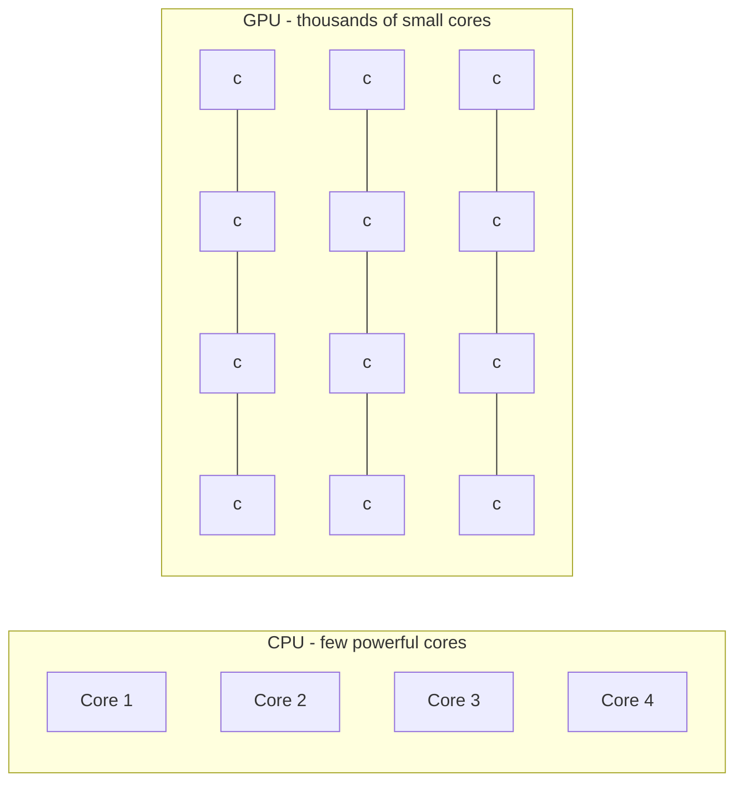
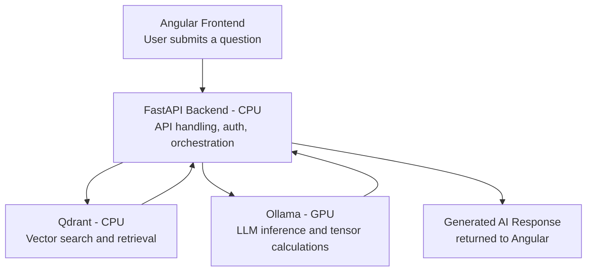

# CPU vs GPU – Complete Explanation

CPU and GPU are two important hardware components in a computer or server. Both process instructions, but they are designed for different types of workloads.

The simplest way to understand the difference:

- **CPU (Central Processing Unit):** Designed to handle a wide variety of tasks efficiently, including complex logic and sequential operations.
- **GPU (Graphics Processing Unit):** Designed to perform thousands of similar calculations simultaneously (parallel processing).

---

## 1. What is a CPU?

A CPU is the general-purpose processor and is often called the **brain of a computer**.

It executes operating system instructions, application logic, calculations, and controls other hardware components.

### Characteristics
- Usually has a smaller number of powerful processing cores.
- Each core can handle complex instructions.
- Excellent for sequential processing.
- Designed for low-latency execution.
- Handles branching, decision-making, and operating system tasks.

### Real-world examples
- Running Angular applications.
- Executing Java, Python, or Node.js backend code.
- Processing API requests.
- Running SQL queries.
- Managing Docker containers.
- Running operating systems.

---

## 2. What is a GPU?

A GPU is a specialized processor designed to execute many calculations in parallel.

Originally designed for graphics rendering, GPUs are now widely used for AI, machine learning, scientific computing, and deep learning.

### Characteristics
- Contains hundreds or thousands of smaller processing cores.
- Executes many similar operations simultaneously.
- Excellent for parallel processing.
- High memory bandwidth.
- Particularly effective for matrix and tensor calculations.

### Real-world examples
- AI model training.
- Generative AI (LLMs).
- Image and video processing.
- 3D rendering.
- Neural network computations.
- Scientific simulations.

---

## 3. CPU vs GPU – Architecture

| Feature | CPU | GPU |
| :--- | :--- | :--- |
| **Full form** | Central Processing Unit | Graphics Processing Unit |
| **Core count** | Relatively few | Hundreds or thousands |
| **Processing** | Primarily sequential, also parallel | Massively parallel |
| **Core design** | Powerful, complex cores | Smaller, simpler processing units |
| **Optimization** | Low latency | High throughput |
| **Best for** | Complex logic | Repetitive parallel calculations |
| **Memory** | Typically system RAM | Typically dedicated GPU memory (VRAM) |
| **Examples** | Intel Core, AMD Ryzen | NVIDIA RTX, AMD Radeon |

---

## 4. Real-Life Example: Restaurant

Imagine a restaurant receiving 1,000 orders.

- **CPU – Few highly skilled chefs:** One chef handles complex orders, makes decisions, and coordinates different activities.
- **GPU – Many chefs working simultaneously:** Many chefs perform similar repetitive tasks at the same time, such as chopping vegetables or preparing identical dishes.

**The analogy:**
- CPU = Complex decision-making and coordination.
- GPU = Large-scale parallel execution.

> This is simplified, but it captures the fundamental difference.

---

## 5. Why is GPU Important for Generative AI?

This is particularly important when understanding LLMs such as Llama, Phi-3, GPT, and other transformer-based models.

An LLM generating a response performs enormous numbers of mathematical operations, especially **matrix multiplications**.

### Example flow
1. User submits a prompt.
2. The prompt is converted into tokens.
3. Tokens are converted into numerical representations (embeddings).
4. Transformer layers perform matrix and tensor calculations.
5. The model predicts the next token.
6. This process repeats until the response is generated.

GPUs can perform many of these mathematical operations in parallel.

### CPU vs GPU in an AI Application

| Task | CPU | GPU |
| :--- | :--- | :--- |
| Receive user request | Excellent | Not typically needed |
| API request processing | Excellent | Not typically needed |
| Tokenization | Good | Possible |
| Matrix multiplication | Good | Excellent |
| LLM inference | Possible | Usually faster |
| Model training | Possible, slower | Excellent |

---

## 6. How CPU and GPU Work Together in a Production AI Architecture

Consider a local GenAI + RAG architecture using **Angular, FastAPI, Ollama, and Qdrant**.

In this architecture:
- **CPU** handles API requests, business logic, orchestration, and much of the retrieval work.
- **GPU** accelerates LLM inference when supported and configured.
- **Qdrant** can use CPU for vector search, although GPU acceleration is possible in some configurations.

> **Important:** You do not necessarily need a GPU to run an LLM. Ollama can run models using CPU alone, but inference may be slower.

---

## 7. When Should You Use CPU vs GPU?

| Scenario | Preferred Hardware |
| :--- | :--- |
| Angular application | CPU |
| Node.js / FastAPI backend | CPU |
| PostgreSQL database | CPU |
| Docker containers | CPU |
| Kubernetes control plane | CPU |
| Large-scale AI model training | GPU |
| LLM inference | GPU or CPU |
| Image generation | GPU |
| Video rendering | GPU |
| Vector database | Usually CPU |

---

## 8. Important Concepts to Understand Next

Three concepts are closely related to CPU and GPU:

1. **CPU cores vs threads:** How a CPU executes multiple tasks.
2. **GPU VRAM vs RAM:** Why an LLM needs sufficient GPU memory to load a model.
3. **GPU vs TPU vs NPU:** Different hardware accelerators for AI workloads.

---

## Key Takeaway

Since you're learning Docker, Kubernetes, distributed systems, and local GenAI, remember one important principle:

> **CPU is generally optimized for handling diverse application workloads, whereas GPU is optimized for accelerating massively parallel computations.**

This distinction is fundamental when designing production AI infrastructure, deciding server specifications, and deploying LLMs using Ollama.
