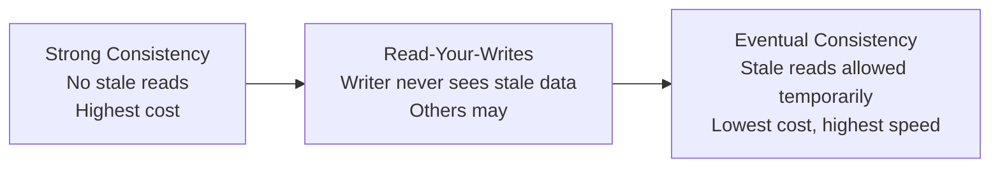
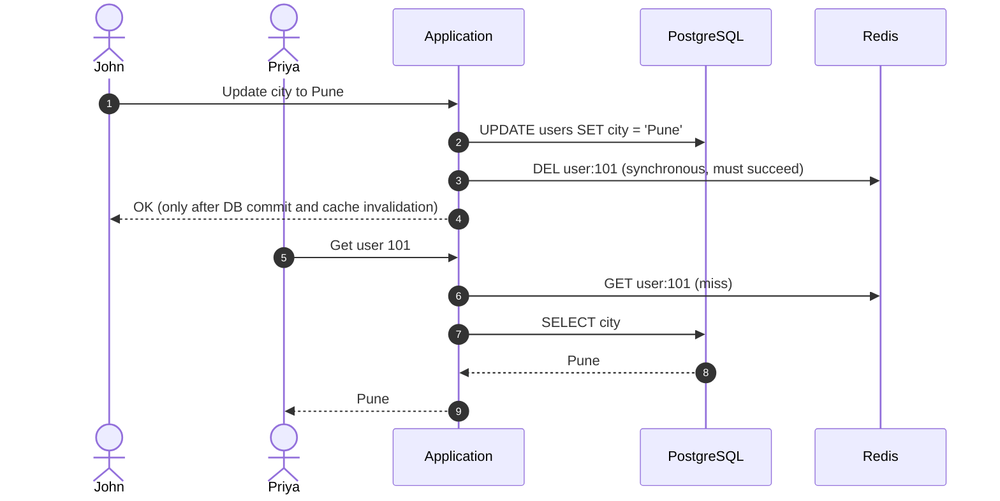
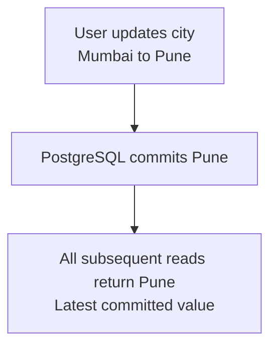
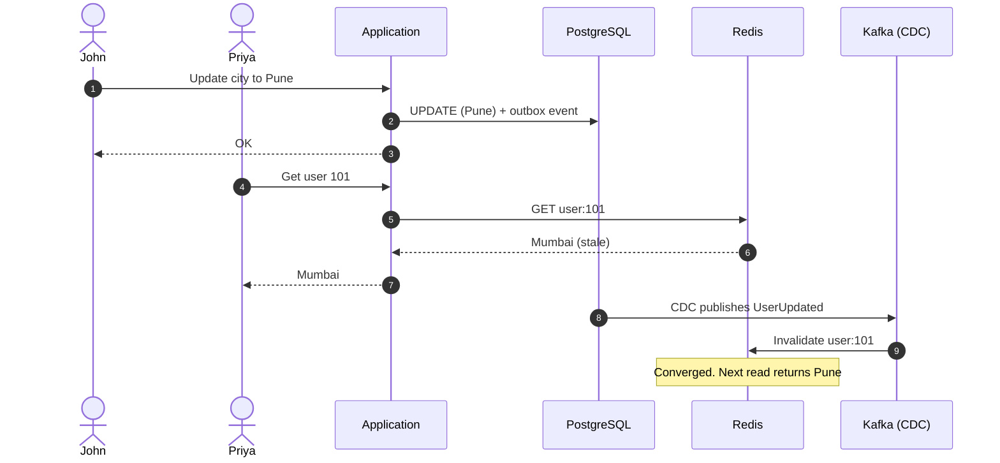
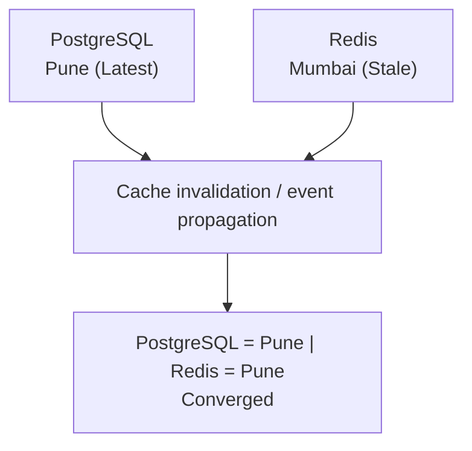
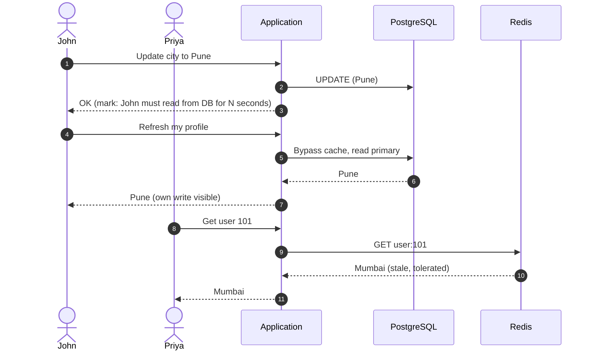
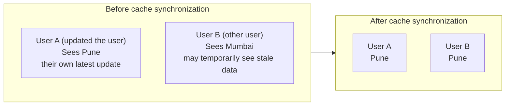
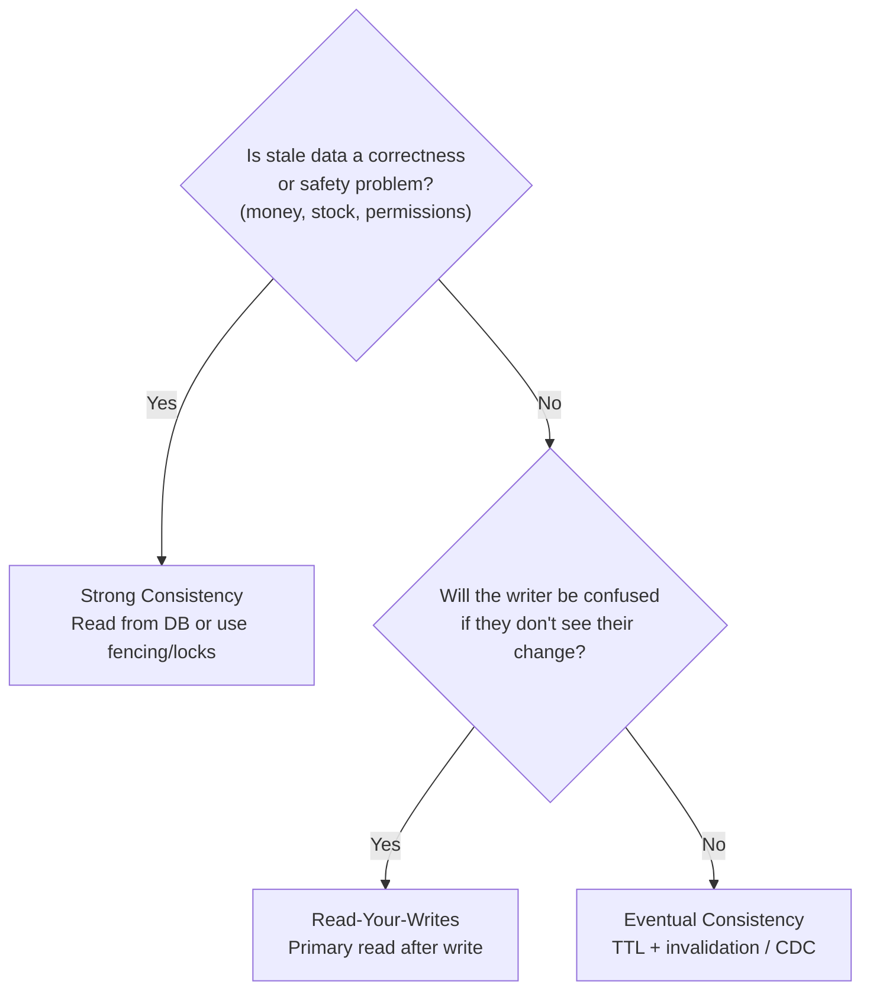
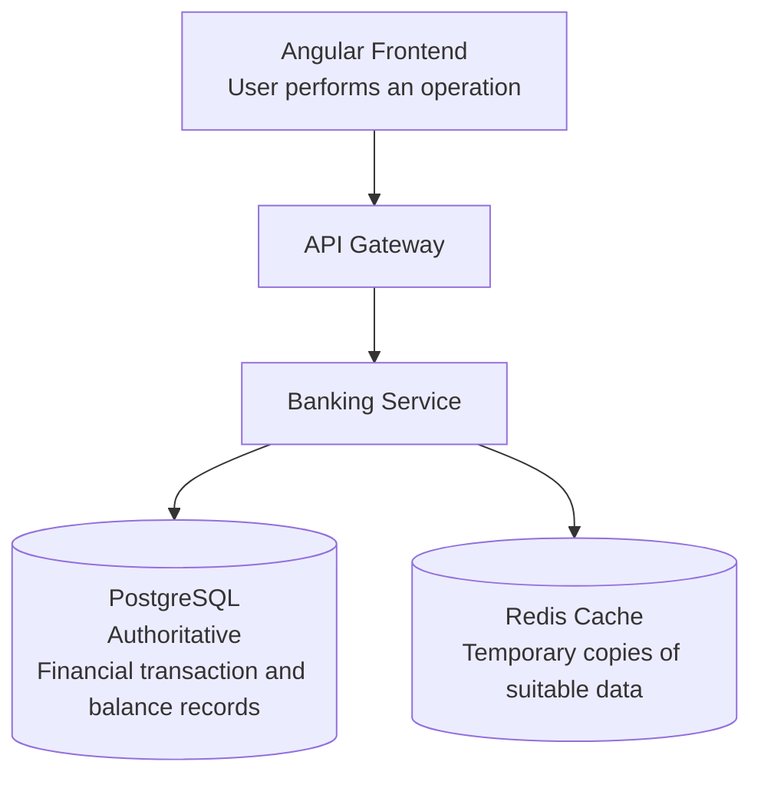

# Cache Consistency Models: Strong Consistency vs Eventual Consistency vs Read-Your-Writes Consistency

> **Core Idea:** A cache is a copy of the database. The moment you have two copies, you must decide **how much staleness the system can tolerate**. A *consistency model* is the contract that answers: *"After a write, what is a reader allowed to see, and when?"*

---

## Table of Contents
1. [Why Consistency Models Matter for Caching](#1-why-consistency-models-matter-for-caching)
2. [Running Example](#2-running-example)
3. [Strong Consistency](#3-strong-consistency)
4. [Eventual Consistency](#4-eventual-consistency)
5. [Read-Your-Writes Consistency](#5-read-your-writes-consistency)
6. [Side-by-Side Comparison](#6-side-by-side-comparison)
7. [Implementing Each Model with PostgreSQL + Redis](#7-implementing-each-model-with-postgresql--redis)
8. [How Much Staleness Can You Tolerate? (Choosing a Model)](#8-how-much-staleness-can-you-tolerate-choosing-a-model)
9. [Related Models Worth Knowing](#9-related-models-worth-knowing)
10. [Interview-Ready Summary Answer](#10-interview-ready-summary-answer)
11. [Self-Assessment Quiz](#11-self-assessment-quiz)
12. [Real-World Architecture Comparison: Online Banking](#12-real-world-architecture-comparison-online-banking)
13. [Important Interview Question](#13-important-interview-question)
14. [Remember This for Interviews](#14-remember-this-for-interviews)

---

## 1. Why Consistency Models Matter for Caching

Previous topics showed that **cache deletion is a strategy, not a complete consistency guarantee**. Even with invalidation, versioning, TTL and CDC, some window of staleness may remain.

So the real production question is not *"Can I eliminate staleness?"* but:

- **How long** can data be stale?
- **Who** is allowed to see stale data (everyone, or only other users)?
- **What does it cost** (latency, availability, complexity) to reduce it?



---

## 2. Running Example

These three models matter in distributed system design, especially when the architecture uses **PostgreSQL + Redis + multiple backend services**. The central question is:

> **After a user updates data, when should that user and other users see the updated value?**

One example is used throughout: a user changes their city from Mumbai to Pune.
- PostgreSQL stores the latest value.
- Redis stores a cached copy.
- Multiple application instances may read the data.

We reuse the same example from earlier notes:

- PostgreSQL (source of truth) holds `user:101` with `city = "Mumbai"`.
- Redis caches `user:101`.
- User **John** updates his city from `Mumbai` to `Pune`.
- John's friend **Priya** views John's profile.

We will ask: *after the write, what do John and Priya see under each model?*

---

## 3. Strong Consistency

**Latest data guaranteed.**

**Definition:** Once a write completes, **every** subsequent read, from any client, returns that write (or something newer). The system behaves as if there were a single copy of the data. Put differently: every successful read after a completed write returns the latest committed value.

### Behaviour



Both John and Priya see `Pune` immediately after the write returns.

### Strong Consistency Flow



Example: the user updates city to Pune, the database commits the update, and the next read **must** return Pune, not Mumbai.

### How It Is Achieved
- Read from the authoritative database when required.
- Avoid serving potentially stale cache entries.
- Use appropriate transaction and consistency mechanisms.
- Ensure replicas or caches do not return older data when strong consistency is required.
- Read directly from the database (bypass cache) for critical data.
- Write-through caching with synchronous, atomic updates of DB and cache.
- Distributed locks or consensus (e.g. Raft/Paxos-backed stores) so reads and writes are serialized.
- Versioning/fencing with atomic checks so stale writes are rejected.

### Trade-offs
| Pros | Cons |
| :--- | :--- |
| No stale reads, simplest mental model | Higher latency (synchronous coordination) |
| Safe for money/inventory/security data | Lower availability during failures or partitions |
| Easy to reason about correctness | Poor scalability; limits cache benefit |

> **Reality check:** A plain Cache-Aside setup with a separate Redis and PostgreSQL is **not** strongly consistent, because the DB write and cache invalidation are two separate steps and the repopulation race can still occur. True strong consistency usually means *not caching* that data, or paying the cost of coordination.

### Typical Use Cases
- Banking balance updates
- Money transfers
- Account transaction records
- Critical inventory operations
- Authorization/permission revocation
- Seat or ticket booking

For banking systems, you generally want strong correctness guarantees for financial transactions.

---

## 4. Eventual Consistency

**Definition:** If no new writes occur, all copies will **eventually** converge to the same value. In the meantime, reads may return stale data.

### Behaviour



Priya may see `Mumbai` for a short window (the **inconsistency window**). After invalidation or TTL expiry, everyone sees `Pune`.

### Eventual Consistency Flow

1. User updates city to Pune in PostgreSQL.
2. PostgreSQL commits Pune.
3. Redis still contains Mumbai.
4. An application reads Mumbai temporarily.
5. Cache invalidation or refresh happens.
6. Redis now contains Pune.



### How It Is Achieved
- Redis cache invalidation.
- TTL-based expiration.
- Transactional Outbox.
- CDC (Change Data Capture).
- Kafka events.
- Background synchronization.
- Delayed double deletion to shrink the window.
- Replica lag in read replicas and multi-region caches is also eventual consistency.

### Trade-offs
| Pros | Cons |
| :--- | :--- |
| Highest performance and cache hit ratio | Users can read stale data |
| High availability, tolerant of partitions | Hard to reason about ordering and conflicts |
| Scales horizontally across services/regions | Needs retries, idempotency and monitoring |

### Typical Use Cases
- Product catalogues
- Social media likes and counts
- User profile information
- Analytics dashboards
- Search indexes
- Recommendations

For these use cases, a small delay in synchronization is often acceptable.

> **Key metric:** the **staleness bound**, e.g. *"stale for at most 5 minutes (TTL) or typically under 1 second (CDC lag)"*.

---

## 5. Read-Your-Writes Consistency

**Definition:** After a client performs a write, **that same client** will always see its own write in subsequent reads. Other clients may still see older data temporarily.

It is a *session-level guarantee*, a middle ground that fixes the most visible user-facing bug of eventual consistency: *"I just changed it, why does the page still show the old value?"*

### Behaviour



John always sees `Pune`. Priya may briefly see `Mumbai`, which is acceptable.

### Read-Your-Writes Example (User A and User B)

Two users, User A and User B, view the same profile.
1. User A changes city from Mumbai to Pune.
2. PostgreSQL commits Pune.
3. Redis still contains Mumbai.
4. User A requests their profile again.
5. User A **must** see Pune.
6. User B **might** temporarily see Mumbai until cache synchronization completes.



> This is the key distinction from strong consistency: only the writer is guaranteed to see the update immediately.

### How It Is Achieved
1. **Read directly from the primary database after a write:** Avoid reading an older cached value for that user's subsequent request (route that user's reads to the primary DB, or skip the cache, for a short window).
2. **Update the cache synchronously:** Update or invalidate the relevant cache as part of the write workflow, with appropriate failure handling.
3. **Session-based version tracking:** Remember the version returned by a successful write (a version, timestamp or WAL LSN) and reject reads returning an older version; otherwise fall through to the primary.
4. **Read-your-writes routing:** Route subsequent reads to an authoritative source rather than a lagging replica (sticky routing to a node or replica that already has the write also works).

```python
RYW_WINDOW_SECONDS = 10

async def update_city(user_id, new_city):
    await db.update_user(user_id, new_city)
    await redis.delete(f"user:{user_id}")
    # Remember that this user just wrote
    await redis.set(f"recent_write:{user_id}", "1", ex=RYW_WINDOW_SECONDS)

async def get_own_profile(user_id):
    # Writer's reads bypass possibly stale cache during the window
    if await redis.exists(f"recent_write:{user_id}"):
        return await db.get_user(user_id)
    return await cached_get_user(user_id)
```

### Trade-offs
| Pros | Cons |
| :--- | :--- |
| Great UX: users trust their own changes | Extra routing/session logic |
| Cheaper than global strong consistency | Other users can still read stale data |
| Cache still serves most traffic | Extra primary DB load right after writes |

### Typical Use Cases
- User profile updates
- Shopping cart updates
- Changing account preferences
- Editing personal information
- Posting a comment and immediately viewing it

---

## 6. Side-by-Side Comparison

| Aspect | Strong Consistency | Read-Your-Writes | Eventual Consistency |
| :--- | :--- | :--- | :--- |
| **Writer sees own write** | Always | Always | Not guaranteed |
| **Other readers see write** | Immediately | Eventually | Eventually |
| **Stale reads possible** | No | Yes, for other users | Yes |
| **Latency** | Highest | Medium | Lowest |
| **Availability under failure** | Lowest | Medium | Highest |
| **Cache hit ratio** | Low | Medium to high | Highest |
| **Implementation complexity** | High (coordination) | Medium (session routing) | Low to medium (TTL, invalidation) |
| **Typical tools** | Direct DB reads, locks, consensus | Primary reads after write, version tokens | TTL, CDC, Kafka, async invalidation |

### Concise Feature Comparison

| Feature | Strong | Eventual | Read-your-writes |
| :--- | :--- | :--- | :--- |
| Latest data guaranteed for every read after write | Yes | No | For that user's subsequent reads |
| Other users may see stale data | No, under the guarantee | Yes | Yes |
| Temporary inconsistency | No | Yes | Possible for other users |
| Performance trade-off | Potentially higher latency | Often faster | Depends on implementation |
| Complexity | High in distributed systems | Moderate | Moderate |


---

## 7. Implementing Each Model with PostgreSQL + Redis

| Model | Write path | Read path |
| :--- | :--- | :--- |
| **Strong** | Commit to DB, then atomically invalidate/update cache with version check (Lua) or skip cache entirely | Read from DB, or read cache only after verifying its version against the DB |
| **Read-Your-Writes** | Commit to DB, delete key, record "recent write" marker or version token for the session | If the session has a recent write, read from primary; else read cache |
| **Eventual** | Commit to DB, delete key (plus TTL, optional outbox + CDC) | Read cache; on miss, load from DB and repopulate |

How this connects to the strategies from the previous note:

| Strategy | Moves you toward |
| :--- | :--- |
| Cache versioning / fencing tokens | Strong consistency (rejects stale writes) |
| Distributed lock | Strong consistency (serializes operations), at a latency cost |
| Primary read after write / session token | Read-Your-Writes |
| Delayed double deletion | Narrower eventual consistency window |
| TTL | Bounds eventual consistency staleness |
| Outbox + CDC + Kafka | Reliable eventual consistency across services |

---

## 8. How Much Staleness Can You Tolerate? (Choosing a Model)

Ask these questions per data type, not per system:



| Data | Tolerable staleness | Suggested model |
| :--- | :--- | :--- |
| Account balance, payment status | None | Strong |
| Inventory at checkout | None | Strong |
| Permission/role revocation | Seconds at most | Strong (or very short TTL + event invalidation) |
| User's own profile edits | None for the owner | Read-Your-Writes |
| Other users' view of a profile | Seconds to minutes | Eventual |
| Product descriptions, catalog | Minutes | Eventual |
| Like counts, view counts | Minutes to hours | Eventual |
| Analytics dashboards | Hours | Eventual |

> **Rule of thumb:** Default to eventual consistency with TTL and invalidation. Upgrade specific paths to read-your-writes for UX, and to strong consistency only where correctness demands it.

---

## 9. Related Models Worth Knowing

- **Monotonic Reads:** A client never sees data go backwards in time (e.g. Pune, then Mumbai on the next refresh). Prevented by sticky sessions or version-aware reads.
- **Monotonic Writes:** A client's writes are applied in the order issued.
- **Causal Consistency:** If write B depends on write A, everyone sees A before B.
- **Bounded Staleness:** Reads are at most *N* seconds or *K* versions behind (what TTL approximates).
- **Linearizability:** The formal, strongest form of strong consistency for single objects.

---

## 10. Interview-Ready Summary Answer

> **Interviewer Question:**
> *"What consistency model do you use for a Redis cache in front of PostgreSQL?"*

> **Target Response:**
> *"It depends on the data. The database is the source of truth and I use Cache-Aside by default: commit to the database first, then invalidate the cache, with a TTL as a safety net. That gives **eventual consistency** with a bounded staleness window, which is fine for most read-heavy data like catalogs or other users' profiles.*
>
> *Where users must see their own changes, I add **read-your-writes consistency**, routing a user's reads to the primary or using a session version token for a short period after they write.*
>
> *For data where staleness is unacceptable, such as payments or inventory, I either skip the cache or enforce **strong consistency** using atomic version/fencing checks or locks, accepting higher latency and lower availability. For multi-service systems I propagate invalidations with Transactional Outbox, CDC and Kafka, which is eventually consistent by design."*

### Key Distinctions
- **Strong:** everyone sees the latest write immediately.
- **Read-Your-Writes:** the writer sees their write immediately; others eventually.
- **Eventual:** everyone sees the write eventually.
- Stronger consistency means **higher latency and lower availability**; weaker consistency means **higher speed and scale**.

---

## 11. Self-Assessment Quiz

### Question 1
**Scenario:** A user edits their display name and, on page refresh, still sees the old name because the page was served from a Redis cache. Which guarantee was violated?
- [ ] A) Strong consistency for all users
- [x] B) Read-your-writes consistency
- [ ] C) Durability of the database

---

### Question 2
**Scenario:** An e-commerce site shows product like counts that may lag by a few minutes. Which model fits best?
- [ ] A) Strong consistency
- [ ] B) Linearizability across all replicas
- [x] C) Eventual consistency

---

### Question 3
**Scenario:** Why is Cache-Aside with a separate Redis and PostgreSQL not strongly consistent?
- [ ] A) Redis cannot store the same data as PostgreSQL.
- [x] B) The database write and cache invalidation are separate steps, and a concurrent slow reader can repopulate stale data after invalidation.
- [ ] C) PostgreSQL does not support transactions.

---

### Question 4
**Scenario:** Which approach most directly provides read-your-writes consistency?
- [ ] A) Increasing the Redis TTL
- [x] B) Routing a user's reads to the primary database (or checking a session version token) for a short period after they write
- [ ] C) Adding more Redis replicas

---

### Question 5
**Scenario:** Which data should NOT rely on eventually consistent cache reads?
- [ ] A) Product descriptions
- [ ] B) Like counts
- [x] C) Account balance used to authorize a payment

---

## 12. Real-World Architecture Comparison: Online Banking

Consider an online banking application.



| Banking operation | Suitable consistency |
| :--- | :--- |
| Money transfer | Strong correctness guarantees |
| Account balance after transfer | Read-your-writes, with authoritative balance reads |
| Transaction history | Read-your-writes |
| Branch information | Eventual |
| Promotional banners | Eventual |

> **Note:** Read-your-writes alone is **not sufficient** for financial correctness. A balance operation must also enforce **atomic updates** and prevent **conflicting concurrent transactions**.

---

## 13. Important Interview Question

**Question:** A user updates their profile from Mumbai to Pune. PostgreSQL contains `Pune`, but Redis still contains `Mumbai`.

The user refreshes the page. Which consistency model ensures that the user sees `Pune` immediately?

- [ ] A) Strong Consistency
- [ ] B) Eventual Consistency
- [x] C) Read-Your-Writes Consistency

**Answer: C. Read-Your-Writes Consistency.**
It ensures that the user sees their own successful update on subsequent reads. A strong consistency guarantee would also satisfy this requirement, but it is stronger than necessary.

---

## 14. Remember This for Interviews

| Model | One-line summary |
| :--- | :--- |
| **Strong** | Everyone sees the latest committed data. |
| **Eventual** | Everyone will converge to the latest data. |
| **Read-your-writes** | You see your own successful updates. |
