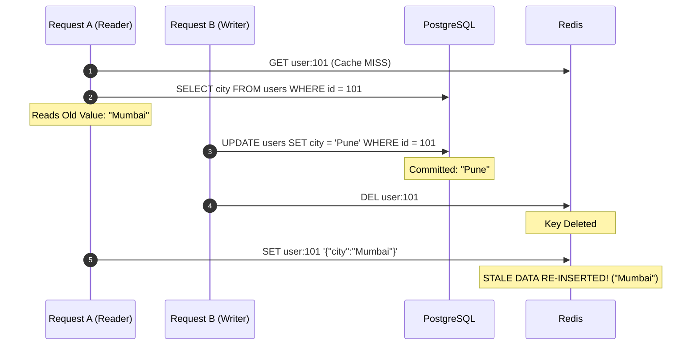
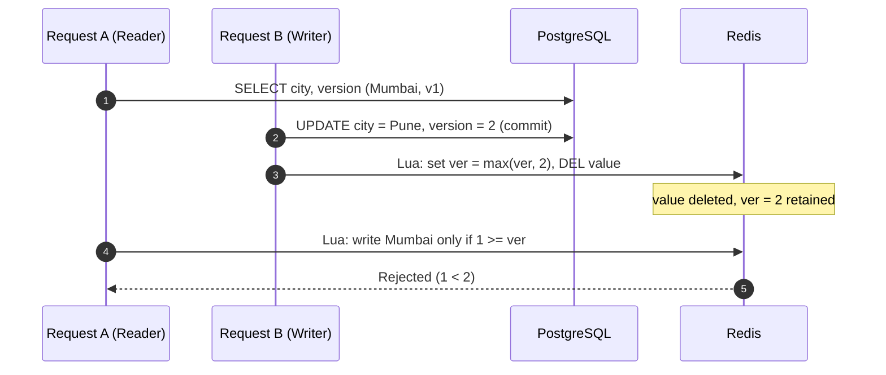
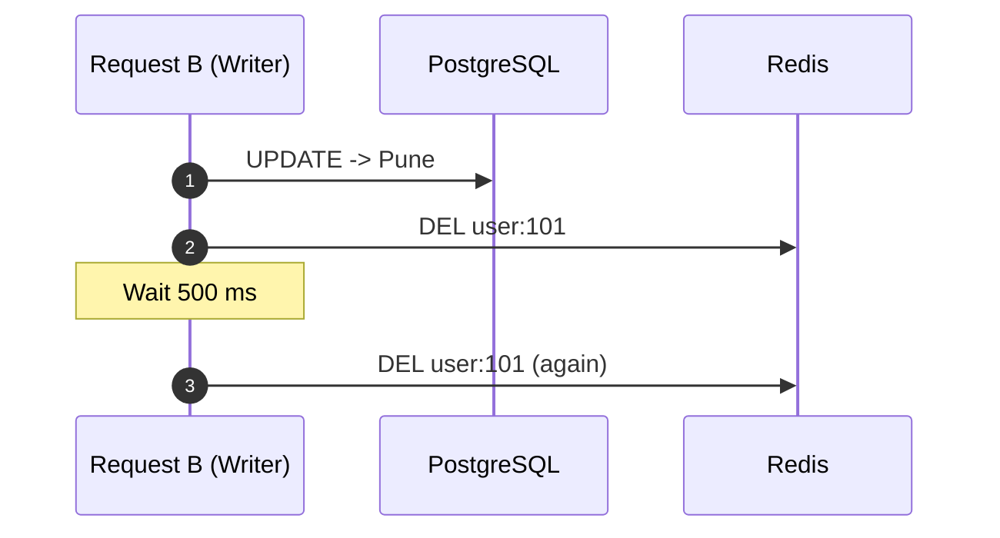
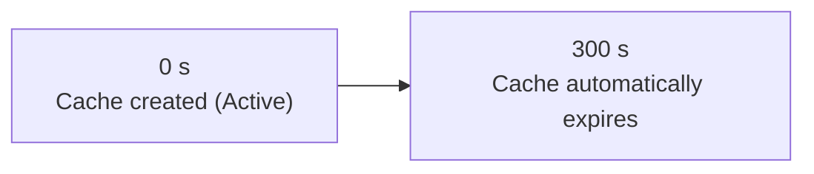
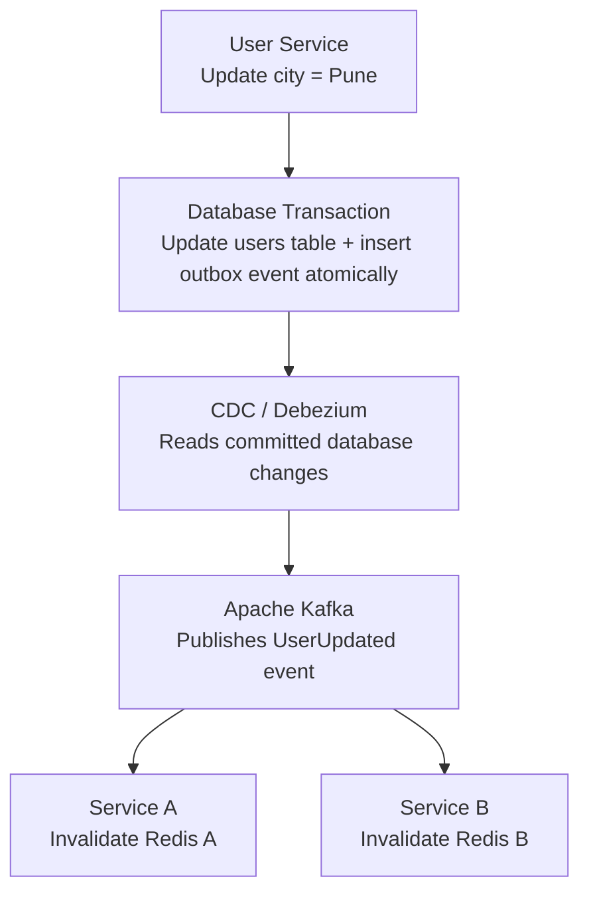
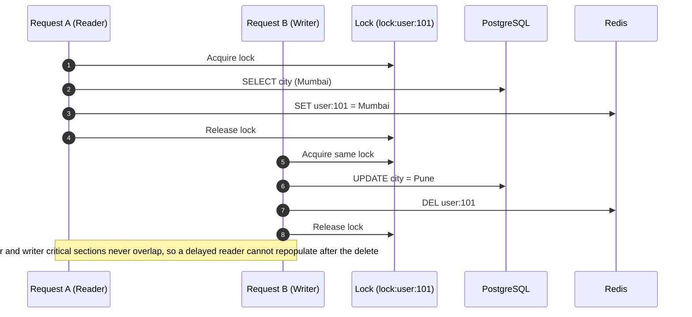
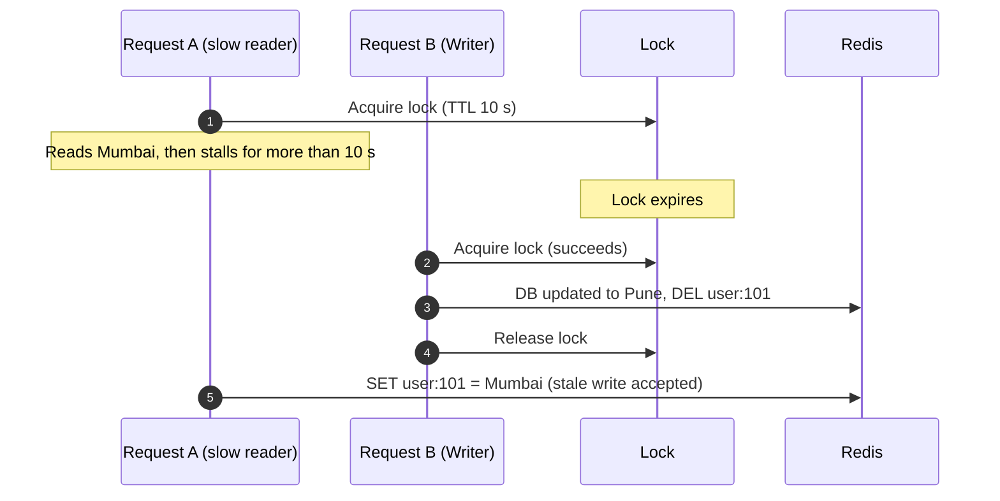
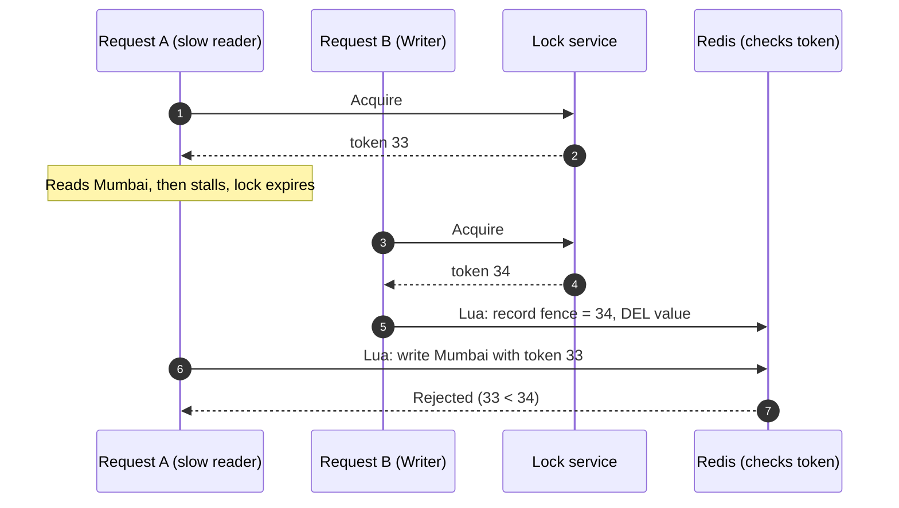
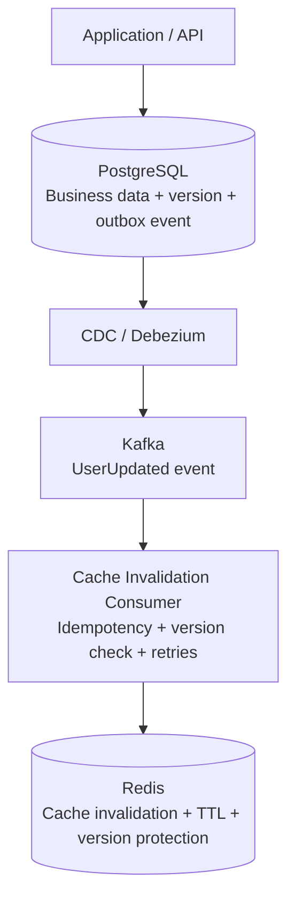
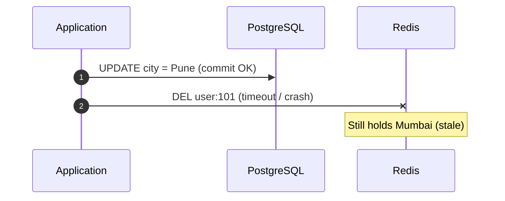

# Edge Case & Production Trap: Cache Repopulation Race Condition

> Even with cache deletion, concurrent reads and writes can trigger a rare race condition if read operations overlap with write operations.


---

## Table of Contents
1. [Race Condition Timeline](#1-race-condition-timeline)
2. [Then What Next? Protecting Redis from Stale Data](#2-then-what-next-protecting-redis-from-stale-data)
3. [Solution 1: Cache Versioning / Fencing Tokens](#3-solution-1-cache-versioning--fencing-tokens)
4. [Solution 2: Delayed Double Deletion](#4-solution-2-delayed-double-deletion)
5. [Solution 3: TTL (Time To Live)](#5-solution-3-ttl-time-to-live)
6. [Solution 4: Transactional Outbox + CDC + Kafka](#6-solution-4-transactional-outbox--cdc--kafka)
7. [Solution 5: Distributed Lock / Mutex](#7-solution-5-distributed-lock--mutex)
8. [Which Solution Should You Choose in Production?](#8-which-solution-should-you-choose-in-production)
9. [Recommended Architecture](#9-recommended-architecture)
10. [System Design Interview Takeaway](#10-system-design-interview-takeaway)

---

## 1. Race Condition Timeline



### Detailed Breakdown
1. **Request A (Read):** Queries cache (miss), reads old value (`"Mumbai"`) from the **primary** database **before Request B's update commits**, so `"Mumbai"` was still the correct committed value at that moment. Before it writes back to Redis, context switching or network lag delays Request A.
2. **Request B (Write):** Updates DB to `"Pune"`.
3. **Request B (Write):** Deletes Redis key `user:101`.
4. **Request A (Read):** Finally executes its delayed write to Redis, setting the old value (`"Mumbai"`).

> **Outcome:** Redis holds `"Mumbai"` while PostgreSQL holds `"Pune"` until the key expires or is deleted again.
>
> **Problem:** Stale cache recreated. Cache deletion alone does not guarantee consistency when concurrent read and write operations overlap.

---

## 2. Then What Next? Protecting Redis from Stale Data

After discovering the cache repopulation race condition, the next step is to **protect Redis from accepting stale data**.

In production systems, we use additional consistency strategies. The important thing is to understand **which strategy solves which problem**.

Continuing with the same example:
- PostgreSQL initially contains `Mumbai`.
- Request A reads `Mumbai`.
- Request B updates PostgreSQL to `Pune`.
- Request B deletes the Redis key.
- Request A tries to write `Mumbai` back into Redis.

**Goal:** Prevent Request A from inserting old data after Request B has updated the database.


---

## 3. Solution 1: Cache Versioning / Fencing Tokens

*Strong protection against stale writes, but only if the version survives cache invalidation.*

The idea: every cache write carries a version, and Redis **rejects any cache write whose version is older than the latest version it knows about**.

### The Trap: Where Does Redis Get the Latest Version From?

A naive design stores the version *inside* the cached value:

```json
{ "city": "Mumbai", "version": 1 }
```

Now replay the race:
1. Request A reads `Mumbai`, version 1.
2. Request B updates PostgreSQL to `Pune`, version 2.
3. Request B **deletes the Redis key**, and the version stored inside it is deleted too.
4. Request A attempts to insert `Mumbai`, version 1.
5. Redis has **nothing to compare against**, so the stale write is accepted.

> **Rule:** Deleting the cached *value* must not also destroy the *version information* needed to reject stale writes.

### The Correction: Keep Version Metadata Separate From the Cached Value

Maintain a **durable, monotonically increasing version (generation) number separately from the cached value**:

| Redis key | Holds | Lifecycle |
| :--- | :--- | :--- |
| `{user:101}:value` | Cached payload, e.g. `{"city":"Pune"}` | Deleted on invalidation, has a TTL |
| `{user:101}:ver` | Latest known version, e.g. `2` | **Survives value deletion**, never shortened by the value's TTL |

```
REDIS VERSION METADATA
  Current version ............ 2

REQUEST A ATTEMPTS CACHE WRITE
  Request A version .......... 1
  Redis current version ...... 2

  => Write rejected: 1 is older than 2
```

### Corrected Execution
1. Request A reads `Mumbai` **and its version (1) from PostgreSQL in the same query**.
2. Request B updates PostgreSQL to `Pune`; the row's version becomes 2 (incremented in the same transaction).
3. After commit, Request B runs an atomic script that **advances `{user:101}:ver` to 2 and deletes `{user:101}:value`**. The version key is kept.
4. Request A attempts to write `Mumbai` with version 1 through an atomic script.
5. The script sees `1 < 2` and **rejects** the write. The next reader loads `Pune` (version 2) from the DB and caches it.



### Atomic Redis Lua Scripts

The compare and the write must happen in **one atomic compare-and-set step** (read the stored version, compare it with the incoming one, and write only if valid); otherwise another writer can slip in between the check and the `SET`. Redis executes a Lua script atomically. The version key is the durable metadata described above: it is never deleted with the cached value and carries no TTL.

Both keys share the hash tag `{user:101}` so they land in the same slot when using Redis Cluster (multi-key scripts require this).

**Guarded cache write (reader):**
```lua
-- KEYS[1] = {user:101}:value   KEYS[2] = {user:101}:ver
-- ARGV[1] = incoming version   ARGV[2] = payload   ARGV[3] = value TTL (seconds)
local current  = tonumber(redis.call('GET', KEYS[2]) or '0')
local incoming = tonumber(ARGV[1])

if incoming < current then
  return 0                                   -- stale write rejected
end

redis.call('SET', KEYS[2], incoming)         -- version key: no TTL
redis.call('SET', KEYS[1], ARGV[2], 'EX', tonumber(ARGV[3]))
return 1
```

**Invalidate + advance version (writer):**
```lua
-- KEYS[1] = {user:101}:value   KEYS[2] = {user:101}:ver
-- ARGV[1] = new version committed in PostgreSQL
local current  = tonumber(redis.call('GET', KEYS[2]) or '0')
local incoming = tonumber(ARGV[1])

if incoming > current then
  redis.call('SET', KEYS[2], incoming)       -- never move the version backwards
end

redis.call('DEL', KEYS[1])                   -- delete the value, keep the version
return 1
```

### Additional Requirements

- **Reliable, monotonic version source:** The version must come from a source that only moves forward, such as a PostgreSQL `version` column incremented in the same transaction as the update, a sequence, or a log position (LSN). Do not use per-server clocks or per-instance counters.
- **Version metadata must outlive the cached value:** It must survive value deletion and must not vanish prematurely through TTL. Give it no TTL, or a TTL much longer than the value's TTL *and* the longest possible reader delay. If the version key is evicted (for example by `maxmemory` eviction, a restart without persistence, or a failover that loses recent writes), Redis falls back to `0` and stale writes are accepted again. Protect it with a no-eviction policy or a separate Redis instance and persistence.
- **Coordinate invalidation with version advancement:** Delete the value and advance the version in the **same atomic script**, after the database commit. Doing them as two separate commands reopens a window.
- **Handle concurrent updates and out-of-order events:** Use `max` semantics (only advance when `incoming > current`) so a late invalidation for version 2 can never lower a version already advanced to 3. Deleting the value for an old event is harmless. Make consumers idempotent.
- **Read the data and its version together:** Load the value and its version in one DB query or snapshot, so the version describes exactly the data being cached.

### Fencing Token vs Plain Version Field

A **fencing token is not simply a version field.** It is a **monotonically increasing token issued with each operation or lock acquisition**, used to stop an older lock holder or older operation from modifying protected state after a newer one has taken over. The protected resource remembers the highest token it has seen and **rejects anything lower**.

| | Plain version inside the value | Fencing token |
| :--- | :--- | :--- |
| Where it lives | Inside the cached payload | In state that outlives the payload |
| Issued by | Whoever builds the value | A monotonic authority (DB sequence/version, lock service) |
| Enforcement | Often just informational | The resource itself rejects lower tokens |

In this design the PostgreSQL-assigned version acts as the fencing token and Redis, through the Lua script, is the resource that rejects lower tokens. For background on why fencing tokens matter with distributed locks, see the [Redis distributed locks pattern](https://github.com/redis/redis-doc/blob/master/docs/manual/patterns/distributed-locks.md).

> **Important:** The version check and cache write must be **atomic**, and the version must be stored and advanced **independently of the cached value**. Deleting the key and then checking its (now missing) version is insufficient.

---

## 4. Solution 2: Delayed Double Deletion

Another technique used to *reduce* the race condition: delete the cache **twice** instead of once.

### Execution
1. Update PostgreSQL to `Pune`.
2. Delete Redis key.
3. Wait for a short interval (e.g. 500 ms).
4. Delete the Redis key again.



**Purpose:** Catch and remove stale data that an overlapping reader may have repopulated.

### How to Choose the Second-Deletion Delay

The delay must be **longer than the time a slow reader needs to finish its read-then-write cycle**: the time from "reader queried PostgreSQL" to "reader's `SET` reaches Redis". If the second `DEL` runs before that delayed `SET`, it removes nothing and the stale value survives.

A practical way to pick it:
1. **Measure** the reader path: DB read latency + application processing + Redis write latency, and look at high percentiles (p99 / p99.9), not the average.
2. **Add replica lag** if readers can hit a read replica, because a replica may still return the old value for that long after the commit.
3. **Add a safety margin**, for example `delay ≈ p99 read-to-cache-write time + replica lag + margin`.
4. **Re-evaluate under load**: GC pauses, retries and slow queries stretch the tail, so the delay that works at 10 req/s may not work at 10,000 req/s.

| Delay | Effect |
| :--- | :--- |
| Too short | Second delete runs before the slow reader writes, so stale data survives |
| Too long | Stale data stays visible longer, and the writer holds resources or a scheduled task for longer |

Run the second delete **asynchronously** (a scheduled task, delayed queue or message) instead of sleeping inside the request, and make it retryable so a lost task does not skip the second delete. Even then the delay is an estimate, which is why this remains a mitigation rather than a guarantee.

### Example
Illustrative code: it assumes `db` and `redis` are already configured async clients.
```python
import asyncio


async def update_user(user_id, new_city):
    # 1. Update database
    await db.update_user(user_id, new_city)

    # 2. First deletion
    await redis.delete(f"user:{user_id}")

    # 3. Wait briefly
    await asyncio.sleep(0.5)

    # 4. Second deletion
    await redis.delete(f"user:{user_id}")
```

> **Limitation:** This is a **mitigation, not a mathematical guarantee**. If a slow reader writes stale data after the second deletion, the race can still occur.

---

## 5. Solution 3: TTL (Time To Live)

TTL means automatically expiring a cache entry after a specified duration.

```python
redis.set(
    "user:101",
    '{"city":"Pune"}',
    ex=300
)
```

Here, `300` means 300 seconds (5 minutes).



> **Limitation:** TTL limits *how long* stale data can remain, but users can still receive stale data before expiration.

### TTL Does Not Fix Repeated Stale Repopulation

TTL starts counting from the moment the entry is written. If a stale value is written, it lives for the full TTL. If the race repeats, each stale repopulation **restarts the clock**, so staleness can be extended well beyond a single TTL window:

1. Stale `Mumbai` is cached at t = 0 with a 300 s TTL.
2. At t = 290 s the entry is about to expire, but another slow reader repopulates `Mumbai` again.
3. The TTL resets, so `Mumbai` can now survive until t = 590 s.

A hot key that is repeatedly invalidated and reloaded concurrently can stay stale for much longer than the nominal TTL. Choose TTLs based on how stale the business can tolerate, treat TTL as a **safety net rather than the primary protection**, and combine it with versioning/fencing or other write-side protection.

---

## 6. Solution 4: Transactional Outbox + CDC + Kafka

*Useful for enterprise distributed systems.*

Imagine multiple services use the same user information and maintain their own Redis caches. Manually invalidating every cache becomes difficult. A common approach is **event-driven invalidation**.



The **transactional outbox** ensures the database update and event record are committed together. **CDC** publishes the event, and consumers invalidate their caches.

> **Limitation:** Event delivery and processing are generally asynchronous. Consumers need retries, idempotency and monitoring. This provides *eventual propagation*, not instantaneous consistency.

### Operational Concerns: Lag, Duplicates and Ordering

| Concern | What happens | Mitigation |
| :--- | :--- | :--- |
| **Consumer lag** | Events wait in Kafka while the consumer is slow, restarting or rebalancing. Caches keep serving stale data until the invalidation is processed. | Monitor consumer lag per partition, alert on thresholds, scale consumers, and keep a TTL as a safety net. |
| **Duplicate events** | Delivery is typically at-least-once, so the same `UserUpdated` event can arrive more than once (retries, rebalances, CDC restarts). | Make invalidation **idempotent**. Deleting a key twice is harmless; deduplicate by event ID or version where handlers have side effects. |
| **Out-of-order events** | Events for different partitions or after retries can arrive out of sequence (version 3 processed before version 2). | Key events by entity ID so one entity stays in one partition (preserves per-key order), carry a version number, and ignore or safely handle events older than what has been applied (see the `max` rule in Solution 1). |

Another subtle point: an invalidation consumer deletes the key *after* the commit, so a slow reader can still repopulate a stale value just after the consumer runs. CDC narrows the problem but does not remove the need for versioning/fencing or a TTL.

---

## 7. Solution 5: Distributed Lock / Mutex

*Coordinate readers and writers so their critical sections cannot overlap.*

### The Locking Protocol Must Be Shared

A lock only helps if **both readers and writers follow the same protocol on the same lock key** (for example `lock:user:101`). If only the reader locks, or the writer ignores the lock, the race is still possible. Saying "Request A takes a lock" and "Request B coordinates with it" is not enough; the exact sequence matters.

**Reader (cache miss path)**
1. Acquire the lock for `user:101`.
2. Read the value from PostgreSQL.
3. Populate Redis.
4. Release the lock.

**Writer**
5. Acquire the **same** lock for `user:101`.
6. Update PostgreSQL.
7. Invalidate (delete) the Redis key.
8. Release the lock.



If Request B arrives while Request A holds the lock, B waits (or retries) until A releases it. A's stale `SET` therefore always happens **before** B's `DEL`, and the delete removes it.

### The Hidden Problem: Lock Expiry

Distributed locks must have an expiry (TTL), otherwise a crashed client would hold the lock forever. But expiry breaks the guarantee when a client is slow:

1. Request A acquires the lock with a 10 s TTL and reads `Mumbai` from PostgreSQL.
2. Request A stalls (GC pause, network lag, CPU starvation) for longer than 10 s.
3. The lock **expires**. Request B acquires it, updates PostgreSQL to `Pune`, deletes the Redis key and releases it.
4. Request A wakes up, still believing it holds the lock, and writes `Mumbai` into Redis.

Result: the stale value is back in the cache, and **the lock gave no protection**. The client cannot reliably detect this itself, because a pause can happen right after its last "do I still hold the lock?" check.



### Fix: Fencing Tokens

Have the lock service issue a **monotonically increasing fencing token** with every successful acquisition, and make the **protected resource enforce it**, rejecting any operation that carries a token lower than one it has already seen.

| Event | Token |
| :--- | :--- |
| Request A acquires lock | 33 |
| Lock expires, Request B acquires lock | 34 |
| Request B invalidates Redis, resource remembers highest token | 34 |
| Request A's delayed write arrives with token 33 | **Rejected (33 < 34)** |



The enforcement uses the same pattern as Solution 1: a fence key stored **separately from the cached value** and an **atomic Lua script** that compares tokens and writes only when the token is not older. Here the token comes from the lock acquisition instead of the database row version.

```lua
-- KEYS[1] = {user:101}:value   KEYS[2] = {user:101}:fence
-- ARGV[1] = fencing token      ARGV[2] = payload   ARGV[3] = value TTL (seconds)
local fence = tonumber(redis.call('GET', KEYS[2]) or '0')
local token = tonumber(ARGV[1])

if token < fence then
  return 0                                    -- stale lock holder rejected
end

redis.call('SET', KEYS[2], token)             -- fence key: no TTL
redis.call('SET', KEYS[1], ARGV[2], 'EX', tonumber(ARGV[3]))
return 1
```

Important details:
- **The token must be monotonic.** A random lock value (the usual `SET lock <random> NX PX ...` pattern) proves ownership but does **not** give ordering. You need a counter or sequence issued at acquisition, or a lock service that provides one. Do not assume a lock implementation issues fencing tokens; verify it.
- **The resource must enforce the token.** Checking the token only in the client is useless, because the client is exactly the thing that may be paused. Enforce it in the Redis script, and for the database write path also in PostgreSQL (for example `UPDATE ... WHERE fence < :token`).
- **Release safely.** Release the lock only if you still own it (compare the stored owner value, then delete, atomically), so an expired holder cannot release a newer holder's lock.
- **Keep the fence key.** As in Solution 1, it must outlive the cached value and must not be evicted or expire early.

For background on why fencing tokens matter, see the [Redis distributed locks pattern](https://github.com/redis/redis-doc/blob/master/docs/manual/patterns/distributed-locks.md).

### Other Costs of Distributed Locks

- **Deadlock / stuck locks:** a crashed holder blocks others until the TTL expires.
- **Availability:** if the lock service is down or partitioned, reads on cache misses and writes may block or fail.
- **Latency and contention:** every cache miss and every write pays an extra round trip, and hot keys serialize.
- **Complexity:** timeouts, retries, safe release, and token enforcement must all be implemented correctly.

> **Recommendation:** Do **not** make distributed locks the default solution for cache invalidation. Prefer TTL, invalidation after commit, and versioning/fencing first, and use locks **selectively** where coordination is genuinely necessary (for example, protecting an expensive cache rebuild or a critical read-modify-write), and then always together with fencing tokens.

---

## 8. Which Solution Should You Choose in Production?

| Strategy | Primary purpose | Limitation |
| :--- | :--- | :--- |
| **Cache versioning / fencing** | Reject stale writes | Requires atomic checks and durable version metadata that outlives value deletion |
| **Delayed double deletion** | Catch stale repopulation | Timing-dependent |
| **TTL** | Limit stale-data lifetime | Doesn't prevent stale reads |
| **Outbox + CDC + Kafka** | Distributed cache invalidation | Eventual consistency |
| **Distributed lock** | Coordinate concurrent operations | Readers and writers must share the protocol; lock expiry needs fencing tokens; added complexity and latency |

---

## 9. Recommended Architecture

For a typical enterprise application using PostgreSQL + Redis:

1. **Database is the source of truth.** Always commit the database transaction first.
2. **Invalidate the cache.** Delete affected Redis keys after successful commit.
3. **Use TTL.** Set a reasonable expiration as a safety net.
4. **Protect against stale repopulation.** Use atomic versioning/fencing when stronger protection is required.
5. **Use Transactional Outbox + CDC for distributed systems.** Propagate invalidation events reliably to multiple services.

### Production Architecture Diagram



How the pieces fit together:
- **Application / API:** writes business data, increments the row version and inserts the outbox event in **one PostgreSQL transaction**.
- **CDC / Debezium:** reads the committed changes and publishes them, so the event exists only if the transaction committed.
- **Kafka:** carries the `UserUpdated` event to every interested service.
- **Cache invalidation consumer:** applies the event idempotently, checks the version so older or duplicate events are ignored, and retries on failure.
- **Redis:** the consumer invalidates the value and advances the version metadata atomically (Solution 1), and every cached value still carries a TTL as a safety net.

> **Important:** This is an **asynchronous invalidation architecture**, not a strict strong-consistency guarantee. There is still a window between the database commit and the consumer processing the event (consumer lag, retries), during which Redis can serve stale data. Stronger read guarantees, such as read-your-writes or strong consistency, require additional coordination, for example reading from the primary for the writer's own reads or skipping the cache for critical data. See the *Cache Consistency Models* note.

### Failure Scenario: DB Commit Succeeds, Redis Invalidation Fails

Step 2 is not guaranteed to succeed. After PostgreSQL commits `Pune`, the `DEL user:101` call can fail (Redis timeout, network partition, failover, or the application crashing between the commit and the delete). Redis still holds `Mumbai`, and nothing tells it to drop that value.



The database transaction cannot be rolled back, because it has already committed. A direct `DEL` in application code is therefore **not reliable on its own**. Defences, from simplest to strongest:

| Defence | How it helps |
| :--- | :--- |
| **Retry with backoff** | Retry the `DEL` a few times; handles transient failures only |
| **TTL safety net** | Bounds how long the stale value can live even if every retry fails |
| **Transactional Outbox + CDC** | The invalidation intent is committed in the same DB transaction as the update, so it survives an application crash and is delivered (and retried) by the consumer |
| **Versioning / fencing** | A later cache write or read can detect that the cached version is older than the database version |
| **Alerting on failed invalidations** | Makes silent staleness visible (dead-letter queue, error metrics) |

> **Takeaway:** Treat cache invalidation as something that can fail. Make it retryable and durable (outbox), and keep a TTL as the last line of defence.

---

## 10. System Design Interview Takeaway

Remember these distinctions:
- **Cache invalidation** solves the problem of outdated cached entries.
- **Versioning/fencing** prevents older writes from overwriting newer versions.
- **TTL** limits the lifetime of stale entries.
- **CDC + Kafka** distributes cache invalidation across services.
- **Distributed locks** coordinate concurrent operations.

> **The most important lesson:** Cache deletion is a strategy, not a complete consistency guarantee.

**Next topic to study:** Cache Consistency Models — Strong Consistency vs Eventual Consistency vs Read-Your-Writes Consistency. These concepts explain exactly how much stale data a production system can tolerate.
