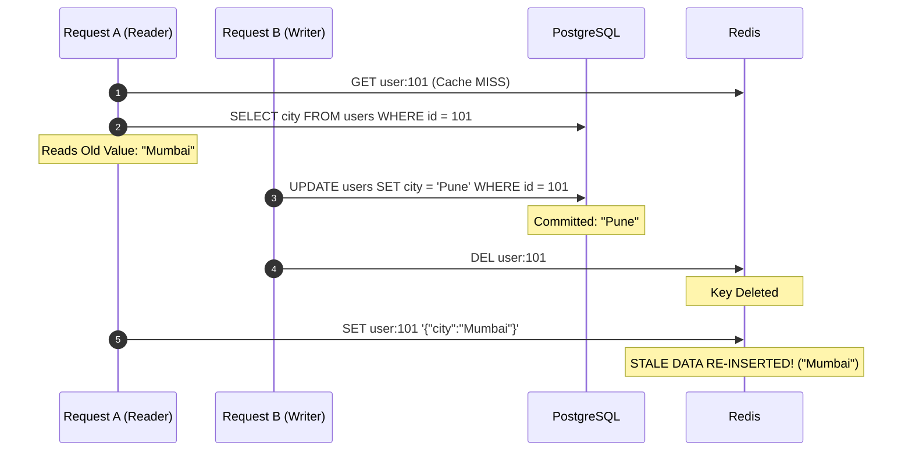
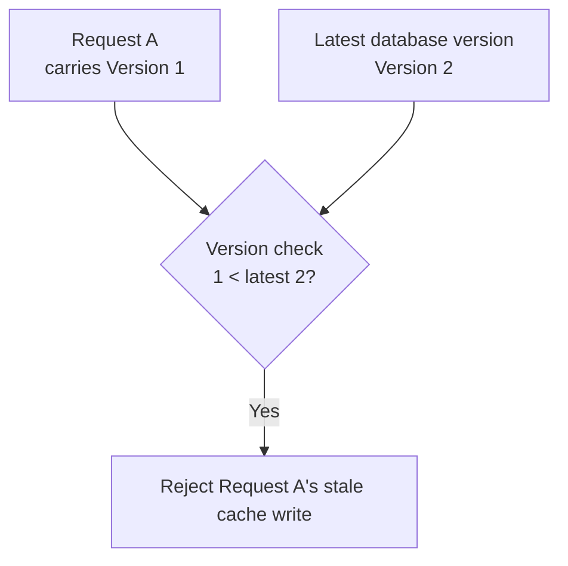
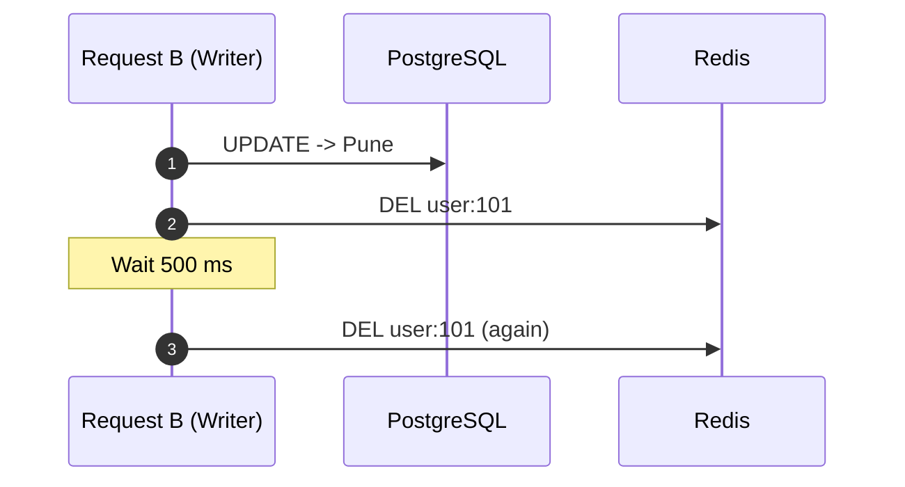
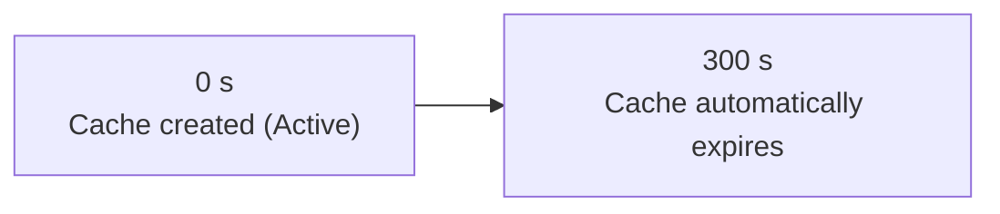
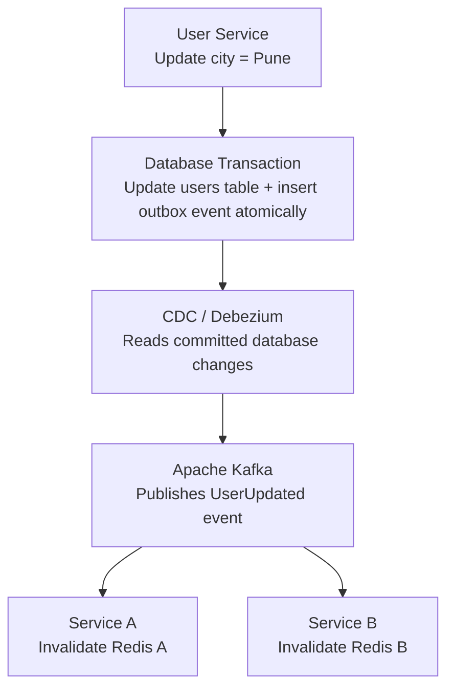

# Edge Case & Production Trap: Cache Repopulation Race Condition

> Even with cache deletion, concurrent reads and writes can trigger a rare race condition if read operations overlap with write operations.


---

## Table of Contents
1. [Race Condition Timeline](#1-race-condition-timeline)
2. [Then What Next? Protecting Redis from Stale Data](#2-then-what-next-protecting-redis-from-stale-data)
3. [Solution 1: Cache Versioning / Fencing Tokens](#3-solution-1-cache-versioning--fencing-tokens)
4. [Solution 2: Delayed Double Deletion](#4-solution-2-delayed-double-deletion)
5. [Solution 3: TTL (Time To Live)](#5-solution-3-ttl-time-to-live)
6. [Solution 4: Transactional Outbox + CDC + Kafka](#6-solution-4-transactional-outbox--cdc--kafka)
7. [Solution 5: Distributed Lock / Mutex](#7-solution-5-distributed-lock--mutex)
8. [Which Solution Should You Choose in Production?](#8-which-solution-should-you-choose-in-production)
9. [Recommended Architecture](#9-recommended-architecture)
10. [System Design Interview Takeaway](#10-system-design-interview-takeaway)

---

## 1. Race Condition Timeline



### Detailed Breakdown
1. **Request A (Read):** Queries cache (miss), reads old value (`"Mumbai"`) from DB. Before it writes back to Redis, context switching or network lag delays Request A.
2. **Request B (Write):** Updates DB to `"Pune"`.
3. **Request B (Write):** Deletes Redis key `user:101`.
4. **Request A (Read):** Finally executes its delayed write to Redis, setting the old value (`"Mumbai"`).

> **Outcome:** Redis holds `"Mumbai"` while PostgreSQL holds `"Pune"` until the key expires or is deleted again.
>
> **Problem:** Stale cache recreated. Cache deletion alone does not guarantee consistency when concurrent read and write operations overlap.

---

## 2. Then What Next? Protecting Redis from Stale Data

After discovering the cache repopulation race condition, the next step is to **protect Redis from accepting stale data**.

In production systems, we use additional consistency strategies. The important thing is to understand **which strategy solves which problem**.

Continuing with the same example:
- PostgreSQL initially contains `Mumbai`.
- Request A reads `Mumbai`.
- Request B updates PostgreSQL to `Pune`.
- Request B deletes the Redis key.
- Request A tries to write `Mumbai` back into Redis.

**Goal:** Prevent Request A from inserting old data after Request B has updated the database.


---

## 3. Solution 1: Cache Versioning / Fencing Tokens

*Strong protection against stale writes.*

Instead of storing only the user data in Redis, store a **version number** too.

Initially:
```json
{
  "city": "Mumbai",
  "version": 1
}
```

When Request B updates the database:
```json
{
  "city": "Pune",
  "version": 2
}
```

Redis must now **reject any cache write carrying an older version**.

### Execution
1. Request A reads `Mumbai`, version 1.
2. Request B updates PostgreSQL to `Pune`, version 2.
3. Request B invalidates Redis and advances the cache version / fencing token.
4. Request A attempts to write `Mumbai`, version 1.
5. Redis **rejects** the stale write because version 1 is older than version 2.



> **Important:** The version check and cache write must be **atomic** (for example, using a Redis Lua script). The version itself must also be maintained safely; simply deleting the cache key and then checking its version is insufficient.

---

## 4. Solution 2: Delayed Double Deletion

Another technique used to *reduce* the race condition: delete the cache **twice** instead of once.

### Execution
1. Update PostgreSQL to `Pune`.
2. Delete Redis key.
3. Wait for a short interval (e.g. 500 ms).
4. Delete the Redis key again.



**Purpose:** Catch and remove stale data that an overlapping reader may have repopulated.

### Example
```python
async def update_user(user_id, new_city):
    # 1. Update database
    await db.update_user(user_id, new_city)

    # 2. First deletion
    await redis.delete(f"user:{user_id}")

    # 3. Wait briefly
    await asyncio.sleep(0.5)

    # 4. Second deletion
    await redis.delete(f"user:{user_id}")
```

> **Limitation:** This is a **mitigation, not a mathematical guarantee**. If a slow reader writes stale data after the second deletion, the race can still occur.

---

## 5. Solution 3: TTL (Time To Live)

TTL means automatically expiring a cache entry after a specified duration.

```python
redis.set(
    "user:101",
    '{"city":"Pune"}',
    ex=300
)
```

Here, `300` means 300 seconds (5 minutes).



> **Limitation:** TTL limits *how long* stale data can remain, but users can still receive stale data before expiration.

---

## 6. Solution 4: Transactional Outbox + CDC + Kafka

*Useful for enterprise distributed systems.*

Imagine multiple services use the same user information and maintain their own Redis caches. Manually invalidating every cache becomes difficult. A common approach is **event-driven invalidation**.



The **transactional outbox** ensures the database update and event record are committed together. **CDC** publishes the event, and consumers invalidate their caches.

> **Limitation:** Event delivery and processing are generally asynchronous. Consumers need retries, idempotency and monitoring. This provides *eventual propagation*, not instantaneous consistency.

---

## 7. Solution 5: Distributed Lock / Mutex

Coordinate readers and writers using a lock.

- Request A acquires a lock before loading data into Redis.
- Request B must coordinate with that lock before updating the database and invalidating the cache.
- The system controls which operation can proceed.

This can prevent certain overlapping operations, but introduces **lock expiry, deadlock, availability and performance** concerns.

> Use it selectively rather than automatically adding distributed locks to every cache operation.

---

## 8. Which Solution Should You Choose in Production?

| Strategy | Primary purpose | Limitation |
| :--- | :--- | :--- |
| **Cache versioning / fencing** | Reject stale writes | Requires atomic version checks |
| **Delayed double deletion** | Catch stale repopulation | Timing-dependent |
| **TTL** | Limit stale-data lifetime | Doesn't prevent stale reads |
| **Outbox + CDC + Kafka** | Distributed cache invalidation | Eventual consistency |
| **Distributed lock** | Coordinate concurrent operations | Added complexity and latency |

---

## 9. Recommended Architecture

For a typical enterprise application using PostgreSQL + Redis:

1. **Database is the source of truth.** Always commit the database transaction first.
2. **Invalidate the cache.** Delete affected Redis keys after successful commit.
3. **Use TTL.** Set a reasonable expiration as a safety net.
4. **Protect against stale repopulation.** Use atomic versioning/fencing when stronger protection is required.
5. **Use Transactional Outbox + CDC for distributed systems.** Propagate invalidation events reliably to multiple services.

---

## 10. System Design Interview Takeaway

Remember these distinctions:
- **Cache invalidation** solves the problem of outdated cached entries.
- **Versioning/fencing** prevents older writes from overwriting newer versions.
- **TTL** limits the lifetime of stale entries.
- **CDC + Kafka** distributes cache invalidation across services.
- **Distributed locks** coordinate concurrent operations.

> **The most important lesson:** Cache deletion is a strategy, not a complete consistency guarantee.

**Next topic to study:** Cache Consistency Models — Strong Consistency vs Eventual Consistency vs Read-Your-Writes Consistency. These concepts explain exactly how much stale data a production system can tolerate.
