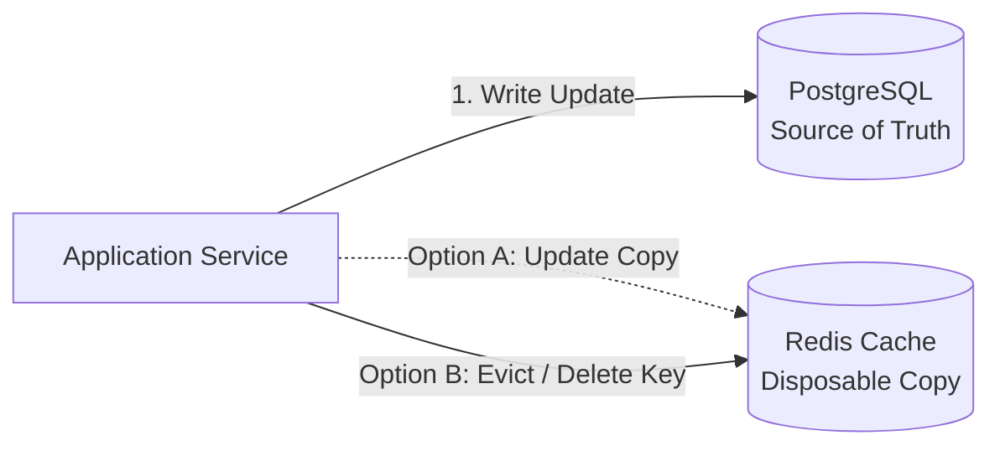
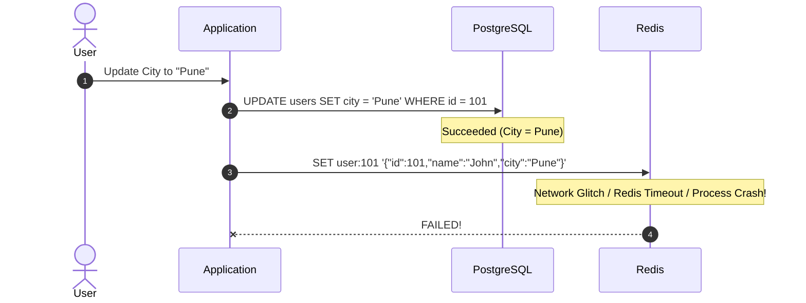
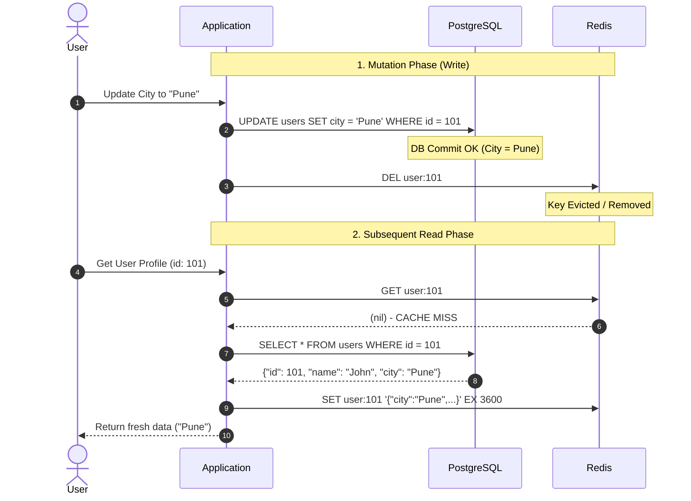
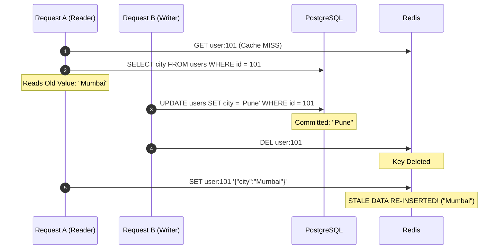

# Engineers Often Prefer Deleting (Evicting) a Cache Entry Instead of Updating It

> **Core System Design Principle:**  
> In production systems using a **Cache-Aside (Lazy Loading)** architecture, engineers often prefer **deleting (invalidating/evicting)** a cache entry over **updating** it directly when modifying the primary database. Deletion is fundamentally simpler, avoids dual-write race conditions, and drastically reduces the risk of serving stale or inconsistent data.


---

## Table of Contents
1. [Core Concept: Invalidation vs. Update](#1-core-concept-invalidation-vs-update)
2. [Example Scenario: User Profile Update](#2-example-scenario-user-profile-update)
3. [Option A: Updating the Cache Directly (And Why It Fails)](#3-option-a-updating-the-cache-directly-and-why-it-fails)
4. [Option B: Deleting the Cache Entry (Cache-Aside Pattern)](#4-option-b-deleting-the-cache-entry-cache-aside-pattern)
5. [Comparison Matrix: Cache Deletion vs. Cache Update](#5-comparison-matrix-cache-deletion-vs-cache-update)
6. [Edge Case & Production Trap: Cache Repopulation Race Condition](#6-edge-case--production-trap-cache-repopulation-race-condition)
7. [Mitigations & Production Consistency Strategies](#7-mitigations--production-consistency-strategies)
8. [Interview-Ready Summary Answer](#8-interview-ready-summary-answer)
9. [Self-Assessment Quiz](#9-self-assessment-quiz)

---

## 1. Core Concept: Invalidation vs. Update

When your application writes to a persistent database (e.g., PostgreSQL, MySQL, DynamoDB) and caches data in an in-memory store (e.g., Redis, Memcached), you face the classic **dual-write consistency problem**:



- **Database** = The durable, authoritative **Source of Truth**.
- **Cache** = A temporary, disposable fast-lookup optimization.

---

## 2. Example Scenario: User Profile Update

Suppose a user profile is stored in PostgreSQL and cached in Redis.

### Initial State

**PostgreSQL (Source of Truth):**
```json
{
  "id": 101,
  "name": "John",
  "city": "Mumbai"
}
```

**Redis (Cached Copy):**
```json
{
  "id": 101,
  "name": "John",
  "city": "Mumbai"
}
```

**Event:** User updates their city from `"Mumbai"` to `"Pune"`.

---

## 3. Option A: Updating the Cache Directly (And Why It Fails)

The application attempts to update both data stores sequentially:



### What is the Problem?

1. **Dual-Write Failure:** If PostgreSQL updates successfully but the Redis write fails (timeout, network partition, Redis OOM error), the cache now holds stale data (`"Mumbai"`), while the DB holds `"Pune"`.
2. **Ghost Stale Data:** Unless you implement complex distributed transactions (2PC), distributed sagas, or background sync reconciliation, users will continuously read stale data until key TTL expiration.
3. **Heavy Computation / Complex Objects:** If the cached entry is a computed aggregate (e.g., aggregated user analytics or denormalized joins), computing the updated cache payload on every write wastes CPU and memory—especially if the data is rarely read again before the next write.

---

## 4. Option B: Deleting the Cache Entry (Cache-Aside Pattern)

Instead of updating Redis, the application simply **deletes (evicts)** the existing cache entry after the database write succeeds.



### Why This Works Seamlessly:
- **Lazy Evaluation:** Cache is only repopulated when someone actually requests the data.
- **Fail-Safe Invalidation:** If the delete succeeds, subsequent reads are guaranteed to fetch the authoritative database state.

---

## 5. Comparison Matrix: Cache Deletion vs. Cache Update

| Criteria | Delete (Evict) Cache Entry | Update Cache Directly |
| :--- | :--- | :--- |
| **Architectural Simplicity** | **High** (Standard Cache-Aside) | **Low** (Requires synchronization & coordination) |
| **Failure Handling** | **Simple** (Next cache miss self-heals by reading DB) | **Complex** (Requires retries, compensating transactions) |
| **Stale Data Risk** | **Significantly Reduced** | **High** (Dual-write desynchronization) |
| **Multiple / Denormalized Keys** | **Easy** (Evict affected keys or namespaces) | **Hard** (Must construct & update every single affected key) |
| **Resource Utilization** | **Optimal** (Only actively queried keys consume cache memory) | **Wasteful** (Computes & caches keys that may never be read) |
| **Concurrency / Race Conditions** | Still requires care, but manageable with TTL / locking | Highly prone to out-of-order write race conditions |

---

## 6. Edge Case & Production Trap: Cache Repopulation Race Condition

Even with cache deletion, concurrent reads and writes can trigger a rare race condition if read operations overlap with write operations.

### Race Condition Timeline



### Detailed Breakdown:
1. **Request A (Read):** Queries cache (miss), reads old value (`"Mumbai"`) from DB. Before it writes back to Redis, context switching or network lag delays Request A.
2. **Request B (Write):** Updates DB to `"Pune"`.
3. **Request B (Write):** Deletes Redis key `user:101`.
4. **Request A (Read):** Finally executes its delayed write to Redis, setting the old value (`"Mumbai"`).

> **Outcome:** Redis holds `"Mumbai"` while PostgreSQL holds `"Pune"` until the key expires or is deleted again.
> **Problem:** Stale cache recreated


---

## 7. Mitigations & Production Consistency Strategies

Production systems employ multiple defensive layers to ensure strong or eventual consistency:

```
+----------------------------------------------------------------------------------+
|                            PRODUCTION CONSISTENCY TOOLKIT                        |
+----------------------------------------------------------------------------------+
| 1. Short / Adaptive TTLs        -> Safety net ensuring stale data auto-expires.  |
| 2. Delayed Double Deletion      -> Delete key -> Update DB -> Sleep -> Re-delete.|
| 3. Transactional Outbox + CDC   -> Debezium/Kafka tail DB WAL and evict cache.   |
| 4. Cache Versioning / Fencing   -> Reject older version writes with token check. |
| 5. Mutual Exclusion (Mutex)     -> Distributed locks (e.g. Redlock) on reads.    |
+----------------------------------------------------------------------------------+
```

1. **TTL (Time-To-Live) as a Safety Net:** Always assign a reasonable TTL (e.g., 5 to 60 minutes) so any stale data naturally expires.
2. **Delayed Double Delete (Cache Invalidation Strategy):**
   ```python
   # 1. Delete cache first
   redis.delete(user_key)
   
   # 2. Update Database
   db.update_user(user_id, new_data)
   
   # 3. Asynchronously wait briefly (e.g. 500ms) and delete cache again
   async_scheduler.run_after(delay_ms=500, func=lambda: redis.delete(user_key))
   ```
3. **Change Data Capture (CDC) with Transactional Outbox:**
   - Listen to database Write-Ahead Logs (WAL) via tools like **Debezium + Apache Kafka**.
   - A dedicated cache consumer service handles invalidation asynchronously only after the DB transaction has durably committed.
4. **Cache Versioning / Timestamp Fencing:**
   - Cache records with a monotonically increasing `version` or timestamp.
   - Reject writes to cache if `payload.version < current_cache_version`.

---

## 8. Interview-Ready Summary Answer

> **Interviewer Question:**  
> *"Why do you prefer deleting a cache entry over updating it when modifying data?"*

> **Target Response:**  
> *"In a Cache-Aside architecture, the primary database is our single source of truth. Directly updating both the database and the cache introduces a **dual-write consistency hazard**, where network glitches or out-of-order execution can leave stale data permanently in cache.*  
>  
> *Instead, we **invalidate (delete)** the cache entry upon a successful database write. The next read operation experiences a cache miss, fetches the authoritative record from the database, and repopulates the cache lazily.*  
>  
> *This drastically simplifies failure handling and avoids computing unread data. To defend against concurrent read/write race conditions, we enforce **strict TTLs**, **Delayed Double Deletes**, or **WAL/CDC-driven invalidations** (such as Debezium + Kafka)."*

---

## 9. Self-Assessment Quiz

### Question 1
**Scenario:** PostgreSQL update succeeds, but Redis update/invalidation fails due to a network glitch. What is the advantage of Cache Invalidation with a retry mechanism compared to Cache Update?
- [ ] A) Redis automatically performs cross-network rollback.
- [x] B) With invalidation, once the key is deleted, the next read safely fetches authoritative data from the database rather than trusting an inconsistent cached payload.
- [ ] C) PostgreSQL automatically rolls back committed transactions if Redis fails.

---

### Question 2
**Scenario:** Why can deleting a cache entry still occasionally result in stale data in high-concurrency systems?
- [ ] A) Redis key deletion is non-deterministic and can fail silently.
- [x] B) A concurrent slow read request that fetched old DB data prior to the update can repopulate the cache after the invalidation has executed.
- [ ] C) Relational databases always return stale data under READ COMMITTED isolation.

---

### Question 3
**Scenario:** In a Cache-Aside architecture, which component represents the durable Source of Truth?
- [ ] A) Redis / Memcached in-memory cluster
- [ ] B) Client-side browser / CDN cache
- [x] C) Primary Relational / NoSQL Database (e.g., PostgreSQL, DynamoDB)
