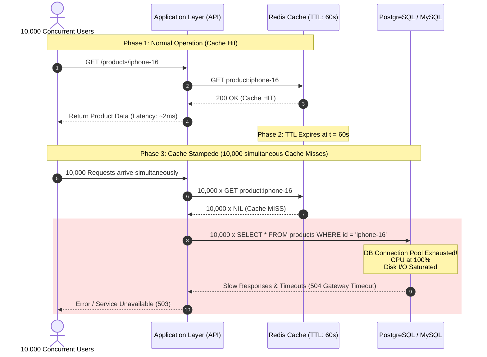
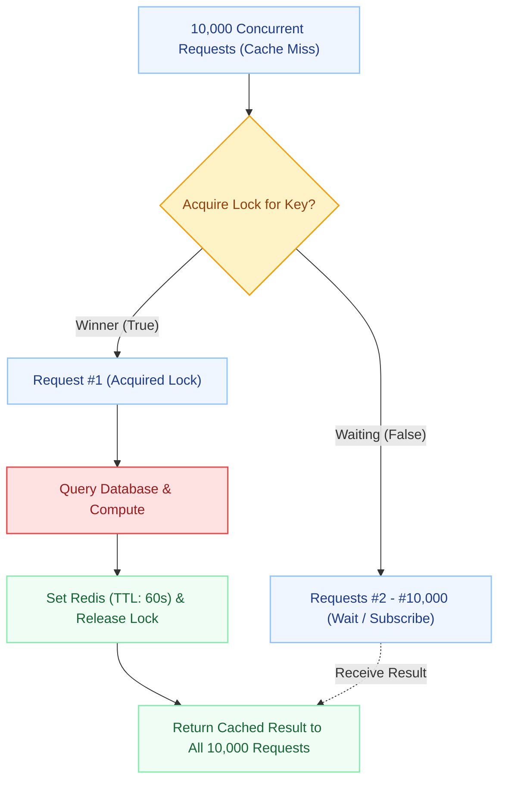
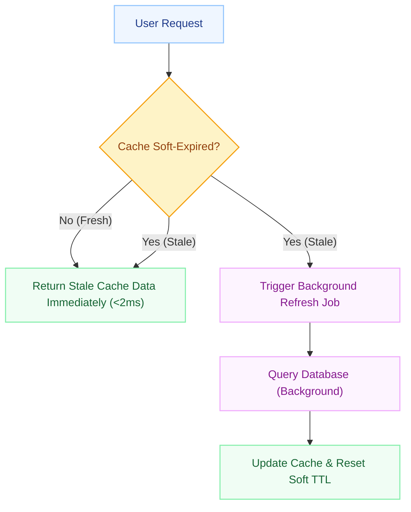
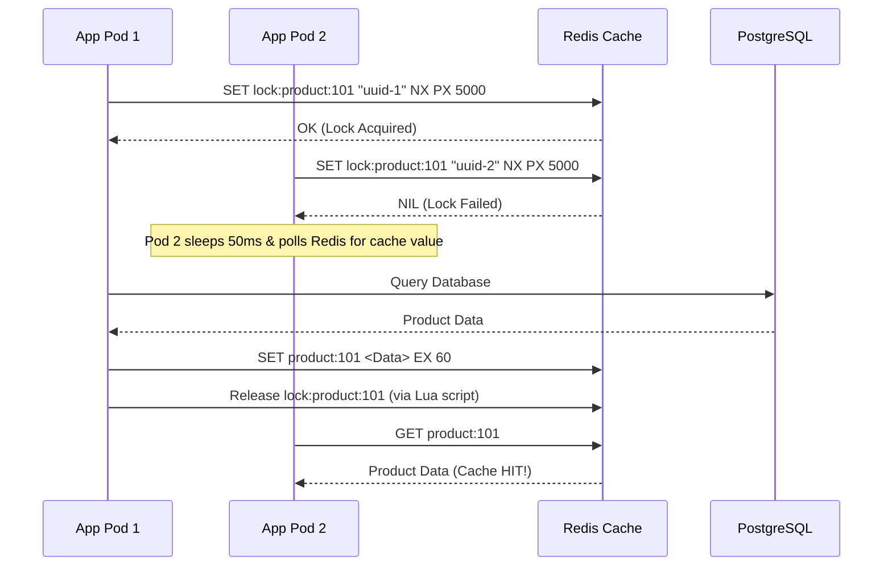

# Cache Stampede (Thundering Herd): Architecture, Prevention & Production Patterns

> *A deep dive into why cache misses can bring down your production database, how the Thundering Herd problem manifests at scale, and the four industry-standard mitigation strategies: Single-Flight, TTL Jitter, Stale-While-Revalidate, and Request Coalescing.*

---

## Table of Contents
1. [What is a Cache Stampede?](#1-what-is-a-cache-stampede)
2. [The Anatomy of a Failure: How the Stampede Happens](#2-the-anatomy-of-a-failure-how-the-stampede-happens)
3. [The 4 Core Prevention Strategies](#3-the-4-core-prevention-strategies)
   - [Strategy 1: Single-Flight (Mutex / Lock)](#strategy-1-single-flight-mutex--lock)
   - [Strategy 2: TTL Jitter (Randomized Expiration)](#strategy-2-ttl-jitter-randomized-expiration)
   - [Strategy 3: Stale-While-Revalidate (Background Refresh)](#strategy-3-stale-while-revalidate-background-refresh)
   - [Strategy 4: Request Coalescing](#strategy-4-request-coalescing)
4. [Strategy Comparison Matrix](#4-strategy-comparison-matrix)
5. [The Multi-Instance Challenge: Local vs. Distributed Coordination](#5-the-multi-instance-challenge-local-vs-distributed-coordination)
6. [Production-Grade Defense-in-Depth Architecture](#6-production-grade-defense-in-depth-architecture)
7. [Implementation Examples](#7-implementation-examples)
   - [Python (FastAPI + Redis + Mutex)](#a-python-fastapi--single-flight-pattern)
   - [Go (`golang.org/x/sync/singleflight`)](#b-go-standard-singleflight-pattern)
   - [Node.js / TypeScript](#c-nodejs--typescript-pattern)
8. [System Design Interview Q&A](#8-system-design-interview-qa)
9. [Key Takeaways & Best Practices](#9-key-takeaways--best-practices)

---

## 1. What is a Cache Stampede?

A **Cache Stampede** (also known as the **Thundering Herd Problem** or **Dog-Piling**) occurs in high-concurrency systems when a heavily accessed, cached item expires or is invalidated, causing a massive wave of simultaneous client requests to bypass the cache and hit the underlying database at the exact same instant.

```
       10,000 Concurrent Requests/sec
                    |
                    v
          +-------------------+
          |    Redis Cache    |
          +-------------------+
                    |
             [ CACHE MISS ] (Key Expired)
                    |
      +-------------+-------------+-------------+
      |             |             |             |
      v             v             v             v
  DB Query 1    DB Query 2    DB Query 3 ... DB Query 10,000
      \             |             /             /
       +------------+-------------+------------+
                    |
                    v
       [ DATABASE CPU 100% / POOL EXHAUSTION ]
                    |
                    v
          [ CASCADING 504 TIMEOUTS ]
```

### The Irony of Caching
A cache is designed to protect your database from high traffic. However, without proper cache-miss safeguards:
> **The real bottleneck appears the exact millisecond the cache stops helping.**

---

## 2. The Anatomy of a Failure: How the Stampede Happens

Consider an e-commerce product page (e.g., a flash sale on a flagship phone) receiving **10,000 requests per second**:



### Cascading Failure Lifecycle:
1. **Steady State:** Redis serves all 10,000 req/sec comfortably. The database CPU stays at ~5%.
2. **Key Expiry:** At $t = 60s$, the cache key expires.
3. **Massive Miss:** 10,000 concurrent threads detect a cache miss within milliseconds.
4. **Redundant Execution:** All 10,000 workers execute the exact same heavy SQL query.
5. **Resource Starvation:** Database thread pools, connection pools, and CPU queues saturate.
6. **Cascading Collapse:** Database becomes unresponsive, causing connection timeouts across unrelated services in the application.

---

## 3. The 4 Core Prevention Strategies

```
+---------------------------------------------------------------------------------------------------+
|                                   CACHE STAMPEDE MITIGATION TOOLKIT                               |
+--------------------------+----------------------------------------+-------------------------------+
| Strategy                 | Mechanism                              | Primary Benefit               |
+--------------------------+----------------------------------------+-------------------------------+
| 1. Single-Flight         | Lock / Mutex per missing key           | Exactly 1 DB query executed   |
| 2. TTL Jitter            | Randomize expiration timestamps        | Prevents synchronized expiry  |
| 3. Stale-While-Revalidate| Serve old value while updating in bg   | Zero latency spike for users  |
| 4. Request Coalescing    | Merge in-flight asynchronous promises  | Collapses concurrent requests |
+--------------------------+----------------------------------------+-------------------------------+
```

---

### Strategy 1: Single-Flight (Mutex / Lock)

**Single-flight** guarantees that for any given cache key, **only one request** is permitted to query the database and populate the cache. All subsequent concurrent requests for that key subscribe/wait for that single operation to complete.



#### Key Characteristics:
* **Database Load:** Reduced from 10,000 queries down to **1 single query**.
* **Waiting Overhead:** Waiting requests experience a small latency delay (the time for Request #1 to fetch data), but the database never spikes.

---

### Strategy 2: TTL Jitter (Randomized Expiration)

When batch jobs or database migrations populate thousands of cache entries at the same time with identical TTLs (e.g., `TTL = 3600s`), they will all expire simultaneously at $t = 3600s$.

**TTL Jitter** adds a pseudo-random delta to the base TTL:

$$\text{Final TTL} = \text{Base TTL} + \text{random}(0, \text{Jitter Max})$$

```python
import random

def get_jittered_ttl(base_ttl: int = 3600, jitter_percentage: float = 0.2) -> int:
    max_jitter = int(base_ttl * jitter_percentage)
    return base_ttl + random.randint(0, max_jitter)
```

```
WITHOUT JITTER (Uniform Expiration at 60s):
Keys:   [Prod A] [Prod B] [Prod C] [Prod D] [Prod E]
Expiry:    60s      60s      60s      60s      60s  ---> ALL EXPIRE TOGETHER (Massive DB Spike)

WITH JITTER (Distributed Expiration):
Keys:   [Prod A] [Prod B] [Prod C] [Prod D] [Prod E]
Expiry:    62s      71s      65s      74s      60s  ---> SMOOTH LOAD CURVE
```

> ⚠️ **Limitation:** TTL Jitter prevents multiple *different* keys from expiring at the same instant. It does **not** protect against a stampede on a single hyper-popular key (e.g., iPhone product page).

---

### Strategy 3: Stale-While-Revalidate (Background Refresh)

Also popularized by HTTP RFC 5861 (`stale-while-revalidate`), this strategy decouples the user-facing request from the database fetch.



#### Dual-TTL Pattern:
- **Soft TTL (e.g., 60 seconds):** When reached, the data is marked "stale", triggering an asynchronous background revalidation.
- **Hard TTL (e.g., 300 seconds):** When reached, the data is evicted completely from Redis.

```json
{
  "key": "product:101",
  "data": { "name": "iPhone 16", "price": 999 },
  "soft_expiry": 1731250000,
  "hard_expiry": 1731250240
}
```

* **Advantage:** Users **never experience cache-miss latency spikes**. The response is always served from RAM in ~1–2ms.
* **Caution:** **Never use stale data for sensitive data** (banking balances, payment verifications, or inventory count during checkout).

---

### Strategy 4: Request Coalescing

**Request Coalescing** (Promise Sharing) combines concurrent identical in-flight asynchronous operations at the application runtime layer.

```text
Request 1  \
Request 2   \
Request 3    \
Request 4     ---> [ Coalescing Layer / Flight Group ] ---> 1 Database Fetch
Request 5    /
Request 6   /
Request 7  /
                         |
                         v
                    Product Data
                         |
             +-----------+-----------+
             |           |           |
         Request 1   Request 2   Request 3... (All receive identical response)
```

* In Node.js / JavaScript, this is implemented by sharing the same active `Promise` for identical keys.
* In Go, this is provided by `singleflight.Group`.

---

## 4. Strategy Comparison Matrix

| Feature | Single-Flight | TTL Jitter | Stale-While-Revalidate | Request Coalescing |
| :--- | :--- | :--- | :--- | :--- |
| **Solves Single-Key Stampede?** | **Yes** | No | **Yes** | **Yes** |
| **Solves Multi-Key Synchronized Expiry?** | No | **Yes** | No | No |
| **User Latency on Miss** | Waiting time of 1st DB query | Full DB query latency | **Zero** (serves stale instantly) | Waiting time of 1st DB query |
| **Data Freshness** | 100% strictly fresh | 100% strictly fresh | Eventual / slightly stale | 100% strictly fresh |
| **Implementation Complexity** | Medium (Mutex/Locks) | Very Low (1 line of code) | Medium (Dual TTL / Workers) | Low (In-memory Promise map) |
| **Best Used For** | Critical data, balance queries, stock check | General batch caching, catalogs | Product pages, blogs, feeds | High-throughput microservice calls |

---

## 5. The Multi-Instance Challenge: Local vs. Distributed Coordination

A common pitfall in system design interviews:
> *"I implemented in-memory Single-Flight in my Go / Node.js application, so my database is safe."*

### Why In-Memory Single-Flight is Incomplete:

```
                  10,000 Incoming Requests
                             |
                   +---------+---------+
                   |   Load Balancer   |
                   +---------+---------+
                   /         |         \
                  v          v          v
          +------------+------------+------------+
          | App Node 1 | App Node 2 | App Node N |  (e.g., 20 Kubernetes Pods)
          +------------+------------+------------+
          | Single-    | Single-    | Single-    |
          | Flight     | Flight     | Flight     |
          +------------+------------+------------+
                 \           |           /
                  v          v          v
              +-------------------------------+
              |   20 Concurrent DB Queries    |  (1 query per App Instance!)
              +-------------------------------+
```

If you have **20 Kubernetes pods** running your service:
- Local single-flight reduces 10,000 requests to **20 database queries** (1 per pod).
- While 20 queries is far better than 10,000, for expensive aggregation queries, 20 parallel queries can still degrade DB performance.

### Solution: Distributed Locking (Redis Mutex)

To ensure **strictly 1 database query across the entire global cluster**, use a distributed lock via Redis:



---

## 6. Production-Grade Defense-in-Depth Architecture

In high-scale enterprise systems, rely on multiple overlapping defense layers:

```
+-------------------------------------------------------------------------------------------------+
|                                ENTERPRISE CACHE PROTECTION STACK                                |
+-------------------------------------------------------------------------------------------------+

  [ Layer 1: Edge CDN ]           stale-while-revalidate at Cloudflare / CloudFront
            |
  [ Layer 2: Load Balancer ]      Rate Limiting & Concurrency Throttling
            |
  [ Layer 3: Application Pod ]    Local Single-Flight (In-memory Promise / singleflight.Group)
            |
  [ Layer 4: Redis Cluster ]      Distributed Lock (SET NX PX) + TTL Jitter on write
            |
  [ Layer 5: Database Proxy ]     PgBouncer / AWS RDS Proxy (Connection Pool Protection)
            |
  [ Layer 6: Database Engine ]    Read Replicas + Query Timeout Circuit Breaker
```

---

## 7. Implementation Examples

### A. Python (FastAPI + Single-Flight Pattern)

```python
import asyncio
import random
from typing import Optional, Dict
from fastapi import FastAPI, HTTPException

app = FastAPI()

# In-memory single-flight lock registry per key
locks: Dict[str, asyncio.Lock] = {}
cache: Dict[str, dict] = {}

def get_key_lock(key: str) -> asyncio.Lock:
    if key not in locks:
        locks[key] = asyncio.Lock()
    return locks[key]

async def fetch_product_from_db(product_id: str) -> dict:
    # Simulate expensive DB query (100ms)
    await asyncio.sleep(0.1)
    return {"id": product_id, "name": "iPhone 16 Pro", "price": 1099}

@app.get("/products/{product_id}")
async def get_product(product_id: str):
    cache_key = f"product:{product_id}"

    # 1. Check Cache
    if cache_key in cache:
        return {"source": "cache", "data": cache[cache_key]}

    # 2. Single-Flight Lock: Only 1 coroutine queries DB
    lock = get_key_lock(cache_key)
    async with lock:
        # Double-check cache inside lock (another thread might have populated it)
        if cache_key in cache:
            return {"source": "cache_after_lock", "data": cache[cache_key]}

        # 3. Query Database
        product_data = await fetch_product_from_db(product_id)

        # 4. Populate cache with TTL Jitter
        cache[cache_key] = product_data
        return {"source": "database", "data": product_data}
```

---

### B. Go (Standard `singleflight` Pattern)

Go provides a production-ready single-flight primitive in its standard extended library:

```go
package main

import (
	"context"
	"fmt"
	"time"

	"golang.org/x/sync/singleflight"
)

var (
	sfGroup singleflight.Group
)

type Product struct {
	ID    string
	Name  string
	Price float64
}

func fetchProductFromDB(id string) (*Product, error) {
	time.Sleep(100 * time.Millisecond) // Simulate DB I/O
	return &Product{ID: id, Name: "MacBook Pro M4", Price: 1999.00}, nil
}

func GetProduct(ctx context.Context, id string) (*Product, error) {
	cacheKey := fmt.Sprintf("product:%s", id)

	// 1. Check Redis Cache here...
	// if found { return val, nil }

	// 2. Coalesce concurrent requests into a single database execution
	val, err, shared := sfGroup.Do(cacheKey, func() (interface{}, error) {
		product, err := fetchProductFromDB(id)
		if err != nil {
			return nil, err
		}
		// Write to Redis with Jittered TTL here...
		return product, nil
	})

	if err != nil {
		return nil, err
	}

	fmt.Printf("Request for %s served. Shared with other concurrent requests: %t\n", id, shared)
	return val.(*Product), nil
}
```

---

### C. Node.js / TypeScript

```typescript
import { Redis } from 'ioredis';

const redis = new Redis();
const inFlightPromises = new Map<string, Promise<any>>();

async function getProductWithCoalescing(productId: string): Promise<any> {
  const cacheKey = `product:${productId}`;

  // 1. Check Redis
  const cached = await redis.get(cacheKey);
  if (cached) {
    return JSON.parse(cached);
  }

  // 2. Request Coalescing (Reuse active promise if already in flight)
  if (inFlightPromises.has(cacheKey)) {
    return inFlightPromises.get(cacheKey);
  }

  // 3. Initiate single fetch promise
  const fetchPromise = (async () => {
    try {
      // Simulate Database Query
      const dbResult = { id: productId, name: 'iPad Pro', price: 799 };

      // Set Redis with TTL + Jitter (60s + random 0-15s)
      const jitter = Math.floor(Math.random() * 15);
      await redis.set(cacheKey, JSON.stringify(dbResult), 'EX', 60 + jitter);

      return dbResult;
    } finally {
      // Clean up in-flight map immediately upon completion
      inFlightPromises.delete(cacheKey);
    }
  })();

  inFlightPromises.set(cacheKey, fetchPromise);
  return fetchPromise;
}
```

---

## 8. System Design Interview Q&A

### Q1: What is the exact difference between Cache Stampede, Cache Avalanche, and Cache Penetration?
* **Cache Stampede (Thundering Herd):** One single hot key expires, and thousands of concurrent requests query the database for that same key at the same instant.
* **Cache Avalanche:** Thousands of *different* keys expire at the exact same moment (e.g., due to fixed TTLs across batch imports), overloading the DB.
* **Cache Penetration:** Requests query for keys that *do not exist* in either the cache or database (e.g. `id = -999`), forcing every request to hit the DB. (Mitigated using **Bloom Filters** or caching null values).

### Q2: What are the risks of using Distributed Locks for Single-Flight?
* **Deadlocks / Leaked Locks:** If the node holding the lock crashes before releasing it, other nodes could wait indefinitely. (Always use lock TTLs / leases).
* **Lock Stampede:** If 1,000 nodes poll Redis waiting for a lock, Redis itself can get overwhelmed by polling traffic. (Use exponential backoff with jitter).

### Q3: How do you choose between Single-Flight and Stale-While-Revalidate?
* Use **Stale-While-Revalidate** when data changes infrequently and short-term eventual consistency is acceptable (e.g., news articles, homepage feeds, product catalogs).
* Use **Single-Flight** when data must be 100% strictly accurate (e.g., airline ticket seat reservations, wallet balances, bidding systems).

---

## 9. Key Takeaways & Best Practices

1. **Never use fixed TTLs for batch-cached data:** Always add TTL jitter ($\pm 10\text{–}20\%$).
2. **Combine local single-flight with distributed coordination:** Prevent both in-process and cross-instance stampedes.
3. **Protect the database with connection pool limits and circuit breakers:** Even if a stampede slips past caching layers, fail-fast mechanisms (e.g. resilience4j / Envoy circuit breakers) prevent full database outage.
4. **Log & Monitor Cache Hit Ratio:** Set up alerts when Cache Hit Ratio drops below 95% on hot endpoints.
