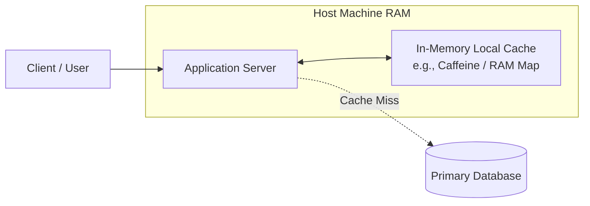
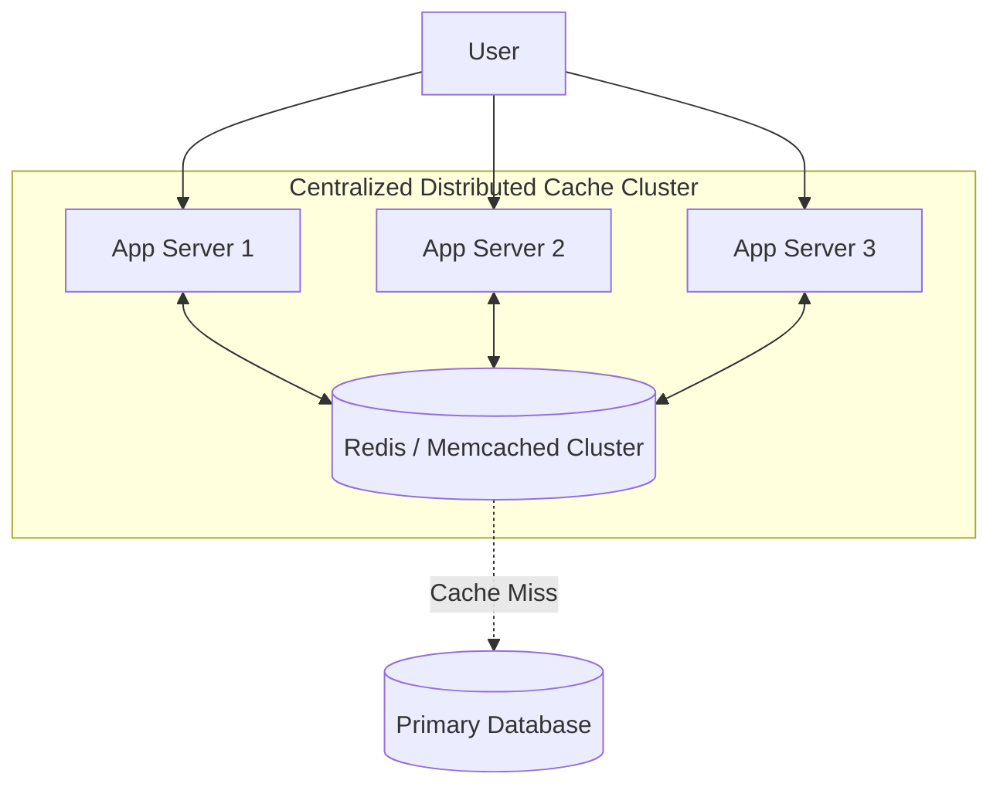
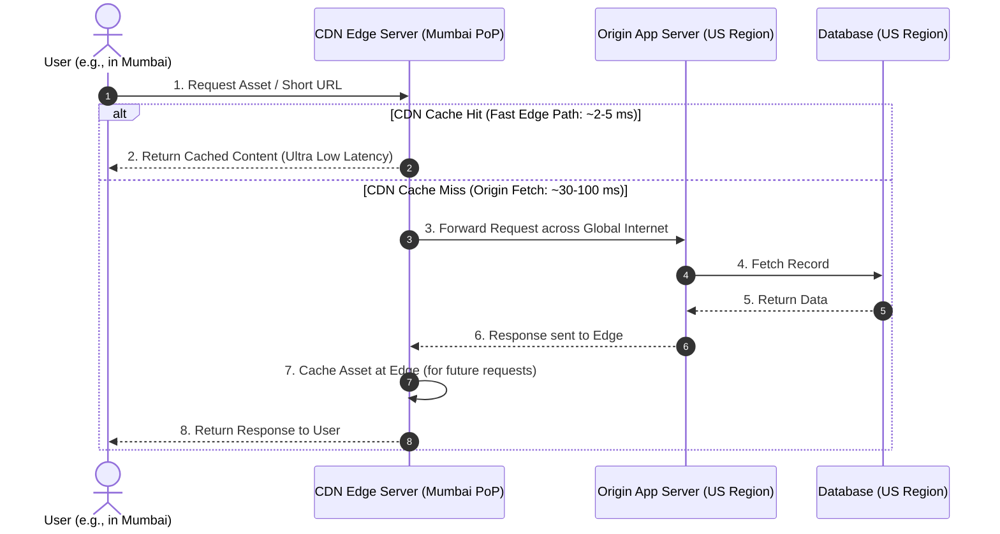
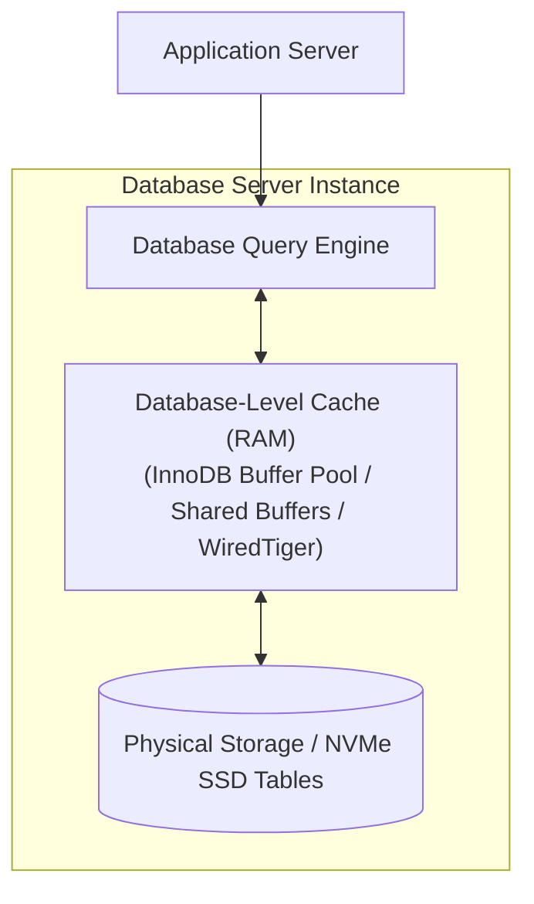
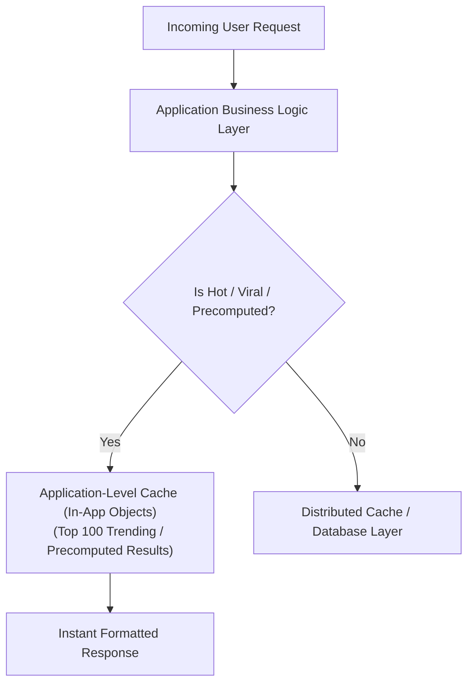
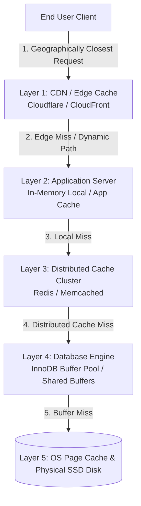
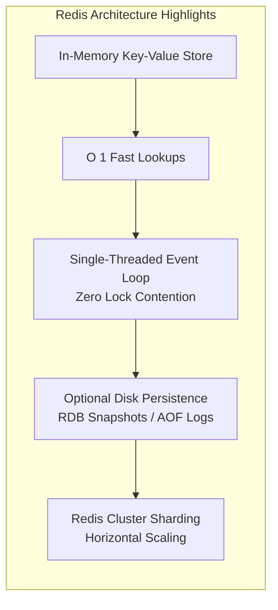
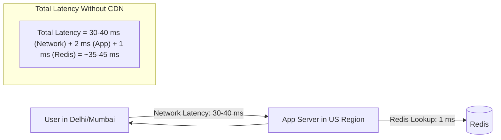
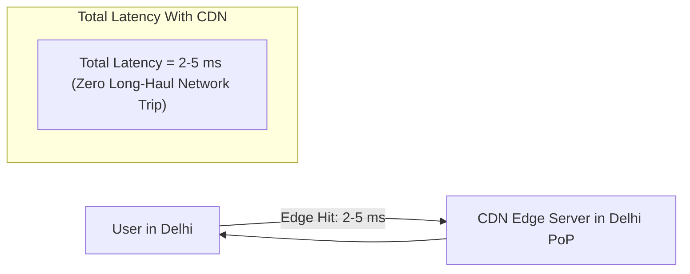

# Comprehensive Guide to Caching Categories & Multi-Layer Architecture

In modern distributed system design, caching is not restricted to a single point. To build ultra-scalable, low-latency applications (handling millions of writes and billions of reads), caching must be applied across multiple architectural tiers.

---

## 1. Overview of the 6 Core Caching Categories

| # | Caching Category | Location / Tier | Primary Role | Popular Technologies |
| :--- | :--- | :--- | :--- | :--- |
| **1** | **In-Memory Local Cache** | Inside application server process memory (RAM) | Ultra-fast process-local lookups with zero network overhead | Guava, Caffeine, Go Sync.Map, In-memory maps |
| **2** | **Distributed Cache** | Dedicated centralized cluster shared across app nodes | Shared state, horizontal scalability, and persistence | Redis, Memcached, Hazelcast, Apache Ignite |
| **3** | **CDN / Edge Cache** | Geographically distributed PoPs close to users | Static assets, media streaming, and edge redirect routing | Cloudflare, AWS CloudFront, Akamai, Fastly |
| **4** | **Database-Level Cache** | Inside the database engine memory | Reducing disk I/O for frequently queried table blocks | MySQL Buffer Pool, Postgres Shared Buffers, Mongo WiredTiger |
| **5** | **Application-Level Cache** | Inside application business logic layer | Pre-computed domain logic, top trending items, ML inferences | Custom business logic, preloaded hot hashes |
| **6** | **OS-Level Cache** | OS Kernel memory between disk and user space | Caching physical disk blocks in memory (Page Cache) | Linux Page Cache / VFS buffer cache |

---

## 2. Deep Dive: The 6 Caching Categories

### 1. In-Memory Local Cache
Local cache stores frequently accessed data directly inside the process memory (RAM) of the server hosting the application.

* **How It Works:** When the app requests data, it checks its local RAM. On a cache miss, it queries the database and populates its local heap/memory. Subsequent queries are served directly from RAM.
* **When to Use:**
  - Simple, small-to-medium standalone applications.
  - Read-heavy data that rarely changes and is specific to a process instance.
  - Scenarios requiring sub-millisecond, zero-network-hop responses.
* **Pros:**
  - **Ultra-Fast (Microsecond Latency):** Direct process memory access without network I/O or disk operations.
  - **Zero Network Overhead:** No network serialization/deserialization penalties.
  - **Simple Setup:** Requires no external infrastructure cluster.
* **Cons:**
  - **Volatile (Loss on Restart):** Memory is wiped whenever the application restarts or crashes.
  - **Memory Limits:** Limited to the host machine's physical RAM.
  - **Inconsistent Across Instances:** In a multi-node cluster, each app server has its own isolated cache with potentially conflicting data.
* **Real-World Examples:**
  - **BookMyShow:** Storing movie metadata for high-demand releases (e.g., *Dhurandhar*) on local app instances.
  - **API Gateway:** Local caching of JWT verification keys and authentication tokens.
  - **Config Servers:** Caching runtime feature flags.
  - **Rate Limiters:** Local sliding-window counter tracking before batching.

---

### 2. Distributed Cache

#### What is it?
* Separate cache server shared across application instances.

#### Examples
* **Redis**
* **Memcached**
* **Hazelcast**
* **Apache Ignite**

#### Where it sits
* **User $\rightarrow$ App Servers $\rightarrow$ Distributed Cache Cluster $\rightarrow$ Database**

* **How It Works:** Multiple independent application instances communicate over TCP/network with a centralized cluster (e.g., Redis). All app servers share the same synchronized cache view.

#### When to Use
* Medium to large scale systems
* Multiple app servers
* Read-heavy systems
* Session storage
* API response caching

#### Real-World Examples
* URL shortener mapping cache
* E-commerce product cache
* Instagram feed metadata
* Payment token validation

#### Pros:
* **Shared cache across services:** Single source of truth for all application nodes
* **Scalable:** Easily partitioned (sharded) horizontally across nodes
* **Centralized management:** Monitoring, eviction, and TTL managed in one cluster
* **Persistence (if Redis):** Supports RDB snapshots and AOF logs to survive crashes

#### Cons:
* **Network hop involved:** Introduces network latency (1–3 ms) vs. process-local RAM
* **Requires infra management:** Operational overhead of running, clustering, and monitoring dedicated instances
* **Can become bottleneck if poorly designed:** Hot keys or uneven sharding can overload individual cache nodes

---

### 3. CDN (Content Delivery Network) & Edge Caches

#### What is it?
* Caches placed geographically close to users (Points of Presence / Edge Servers) across the globe to serve static and cacheable content with minimal physical network latency.

#### CDN Examples (Providers)
* **Cloudflare**
* **AWS CloudFront**
* **Akamai**
* **Fastly**

#### Where it sits
* **User $\rightarrow$ CDN / Edge Server (PoP) $\rightarrow$ Origin Application Server $\rightarrow$ Database**

#### How It Works
* Instead of traversing global internet backbones thousands of kilometers away to an origin data center ($\Delta T$), requests are intercepted and served directly from the geographically closest Edge Point of Presence (PoP).

#### When to Use
* **Static content:** Images, videos, CSS, JavaScript files, and HTML bundles
* **Static & cacheable API responses:** High-volume public GET endpoints
* **Short URL redirects:** Caching `HTTP 301 / 302` redirect responses at the edge
* **Global traffic:** Serving users distributed worldwide with consistent low latency
* **Traffic surges & DDoS mitigation:** Absorbing high-concurrency traffic spikes before they reach origin servers

#### Real-World Examples
* **Netflix:** Video caching on ISP edge appliances (Open Connect) so Indian users stream from Mumbai PoPs rather than US servers
* **Instagram:** Caching images, reels, and static media assets
* **Twitter / X:** Caching avatars, banner media, and static assets
* **URL Shortener:** Caching short-link redirect targets at the edge for instant resolution

#### Pros:
* **Ultra-low latency:** Drastically cuts network transit time ($\Delta T$) from 50–200 ms to 2–5 ms
* **Reduces origin server & DB load:** Intercepts requests so backend data centers never process repeat queries
* **Global scale:** Effortlessly scales to millions of concurrent requests across hundreds of worldwide PoPs
* **Massive traffic handling & DDoS shield:** Buffers high-volume traffic bursts and malicious attacks

#### Cons:
* **Limited control:** Relies on third-party edge infrastructure and proprietary caching rules
* **Harder to invalidate:** Propagating cache purges across thousands of worldwide edge nodes takes time
* **Restricted to GET / Read operations:** Cannot cache dynamic, transactional writes (POST/PUT/DELETE)

---

### 4. Database-Level Cache

#### What is it?
* Internal in-memory caching mechanisms built directly inside the database engine to store frequently accessed data pages, indexes, and query buffers in RAM to avoid slow physical disk I/O.

#### Database Cache Examples (Engines)
* **MySQL:** InnoDB Buffer Pool
* **PostgreSQL:** Shared Buffers
* **MongoDB:** WiredTiger Cache
* **Oracle / SQL Server:** Buffer Cache

#### Where it sits
* **Application Server $\rightarrow$ Database Engine (Internal RAM Cache) $\rightarrow$ Physical Storage (HDD/SSD)**

#### How It Works
* When an application sends a query, the database engine checks its allocated RAM buffer pool first. If the requested table pages or index blocks are cached in memory, they are returned immediately without performing physical disk reads.

#### When to Use
* **Default behavior:** Active out of the box for all modern databases.
* **Small to medium scale systems:** Workloads with low-to-moderate queries per second (QPS).
* **Internal tools and POCs:** Applications where traffic is low and adding an external caching cluster (like Redis) is unnecessary overhead.
* **Low concurrent load:** Systems where the database server CPU and connection pools are not saturated.

#### Real-World Examples
* **Internal Admin Dashboards:** Internal team portals with low concurrency (e.g., internal employee management tools).
* **POCs and MVPs:** Rapid prototypes where simplicity and minimal infrastructure cost are prioritized.
* **Low-Traffic Microservices:** Specialized internal services that process few requests per minute.

#### Pros:
* **Zero extra infrastructure:** No need to deploy, pay for, or manage separate cache clusters (Redis/Memcached).
* **Completely automatic & transparent:** Database engine autonomously optimizes buffer page allocation and evictions using internal LRU algorithms.
* **Simplified architecture:** Eliminates the complexity of manual cache invalidation, cache warming, and dual-write logic in application code.

#### Cons:
* **Database remains a single bottleneck:** Every query still consumes database connections, CPU cycles, and network bandwidth.
* **Limited scalability:** Bound to the RAM and CPU limits of the single database server instance.
* **Not sufficient for high-scale applications:** Cannot absorb massive traffic surges or shield databases under high concurrent read/write spikes.

---

### 5. Application-Level Cache

#### What is it?
* Manually controlled, domain-specific caching logic embedded directly inside the application's business code (rather than an external infrastructure tier), storing precomputed, aggregated, or preloaded business entities.

#### Examples (Techniques & Patterns)
* **Preloaded Hot Datasets:** Preloading top trending items into memory at application boot time
* **Precomputed Aggregations:** Caching complex calculations and aggregated dashboards
* **ML Inference Caching:** Storing repeated machine learning predictions and model outputs
* **In-Memory Business Hashes:** Custom in-app hash maps and priority queues

#### Where it sits
* **Inside the Application Business Logic Layer (before general caching layers and database queries)**

#### How It Works
* The application code intelligently decides what to cache using domain awareness. Instead of blindly caching raw database rows, it pre-computes, aggregates, and stores high-value view models in memory (e.g., preloading the top 1,000 trending short URLs on startup).

#### When to Use
* **Known hot & viral data:** When specific items are guaranteed to experience extreme read traffic (e.g., breaking news, viral products).
* **Precomputed calculation results:** Heavy mathematical aggregations or report computations.
* **Machine Learning inference:** Caching high-frequency model predictions to avoid repeated GPU/CPU inference costs.
* **Warm-up on startup:** Preloading critical metadata into memory when the application initializes.

#### Real-World Examples
* **Instagram:** In-memory caching of viral trending posts for instant exploration feed generation.
* **Amazon Homepage:** Precomputed "Top 10 Deals of the Day" stored as ready-to-render view objects in memory.
* **Gaming Applications:** In-memory real-time Top 100 Leaderboards updated via sorted structures.
* **URL Shortener:** Preloading the top 1,000 popular short URLs into application memory on startup.

#### Pros:
* **Super fast:** Instant access to pre-aggregated, formatted objects with zero network or serialization overhead.
* **Fine-grained business control:** Developers explicitly control caching rules, freshness criteria, and eviction triggers.
* **Domain-aware & smart memory usage:** Caches only business-critical, high-traffic data rather than arbitrary raw database records.

#### Cons:
* **Limited capacity:** Bound to the application process heap; cannot store massive datasets.
* **Maintenance complexity:** Requires custom application code for cache synchronization, warming, and invalidation.
* **Staleness risk:** Demands robust cache invalidation logic to prevent serving outdated business information.

---

### 6. OS-Level Cache (Page Cache)
The operating system automatically caches physical disk blocks in unused system RAM to optimize disk I/O performance.

* **How It Works:** When an application reads or writes files/databases, the Linux OS kernel stores the referenced disk pages in RAM (Page Cache). Subsequent file reads are satisfied from memory without hitting disk hardware.
* **When to Use:**
  - Transparently and continuously active on all modern operating systems (Linux, Windows, macOS).
* **Pros:**
  - **Completely Transparent:** No software development or configuration effort needed.
  - **Accelerates File & DB I/O:** Makes repeat disk reads orders of magnitude faster.
* **Cons:**
  - **No Application-Level Control:** OS kernel manages page eviction automatically.
  - **Non-Distributed:** Bound strictly to the individual physical machine.
* **Real-World Examples:**
  - **Linux Page Cache:** Accelerating database files, append-only logs (Kafka / RocksDB), and static file servers.

---

## 3. End-to-End Modern Multi-Layer Caching Architecture

Real-world high-scale systems combine multiple tiers of caching into an integrated pipeline:

---

## 4. Case Study: URL Shortener Cache Capacity & Strategy

### 1. Capacity Estimation
* **Assumption:** Top 20% hot data represents 100 Million popular URL redirects.
* **Data Size per Record:** ~200 Bytes (Key, Long URL, metadata).
* **Total In-Memory Size Required:**
  $$\text{Memory} = 100{,}000{,}000 \times 200 \text{ Bytes} = 20{,}000{,}000{,}000 \text{ Bytes} \approx 20\text{ GB}$$

### 2. Why Local Cache Alone Fails
In a scaled URL shortener with 10+ application instances, storing 20 GB locally on every instance leads to:
1. Massive memory duplication (200 GB across 10 nodes).
2. Cache synchronization issues (instance A has updated key; instance B does not).

**Solution:** Use a **Distributed Cache (Redis)** cluster shared across all application instances.

---

## 5. Deep Dive: Redis as a Distributed Caching Engine

### Why Redis is Dominant:
1. **$O(1)$ Time Complexity:** Ultra-fast key-value reads directly from memory.
2. **Single-Threaded Event Loop:** Uses non-blocking multiplexed I/O (`epoll`/`kqueue`). Eliminates multi-threading lock overhead, race conditions, and CPU context switching.
3. **Dual Persistence:** Unlike purely volatile caches, Redis supports durable persistence:
   - **RDB (Redis Database Snapshots):** Point-in-time snapshots to disk.
   - **AOF (Append-Only File):** Logs every write operation for disaster recovery.
4. **Rich Data Structures:** Strings, Hashes, Lists, Sets, Sorted Sets (ZSETs), Bitmaps, HyperLogLogs.

---

## 6. The Geographic Latency Problem ($\Delta T$) & The Need for CDNs

Even with Redis returning records in $\approx 1\text{ ms}$, geography introduces severe network latency ($\Delta T$):

When an Edge CDN PoP is placed locally in India:

---

## 7. Comparative Summary: Redis vs. CDN

| Dimension | Distributed Cache (Redis) | Content Delivery Network (CDN) |
| :--- | :--- | :--- |
| **Location** | Inside your backend data center / VPC | Geographically distributed edge PoPs worldwide |
| **Primary Target** | Dynamic data, session states, DB queries, API tokens | Static assets (Images, JS/CSS, Videos, HTTP 301/302 Redirects) |
| **Reduces DB Load?** | **Directly:** Intercepts database read queries | **Indirectly:** Prevents requests from ever reaching the backend |
| **Reduces Network Latency?** | No (Latency to data center remains unchanged) | **Yes:** Resolves requests at the closest local edge server |
| **Data Types** | Structured JSON, strings, hashes, numbers, lists | Static files, cached HTTP responses, binary media files |
| **Traffic Spike Protection** | Protects internal database from overload | Absorbs massive global DDoS and traffic spikes at edge |

---

## 8. Summary Checklist for System Design Interviews

1. **Local vs. Distributed:** Use local cache for process-specific/static lookups (zero network overhead); use distributed cache (Redis) when multiple app servers must share consistent state.
2. **Combine Redis + CDN:** Use Redis to accelerate backend dynamic reads and use CDN edge caches to eliminate global round-trip network latency ($\Delta T$).
3. **Layered Defense:** Design multi-tier fallbacks: `Client → CDN → App Local Cache → Redis → DB Buffer Pool → Disk`.
