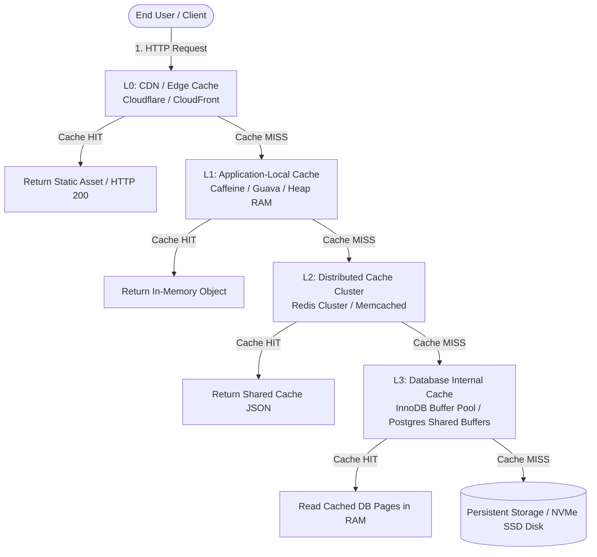
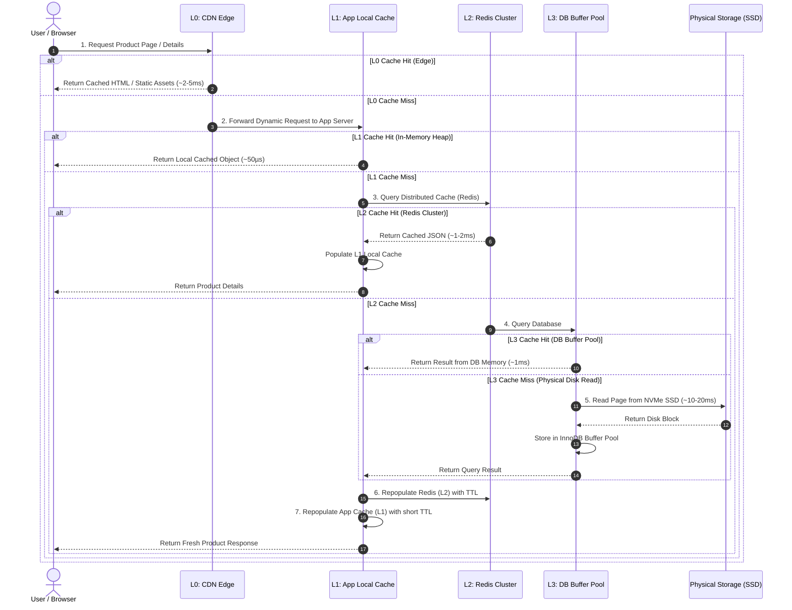
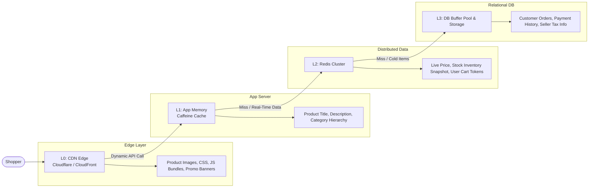
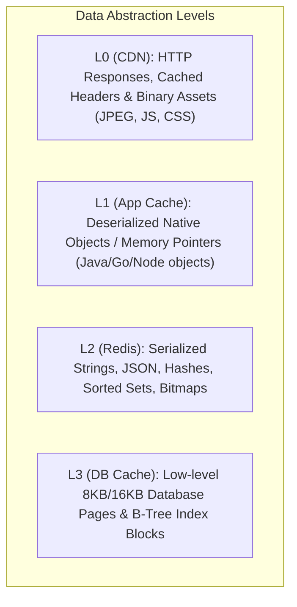

# Multi-Layer Caching Architecture (L0 → L3)

In high-scale distributed systems, a single caching layer is rarely sufficient to handle high concurrency, global user distribution, and intensive database workloads. A **Multi-Layer Caching Architecture (L0 → L3)** establishes a tiered line of defense where each layer attempts to satisfy the incoming request as close to the user as possible before passing it deeper into the stack.

---

## 1. Architecture Flow & Overview

### Layer Breakdown

| Layer | Cache Type | Purpose | Representative Technologies | Typical Latency |
| :--- | :--- | :--- | :--- | :--- |
| **L0** | **CDN / Edge Cache** | Caches static assets, media, and cacheable HTTP responses near the user | Cloudflare, Amazon CloudFront, Akamai, Fastly | $\approx 2 - 10\text{ ms}$ |
| **L1** | **Application-Local Cache** | Stores frequently accessed objects directly in the application's heap memory | Caffeine, Guava Cache, Go Sync.Map | $\approx 10 - 100\text{ }\mu\text{s}$ (Microseconds) |
| **L2** | **Distributed Cache** | Centralized in-memory store shared across all application instances | Redis Cluster, Memcached, Hazelcast | $\approx 1 - 3\text{ ms}$ |
| **L3** | **Database Internal Cache** | Caches disk data pages and indexes inside database engine memory | PostgreSQL Shared Buffers, MySQL InnoDB Buffer Pool | $\approx 0.5 - 2\text{ ms}$ (DB internal) |
| **Storage** | **Persistent Storage** | Authoritative source of truth when data is absent in all preceding caches | NVMe SSD, AWS EBS, Distributed DB Storage | $\approx 10 - 50\text{ ms}+$ |

> **Note on Terminology:** *L0–L3 is a conceptual naming convention used in system design interviews and architectural models, not a rigid IEEE/RFC standard. A CDN is not necessarily traversed for every internal API request, and database internal caches store low-level disk pages rather than application-ready domain objects.*

---

## 2. How a Request Traverses the Multi-Layer Stack

Suppose a user navigates to a high-traffic product page. The request traverses the stack hierarchically:

### Request Execution Steps:
1. **L0 Hit (CDN):** The edge server serves static assets (HTML/CSS/Images/Redirects) immediately without reaching origin servers.
2. **L0 Miss:** The request enters the backend infrastructure and hits an application instance.
3. **L1 Hit (App Local Memory):** The application reads the domain object from its local JVM/heap memory (zero network overhead).
4. **L1 Miss:** The application queries the centralized Redis cluster over the local VPC network.
5. **L2 Hit (Distributed Cache):** Redis returns the cached JSON string; the application deserializes it, populates L1, and returns.
6. **L2 Miss:** The application executes an SQL query against the primary database.
7. **L3 Hit (DB Buffer Pool):** The database engine finds the table/index pages already resident in memory (`InnoDB Buffer Pool` / `Shared Buffers`).
8. **L3 Miss (Disk Storage):** The DB engine performs physical disk I/O, loads pages into L3 memory, and returns data to the application.
9. **Back-Propagation:** The application caches the record in **L2 (Redis)** with a standard TTL and in **L1 (Local)** with a shorter TTL.

---

## 3. Real-Life Example: E-Commerce Product Page (Amazon / Flipkart)

When millions of users open an e-commerce product page (e.g., during a Black Friday or Prime Day sale), different layers handle distinct components of the page:

### Layer-by-Layer Scenario Mapping

| Layer | Real-Life Component | What Happens |
| :--- | :--- | :--- |
| **L0 — CDN / Edge** | Product images, CSS stylesheets, JavaScript bundles, video previews | Served directly from the nearest regional ISP/Edge PoP without touching backend servers. |
| **L1 — Application Cache** | Static product catalog text, breadcrumb categories, brand details | Served in microseconds directly from application process heap RAM. |
| **L2 — Redis Cluster** | Real-time pricing, stock inventory counts, seller rating summary, active coupon codes | Shared across all app nodes; updated with high frequency and sub-millisecond lookups. |
| **L3 — Database Cache** | Relational table pages for user reviews, order ledger, and merchant accounts | Read from database RAM buffer pool without physical disk seek latency. |
| **Disk / Storage** | Cold product catalog, historical archived reviews, audit logs | Physical disk read executed only when an obscure, rarely viewed product is requested. |

---

## 4. What Happens on a Complete Cache Miss? (Cold Start Walkthrough)

Suppose a user requests a rarely purchased niche product (`prod:99481`) that has never been cached:

1. **Client Request:** User requests `prod:99481`.
2. **L0 Miss:** CDN forwards the dynamic API call to the application server.
3. **L1 Miss:** Application's local Caffeine cache does not contain `prod:99481`.
4. **L2 Miss:** Redis cluster lookup returns `nil` (key not found).
5. **Database Query:** Application sends an SQL query to PostgreSQL/MySQL.
6. **L3 Miss & Disk Read:** Database engine does not have the table pages in its buffer pool; it reads them from the NVMe SSD into L3 memory.
7. **Database Response:** Query result is returned to the application server.
8. **Repopulation & Warming:**
   - Application writes `prod:99481` to **Redis (L2)** with a TTL of 1 hour.
   - Application stores `prod:99481` in **Local Cache (L1)** with a TTL of 1 minute.
9. **Subsequent Requests:** Future users requesting `prod:99481` are served in microseconds from **L1** or milliseconds from **L2**, completely shielding the database from repeated queries.

---

## 5. Architectural Differences Across Layers

| Dimension | L0: CDN Cache | L1: App-Local Cache | L2: Distributed Cache | L3: DB Internal Cache |
| :--- | :--- | :--- | :--- | :--- |
| **Data Format** | HTTP payloads, binary files, HTML | Deserialized native heap objects | Key-value strings, JSON, Hashes | Raw database disk pages & index blocks |
| **Location** | Global edge network (ISP edge) | Local process memory | Centralized VPC cluster | Database engine memory space |
| **Accessibility** | Direct by client browsers | Single application process | All application instances | Internal to DB query engine only |
| **Latency** | $2 - 10\text{ ms}$ | $10 - 100\text{ }\mu\text{s}$ | $1 - 3\text{ ms}$ | $0.5 - 2\text{ ms}$ |
| **Invalidation** | CDN Purge API / URL Versioning | In-app eviction / short TTL | Redis `DEL` / Pub-Sub / CDC | Automatic DB LRU / WAL flush |

---

## 6. Why Use Multiple Cache Layers? (Pros & Cons)

### Benefits
* **Ultra-Low Latency:** Satisfies 90–99% of requests in microseconds (L1) or low milliseconds (L0/L2).
* **Massive Database Offloading:** Prevents high-volume read queries from saturating database connection pools, CPU, and disk I/O.
* **Elastic Scalability:** L2 (Redis) allows independent scaling of stateless application nodes while sharing unified cached data.
* **Resilience Against Traffic Spikes:** Absorbs sudden flash crowds at L0 and L1 without risking a database crash.

### Engineering Challenges & Trade-offs
* **Cache Invalidation Complexity:** Updating data requires invalidating or updating entries across multiple distinct tiers (DB $\rightarrow$ Redis $\rightarrow$ Local App Instances $\rightarrow$ CDN Edge).
* **Stale Data Risks:** Different layers may temporarily hold differing versions of the same entity unless synchronized with careful TTL tuning or event-driven invalidation (e.g., Redis Pub/Sub / Kafka CDC).
* **Memory & Cost Overhead:** Operating dedicated Redis clusters and CDN enterprise plans introduces infrastructure and operational costs.

---

## 7. Interview Summary & Takeaways

> 💡 **Key Interview Takeaway:**
> - Multi-layer caching optimizes latency by placing data as close to the consumer as possible (**CDN at edge $\rightarrow$ Local RAM in app $\rightarrow$ Shared Redis cluster $\rightarrow$ DB Buffer Pool**).
> - Each layer shields subsequent layers: a cache hit at an earlier layer avoids executing work at all subsequent layers.
> - The core engineering trade-off is **Consistency vs. Performance**: managing multi-tier invalidation, TTL hierarchies (shorter TTLs at L1, longer at L2), and failure recovery.
