# Caching

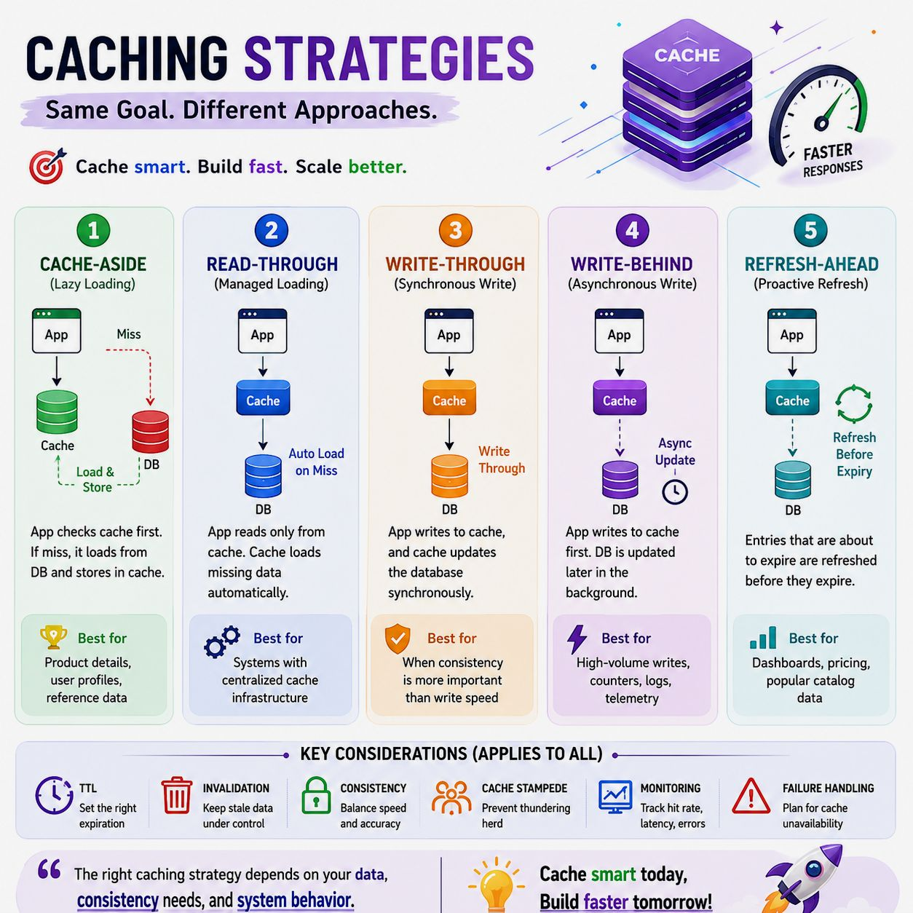

**Caching:** Caching is like having a memory bank for your application. Instead of having to ask for the same data repeatedly (which takes time), you temporarily store that data in a fast-access place. When you need the data again, you fetch it from the cache instead of querying the original source. Caching reduces latency and lightens the load on the backend by serving pre-processed data. It also improves scalability and reduces operational costs, making it a lifesaver for businesses of all sizes.

Imagine if instead of querying the database every time, you could store that data somewhere faster and more accessible. This would speed things up and ease the burden on your server. Caching is exactly that—a way to store data temporarily so that you don’t have to re-fetch it every time it's needed.

## Working:
+ When the first time a request is made a call will have to be made to the database to process the query. This is known as a cache miss.
+ Before giving back the result to the user, the result will be saved in the cache.
+ When the second time a user makes the same request, the application will check your cache first to see if the result for that request is cached or not.
+ If it is then the result will be returned from the cache. This is known as a cache hit.
+ The response time for the second time request will be a lot less than the first time. 

## Top Caching Strategies

### 1. Cache Aside (Lazy Loading)
Also known as "Lazy Loading," this strategy involves loading data into the cache on demand. In the cache-aside (lazy loading) pattern, write operations do not update the cache directly with new values; instead, the application updates the database first and then invalidates (deletes) the key from the cache.

#### How It Works

**Read Operation:**
1. **Check Cache:** The application checks the cache for requested data.
2. **Cache Hit:** If found, data is returned directly to the client.
3. **Cache Miss:** If not found:
   - Application queries the primary database.
   - Application stores the retrieved data in the cache (often with a TTL).
   - Application returns data to the client.

**Write Operation:**
1. **Update Database:** The application sends the write/update request directly to the primary database.
2. **Invalidate Cache:** Once the database update succeeds, the application deletes (or evicts) the corresponding key from the cache (e.g., Redis or Memcached).
3. **Next Read Repopulates:** The next time that piece of data is requested, a cache miss occurs, forcing the application to fetch the fresh data from the database and write it back to the cache.

> **Key Principle:** The application updates the database first and then invalidates the cache, rather than directly updating the cached value.

#### Architecture Flow

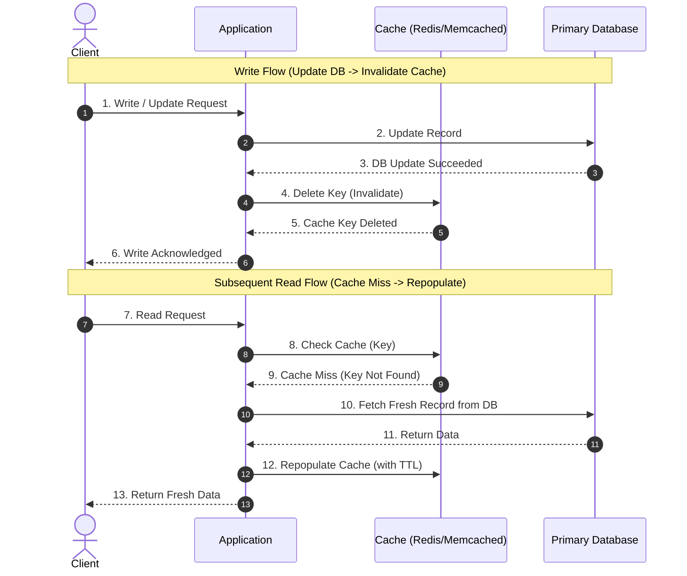

#### Example: Updating a User's Profile
Suppose Redis contains `user:101` with the old name, `Alice`.

| Step | Operation | Result |
| :--- | :--- | :--- |
| **1** | Update the database | Name becomes `Alicia` in DB |
| **2** | Delete Redis key `user:101` | Old cached value is removed |
| **3** | Next request reads `user:101` | Cache miss occurs |
| **4** | Fetch user from database | Returns `Alicia` |
| **5** | Store the result in Redis | Cache now contains `Alicia` |

#### Example Pseudocode
```python
def update_user(user_id, new_name):
    # 1. Update the database first
    db.update_user(user_id, new_name)
    # 2. Invalidate cache after DB success
    redis.delete(f"user:{user_id}")

def get_user(user_id):
    key = f"user:{user_id}"
    # 1. Try cache first
    cached_user = redis.get(key)
    if cached_user is not None:
        return cached_user
    
    # 2. Cache miss: fetch from DB
    user = db.get_user(user_id)
    
    # 3. Repopulate cache
    if user is not None:
        redis.setex(key, 300, user)  # Cache for 300 seconds (TTL)
    return user
```

#### Why Invalidate Instead of Updating the Cache Directly?
- **Simpler consistency management:** The application avoids maintaining two copies of the new value during the write operation.
- **Prevents stale values from persisting indefinitely:** The old cache entry is removed after a successful database update.
- **Lazy repopulation:** Only data that is requested again needs to be cached.

#### Production Caveats: Can Cache-Aside Return Stale Data?

> **Yes, Cache-Aside (Lazy Loading) can return stale data.** Cache invalidation reduces this risk, but does not guarantee strong consistency.

##### How can the cache become stale? (Race Condition Scenario)
Consider concurrent read and write operations occurring across multiple application instances:

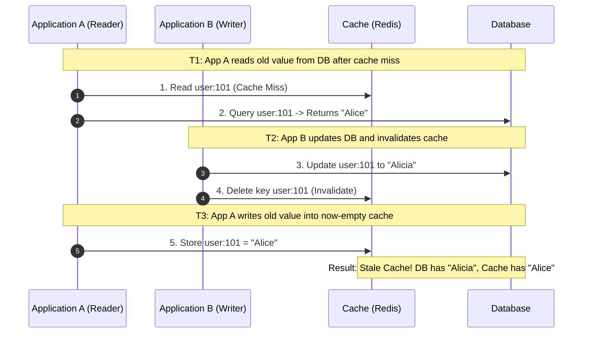

* **T1:** Application A reads old value `Alice` from the database after a cache miss.
* **T2:** Application B updates the database to `Alicia` and deletes the cache key.
* **T3:** Application A writes its previously fetched value `Alice` into the now-empty cache.
* **Result:** **Database = Alicia**, but **Cache = Alice** (stale data persists until evicted or TTL expires).

##### How can production systems reduce stale cache data?

| Technique | Purpose |
| :--- | :--- |
| **Cache TTL** | Limits how long an entry can remain cached, ensuring eventual consistency. |
| **Invalidate after DB commit** | Ensures invalidation follows a successful database transaction commit. |
| **Retry / Transactional Outbox** | Helps recover and guarantee cache eviction if network issues cause cache invalidation to fail. |
| **Versioning or Fencing** | Attaches version/timestamp tokens to prevent older reads from overwriting newer cached values. |
| **Cache Bypass for Critical Reads** | Reads directly from the authoritative database when strong freshness is strictly required (e.g., checkout or balance check). |

> **Interview Takeaway:** Cache-aside improves read performance and reduces database load, but it offers no automatic guarantee of strong consistency. It typically follows **Database write → Cache invalidation → Lazy cache refill on the next read**. TTL and invalidation help manage staleness; concurrent operations and failures still require careful architectural handling.

**Pros:**
- Prevents unnecessary data from being loaded into the cache (cache only contains requested data).
- Resilient to cache node failures (the application can still fallback to the database).
- Offers fine-grained control over caching and invalidation logic.

**Cons:**
- Increased latency on cache misses as the application must perform multiple round-trips (Cache → DB → Cache).
- Requires additional complexity in application code to orchestrate cache reads, writes, and invalidation.
- Possibility of momentary stale data between the database update and cache invalidation.

---

### 2. Read Through
In the Read-Through caching pattern, the cache sits inline between the application and the database. The application interacts **only** with the cache layer for read queries (treating the cache as the main data store). When a cache miss occurs, the caching layer itself (not the application code) transparently fetches the missing data from the database, populates its cache store, and returns the data to the application.

> **Key Idea:** The application delegates data retrieval to the cache layer; the cache autonomously loads missing data from the database on a cache miss.

#### 1. How Read-Through Works

* **Read Operation (Cache Hit):** The application requests data from the cache. The cache finds the key and returns it immediately.
* **Read Operation (Cache Miss):** The application requests data from the cache. The cache detects a miss, fetches the record directly from the primary database, stores it in cache memory, and returns it to the application.
* **Write Pairing:** Read-Through is exclusively a read strategy. In production, it is almost always paired with **Write-Through** (the cache layer handles both reads and writes to the DB) or **Write-Around / Cache-Aside writes** (updates invalidate the cache key).

#### Architecture Flow & Diagrams (Read & Write)

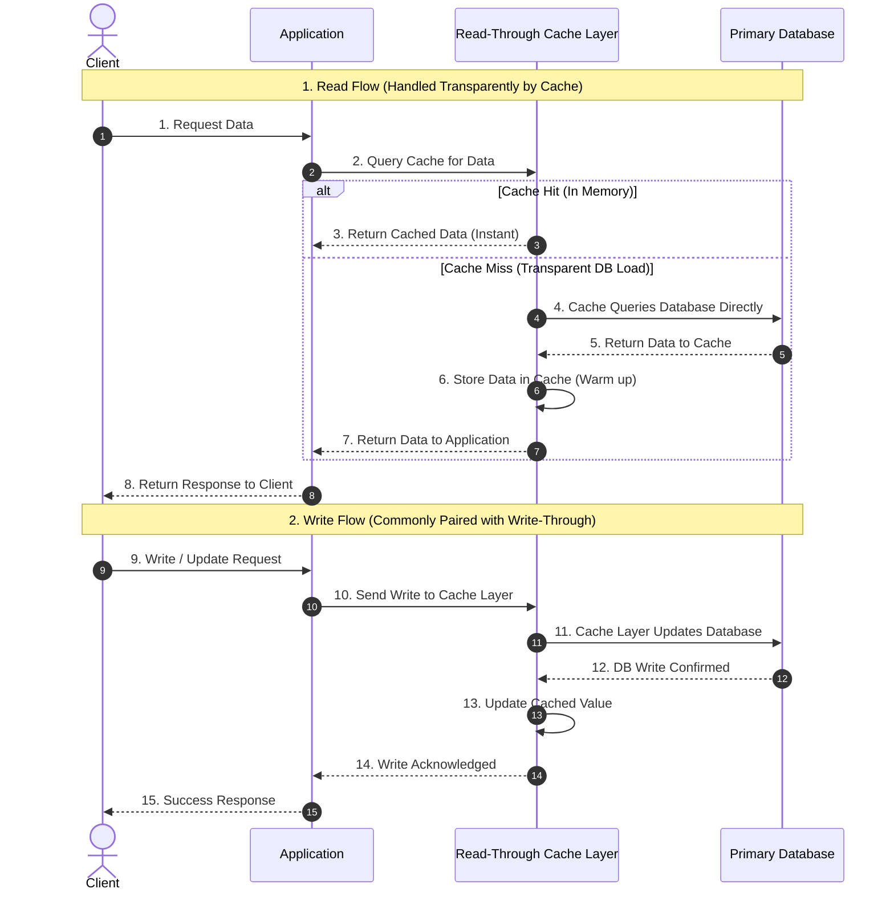

#### 2. Example: Fetching and Updating Product Catalog `prod:303`

| Step | Operation | Action Taken by Cache Layer | Application Experience |
| :--- | :--- | :--- | :--- |
| **1** | First Read `prod:303` | Cache miss $\rightarrow$ Cache queries DB and stores `prod:303` | Application receives data without writing DB query logic |
| **2** | Second Read `prod:303` | Cache hit $\rightarrow$ Returned directly from RAM | Ultra-fast response from cache |
| **3** | Write: Update price | Cache layer synchronously persists new price to DB and updates RAM | Application issues a single update call to cache |
| **4** | Subsequent Read | Cache hit $\rightarrow$ Returns updated price from RAM | Up-to-date data served instantly |

#### 3. Read-Through vs. Cache-Aside

| Feature | Cache-Aside (Lazy Loading) | Read-Through |
| :--- | :--- | :--- |
| **Data Fetch Responsibility** | **Application Code:** App catches miss, queries DB, and populates cache | **Cache Layer:** Cache library/service fetches from DB and stores automatically |
| **Application Complexity** | Higher (App manages both cache and DB connections/queries) | Lower (App only connects to and queries the cache layer) |
| **Data Model Coupling** | Cache and DB schemas can differ | Cache layer must understand the underlying database schema/queries |
| **Common Implementations** | Redis / Memcached client code in App | DynamoDB Accelerator (DAX), Hibernate 2nd Level Cache, Guava CacheLoader |

#### 4. When to Use Read-Through?
- **Read-heavy workloads** where the same data is requested repeatedly across many clients.
- **Microservices architectures** where you want to centralize and encapsulate data fetching logic inside a caching service/plugin rather than duplicating it across multiple app services.
- **Simplifying application code:** Eliminates repetitive boilerplate (`if key not in cache: fetch from db and set`).

#### 5. Production Considerations
- **Cold Start & Thundering Herd:** When multiple concurrent requests miss the cache simultaneously, ensure the cache layer uses request coalescing (single-flighting / mutex locks) so only one query hits the database.
- **Schema Mapping:** Requires the caching layer or cache framework to have direct data access and knowledge of database schemas.

> **Interview Takeaway:** In **Read-Through**, the application treats the cache as the primary data store for reads. On a cache miss, the cache layer transparently loads data from the database without application intervention. It is frequently paired with **Write-Through** to provide a unified data access abstraction.

**Pros:**
- Simplifies application business logic by abstracting database queries behind the cache interface.
- Ensures consistent caching policies across all application instances.
- Memory efficient: only requested data is cached.

**Cons:**
- Requires caching infrastructure/libraries with built-in database adapters (e.g., DAX, Hazelcast, Ehcache).
- Cache layer becomes a critical single point of failure if not configured with high availability.
- Cache misses still incur database round-trip latency.

---

### 3. Write Around
In the Write-Around caching pattern, write operations bypass the cache entirely and are written directly to the primary database. The cache is not populated or updated during the write operation. Instead, data is loaded into the cache only when it is subsequently read (typically paired with Cache-Aside or Read-Through).

> **Key Idea:** Write directly to authoritative storage without polluting the cache; populate the cache only on demand when reads occur.

#### 1. How Write-Around Works

* **Write Operation:** The application writes/updates data directly in the primary database. The cache is completely bypassed.
* **First Read (Cache Miss):** When the data is first requested, a cache miss occurs. The application fetches the data from the database and populates the cache.
* **Subsequent Reads (Cache Hit):** All subsequent reads for this data are served directly from the cache with low latency.

#### Architecture Flow & Diagrams (Read & Write)

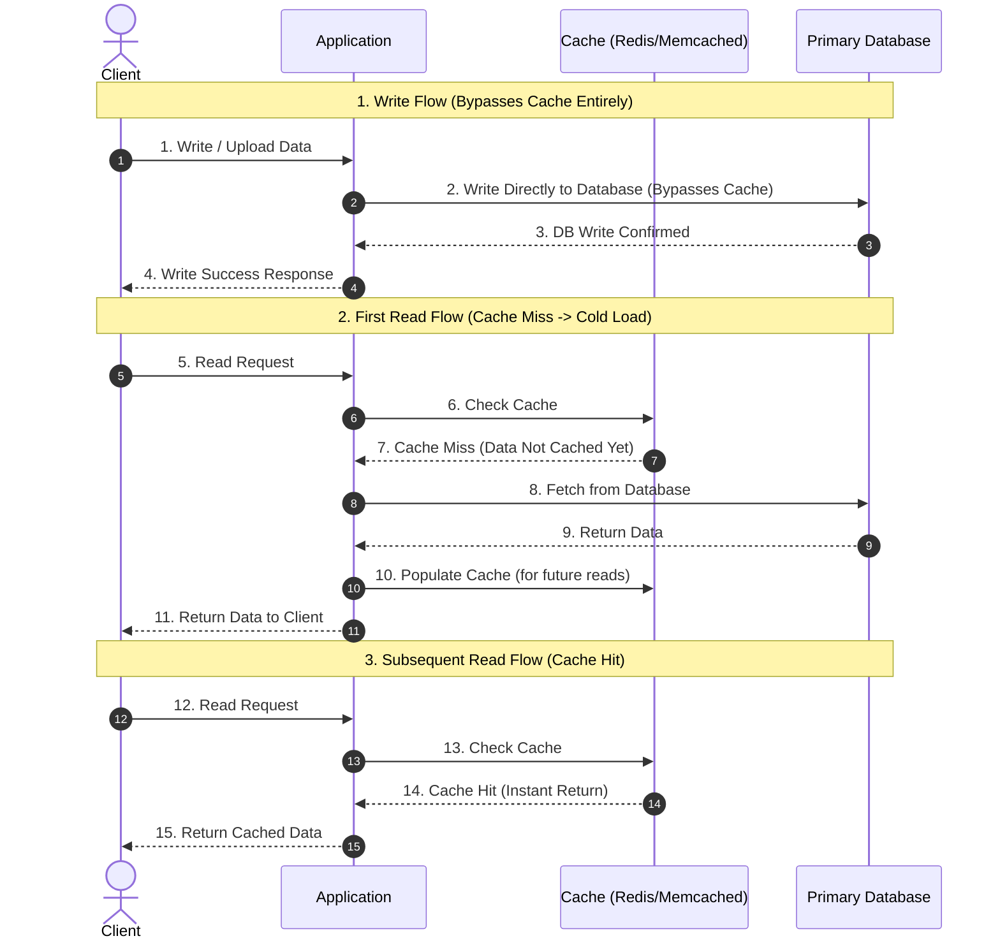

#### 2. Example: User Uploading Archival Video / Document
Suppose a user uploads a new video or archival document `doc:501`:

| Step | Operation | Cache State | Database State | Explanation |
| :--- | :--- | :--- | :--- | :--- |
| **1** | Write: Upload `doc:501` | *Empty / Untouched* | `doc:501` persisted | Write bypasses cache completely |
| **2** | Write response | *Empty / Untouched* | `doc:501` persisted | Client receives upload confirmation |
| **3** | First Read: Request `doc:501` | Cache Miss $\rightarrow$ Load from DB | `doc:501` read | Fetched from DB, saved to Cache |
| **4** | Cache State after 1st Read | `doc:501` cached | `doc:501` persisted | Cache is now warm for `doc:501` |
| **5** | Subsequent Reads | Cache Hit (Instant) | *No DB load* | Served directly from cache memory |

#### 3. Why Use Write-Around?
- **Prevents Cache Pollution (Cache Churn):** In workloads where data is written once but rarely or never read again (e.g., archival storage, real-time logging, security audit trails, bulk imports), write-around prevents fresh writes from evicting hot, frequently read keys from memory.
- **Saves Cache Memory & Bandwidth:** Only data that is actually requested by consumers consumes high-speed RAM.
- **Reduces Write Overhead:** No dual-write or coordination latency on the write path.

#### 4. Production Considerations & Stale Data Risk
* **Existing Cache Keys:** If a key already resides in the cache and a write-around operation updates the database directly, the cache will hold **stale data** unless the application explicitly invalidates the old cached key or sets short TTLs.
* **First-Read Latency (Cold Start):** The first read following a write will always experience a cache miss, resulting in higher latency for that initial query.

> **Interview Takeaway:** Write-around writes directly to primary storage and relies on subsequent read operations to lazily warm the cache. It is the optimal strategy for write-heavy workloads where newly written data is not accessed immediately, protecting cache memory against unnecessary churn.

**Pros:**
- Eliminates cache churn by keeping write-once, read-rarely data out of RAM.
- Maximizes cache hit rates for truly hot items by preventing unnecessary evictions.
- Simpler write path with no synchronous dual-write penalty.

**Cons:**
- Higher latency for initial read requests (guaranteed cache miss after new writes).
- Higher load on primary database if many newly created records are read right away.
- Risk of serving stale data if modifying existing records without invalidating pre-existing cache entries.

---

### 4. Write Back (Write Behind)
In the Write-Back (Write-Behind) pattern, the application writes directly to the cache first and receives an immediate acknowledgment. The cache or a background worker then asynchronously writes the updated data back to the database later (individually or coalesced in batches).

> **Key Idea:** Acknowledge writes immediately from fast in-memory cache, and flush updates to the database asynchronously.

#### 1. How Write-Back Cache Works

1. **Application:** Receives a write request.
2. **Cache (In-Memory):** Writes the new value first and returns a fast acknowledgment.
3. **Asynchronous Background Worker / Queue:** Buffers and flushes pending writes later (often batched).
4. **Database:** Persists the updated value durably.

#### Architecture Flow & Diagrams (Read & Write)

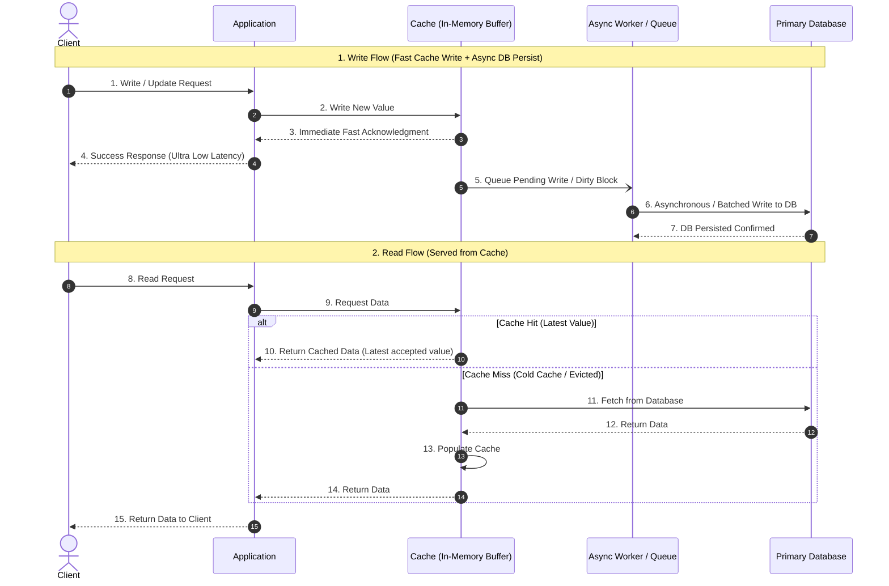

#### 2. Example: Updating a Bank Account Balance
Suppose the initial balance is **₹1,000** and the user deposits **₹500**:

| Step | Write-back Operation | Balance State |
| :--- | :--- | :--- |
| **1** | Initial balance | Cache: ₹1,000 \| DB: ₹1,000 |
| **2** | Update the cache immediately | Cache: ₹1,500 \| DB: ₹1,000 |
| **3** | Return success to the application/client | Client receives ₹1,500 success |
| **4** | Background worker writes to the database | Cache: ₹1,500 \| DB: ₹1,500 |

*The application acknowledges the write before the database has persisted it, maximizing throughput and minimizing write latency.*

##### Why is it fast?
- **Memory write speeds:** In-memory writes are orders of magnitude faster than durable disk/database I/O.
- **Non-blocking write path:** The application never waits for database network trips or disk fsync operations.
- **Write Coalescing & Batching:** Multiple consecutive writes to the same key or records can be merged into a single batched database write.

#### 3. What are the Disadvantages?
- **Data Loss Risk:** If a cache node or process crashes before pending dirty writes are flushed to the database, acknowledged writes can be permanently lost unless protected by durable write-ahead logs or replication.
- **Database Lag:** The database temporarily holds stale values until asynchronous flushing completes.
- **Recovery and Ordering Challenges:** Failed writes must be retried with robust backoff, and concurrent updates must be persisted in strict timestamp/version order to avoid write-skew.

#### 4. Comparison of the Three Core Caching Patterns

| Feature | Cache-Aside | Write-Through | Write-Back |
| :--- | :--- | :--- | :--- |
| **Write Path** | Database first, then invalidate cache | Update database and cache synchronously before success | Cache first, database asynchronously later |
| **Database Write** | Synchronous in the application flow | Synchronous in the write flow | Asynchronous in background worker |
| **Write Latency** | Depends on database speed | Higher (waits for both DB & cache) | Lowest (in-memory write speed) |
| **Cache Freshness** | Stale data possible during race conditions | Better coordinated freshness | Cache holds latest accepted value |
| **Data Loss Risk** | Low (database is source of truth on write) | Low (data is persisted to DB before ack) | Higher if pending writes aren't durably protected |
| **Typical Use** | Read-heavy applications | Applications needing guaranteed fresh cache | Write-heavy workloads prioritizing low write latency |

#### 5. Important Production Clarifications
- **Volatile Memory vs. Durable Protections:** While purely in-memory caches risk data loss upon crashes, production write-back systems mitigate this using **Write-Ahead Logging (WAL)**, **persistent NVMe/SSD cache storage**, **multi-node replication**, or **durable message queues (e.g., Kafka)** to stage pending writes.
- **Database Lag for External Readers:** Reads hitting the cache see the latest accepted value; however, other downstream services reading directly from the underlying database will see stale data until pending writes are flushed.
- **Financial / High-Stakes Caveat:** For mission-critical operations (such as high-value banking or financial ledgers), acknowledging a transaction as permanently settled purely because it reached volatile memory is unsafe without synchronous multi-replica durability.

> **Interview Summary:** Write-back caching improves write performance and absorbs traffic spikes by acknowledging writes immediately from cache before asynchronously persisting them to the database. Its primary trade-off is the added architectural complexity required to manage durability, retries, write ordering, and crash recovery.

**Pros:**
- Ultra-low write latency and superior write throughput.
- Drastically reduces database load via write coalescing and batching.
- Shields primary databases from high-frequency write spikes.

**Cons:**
- Risk of data loss if cache fails before flushing pending writes.
- Increased complexity for recovery, retries, and ordering consistency.
- Database temporarily lags behind cache.

---

### 5. Write Through
In the Write-Through Cache pattern, every write updates the cache and the database together. The application typically writes through the cache layer, which updates the cache and synchronously propagates the write to the database.

> **Key Idea:** Write to both the cache and the database before reporting success to the client.

#### Architecture Flow & Diagrams (Read & Write)

The exact order of cache and database updates depends on the implementation. A common design updates the database and then the cache before acknowledging success.

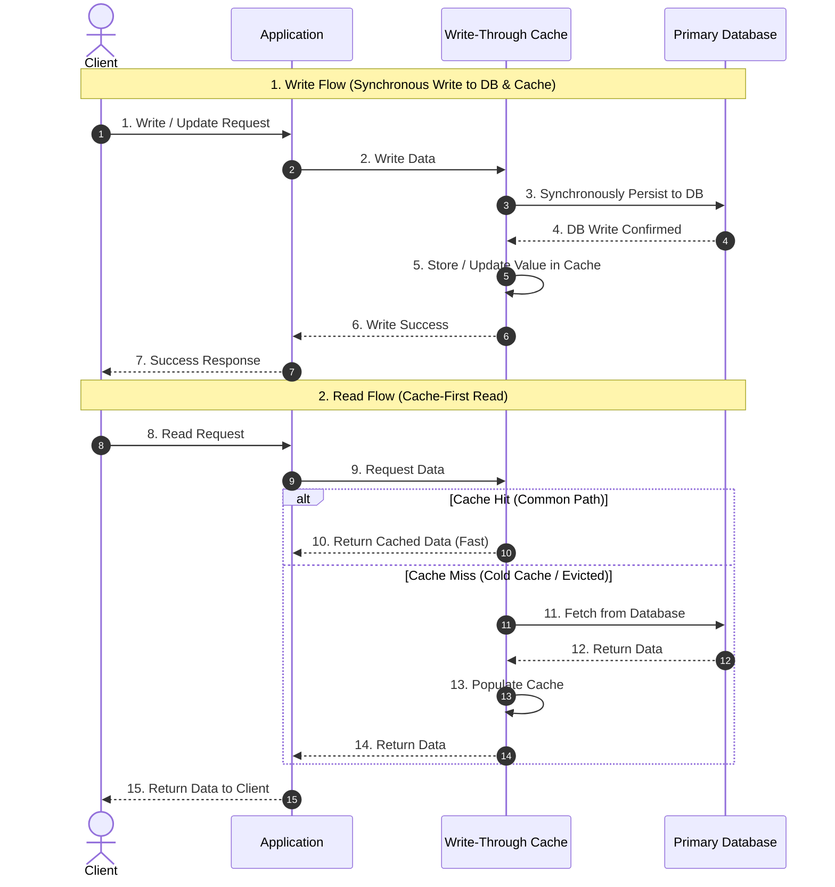

#### Example: Updating a User's Profile
Suppose the database and cache both contain:
`user:101 → Alice`

The user changes their name to **Alicia**:

| Step | Operation | Result |
| :--- | :--- | :--- |
| **1** | Application sends write request | Update name to `Alicia` |
| **2** | Write-through layer updates the database | Database stores `Alicia` |
| **3** | Write-through layer updates the cache | Cache stores `Alicia` |
| **4** | Application receives success | Both writes have succeeded |

*Unlike cache-aside, the cache is updated during the write operation rather than waiting for the next read.*

#### Cache-Aside vs. Write-Through

| Feature | Cache-Aside | Write-Through |
| :--- | :--- | :--- |
| **Read behavior** | Cache miss fetches from DB and populates cache | Cache usually serves reads; misses still need loading |
| **Write behavior** | Update DB, then invalidate cache | Update DB and cache synchronously |
| **Cache after write** | Key is deleted (evicted) | New value is stored immediately |
| **Stale data risk** | Possible due to races or failed invalidation | Reduced when writes are coordinated correctly; races are still possible |
| **Write latency** | Usually lower (single write to DB + async/fast delete) | Usually higher (must complete both DB & cache writes) |
| **Cache contents** | Only accessed data is typically cached | Written data is typically cached regardless of access frequency |
| **Database load** | Depends on cache misses and writes | Database receives writes and reads that miss the cache |

#### Does Write-Through Eliminate Stale Data?
**No, not completely.**

* For example, if the database update succeeds but the cache update fails, the database contains `Alicia` while the cache might still contain `Alice`.
* Production implementations need to handle partial failures, retries, concurrency, and cache invalidation or repair.
* A distributed cache and database generally cannot be updated as one atomic transaction without additional distributed coordination (e.g., Two-Phase Commit or saga-like reconciliation).

#### When Should You Use Write-Through?
- **Frequently read data that is also regularly updated:** Eliminates cache misses on the first read following a write.
- **User profiles, product metadata, and configuration data:** Situations where keeping the cache immediately current is high value.
- **Systems where additional write latency is acceptable** in exchange for consistently fast read performance.

> **Interview Takeaway:**
> - **Cache-aside:** Write to the database → invalidate cache → repopulate on next read.
> - **Write-through:** Write through the cache layer → update database and cache as part of the write path.
>
> *Write-through trades additional write-path latency for a cache that is generally always up to date and warm for subsequent reads.*

**Pros:**
- Guarantees high cache hit rates for updated data (cache is warm immediately after writes).
- Reduces stale data windows because the cache is actively updated with the latest value.
- Simplifies read logic since data is readily populated.

**Cons:**
- Higher write latency as every write must synchronously complete on both cache and database.
- Cache churn / memory overhead for data that is written frequently but rarely read.
- Complex error handling for partial failure scenarios (e.g., DB write succeeds but Cache write fails).

## Pros of Cache:
- Reduced Latency: Caching significantly decreases the time it takes to access data, leading to faster response times for user requests.
- Decreased Network Traffic: By storing frequently accessed data locally, caching reduces the amount of data that must be transmitted over a network, thereby decreasing network congestion.
- Lower Load on Primary Data Stores: Caching reduces the number of queries to primary data sources like databases, decreasing their load and potentially increasing lifespan.
- Improved Performance: Applications and systems often experience a general performance boost, as retrieving data from a cache is typically faster than accessing it from primary storage.
- Increased Throughput: Systems can handle more data and user requests in a given time due to the efficiency gains from caching.
- Data Availability: In some caching strategies, data can still be available even if the primary data source is temporarily unavailable.

## Cons of Cache:
- **Cache Coherence:** Ensuring that data remains consistent across multiple caches in a distributed system.
- **Cache Invalidation:** Deciding when and how to update or remove data in the cache, especially when the original data changes.
- **Stale Data:** Handling scenarios where data in the cache is outdated compared to the primary data source.
- **Cache Sizing:** Determining the optimal size of the cache to balance performance gains with resource usage.
- **Cache Eviction Policies:** Choosing appropriate algorithms for which data to keep in the cache and which to evict when the cache is full.
- **Data Locality:** Ensuring data is stored in a cache close to where it is most frequently accessed to minimize latency.
- **Scalability:** Ensuring the cache can scale as the amount of data and the number of users increase.
- **Warm-up Time:** Managing the time for a cache to “warm up” and become effective after being cleared or created.
- **Thundering Herd Problem:** This occurs when a cached item expires, and multiple clients or processes simultaneously attempt to regenerate the same cache item, causing a surge in load on the data store or compute resources.
- **Cache Penetration:** This happens when queries for non-existent data (not in cache or primary storage) repeatedly bypass the cache and hit the database, potentially leading to performance degradation.
- **Big Key Problem:** Arises when a single cache key is associated with a large amount of data, leading to inefficiencies in cache utilization and potential performance issues.
- **Hot Key Challenge:** Refers to a situation where a few keys are accessed much more frequently than others, causing load imbalances and potential bottlenecks in the caching system.

| Concept               | Problem                                                         | Example                           | Common Solution                                                                      |
| --------------------- | --------------------------------------------------------------- | --------------------------------- | ------------------------------------------------------------------------------------ |
| **Cache Consistency** | Cache contains outdated data after the database changes         | Amazon product price              | Cache invalidation, write-through, TTL                                               |
| **Cache Coherence**   | Multiple caches across servers or regions have different values | Netflix or Facebook global caches | Shared cache, pub/sub, message queues, distributed cache synchronization             |
| **Cache Security**    | Cached authentication data is stolen or never expires           | Login sessions                    | Store only session IDs/tokens, use TTL, secure cookies, encryption where appropriate |

**A useful way to remember them is:**
- Consistency → "Is my cached data up to date?"
- Coherence → "Do all caches agree with each other?"
- Security → "Is the cached data safe, and does it expire appropriately?"

**Putting It All Together**
```
                   User
                     |
                     v
              Load Balancer
                     |
          -----------------------
          |                     |
          v                     v
      App Server 1         App Server 2
          |                     |
          +----------+----------+
                     |
              Redis Cache
                     |
           (Fast Read/Write)
                     |
              Cache Miss?
                Yes |
                    v
                Database
```

**When data changes:**
```
Update Database
       |
       +---------------------------+
       |                           |
       v                           v
Invalidate Cache             Update Cache
(Cache Consistency)     or (Write-Through)
```

**Across multiple regions:**
```
Database
    |
    v
Message Queue
    |
 -------------------------
 |           |           |
Redis A   Redis B   Redis C
(Cache Coherence)
```

**For authentication:**
```
User Login
      |
      v
Generate Session/JWT
      |
      v
Store Session Metadata in Redis
(TTL = 30 minutes)
      |
      v
Auto Expire
(Cache Security)
```


### 1. Cache Consistency

> Question: Is the cache showing the latest data?

Example: Amazon Product Price

Suppose a product costs ₹999.

**Step 1: Initial Request**
```
           User
             |
             v
      +--------------+
      | Application  |
      +--------------+
             |
      Cache Miss
             |
             v
         Redis Cache
             |
        Not Found
             |
             v
        Database
      Price = ₹999
             |
             +-------->
      Store in Cache
             |
             v
          User gets ₹999
```
Now Redis contains
```
Product 1001
Price = ₹999
```

**Step 2: Seller updates the price**

Seller changes
```
₹999
   ↓
₹899
```
Database
```
Product 1001

Price = ₹899
```
But cache still contains
```
Product 1001

Price = ₹999
```
Now another user requests the product.
```
User
   |
   v
Application
   |
   v
Redis Cache
   |
Price = ₹999
```
User sees
```
₹999 ❌
```
Instead of
```
₹899 ✅
```
This is called stale cache.

#### How do companies solve this?

**Strategy 1 — Cache Invalidation (Most Common)**

Whenever database changes
```
Update Database
       |
       v
Delete Redis Key
       |
       v
Next Request
       |
       v
Database
       |
Store Latest Data in Cache
```
Example
```
await db.updateProduct(id);
await redis.del(`product:${id}`);
```

**Strategy 2 — Write Through Cache**

Instead of updating only DB
```
Application
     |
     +------> Database
     |
     +------> Cache
```
Both are updated together.

**Strategy 3 — TTL (Time To Live)**
```
Redis
product:1001
Expires after 60 seconds
```
Even if nobody deletes it,

Redis automatically removes it.

**Real-world example**

Instagram

You upload a new profile picture.

Old picture still appears for 5 seconds.

Why?

Because CDN/cache hasn't refreshed yet.

### 2. Cache Coherence

> Question: What if there are multiple caches?

Imagine Netflix has servers worldwide.
```
          Users

India        USA       Japan
  |           |           |

Server A   Server B   Server C
```
Each server has its own Redis.
```
India
Redis A
Movie Rating = 8.5
```
USA
```
Redis B
Movie Rating = 8.3
```
Japan
```
Redis C
Movie Rating = 8.1
```
Now admin updates rating
```
8.5

↓

9.0
```
Database
```
Movie Rating = 9.0
```
Problem
```
Redis A = 8.5
Redis B = 8.3
Redis C = 8.1
```
Different users see different values.

This is called cache coherence.

**Solution 1**

Broadcast update
```
Update Database
       |
       v
 Message Queue
       |
 -------------------------
 |          |            |
Redis A   Redis B    Redis C
```
Every cache updates itself.

**Solution 2**

Shared Redis

Instead of
```
Server A → Redis A
Server B → Redis B
Server C → Redis C
```
Everyone uses
```
           Redis

        Shared Cache
      /      |      \
ServerA ServerB ServerC
```
Now everyone reads identical data.

**Real Example**

Facebook

When someone changes their profile name,

every region should display the same name.

Keeping caches synchronized globally is a cache coherence problem.

### 3. Cache Security

Many people misunderstand this one.

It is NOT about storing passwords in Redis.

Passwords should never be cached.

Instead, applications often cache authentication state.

**Example**

Suppose you login.
```
Username

john@gmail.com

Password

********
```
Server verifies.

Then generates
```
JWT

or

Session ID
```
Now server may cache
```
Session ID
abc123
User ID
1001
Expires
30 minutes
```
NOT
```
Password ❌
```
When the user requests
```
/profile
```
Server checks
```
Redis
Session abc123
Exists?
```
If yes
```
User authenticated
```
No database lookup needed.

Very fast.

**Problem**

Suppose
```
Session
Never expires
```
Someone steals
```
abc123
```
They can login forever.

Huge security issue.

**Solution**

Use expiration.
```
Redis
Session
TTL = 30 minutes
```
After
```
30 minutes
```
Redis removes it automatically.

User logs in again.

**Another Example**

Gmail

When you click
```
Stay Signed In
```
Google doesn't cache your password.

Instead, it stores a secure, time-limited authentication token (typically in an HTTP-only, secure cookie). If that token expires or is revoked, you'll be asked to sign in again.

---

### 4. Cache Eviction Policies

#### 1. Why do we need to evict a cache?
A cache stores data in memory (RAM) to make reads fast. However, memory is finite and significantly more expensive than disk storage, so we cannot store the entire database in cache memory.

**For example:**
- Total application database data: **500 GB**
- Available cache memory: **1 GB**
- Cache is **100% full**.
- A new request arrives for data that needs to be cached.

To make room for the new data, the cache must remove an existing entry. This process is called **Cache Eviction**.

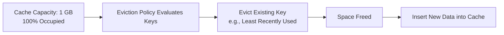

---

#### 2. What is an Eviction Strategy?
An **eviction strategy (policy)** is the algorithmic rule used to decide which cached item should be removed when the cache reaches capacity and needs space for incoming entries.

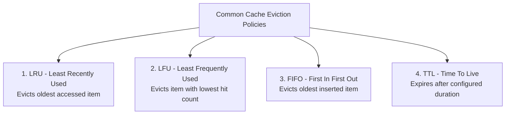

##### 1. LRU — Least Recently Used
* **Mechanism:** Evicts the item that has not been accessed for the longest time.
* **Example:** A product page hasn't been accessed for hours, while other trending products are accessed constantly. The inactive product is evicted.

##### 2. LFU — Least Frequently Used
* **Mechanism:** Evicts the item with the lowest access frequency (hit count).
* **Example:** A product cached after a single one-off request is evicted before a popular product that has been requested thousands of times.

##### 3. FIFO — First In, First Out
* **Mechanism:** Evicts the item that entered the cache earliest, regardless of how frequently or recently it was accessed.

##### 4. TTL — Time to Live
* **Mechanism:** An entry expires automatically after a configured duration (e.g., 5 minutes).
* *Note:* TTL expiration (time-based invalidation) and capacity-driven eviction (space pressure) are different mechanisms, though both remove cached entries.

---

#### 3. LRU Step-by-Step Example
Suppose a cache has a strict capacity limit of **3 items**:

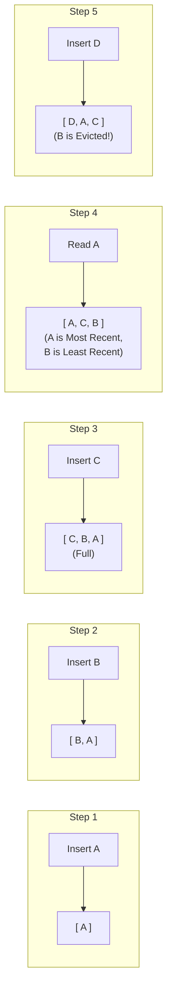

| Step | Operation | Cache Contents (Most Recent $\rightarrow$ Least Recent) | Explanation |
| :--- | :--- | :--- | :--- |
| **1** | Insert A | `[A]` | Added to empty cache |
| **2** | Insert B | `[B, A]` | Added to cache |
| **3** | Insert C | `[C, B, A]` | Cache is now 100% full (3/3 items) |
| **4** | Read A | `[A, C, B]` | `A` accessed $\rightarrow$ moves to front; `B` is now least recently used |
| **5** | Insert D | `[D, A, C]` | Cache full $\rightarrow$ **Evict B** (LRU), store `D` |

*Why is `B` removed? Because among `[A, B, C]`, `B` was accessed longest ago.*

---

#### 4. What happens when an evicted item is requested again?
In a standard cache-aside architecture:
1. **Client Request:** The application requests the item.
2. **Cache Miss:** The cache no longer contains it because it was previously evicted.
3. **Database Fetch:** The application queries the primary database.
4. **Cache Repopulation:** The application stores the fetched item back into the cache (subject to current cache capacity and eviction policies).

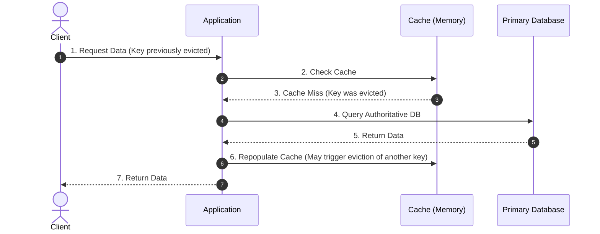

> **Important Concept:** Eviction **only removes the cached copy in memory**, not the original authoritative record in the database.

---

#### 5. Interview-Ready Summary

| Term | Meaning |
| :--- | :--- |
| **Cache** | Fast, high-speed storage tier (commonly in RAM). |
| **Cache Capacity** | The maximum memory or item count allocated for cached entries. |
| **Cache Eviction** | Proactively removing valid cached entries to free up memory for new items. |
| **Eviction Policy** | The algorithmic rule (e.g., LRU, LFU, FIFO) that selects which entries to discard. |
| **Cache Miss** | A request lookup where the target key is not currently present in the cache. |
| **Cache Expiration (TTL)** | Automatic invalidation of an entry after a configured lifespan has elapsed. |

> **Key Takeaway:** Cache eviction is essential because RAM is strictly limited. **LRU**, **LFU**, and **FIFO** are standard capacity eviction policies, while **TTL** controls temporal freshness. Selecting the optimal policy depends on your application's read, write, and data access skew patterns.

---

> 📖 **Deep Dive Guides:**
> - [**Multi-Layer Caching Architecture (L0 → L3)**](Caching/Multi_Layer_Caching_Architecture.md) — Comprehensive guide covering hierarchical request traversal, e-commerce product page case study, and layer-by-layer mapping.
> - [**Caching Categories & Architectures**](Caching/Caching_Categories.md) — Detailed breakdown of all 6 caching categories, Redis internals, CDN $\Delta T$ latency analysis, and capacity estimation.

---

## Types of Caching: Different Approaches for Different Needs:

**1. In-Memory Caching:** In-memory caching, such as with Redis or Memcached, stores data directly in the system’s RAM. This is one of the fastest ways to retrieve data because accessing data from RAM is way quicker than querying a database.
- When to Use: Ideal for frequently accessed data that doesn’t change much, like session information or product catalog details. For example, when a user logs into your website, their session data can be stored in memory, making it fast to access.
- Benefits: Incredibly fast, reduces latency.
- Drawbacks: Limited by the amount of available RAM.

2. **Database Caching (Query Caching):** When you’re running complex queries on a large database, the same query can often be repeated multiple times. Database caching stores the results of these queries so that subsequent requests for the same data don’t need to be processed again.
- When to Use: If you have queries that return the same results for multiple users or repeated sessions. Think of how a news website might display the same headlines for hours.
- Benefits: Great for read-heavy applications, saves on expensive database queries.
- Drawbacks: Cache invalidation can become tricky if data is constantly updated.

**3. Content Delivery Network (CDN) Caching:** A CDN is like a global network of servers that store static assets—images, JavaScript, and CSS files. By caching these assets at servers around the world, users can access them more quickly, no matter where they are. CDN caching replicates your data across various geographical locations, reducing the data travel time (latency) by serving it from the nearest server to the user. Big players like Cloudflare and AWS CloudFront provide CDN services.
- When to Use: If your app or website serves a lot of static content like images, videos, or downloadable files.
- Benefits: Decreases latency, improves page load times globally, reduces load on your origin server.
- Drawbacks: Not useful for dynamic content (content that changes frequently).

4. **Distributed Caching:** When you're scaling your application to multiple servers or cloud instances, it becomes essential to share cache data across those instances. Distributed caching solutions like Hazelcast or Amazon ElastiCache store cache data in a centralized manner, accessible to all instances.
- When to Use: For large-scale applications that span multiple servers, ensuring that the cache is consistent across all of them.
- Benefits: Scales across multiple instances, improves performance.
- Drawbacks: Managing consistency can be more complex.

## Cache Invalidation
In addition to removing infrequently accessed items, caches often contain data that becomes obsolete or stale. These outdated cache entries need to be identified and slated for removal.

1. **Time-Based Expiration (TTL):** Data is invalidated after a specified duration. When the TTL expires, the cached data is either automatically removed or marked as invalid. There are two approaches:
-Active expiration: A background process or thread periodically scans the cache to check the TTL of cache entries.
-Passive expiration: Checks the TTL of a cache entry at its access time.
2.**Write-Invalidate:** When data is updated in the primary storage, corresponding cache entries are invalidated. This ensures consistency between the cache and the source.
3.**Change Notification:** The cache listens for notifications from the data source about changes. When notified, the cache invalidates the relevant entries.
4.**Polling:** The cache periodically checks the validity of its entries by comparing them with the source data.

## "If caching is so great, why not cache everything?"
There are two main reasons: cost and accuracy. 

Since caching is meant to be fast and temporary, it is often implemented with more expensive and less resilient hardware than other types of storage. For this reason, caches are typically smaller than the primary data storage system and must selectively choose which data to keep and which to remove (or evict). This selection process, known as a caching policy, helps the cache free up space for the most relevant data that will be needed in the future. Eviction Policies. 

- **First In, First Out (FIFO):** Evicts the oldest items in the cache first, regardless of their usage frequency.
- **Least Recently Used (LRU):** Evicts the least recently accessed items first, assuming that items not accessed recently are less likely to be accessed in the future.
- **Most Recently Used (MRU):** Opposite of LRU, it evicts the most recently used items first. This can be useful when the most recent items are less likely to be reaccessed.
- **Least Frequently Used (LFU):** Prioritizes eviction of least frequently accessed items, assuming frequent access implies future relevance.
- **Most Frequently Used (MFU):** Eviction policy is a cache eviction strategy where the cache identifies and removes the data items that are accessed most frequently.
- **Random Replacement (RR):** Randomly selects a cache item to evict, which can be simpler to implement and effective in specific scenarios.
- **Size-Based Eviction:** Evicts items based on their size to manage the memory footprint, often used in combination with other policies.

## Terms of Caching
- **Cache Hit:** Occurs when the requested data is found in the cache, allowing for faster data retrieval.
- **Cache Miss:** This happens when the requested data is not in the cache, necessitating fetching the data from its primary storage location.
- **Cache Eviction:** The process of removing data from the cache, typically to make space for new data.
- **Cache Staleness:** Refers to the situation where the data in the cache is outdated compared to the data in the primary storage.
- **Cache Warm-Up:** The process of preloading the cache with data before it is actively used to avoid cache misses in the early stages of usage.
- **Cache State:** The status of data stored in a cache:
   -Hot: Cache contains data that is being accessed very frequently and recently.
   -Warm: Cache is not as actively used as a hot cache but still contains relatively frequently accessed data.
   -Cold: Cache is first initialized and has not yet had any data loaded.
