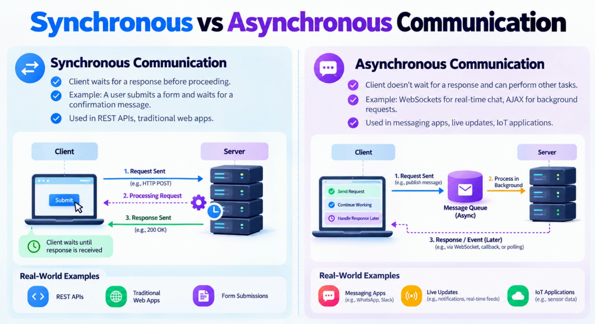
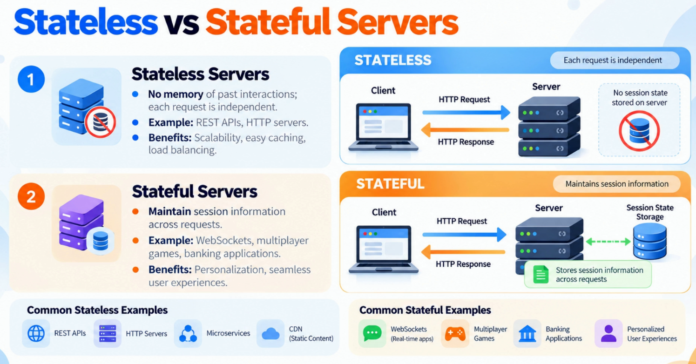
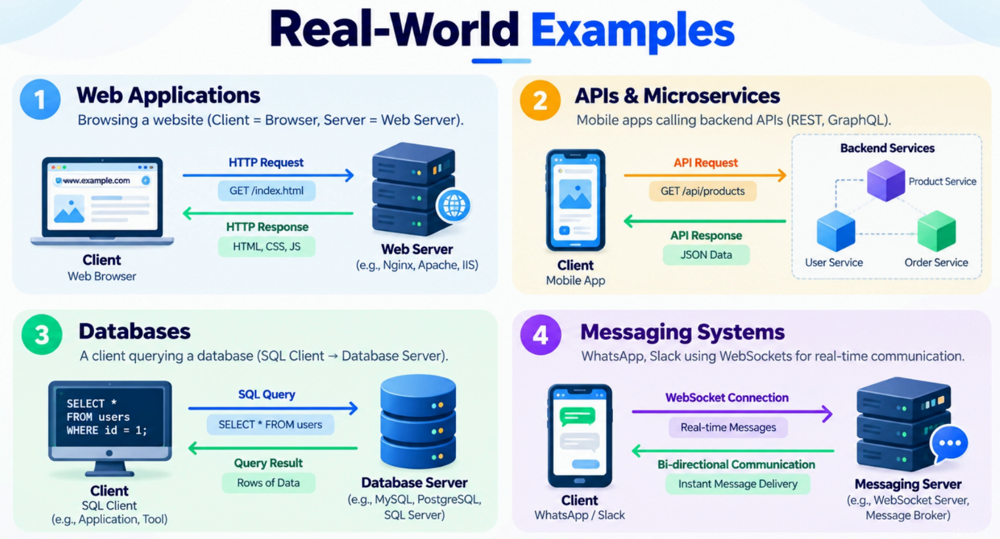

# Client-Server Model

The **client-server model** is the architectural pattern that powers everything from websites and mobile applications to APIs, databases, and large-scale distributed systems.

---

## What is the Client-Server Model?


The client-server model is one of the foundational ideas behind modern software systems because it **separates responsibilities**:

- **Clients** focus on user interaction
- **Servers** centralize processing, business logic, and data management

This separation makes systems easier to scale, secure, and maintain as usage grows.

Think about what happens when you open a website. The browser doesn't contain the website's data or logic — it simply sends a request. The server receives that request, processes it, retrieves any required data, and returns a response. The same pattern appears in email systems, APIs, databases, and cloud platforms.

> As architects, most system design discussions start with this model. Once clients and servers are separated, we can independently scale servers, add caching, introduce load balancers, and distribute services across multiple machines. The client-server model is the first step towards building large-scale distributed systems.

---

## Key Components

Every client-server interaction depends on **three components** working together:

```
┌─────────────────────────────────────────────────────────────────────┐
│                                                                     │
│   ┌───────────┐           ┌───────────┐           ┌─────────────┐  │
│   │           │  Request  │           │  Request  │             │  │
│   │  CLIENT   │──────────►│  NETWORK  │──────────►│   SERVER    │  │
│   │           │           │           │           │             │  │
│   │ - Browser │◄──────────│ - Latency │◄──────────│ - Business  │  │
│   │ - Mobile  │  Response │ - Packet  │  Response │   Logic     │  │
│   │ - App     │           │   Loss    │           │ - Data      │  │
│   │           │           │ - Bandwidth           │ - Security  │  │
│   └───────────┘           └───────────┘           └─────────────┘  │
│                                                                     │
└─────────────────────────────────────────────────────────────────────┘
```

| Component | Responsibility |
|---|---|
| **Client** | Collects user input, sends requests, presents responses. Could be a browser, mobile app, or another service consuming an API. |
| **Server** | Executes business logic, enforces security, processes data, and coordinates with other systems such as databases or external services. |
| **Network** | Connects both sides. Real-world challenges — latency, packet loss, bandwidth limitations, and unreliable connections — all happen here. |

> Architects must design not only for functionality, but also for communication across **imperfect networks**.

---

## How Clients and Servers Communicate


At a conceptual level, every client-server interaction follows a simple flow:

```
Client                          Server
  │                               │
  │──────── Request ─────────────►│
  │                               │  (process request,
  │                               │   query DB, apply logic)
  │◄──────── Response ────────────│
  │                               │
```

What looks like a single click to a user often triggers multiple requests, network hops, backend services, and database operations behind the scenes.

> **Key Insight:** Communication is never free. Every request introduces network latency, consumes resources, and creates potential failure points.

### Communication Patterns

| Pattern | Description | Best For |
|---|---|---|
| **Request-Response** | Client sends a request, server returns a response, interaction ends | Webpages, REST APIs, most business applications |
| **Persistent Connection (WebSocket)** | Channel stays open; both sides exchange data instantly | Live chat, collaborative editing, gaming, stock trading |

Choosing between these models is a trade-off between **simplicity** and **real-time responsiveness**.

---

## The Request-Response Cycle — HTTP Example

The HTTP request-response cycle demonstrates how multiple infrastructure components work together to serve a single user action:

```
User enters URL in Browser
         │
         ▼
┌─────────────────────┐
│   DNS Resolution    │  Translates domain name → IP address
└─────────────────────┘
         │
         ▼
┌─────────────────────┐
│   HTTP Request      │  Browser sends request to web server
└─────────────────────┘
         │
         ▼
┌─────────────────────────────────────────────────────┐
│                  Server Processing                  │
│                                                     │
│  Static content → return immediately                │
│  Dynamic content → business logic → cache/DB call   │
└─────────────────────────────────────────────────────┘
         │
         ▼
┌─────────────────────┐
│   HTTP Response     │  Status code + response body (HTML/JSON/etc.)
└─────────────────────┘
         │
         ▼
┌─────────────────────────────────────────────────────┐
│              Browser Rendering                      │
│                                                     │
│  Renders content → triggers additional requests     │
│  (images, CSS, JavaScript, APIs)                    │
└─────────────────────────────────────────────────────┘
```

> **Architectural Observation:** A single web page is rarely one request. It often involves dozens or even hundreds of requests working together to create the final user experience.

---

## Synchronous vs. Asynchronous Communication



The difference is about **what happens while the work is being performed**.

```
Synchronous
───────────
Client          Server
  │──── Request ────►│
  │    (blocked)     │  ← client waits
  │◄─── Response ────│
  │  (continues)     │


Asynchronous
────────────
Client          Server
  │──── Request ────►│
  │  (continues      │  ← client does other work
  │   other work)    │
  │◄─── Response ────│  (arrives later via callback/event/WebSocket)
```

| Model | Optimizes For | Trade-off | Common Use Cases |
|---|---|---|---|
| **Synchronous** | Simplicity, predictability | Client is blocked if server is slow | REST APIs, traditional web apps |
| **Asynchronous** | Scalability, responsiveness | More complex to reason about | Notifications, background jobs, real-time updates, event-driven workflows |

> In real-world architecture, **both are used together** — synchronous for immediate user interaction, asynchronous for background processing and real-time updates.

---

## Stateless vs. Stateful Servers

One of the most important architectural decisions in distributed systems is determining **where state should live**.

```
Stateless Server                    Stateful Server
────────────────                    ───────────────
  Request 1 ──► [Server A]            Request 1 ──► [Server A] ← stores session
  Request 2 ──► [Server B]            Request 2 ──► [Server A] ← must go to same server
  Request 3 ──► [Server C]            Request 3 ──► [Server A] ← sticky routing required

  Any server can handle any           Only the specific server
  request → easy to scale             with context can respond
```

| | Stateless | Stateful |
|---|---|---|
| **Request handling** | Every request is a fresh interaction | Context is maintained across requests |
| **Scaling** | Easy — any instance handles any request | Complex — requests often need sticky routing |
| **Failover** | Simple — another server takes over instantly | Hard — state must be synchronized or migrated |
| **Use cases** | REST APIs, web servers, microservices | Real-time gaming, live collaboration, WebSockets, banking workflows |

> As systems grow, architects generally prefer **stateless services** whenever possible and store state in dedicated systems — databases, caches, or distributed session stores. This preserves scalability while still delivering stateful user experiences.

---

## Stateless and Stateful Architecture Patterns in System Design

While the previous section compared stateless and stateful *servers*, understanding these as full **architecture patterns** is critical for system design. The distinction shapes how you design authentication, sessions, APIs, data pipelines, and distributed services.



---

### What is Stateless Architecture?

In a stateless architecture, **no session or client context is stored on the server between requests**. Every request must carry all the information the server needs to process it — typically via tokens, headers, or query parameters.

```
Client                    Load Balancer              Any Server Instance
  │                            │                      │
  │  Request + JWT Token ──────►──────────────────────►│
  │                            │                      │  (no prior knowledge needed)
  │                            │                      │  verifies token, processes request
  │◄───────────────────────────◄──────────────────────│
  │         Response           │                      │

Next request can go to a completely different server instance — no problem.
```

**Characteristics:**
- Each request is self-contained
- Server holds no memory of previous interactions
- Any instance can serve any request
- Tokens (e.g., JWT) carry identity and context

**Common examples:** REST APIs, stateless microservices, CDN edge nodes, serverless functions

---

### What is Stateful Architecture?

In a stateful architecture, **the server retains information about the client across multiple requests**. The server "remembers" who you are and what you were doing.

```
Client                    Load Balancer              Server A (owns session)
  │                            │                      │
  │  Login Request ────────────►──────────────────────►│
  │                            │                      │  creates session: sess_001
  │◄───────────────────────────◄──────────────────────│
  │  Session Cookie (sess_001) │                      │
  │                            │                      │
  │  Next Request + sess_001 ──►──── sticky routing ──►│  ← MUST go to Server A
  │                            │      (session pinned) │  looks up sess_001 → context found
  │◄───────────────────────────◄──────────────────────│
```

**Characteristics:**
- Server maintains session data between requests
- Requests from the same client must often reach the same server (sticky sessions)
- Losing a server means losing session state unless externalized
- Richer context available without re-sending it every time

**Common examples:** Traditional web app sessions, WebSocket connections, multiplayer game servers, financial transaction workflows

---

### Architecture Patterns Compared

#### Pattern 1 — Pure Stateless (REST API with JWT)

```
┌──────────┐     POST /api/orders         ┌──────────────┐
│  Client  │  ─────────────────────────►  │  API Server  │
│          │  Authorization: Bearer <JWT> │  (any node)  │
│          │  { "item": "book", "qty": 1 }│              │
│          │  ◄─────────────────────────  │              │
│          │  201 Created                 │              │
└──────────┘                              └──────────────┘
                                                 │
                                                 ▼
                                          ┌──────────────┐
                                          │   Database   │
                                          │  (state lives│
                                          │    here)     │
                                          └──────────────┘
```
State is stored in the database, not in the server. Any API server node can handle any request.

---

#### Pattern 2 — Stateful Session (Traditional Web App)

```
┌──────────┐     GET /dashboard            ┌──────────────┐
│ Browser  │  ─────────────────────────►   │  Web Server  │
│          │  Cookie: sess_abc123           │  (Server A)  │
│          │                               │              │
│          │  ◄─────────────────────────   │  looks up    │
│          │  200 OK (personalized page)   │  sess_abc123 │
└──────────┘                               └──────────────┘
                                                 │
                                          session stored in
                                          server memory or
                                          session store (Redis)
```
The server uses the session ID from the cookie to retrieve context. If using in-memory sessions, the client must always hit the same server.

---

#### Pattern 3 — Externalized State (Scalable Stateful)

The most common production pattern — **stateless servers + external state store** — gives you the best of both worlds:

```
                          ┌─────────────┐
                          │  Redis /    │
            ┌────────────►│  Session    │◄────────────┐
            │             │  Store      │             │
            │             └─────────────┘             │
            │                                         │
┌──────────┐│    Request + Session Token    ┌─────────┴────┐
│  Client  ││ ─────────────────────────►   │  Any Server  │
│          ││                              │   Instance   │
│          ││ ◄─────────────────────────   │              │
└──────────┘│         Response             └──────────────┘
            │
    State is stored externally —
    any server reads it as needed.
    Servers themselves remain stateless.
```

---

#### Pattern 4 — Stateful Persistent Connection (WebSocket / Real-Time)

```
┌──────────┐   WebSocket Handshake   ┌──────────────────┐
│  Client  │ ──────────────────────► │  Chat Server     │
│          │ ◄────────────────────── │  (Server B)      │
│          │   Connection Established│                  │
│          │                         │  maintains:      │
│          │ ◄── push: "New message" │  - client socket │
│          │ ◄── push: "User joined" │  - room state    │
│          │ ──── send: "Hello"  ──► │  - presence info │
└──────────┘                         └──────────────────┘

Connection is long-lived. Server B "owns" this client for the duration.
If Server B goes down, the client must reconnect (potentially to another server).
```

---

### Trade-off Summary

| Dimension | Stateless | Stateful |
|---|---|---|
| **Scalability** | ✅ Horizontal scaling is trivial | ⚠️ Requires sticky routing or state sync |
| **Failover** | ✅ Any node takes over instantly | ⚠️ State must be migrated or externalized |
| **Simplicity** | ✅ Easier to reason about | ⚠️ Session lifecycle adds complexity |
| **Performance** | ⚠️ Client must send full context each time | ✅ Server already has context |
| **Real-time support** | ⚠️ Requires polling or external pub/sub | ✅ Natural fit for persistent connections |
| **User experience** | ⚠️ Requires token management on client | ✅ Seamless continuity across interactions |

---

### When to Use Each

| Use Case | Recommended Pattern |
|---|---|
| REST API / microservices | Stateless with JWT or API keys |
| User sessions at scale | Stateless servers + external session store (Redis) |
| Real-time chat / collaboration | Stateful persistent connections (WebSocket) |
| Serverless / FaaS | Pure stateless (no shared memory between invocations) |
| Online multiplayer games | Stateful game server per session |
| Financial workflows with multi-step transactions | Stateful with externalized, durable state |
| CDN / edge delivery | Pure stateless |

---

### Key Architectural Principle

> As systems scale, the goal is to keep **servers stateless** and **push state into purpose-built storage systems** — databases, distributed caches (Redis, Memcached), or message queues. This decouples compute from state, making each layer independently scalable, replaceable, and resilient to failure.

---

## Real-World Examples

The client-server model adapts to almost every type of application. While the core pattern remains the same, different systems apply it differently:

```
Traditional Web App          API-Driven App               Database Interaction
───────────────────          ──────────────               ────────────────────
  Browser                    Mobile/Web Client             App Server
     │                              │                           │
     │  HTTP Request                │  REST / GraphQL           │  SQL Query
     ▼                              ▼                           ▼
  Web Server                   Backend API                 Database Server
     │                              │                           │
     │  HTML Response               │  JSON Response            │  Result Set
     ▼                              ▼                           ▼
  Browser renders              Client renders              App Server processes
```

```
Real-Time Messaging
───────────────────
  Chat Client A ◄──── WebSocket (persistent) ────► Chat Server ◄──── WebSocket ────► Chat Client B
                         (server pushes updates instantly — no polling needed)
```

> **Key Principle:** A system can be both a server and a client depending on its role in the interaction — for example, a web server is a server to the browser but a client to the database.

---

## Traditional Web App vs. Messaging App

A practical way to understand synchronous and asynchronous communication is to contrast two real-world systems that most people use daily.


---

### A. Traditional Web App — Synchronous Communication

**Example:** Logging into a website or submitting an online form.

```
Browser / Client
      │
      │  1. HTTP Request (POST /login)
      ▼
  Web Server
      │
      │  2. Validate credentials
      ▼
  Database
      │
      │  3. Query result returned to server
      ▼
  Web Server
      │
      │  4. HTTP Response (success / failure)
      ▼
Browser / Client
      │
      ▼
  Display result
```

**How it works:**
1. You enter your username and password.
2. The browser sends an HTTP request to the server.
3. The server validates your credentials, often by querying a database.
4. The server returns success or failure.
5. The browser displays the result.

> **Key point:** The client typically waits for the response before completing the requested operation or moving to the next dependent step.

---

### B. Messaging App — Asynchronous Communication

**Example:** Sending a message through WhatsApp or Slack.

```
Sender's Phone
      │
      │  1. Send message
      ▼
Messaging Server
      │
      │  2. Acknowledge receipt (sync)
      ▼
Message Storage / Queue
      │
      │  3. Store / queue message if recipient is offline
      ▼
Messaging Server
      │
      │  4. Deliver when recipient is reachable
      │     (via WebSocket / push notification)
      ▼
Recipient's Phone
      │
      ▼
  Delivery & read receipts returned later (async)
```

**How it works:**
1. You send a message to a friend.
2. The messaging server accepts the message and may acknowledge receipt.
3. The server stores or queues it if the recipient is offline or delivery is delayed.
4. The recipient receives the message when reachable — often through a persistent WebSocket connection or a platform-specific push mechanism.
5. Delivery and read receipts may arrive later.

> **Key point:** The sender doesn't need to wait for the recipient to be online or to read the message before continuing to use the app.

---

### Key Differences

| Feature | Traditional Web App | Messaging App |
|---|---|---|
| **Example** | Login page, online form | WhatsApp, Slack |
| **Typical communication** | HTTP request/response | WebSocket, HTTP APIs, background messaging |
| **Client behavior** | Waits for a result when the operation requires it | Can continue working while messages are delivered in the background |
| **Server response** | Usually returns the requested result | May acknowledge acceptance first; delivery status comes later |
| **Recipient offline** | Not usually relevant to a form submission | Messages can often be stored and delivered later |
| **Real-time updates** | Often require another request or a live connection | Often use persistent connections and push notifications |
| **Message queue** | Not normally needed for a basic form | May be used for buffering, retries, and background processing |

---

### Important: Messaging Apps Also Use Synchronous Communication

WhatsApp and Slack are **not purely asynchronous** — they combine both approaches.

When you send a message:
- **Synchronous part:** Your app sends a request, and the server acknowledges that it has accepted the message.
- **Asynchronous part:** The server delivers the message to the recipient, processes notifications, and updates delivery or read receipts later.

Similarly, a traditional web app can use asynchronous processing for sending emails, generating reports, or processing payments.

**Remember the distinction:**
- **Synchronous** — wait for the result of a particular operation.
- **Asynchronous** — start an operation and continue without waiting for its final result.

> A message queue is one way to implement asynchronous processing, but WebSockets alone do not necessarily make an operation asynchronous — they provide a communication channel that can support real-time, bidirectional updates.

---

## Practical Example: Login vs. Sending a Message

These two examples illustrate how the same underlying HTTP mechanism can deliver very different user experiences depending on whether the workflow is synchronous or asynchronous.

---

### Example A — Login API (Synchronous Workflow)

```
Browser / Client
      │
      │  POST /api/login
      │  { "username": "alice", "password": "••••" }
      ▼
  ┌─────────────────────────────────┐
  │         Network (Fetch/XHR)     │
  └─────────────────────────────────┘
      │
      │  HTTP Request sent
      │
      ▼
  Web Server  (validates credentials)
      │
      │  HTTP Response
      │  200 OK  { "token": "..." }   or   401 Unauthorized
      ▼
  ┌─────────────────────────────────┐
  │  Request sent → waiting for     │
  │  response → login result        │
  └─────────────────────────────────┘
      │
      ▼
Browser navigates to dashboard  ✓
```

**What happens:** You enter your credentials. The page waits for authentication to complete before navigating to the dashboard.

> **Interpretation:** The login workflow is **synchronous from the user's perspective**, even if the underlying HTTP request uses asynchronous JavaScript (e.g., `async/await` or `fetch`). The next step — loading the dashboard — cannot begin until the login result is known.

---

### Example B — Sending a Chat Message (Asynchronous Workflow)

```
Sender's Client
      │
      │  POST /api/messages
      │  { "to": "bob", "text": "Hey!" }
      ▼
  ┌─────────────────────────────────┐
  │         Network (Fetch/XHR)     │
  └─────────────────────────────────┘
      │
      │  HTTP Request sent
      ▼
  Messaging Server
      │
      │  202 Accepted
      │  { "messageId": "msg_789", "status": "queued" }
      ▼
  ┌─────────────────────────────────────────────────────┐
  │  Message accepted → sender continues →              │
  │  recipient delivery happens later                   │
  └─────────────────────────────────────────────────────┘
      │                              │
      ▼                              ▼
Sender types next message     Server delivers to recipient
                              (WebSocket / push notification)
                                        │
                                        ▼
                              Delivery & read receipts
                              arrive asynchronously
```

**What happens:** You send a message. It appears in the chat immediately, and you start typing another message while delivery and read receipts may arrive later.

> **Interpretation:** The messaging workflow is **asynchronous**. The HTTP request itself might still be awaited by the client (to confirm the server accepted it), but the *outcome* — whether the recipient received and read the message — arrives independently and later.

---

### Side-by-Side Comparison

| | Login API | Send Message API |
|---|---|---|
| **HTTP method** | `POST /api/login` | `POST /api/messages` |
| **Expected response** | `200 OK` with auth token | `202 Accepted` with message ID |
| **Client blocks?** | Yes — waits before navigating | No — continues immediately |
| **Next step depends on result?** | Yes — must know if auth succeeded | No — message is queued regardless |
| **Final outcome timing** | Immediate | Later (delivery/read receipts) |
| **Workflow type** | Synchronous | Asynchronous |

> **Key takeaway:** The distinction between synchronous and asynchronous is about the **workflow and user experience**, not just the transport layer. Both examples use HTTP — but one blocks the user until the result is known, and the other lets the user continue while the outcome resolves in the background.

---

## Interview Questions

Common interview questions on the client-server model:

1. What is the client-server model and why is it fundamental to distributed systems?
2. What are the three key components of the client-server model and what does each do?
3. Explain the HTTP request-response cycle step by step.
4. What is the difference between synchronous and asynchronous communication? When would you use each?
5. What is the difference between stateless and stateful servers?
6. Why do REST APIs prefer stateless design?
7. What are WebSockets and when would you choose them over HTTP?
8. How does the client-server model relate to microservices architecture?
9. How does DNS fit into the client-server request cycle?
10. What are the trade-offs when deciding where to store state in a distributed system?

> 📄 Refer to the Interview Questions PDF for detailed answers.

---

## Summary and Key Takeaways

| Concept | Takeaway |
|---|---|
| **Client-Server Separation** | Separating responsibilities makes systems easier to scale, secure, and maintain |
| **Three Components** | Client, Server, and Network — all three matter; real challenges often live in the network |
| **Request-Response** | The foundation of web architecture, from monoliths to microservices |
| **Synchronous vs. Async** | Synchronous = simplicity; Asynchronous = scalability and responsiveness |
| **Stateless vs. Stateful** | Prefer stateless for scaling; isolate state to dedicated storage systems |
| **Adaptability** | The same pattern powers web apps, APIs, databases, and real-time systems |

Understanding the client-server model gives you a framework for reasoning about **every larger system design topic**. As systems grow, many architectural decisions — load balancing, caching, service decomposition — are extensions of this foundational concept.

---

## Real World Example

