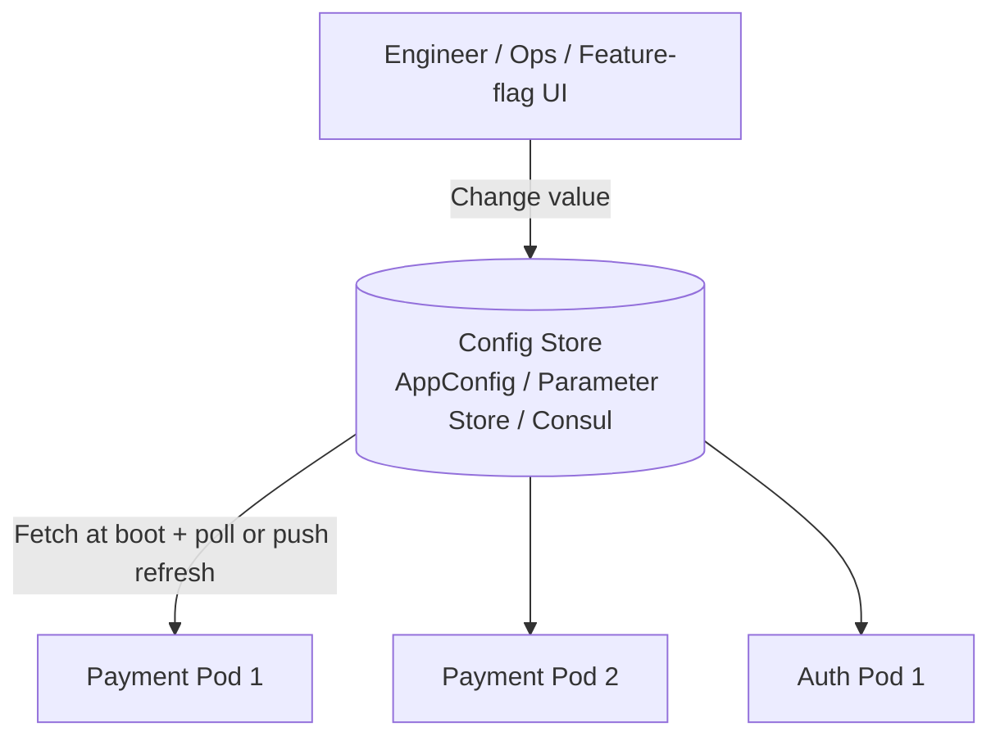
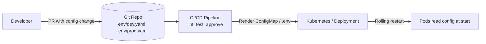
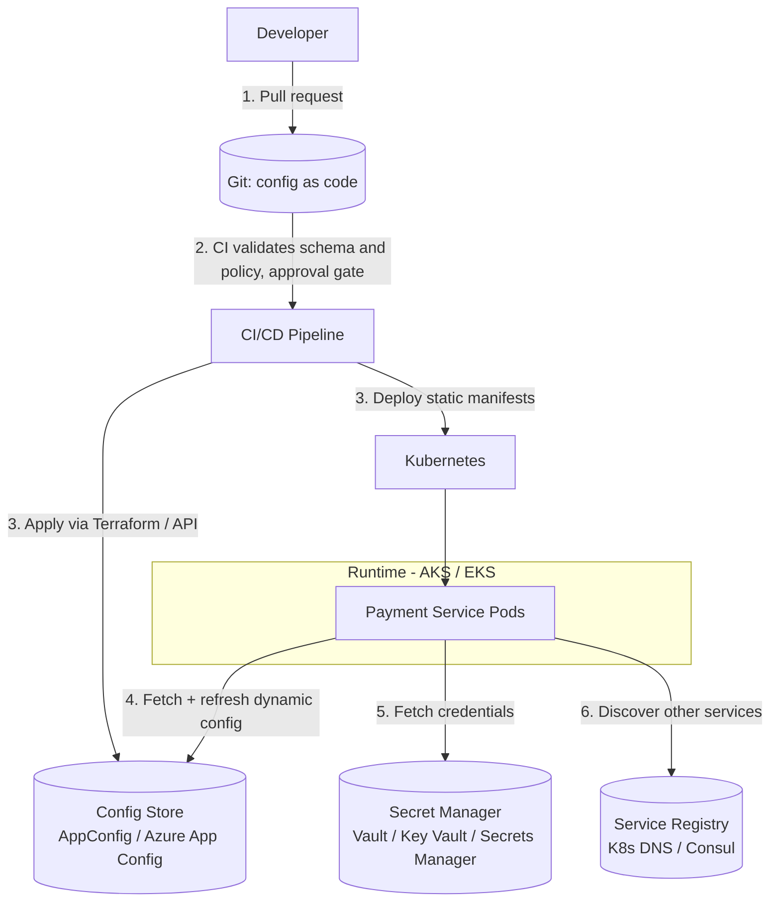
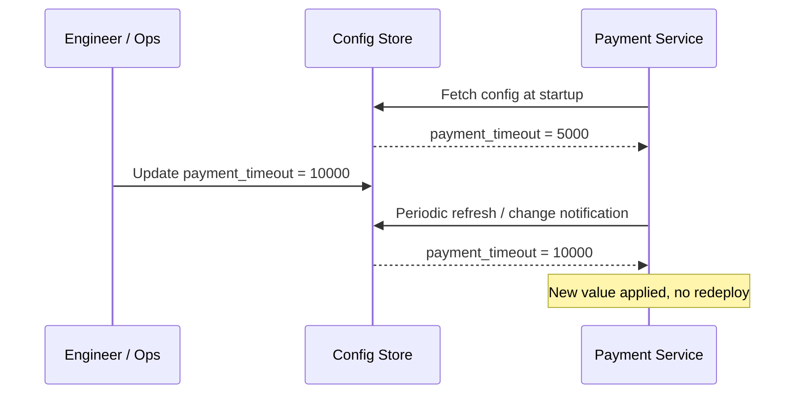
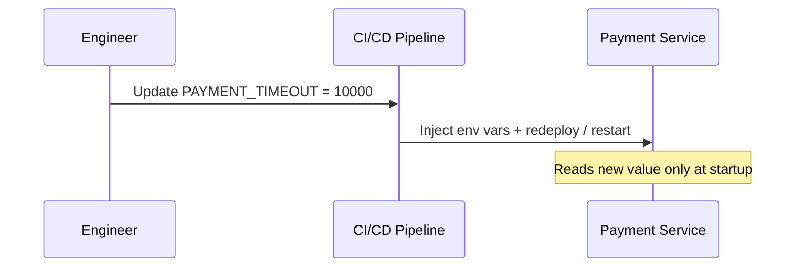
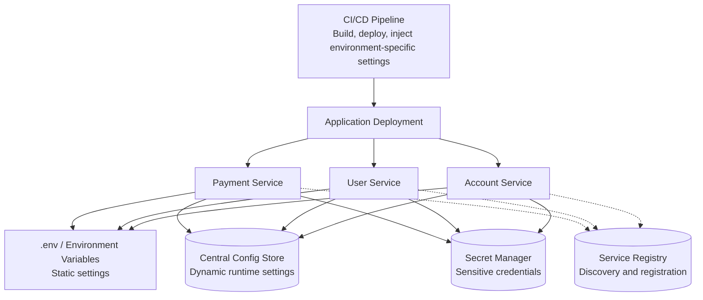

# Centralized Config Store vs. Environment Files via CI/CD

> **Question:** When designing systems like this, do you prefer managing dynamic configuration through centralized cloud stores (AWS Parameter Store / Azure App Configuration), or through distributed environment files managed by CI/CD pipelines?
>
> Related: [`Config Store.md`](Config%20Store.md) · [`Secret Manager.md`](Secret%20Manager.md) · [`Service Registry.md`](Service%20Registry.md) · [`README.md`](README.md)

---


## 1. Short Answer

**Hybrid, split by how often a value changes and how risky it is to change.**

> **centralized configuration stores allow you to update configuration without redeploying the application, whereas .env files generally require a deployment or restart to apply changes.**

| Type of value | Where it lives | Why |
| :--- | :--- | :--- |
| **Static, per-environment infrastructure settings** (cluster names, region, replica counts, image tags) | **Files in Git, applied by CI/CD** (GitOps) | Reviewed, versioned, reproducible, tied to a deploy |
| **Dynamic runtime config** (feature flags, timeouts, rate limits, kill switches) | **Centralized config store** (AWS AppConfig / Parameter Store, Azure App Configuration, Consul) | Changeable without redeploy, with audit and instant rollback |
| **Secrets** (passwords, API keys, certificates) | **Secret Manager** (Vault, AWS Secrets Manager, Azure Key Vault) | Encryption, rotation, access audit; never in Git or env files |

> The word **"dynamic"** in the question is the deciding factor. If a value must change *without a deployment*, a CI/CD-managed file cannot do it, because every change is a redeploy.

---

## 2. The Two Approaches

### Approach A: Centralized Config Store



- Apps **fetch** configuration at startup and **refresh** it at runtime.
- One change updates every instance.

### Approach B: Environment Files via CI/CD (GitOps style)



- Configuration is **pushed** with the deployment.
- Changing a value means a pipeline run and usually a **rollout or restart**.

---

## 3. Side-by-Side Comparison

| Dimension | Centralized Config Store | Env Files via CI/CD |
| :--- | :--- | :--- |
| **Change without redeploy** | Yes (hot reload) | No (needs pipeline and rollout) |
| **Speed of change** | Seconds | Minutes (build, approve, deploy) |
| **Emergency kill switch / rollback** | Instant, one click | Revert commit and redeploy |
| **Code review of changes** | Needs extra process (approvals, change windows) | Native: pull request review |
| **Version history / audit** | Built in (who, what, when) in most stores | Git history gives this for free |
| **Reproducibility** | Weaker: runtime state can drift from Git | Strong: Git is the source of truth |
| **Environment parity** | Labels, paths, namespaces (`/prod/...`) | Separate files per environment |
| **Consistency across many instances** | Single source, all instances see the same value | Each rollout carries a snapshot; mid-rollout mixes old and new |
| **Blast radius of a bad change** | High: can hit every instance immediately | Lower: gated by rolling deployment and health checks |
| **Operational dependency** | Runtime dependency on the store | No runtime dependency |
| **Cost / complexity** | Extra service, SDKs, IAM | Reuses existing pipeline |
| **Fit for feature flags and gradual rollout** | Excellent (percentage rollouts, targeting) | Poor |
| **Fit for secrets** | Not suitable (use Secret Manager) | Not suitable (secrets leak into Git, logs, images) |

---

## 4. When to Choose Which

### Prefer a centralized config store when
- Values change often or must change **without a deploy** (feature flags, rate limits, timeouts, retry counts).
- You run **many services and instances** and need one consistent source.
- You need **runtime control** during incidents (disable a feature, shed load).
- Non-engineers or on-call staff must change values safely, with audit.
- You need percentage rollouts, targeting rules or A/B toggles.

### Prefer env files via CI/CD when
- Values are **tightly coupled to a release** (image tag, schema version, new dependency endpoint).
- You want **every change reviewed in a pull request** and reproducible from Git.
- The system is small, with few services and rare config changes.
- You need a **hard guarantee that config and code version match**.
- You want to avoid adding a runtime dependency.

### Rule of thumb
> **If the value changes with the code, version it with the code. If it changes independently of the code, put it in a config store.**

---

## 5. Risks and Mitigations

### Centralized config store risks

| Risk | Mitigation |
| :--- | :--- |
| **Store outage blocks startup or refresh** | Cache last known good config locally; start with safe defaults; fail open or closed deliberately |
| **A bad value hits all instances at once** | Staged rollout and validation (AWS AppConfig deployment strategies, Azure feature-flag percentages), schema validation, automatic rollback on alarms |
| **Config drift from Git** | Manage the store *as code* (Terraform, Pulumi, Azure Bicep), so changes are still reviewed |
| **Untracked manual edits** | Restrict write access with IAM/RBAC, require approvals, enable audit logs |
| **Stale values in long-lived processes** | Poll interval or push notification; add a version/ETag check |

### CI/CD env file risks

| Risk | Mitigation |
| :--- | :--- |
| **Slow response in an incident** | Keep a small set of runtime kill switches in a config store or flag service |
| **Many repos / many files, inconsistent values** | Central config repo, shared base plus per-environment overlays (Kustomize, Helm values) |
| **Secrets committed to Git** | Never store them here; reference a Secret Manager (External Secrets Operator, CSI driver, sealed secrets) |
| **Mixed versions mid-rollout** | Rolling deployment with readiness checks; backward-compatible config |

---

## 6. Recommended Hybrid Architecture

Combine the strengths of both: **Git for the source of truth and review, a config store for runtime delivery**.



1. Config is **changed through a pull request** (review, history, approvals).
2. CI **validates** it (schema, policy, no secrets).
3. The pipeline **publishes** it to the config store (dynamic) or deploys manifests (static).
4. Services **pull and refresh** dynamic values at runtime, with a local cached fallback.
5. **Secrets stay in the Secret Manager**, never in either path.

This gives you the **auditability and review of GitOps** and the **speed and runtime control of a config store**.

---

## 7. Example: Banking Payment Service

| Setting | Example | Where |
| :--- | :--- | :--- |
| Container image tag | `payment-api:v2.4.1` | Git manifest, CI/CD |
| Replica count, CPU/memory limits | `replicas: 6` | Git manifest, CI/CD |
| Database hostname | `postgres.internal` | Config store (or ConfigMap if static) |
| Payment timeout | `timeout_ms: 5000` | Config store (tunable at runtime) |
| Max retries | `max_retry: 3` | Config store |
| Feature flag | `enable_payment_v2: true` | Config store with percentage rollout |
| Emergency kill switch | `payments_enabled: false` | Config store (instant) |
| Database password | `********` | Secret Manager |
| Redis AUTH password | `********` | Secret Manager |

**Incident scenario:** the downstream payment gateway starts timing out.
- With a **config store**, on-call lowers `timeout_ms`, disables `enable_payment_v2`, or flips the kill switch in seconds, and every instance picks it up.
- With **CI/CD files only**, the same fix needs a commit, pipeline run, approval and rolling restart, which can take many minutes during an outage.

---

## 8. Cloud Options

| Need | AWS | Azure |
| :--- | :--- | :--- |
| Hierarchical config values | Systems Manager **Parameter Store** | **App Configuration** (key-values with labels) |
| Feature flags and safe rollouts | **AWS AppConfig** (validators, staged deployment, auto-rollback) | **App Configuration** feature management (percentage and targeting filters) |
| Secrets | **Secrets Manager** | **Key Vault** |
| Static per-environment config | ConfigMap / Helm values via CI/CD | ConfigMap / Helm values via CI/CD |

---

## 9. Decision Checklist

Ask these for each value:

1. Does it need to change **without a deployment**? → Config store.
2. Does it need to match a **specific code version**? → Git and CI/CD.
3. Is it **sensitive**? → Secret Manager.
4. Does a wrong value have a **large blast radius**? → Use staged rollout, validation and auto-rollback, wherever it lives.
5. Can the app survive the store being **unavailable**? → Add a cached fallback.

---

## 10. How Each Approach Works in Detail

> **Key distinction:** a centralized config store lets you update configuration **without redeploying**, whereas `.env` files generally require a **deployment or restart** to apply changes.

### 10.1 Centralized Configuration Store

**Examples:** AWS Systems Manager Parameter Store, Azure App Configuration, HashiCorp Consul.

**How it works:**
1. Configuration is stored centrally.
2. Backend services retrieve it at startup.
3. Services periodically refresh it, or receive change notifications.
4. When a value changes, services apply the new value **without redeployment**, provided they support runtime refresh.

```json
{
  "payment": {
    "max_retry_attempts": 3,
    "payment_timeout": 5000,
    "maintenance_mode": false
  }
}
```

Change `"payment_timeout": 5000` to `"payment_timeout": 10000`, and the application can pick up the new value without a new application version.



> **Important:** centralized storage alone does **not** guarantee immediate updates. The application needs **polling, push notifications, or a refresh mechanism**.

### 10.2 Distributed Environment Files (`.env`)

**How it works:**
1. Environment-specific configuration is maintained in CI/CD or deployment configuration.
2. CI/CD injects the variables into the deployment.
3. The application starts using those values.
4. To change a value, update the deployment configuration and **redeploy or restart**.

```env
PAYMENT_TIMEOUT=5000
MAX_RETRY_ATTEMPTS=3
PAYMENT_MAINTENANCE_MODE=false
```

If you change `PAYMENT_TIMEOUT` to `10000`, the running application generally **will not detect the change automatically**. You need to restart or redeploy it.



### 10.3 Quick Feature Comparison

| Feature | Centralized Config Store | Distributed `.env` |
| :--- | :--- | :--- |
| **Configuration location** | Centralized | Per environment / deployment |
| **Update configuration** | Centrally | Via CI/CD or deployment |
| **Application redeployment** | Usually not required | Usually required |
| **Runtime refresh** | Supported with implementation | Not automatic |
| **Dynamic configuration** | Excellent | Limited |
| **Environment isolation** | Supported | Supported |
| **Audit / version history** | Usually supported | Depends on CI/CD |
| **Suitable for** | Dynamic settings | Static deployment settings |

---

## 11. Use Cases: Distributed `.env` Files

**Best for static / deployment-time configuration**, where values are relatively stable and normally change during a deployment or restart.

### Common use cases

| Use case | Example |
| :--- | :--- |
| Application configuration | `APP_PORT=8000` |
| Database connection | `DB_HOST=postgres` |
| Backend service URL | `USER_SERVICE_URL=http://user-service:8001` |
| Environment identification | `APP_ENV=production` |
| Logging configuration | `LOG_LEVEL=INFO` |
| Feature settings fixed per deployment | `ENABLE_NEW_CHECKOUT=false` |
| Docker configuration | Container ports and environment variables |

### Real-world example: banking application with three microservices

Each service has its own deployment configuration:

```
payment-service/
    .env.production
    .env.staging

user-service/
    .env.production
    .env.staging

account-service/
    .env.production
    .env.staging
```

**Payment Service**
```env
APP_PORT=8001
DB_HOST=payment-db
LOG_LEVEL=INFO
USER_SERVICE_URL=http://user-service:8002
```

**User Service**
```env
APP_PORT=8002
DB_HOST=user-db
LOG_LEVEL=INFO
```

**Account Service**
```env
APP_PORT=8003
DB_HOST=account-db
LOG_LEVEL=INFO
```

If the Payment Service database hostname changes, update its deployment configuration and **redeploy or restart that service**.

### When to prefer `.env`
- Small applications or monoliths.
- Docker Compose deployments.
- Configuration that rarely changes.
- Environment-specific deployment settings.
- Applications where config changes can follow normal CI/CD releases.

> **Security note:** do not commit production credentials or secrets to `.env` files in Git. Inject secrets through a secret manager or the deployment platform.

---

## 12. Use Cases: Centralized Configuration Store

**Best for dynamic / runtime configuration**, when multiple services need consistent configuration management, or when configuration must change without redeploying.

### Common use cases

| Use case | Example |
| :--- | :--- |
| Feature flags | Enable / disable new payment functionality |
| Payment limits | Change maximum transaction amount |
| Retry policies | Change retry attempts from 3 to 5 |
| API rate limits | Change 100 requests/minute to 200 |
| Circuit breaker settings | Change failure threshold |
| Business rules | Change discount percentage |
| Maintenance mode | Enable / disable application functionality |
| Runtime timeout | Change payment processing timeout |

### Real-world example: banking Payment Service

Initially:
```json
{
  "max_transaction_limit": 100000,
  "max_retry_attempts": 3,
  "maintenance_mode": false
}
```

The business team decides to raise the transaction limit to ₹2,00,000, raise retry attempts to 5, and enable payment maintenance mode. Update the centralized config store:

```json
{
  "max_transaction_limit": 200000,
  "max_retry_attempts": 5,
  "maintenance_mode": true
}
```

The Payment Service refreshes its configuration and applies the new values. **No redeployment is necessary**, assuming runtime refresh is implemented.

### When to prefer a centralized config store
- Microservices architecture with many services.
- Frequently changing business rules.
- Feature flag management.
- Dynamic API rate limits.
- Runtime operational controls.
- Multiple application instances needing consistent configuration.
- Centralized auditing and configuration versioning.

---

## 13. Side-by-Side Real-World Scenarios

| Scenario | `.env` / Environment Variables | Centralized Config Store |
| :--- | :--- | :--- |
| Application port | **Prefer** | Usually unnecessary |
| Database hostname | **Prefer** | Possible |
| Database password | Use secret injection | **Prefer Secret Manager** |
| Payment transaction limit | Possible | **Prefer** |
| Enable maintenance mode | Possible | **Prefer** |
| Feature flags | Possible | **Prefer** |
| Logging level | Suitable | Useful for dynamic changes |
| Retry attempts | Suitable | **Prefer** if frequently changed |
| Service endpoint | Suitable | Useful if dynamically managed |
| API rate limits | Suitable | **Prefer** |
| API timeout | Either, depending on whether runtime changes are needed | Either |

---

## 14. Production Architecture: Using Both Together

A common architecture for a distributed banking application:



| Component | Responsibility |
| :--- | :--- |
| **`.env` / Environment Variables** | Deployment-specific settings (DB host, service URL, port, environment) |
| **Centralized Config Store** | Dynamic application configuration (feature flags, payment limits, retry policies) |
| **Secret Manager** | Passwords, API keys, tokens, certificates |
| **Service Registry** | Service discovery and registration |

### Recommended placement

| Configuration | Recommended approach |
| :--- | :--- |
| Database hostname | Environment variable |
| Application port | Environment variable |
| Feature enable / disable | Central config store |
| Payment transaction limit | Central config store |
| Retry attempts | Central config store |
| API timeout | Either, depending on whether runtime changes are needed |
| Database password | Secret Manager |

### Three separate infrastructure responsibilities
- **Configuration Store** = application behavior and operational settings.
- **Secret Manager** = sensitive credentials such as passwords, API keys and tokens.
- **Service Registry** = where services register and discover other services.

---

## 15. Interview Question: 50 Microservices

> **Question:** You are designing a banking system with 50 microservices. Would you use `.env` files or a centralized configuration store?

**Recommendation: hybrid approach.**
1. Use **environment variables** for static deployment configuration.
2. Use **centralized configuration** for dynamic business and operational settings.
3. Use a **Secret Manager** for sensitive credentials.
4. Implement configuration **refresh, validation and versioning**.
5. **Cache the last known valid configuration locally** so services keep operating if the config store is temporarily unavailable.

**Remember:**
- `.env` → configuration supplied during deployment / startup.
- Centralized Config Store → configuration managed centrally and refreshed at runtime.
- Secret Manager → secure storage and controlled access to sensitive information.

> **Production consideration:** a centralized config store must not become a **single point of failure**. Applications should cache valid configuration locally and define safe fallback behavior.

### Alternative interview answer (short form)

> "I prefer a hybrid configuration management strategy. Static configurations that change infrequently, such as database endpoints and application ports, can be injected through environment variables managed by CI/CD pipelines. For dynamic configurations, such as feature flags, payment limits, retry policies and runtime thresholds, I prefer a centralized configuration store like AWS Parameter Store or Azure App Configuration. This allows configuration changes without application redeployment, provided the services support runtime refresh. It also provides centralized management, versioning and better operational control."

---

## 16. Interview-Ready Answer (Detailed)

> "I don't treat it as either/or. I split configuration by volatility and risk. Static, release-coupled settings stay as versioned files in Git and flow through CI/CD, so they're reviewed and reproducible. Dynamic runtime settings such as feature flags, timeouts and rate limits go in a centralized store like AWS AppConfig or Azure App Configuration, so we can change them without redeploying and roll back instantly. Secrets always go to a dedicated secret manager. To avoid drift, I manage the config store itself as code through the same pull-request pipeline, add schema validation and staged rollout for safety, and keep a cached last-known-good copy so the service still starts if the store is unavailable."

---

## 17. Key Takeaways

1. **Dynamic needs a runtime store.** CI/CD-delivered files cannot change without a rollout.
2. **Release-coupled values belong with the code** in Git.
3. **Never mix secrets with config** in either approach.
4. **Centralized does not mean unreviewed.** Manage the store as code with approvals and audit.
5. **Plan for store failure:** cache, safe defaults, and staged rollouts limit the blast radius.
6. **Hybrid wins in production:** Git for review and truth, config store for runtime agility.
