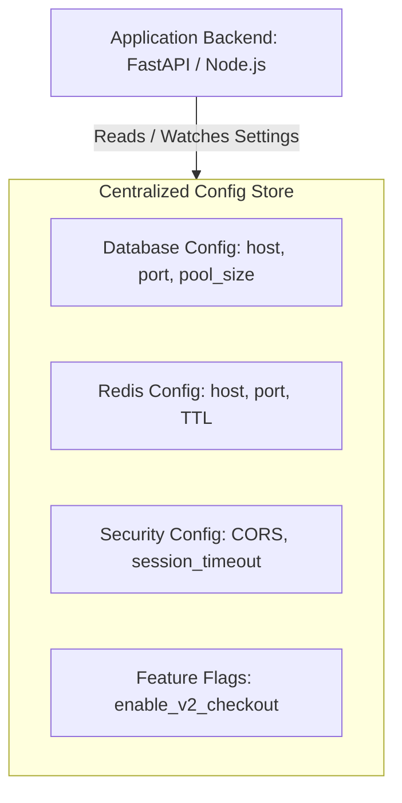
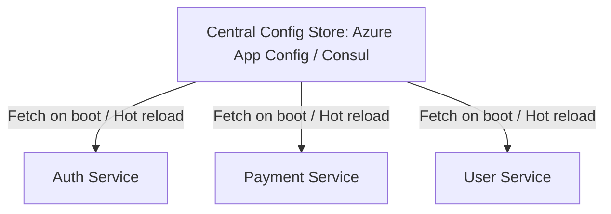
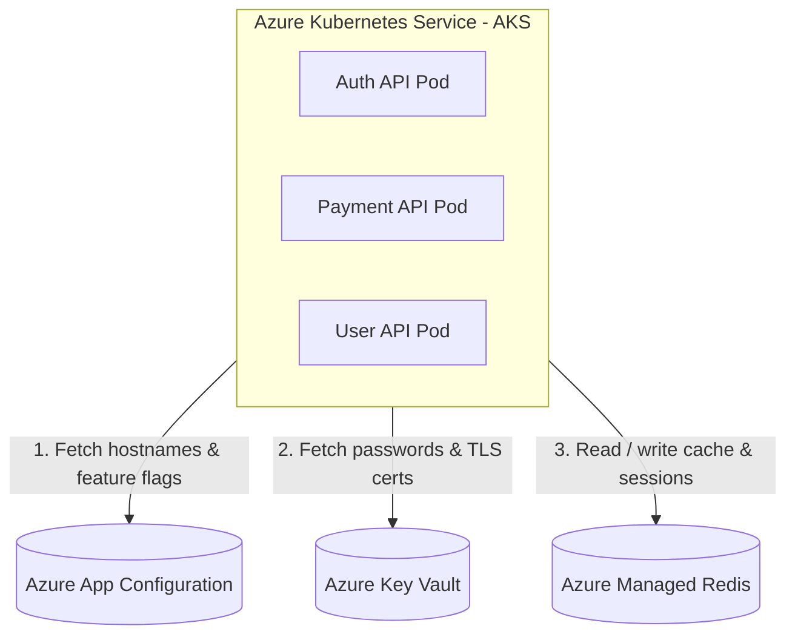

# Configuration Store (Config Store)

A **Config Store (Configuration Store)** is a centralized system where applications store and retrieve their operational settings. Instead of hardcoding configuration values inside application code or scattering them across servers, you maintain them separately in a managed store and allow applications to read or watch them dynamically.

---

## 1. Real-World Example: Banking Application

Suppose you are building a banking application with an **Angular** frontend and a **FastAPI** backend.

Your backend service requires various operational settings to function:
- **Database Connection:** Hostname, port, pool size, schema name
- **Redis Server:** Hostname, port, cluster mode enabled
- **External API URLs:** Payment gateway endpoints, SMS service endpoints
- **Timeouts & Retries:** Payment processing timeout, max retry attempts
- **Rate-Limiting Limits:** Maximum requests per minute per IP
- **Feature Flags:** Enable/disable new payment checkout UI (`enable_new_payment`)

> **Note:** These are **operational configuration parameters**, NOT business domain data (like account balances or user profiles).

### Sample Configuration JSON:
```json
{
  "application": "banking-api",
  "database": {
    "host": "postgres-server.internal",
    "port": 5432
  },
  "redis": {
    "host": "redis-server.internal",
    "port": 6379
  },
  "payment": {
    "timeout_ms": 5000,
    "max_retry": 3
  },
  "features": {
    "enable_new_payment": true
  }
}
```

---

## 2. Where Does Config Store Fit in the Architecture?



---

## 3. Popular Config Store Solutions

| Technology | Purpose & Ecosystem |
| :--- | :--- |
| **HashiCorp Consul** | Centralized dynamic key-value configuration & service discovery |
| **etcd** | Distributed, highly-available key-value store (core of Kubernetes) |
| **AWS Systems Manager Parameter Store** | Cloud-native parameter & configuration store in AWS |
| **Azure App Configuration** | Managed centralized configuration and feature flag management in Azure |
| **Spring Cloud Config** | Centralized server-client configuration for Spring Boot applications |
| **Kubernetes ConfigMap** | Native non-sensitive configuration resource injected into Pods |

> ⚠️ **Important Security Rule:** Never put sensitive secrets (database passwords, API keys, private certificates) in a regular configuration store or ConfigMap. Use a dedicated **Secret Manager** (AWS Secrets Manager, HashiCorp Vault, Azure Key Vault).

---

## 4. Is Redis Also a Config Store?

Redis is an in-memory key-value data store, so technically you *can* write configuration keys into Redis:

```bash
SET config:payment:enabled true
SET config:payment:timeout 5000
GET config:payment:enabled
```

### Why Redis is NOT the Preferred Dedicated Config Store:
1. **No Built-in Versioning:** Config stores maintain revision histories, change logs, and one-click rollbacks.
2. **Access Control (RBAC):** Config stores offer fine-grained access policies per environment (Dev vs. Stage vs. Prod).
3. **Dynamic Hot-Reloading & Watchers:** Dedicated stores notify application listeners when keys change without requiring manual polling loops.
4. **Audit Trails:** Config stores record *who* changed *what* parameter at *what* timestamp.

---

## 5. Architectural Responsibilities (Interview Cheat Sheet)

Understanding the separation of concerns across infrastructure components is essential for system design:

| Component | Primary Responsibility | Example Data Stored |
| :--- | :--- | :--- |
| **Redis** | In-memory cache & fast operational store | Session tokens, leaderboards, cached API responses |
| **PostgreSQL / MySQL** | Persistent business database (Source of Truth) | User accounts, transactions, balances, orders |
| **Config Store** | Application behavior & environment settings | Hostnames, port numbers, timeouts, feature flags |
| **Secret Manager** | Highly-secured credentials & encryption keys | DB passwords, private API tokens, SSL certificates |
| **Service Registry** | Dynamic network locations of microservice instances | `OrderService -> 10.0.4.12:8080, 10.0.4.15:8080` |

### The Triad Example (Connecting Payment Service to Redis):
```
┌────────────────────────────────────────────────────────┐
│ 1. Config Store: "Redis host is redis.internal:6379"   │
│ 2. Secret Store: "Redis Auth password is ********** "  │
│ 3. Redis Engine: Stores the active session data        │
└────────────────────────────────────────────────────────┘
```

---

## 6. Evolution of Configuration Management

### Approach A: Local `.env` File (Local Dev)
- Stored as a `.env` file on the developer's laptop or local server.
- Loaded at application startup as process environment variables.
```env
APP_NAME=BankingAPI
REDIS_HOST=localhost
REDIS_PORT=6379
DB_HOST=localhost
DB_PORT=5432
PAYMENT_TIMEOUT=5000
```
*Limitation:* Does not scale across multiple machines; requires redeployment to update.

---

### Approach B: JSON / YAML Configuration Files
- Stored on the server filesystem or mounted into Docker containers (`config.json` / `config.yaml`).
- Structured hierarchy makes nested settings cleaner.
*Limitation:* Updating 50 instances requires touching 50 server files or rebuilding container images.

---

### Approach C: Centralized Config Store (Cloud / Microservices)
When running 20+ microservice instances across multiple clusters, configuration is fetched from a single source:



#### Key Advantages:
- **Centralized Single Pane of Glass:** Change a value once to update all microservice instances.
- **No Image Rebuilds:** Modify runtime behavior without rebuilding Docker images.
- **Environment Parity:** Manage `dev`, `qa`, `uat`, and `prod` configurations side by side.
- **Feature Flagging:** Toggle features dynamically without deploying code.

---

## 7. How Configuration Works in Kubernetes (`ConfigMap`)

In Kubernetes, non-sensitive configuration is abstracted into a **ConfigMap**:

```yaml
apiVersion: v1
kind: ConfigMap
metadata:
  name: banking-config
data:
  REDIS_HOST: "redis-service.default.svc.cluster.local"
  REDIS_PORT: "6379"
  PAYMENT_TIMEOUT: "5000"
  ENABLE_NEW_PAYMENT: "true"
```

### Injected into Backend Pods:
```yaml
apiVersion: apps/v1
kind: Deployment
metadata:
  name: banking-api-deployment
spec:
  template:
    spec:
      containers:
        - name: banking-api
          image: banking-api:v1.0
          envFrom:
            - configMapRef:
                name: banking-config
```

---

## 8. Summary Comparison of Approaches

| Mechanism | What is it? | Best Suited For | Dynamic Updates? |
| :--- | :--- | :--- | :--- |
| **`.env` File** | Local flat key-value file | Local developer workstation | No (Process restart required) |
| **JSON / YAML** | Structured local/mounted file | Single-node servers | No (File edit / reload required) |
| **Kubernetes ConfigMap** | Native K8s configuration resource | Containerized apps in K8s | Yes (Can update live volume/env) |
| **Central Config Store** | Dedicated managed configuration service | Enterprise microservices & multi-cloud | Yes (Real-time pub/sub notifications) |

---

## 9. Cloud Provider Solutions: AWS vs. Microsoft Azure

Both AWS and Azure provide enterprise-grade managed configuration stores:

### AWS Systems Manager Parameter Store
- Stores application configuration parameters in hierarchical tree paths (e.g., `/banking/prod/redis/host`).
- Supports parameter types: `String`, `StringList`, and encrypted `SecureString` (integrated with AWS KMS).
- Integrates natively with IAM policies, ECS, EKS, and Lambda.

### Microsoft Azure App Configuration
- Centralized key-value management with support for **Labels** (`Dev`, `QA`, `Prod`).
- Native **Feature Flag** management (feature toggles with percentage rollouts).
- Dynamic configuration refresh without application restarts.

---

### Cloud Ecosystem Comparison: AWS vs. Azure

| Responsibility | AWS Solution | Azure Solution |
| :--- | :--- | :--- |
| **Configuration Store** | AWS Systems Manager Parameter Store / AppConfig | Azure App Configuration |
| **Secret Manager** | AWS Secrets Manager / Parameter Store (SecureString) | Azure Key Vault |
| **Service Discovery** | AWS Cloud Map | Azure Service Fabric / AKS DNS |
| **In-Memory Cache** | Amazon ElastiCache (Redis) / MemoryDB | Azure Managed Redis / Azure Cache for Redis |

---

## 10. Production Reference Architecture (Azure Example)



---

## 11. Key Takeaways for System Design Interviews

1. **Config Store is a Capability:** AWS Parameter Store and Azure App Configuration are implementations; the architectural pattern is what matters.
2. **Never Mix Config and Secrets:** Operational settings (public hostnames, timeouts) go to Config Store; credentials (passwords, private keys) go to Secret Manager.
3. **Decouple Code from Configuration:** Following the *12-Factor App methodology*, an application's codebase should be identical across all environments—only the configuration changes.
