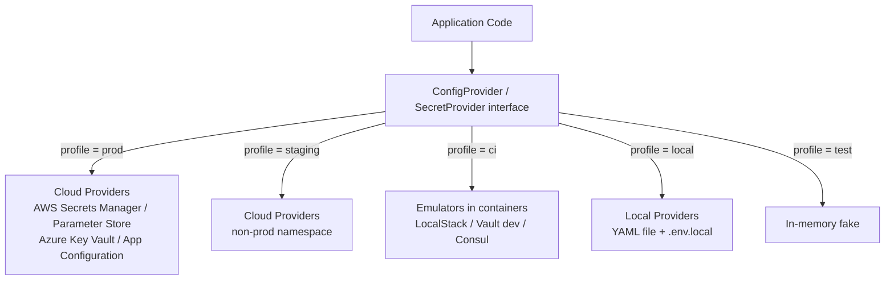
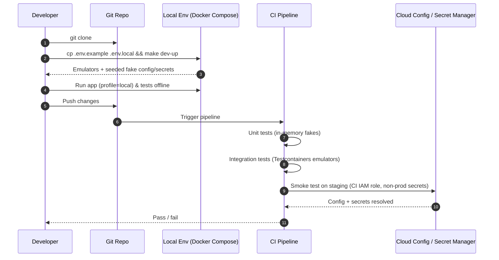

# Local Development Parity & Offline Testing with Cloud Config / Secret Managers

> **Question:** Since centralized stores handle dynamic updates so well, how do you handle local development parity and offline testing when your configurations are heavily dependent on cloud secret managers?
>
> Related: [`Config Store.md`](Config%20Store.md) · [`Secret Manager.md`](Secret%20Manager.md) · [`Centralized Config Store vs CICD Env Files.md`](Centralized%20Config%20Store%20vs%20CICD%20Env%20Files.md) · [`README.md`](README.md)

---

## 1. Short Answer

**Make the config/secret source an interchangeable provider behind an abstraction, and swap the provider per environment — the application code never changes.**

> Same code, same config *schema* (keys and types), different *providers*: cloud store in prod, local emulator / file / env vars on a laptop and in CI.

| Environment | Config source | Secret source | Needs internet / cloud IAM? |
| :--- | :--- | :--- | :--- |
| **Local dev (offline)** | Local file (`application-local.yaml`) or local Consul/AppConfig emulator | `.env.local` (git-ignored) or local Vault in dev mode | No |
| **Unit tests** | In-memory fake / test fixtures | Hard-coded dummy values | No |
| **CI / integration tests** | Containers (LocalStack, Vault dev, Consul) via Testcontainers / Docker Compose | Containerised emulator with seeded fake secrets | No (self-contained) |
| **Shared dev / staging** | Real cloud store (separate namespace) | Real secret manager (non-prod secrets) | Yes |
| **Production** | Real cloud store | Real secret manager | Yes |

---

## 2. The Core Idea: Provider Abstraction

The application depends on an **interface**, not on a specific cloud SDK. A profile / environment variable picks the implementation at startup.



- Frameworks already provide this: **Spring Profiles + Spring Cloud Config/Vault**, **.NET `IConfiguration` providers** (Azure App Configuration / Key Vault vs. `appsettings.Development.json` / User Secrets), **Node `config` / `dotenv`**, **Kubernetes ConfigMap/Secret** mounted as files.
- Keep a **single schema** (typed config class or JSON Schema) validated at startup in every environment, so a missing key fails fast on a laptop rather than in production.

---

## 3. Strategies for Local Development

### 3.1 Local override layer (simplest)

Layer config sources with increasing precedence:

```
defaults (in code)  <  base file  <  environment file  <  local override (git-ignored)  <  env vars
```

```yaml
# application-local.yaml  (committed – safe, non-secret defaults)
redis_host: localhost
redis_port: 6379
payment_timeout_ms: 5000
enable_payment_v2: true
```

```bash
# .env.local  (git-ignored – dummy credentials only)
DB_PASSWORD=local-dev-password
REDIS_AUTH=local-redis-password
STRIPE_API_KEY=sk_test_dummy
```

- Commit a **`.env.example`** listing every required key with fake values, so a new developer onboards by copying it.
- Add `.env*` (except `.env.example`) to `.gitignore`.

### 3.2 Run local emulators of the real services (best parity)

| Cloud service | Local substitute |
| :--- | :--- |
| AWS Secrets Manager / SSM Parameter Store / AppConfig | **LocalStack** |
| Azure App Configuration / Key Vault | Azure emulators where available, or file/env provider via the same `IConfiguration` abstraction |
| HashiCorp Vault | `vault server -dev` (in-memory, auto-unsealed) |
| Consul | `consul agent -dev` |
| Redis / PostgreSQL | Docker containers |

```yaml
# docker-compose.local.yml
services:
  localstack:
    image: localstack/localstack
    environment:
      SERVICES: secretsmanager,ssm
    ports: ["4566:4566"]
  vault:
    image: hashicorp/vault
    command: server -dev -dev-root-token-id=local-root
    ports: ["8200:8200"]
  redis:
    image: redis:7
    ports: ["6379:6379"]
```

A **seed script** (run by `make dev-up`) pushes fake secrets and config into the emulators:

```bash
aws --endpoint-url=http://localhost:4566 secretsmanager create-secret \
  --name payment/db-password --secret-string "local-dev-password"
```

> Only the **endpoint URL** differs (`AWS_ENDPOINT_URL=http://localhost:4566`); the application's SDK calls are identical to production.

### 3.3 Local config server (for centralized-store behaviour)

If you need to test *dynamic refresh* locally (feature-flag flips, hot reload), run a local Config Server / Consul / flagd and change values while the app is running. This exercises the exact refresh path used in production.

---

## 4. Strategies for Offline Testing


| Test level | Technique | Goal |
| :--- | :--- | :--- |
| **Unit** | Inject a fake `ConfigProvider` / `SecretProvider` returning fixed values | Fast, no I/O, no network |
| **Integration** | Spin up emulators with **Testcontainers** or Docker Compose and seed them | Verify real SDK calls, parsing, refresh logic |
| **Failure-mode** | Make the fake provider throw / time out / return stale data | Verify retry, fallback, and cached-last-known-good behaviour |
| **Contract / smoke** | Run against shared staging cloud stores with a CI IAM role | Catch IAM, networking, and schema drift that emulators cannot |

### Resilience also helps offline use

- **Local cache of last-known-good config** (on disk or in memory) so the app starts even when the store is unreachable.
- **Short timeouts + fallback** to defaults for non-critical settings; **fail fast** for mandatory secrets.
- These are production resilience patterns too, so offline testing and outage handling share the same code path.

---

## 5. Guardrails: What NOT to Do

| Anti-pattern | Why it's a problem | Do this instead |
| :--- | :--- | :--- |
| Developers use **real production secrets** locally | Leak risk, audit noise, blast radius | Use dummy/dev-scoped secrets only |
| Copying prod secrets into `.env` files | Secrets end up in laptops, backups, chat | Separate non-prod secret namespace |
| `if (env == "local")` branches scattered through code | Behaviour diverges from production | One abstraction, provider chosen at the composition root |
| Emulator config **schema differs** from prod | "Works on my machine" failures | Share one typed schema + seed from the same templates |
| Committing `.env` or local override files | Secret leakage | `.gitignore` + pre-commit secret scanning (gitleaks, trufflehog) |
| Requiring VPN/cloud login just to run unit tests | Slows feedback, breaks offline work | Fake providers for unit tests |

---

## 6. Recommended Workflow (End to End)



---

## 7. Hybrid Rule of Thumb

| Need | Approach |
| :--- | :--- |
| Run the app on a plane / no VPN | Local YAML + `.env.local` + Docker emulators |
| Fast unit tests | In-memory fake provider |
| Confidence in real SDK/IAM behaviour | Smoke tests against non-prod cloud stores |
| Test dynamic refresh | Local Consul/Config Server/flagd, change values at runtime |
| Prevent drift between environments | Single typed config schema, validated on startup everywhere |

---

## 8. Interview Answer (30 seconds)

> "I treat config and secrets as a provider behind an interface. In production the provider is AWS Secrets Manager / Key Vault / AppConfig; locally it's a layered file plus git-ignored `.env.local`, or emulators like LocalStack and Vault dev mode run through Docker Compose. Unit tests use in-memory fakes, CI integration tests use Testcontainers, and a small smoke suite hits non-prod cloud stores to catch IAM and schema drift. The config schema is identical everywhere and validated at startup, developers never use production secrets, and a last-known-good cache lets the app boot even when the store is unreachable."

---

## 9. Quick Revision

1. **Abstract** the config/secret source behind an interface; pick the provider per profile.
2. **Local**: layered files + git-ignored `.env.local` + `.env.example`, or **LocalStack / Vault dev / Consul dev** in Docker.
3. **Tests**: in-memory fakes (unit), Testcontainers (integration), staging smoke tests (contract).
4. **One schema**, validated at startup in every environment, to keep parity.
5. **Never** use production secrets locally; scan commits for secrets.
6. **Cache last-known-good** config so offline/outage startup works.
