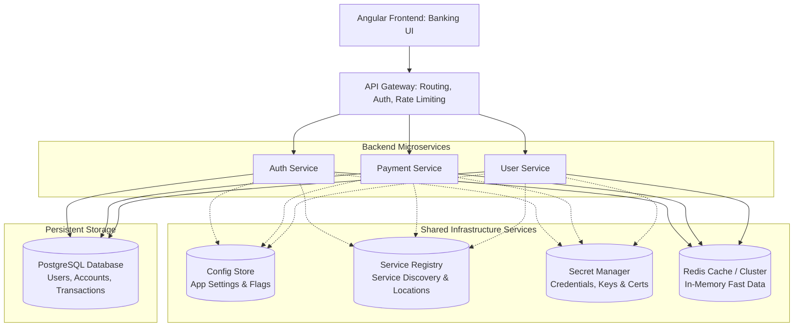
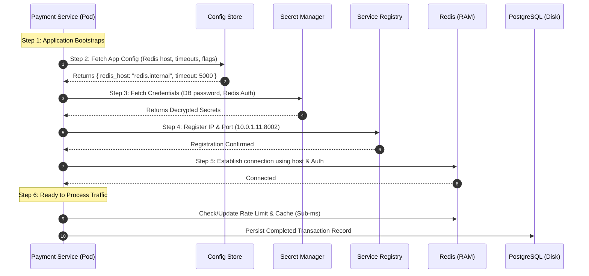

# Production Microservices Infrastructure: Config Store, Service Registry, Secret Manager & Redis

In a production-grade distributed microservices architecture, **Config Store**, **Service Registry**, **Secret Manager**, and **Redis** serve distinct, non-interchangeable architectural responsibilities.

---

## 1. Overall Production Architecture

Consider a banking application with multiple backend microservices:



> **Key Rule:** The shared infrastructure components are accessed by microservices independently as needed during lifecycle events (startup, discovery, cache lookup, or transaction processing).

---

## 2. Core Responsibilities & Real-World Examples

### A. Config Store – *"What settings should my application use?"*
Maintains non-sensitive application parameters, behavior toggles, and environment-specific settings.

#### Example Configuration:
```json
{
  "redis_host": "redis.internal",
  "redis_port": 6379,
  "payment_timeout_ms": 5000,
  "max_retry": 3,
  "enable_payment_v2": true
}
```
- **Popular Solutions:** Azure App Configuration, Spring Cloud Config, HashiCorp Consul, AWS Systems Manager Parameter Store, Kubernetes ConfigMap.

---

### B. Service Registry – *"Where is my service running?"*
Maintains a dynamic directory of active service instances and their network IP/port locations.

#### Example Registry Directory:
| Service | Network Address | Health Status |
| :--- | :--- | :--- |
| **Auth Service** | `10.0.1.10:8001` | Healthy |
| **Payment Service** | `10.0.1.11:8002` | Healthy |
| **User Service** | `10.0.1.12:8003` | Healthy |

> **Use Case:** When `Payment Service` needs to call `User Service`, it queries the Service Registry (or resolves via Kubernetes Service DNS) to discover `User Service` at `10.0.1.12:8003`.

- **Popular Solutions:** HashiCorp Consul, etcd, Eureka, Kubernetes Services & CoreDNS, AWS Cloud Map.

---

### C. Secret Manager – *"How do I securely access services?"*
Securely stores, encrypts, and audits access to sensitive credentials, tokens, and certificates.

#### Protected Credentials:
- Database usernames & passwords
- Redis AUTH passwords
- Third-party API private keys (Stripe, Twilio)
- TLS/SSL certificates & private signing keys

> ⚠️ **Rule:** Never hardcode credentials in code or commit them to Git. Microservices retrieve them at boot time with IAM/RBAC authentication.

- **Popular Solutions:** HashiCorp Vault, AWS Secrets Manager, Azure Key Vault, Google Secret Manager, Kubernetes Secrets.

---

### D. Redis – *"What data should I retrieve quickly without touching the DB?"*
An in-memory data store providing sub-millisecond read/write latency.

#### Stored Data Types:
- User session tokens (`user:session:101`)
- Rate-limiting counters (`rate:limit:ip:10.0.4.1`)
- Real-time leaderboards & queues
- Frequently queried product catalog / account cache

- **Popular Solutions:** Redis Cluster, AWS ElastiCache, Azure Managed Redis, GCP Memorystore.

---

## 3. Step-by-Step Service Startup Lifecycle

Here is how a **Payment Service** initializes and handles requests in production:



---

## 4. Technology Equivalents Matrix

| Architectural Responsibility | General / Self-Hosted | Kubernetes Native | AWS Cloud | Microsoft Azure |
| :--- | :--- | :--- | :--- | :--- |
| **Config Store** | HashiCorp Consul, Spring Cloud Config | ConfigMap | AWS Systems Manager Parameter Store / AppConfig | Azure App Configuration |
| **Service Registry** | HashiCorp Consul, etcd, Eureka | K8s Services + CoreDNS | AWS Cloud Map | Azure Service Fabric / AKS DNS |
| **Secret Manager** | HashiCorp Vault | Kubernetes Secrets | AWS Secrets Manager / Parameter Store (SecureString) | Azure Key Vault |
| **In-Memory Cache** | Redis Cluster | Redis Operator / Helm | Amazon ElastiCache (Redis) / MemoryDB | Azure Managed Redis / Azure Cache for Redis |
| **Persistent Database**| PostgreSQL / MySQL | PostgreSQL Operator | Amazon RDS / Aurora | Azure Database for PostgreSQL |

---

## 5. System Design Interview Distinction Cheat Sheet

| Component | What Does It Store? | Primary Access Pattern |
| :--- | :--- | :--- |
| **Redis** | Frequently accessed hot application data | Read/write in RAM (nanoseconds to microseconds) |
| **PostgreSQL** | Persistent business domain data (Source of Truth) | Read/write on disk with ACID transactions |
| **Config Store** | Non-sensitive application configuration & feature flags | Read at startup / dynamic hot-reload |
| **Secret Manager** | Passwords, private API keys, TLS certificates | Read securely at startup / periodic token rotation |
| **Service Registry** | Network IP, port, and health status of service instances | Heartbeat registration & DNS lookup queries |

### The Redis Connection Example:
When your backend needs to connect to Redis:
1. **Config Store** provides the address: `redis.internal:6379`.
2. **Secret Manager** provides the credential: `AUTH_TOKEN = "s3cr3tP@ss"`.
3. **Redis** stores the application data: `SET user:101 "Piyali"`.

---

## 6. Test Your Understanding (Knowledge Check)

### Q1: Where should a PostgreSQL database password be stored?
- [ ] Redis
- [ ] Config Store
- [x] **Secret Manager** *(Correct: Protects sensitive credentials with encryption and access auditing)*
- [ ] Service Registry

---

### Q2: Payment Service needs to find the network address of User Service. Which component helps?
- [ ] Config Store
- [x] **Service Registry** *(Correct: Maintains dynamic network addresses, ports, and health status)*
- [ ] Redis
- [ ] Secret Manager

---

### Q3: Where would you store frequently accessed user session data?
- [x] **Redis** *(Correct: In-memory storage provides sub-millisecond retrieval)*
- [ ] Service Registry
- [ ] Config Store
- [ ] Secret Manager

---

### Q4: Where would you store a feature flag such as `enable_payment_v2: true`?
- [ ] Secret Manager
- [x] **Config Store** *(Correct: Feature flags are non-sensitive configuration parameters)*
- [ ] Redis
- [ ] Service Registry
