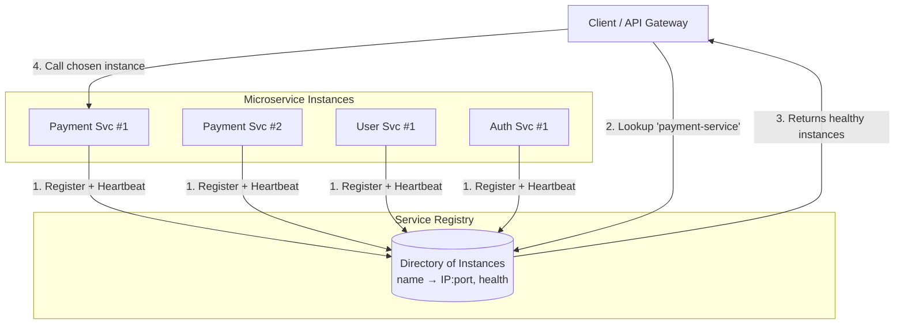
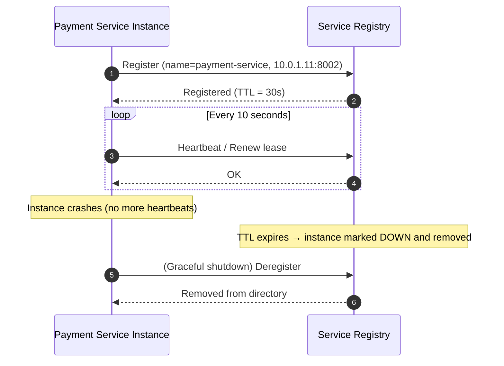
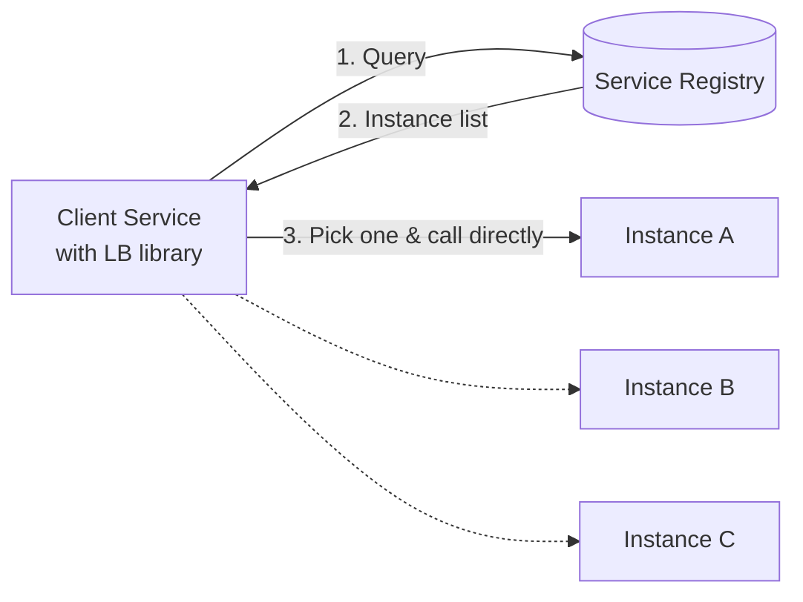
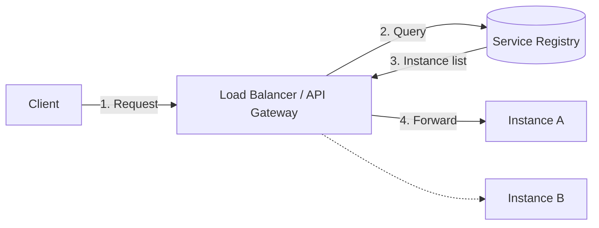
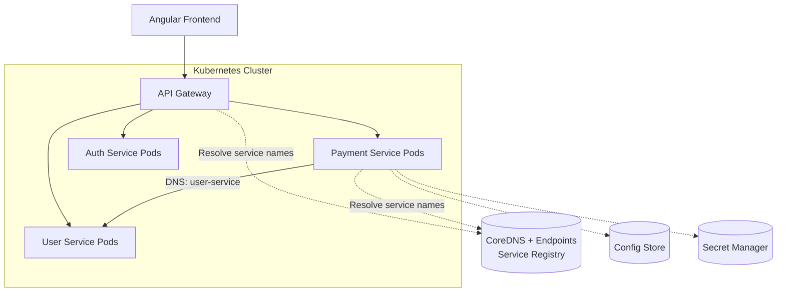

# Service Registry

A **Service Registry** is a centralized, dynamic directory where every running instance of a microservice records its network location (IP address, port, metadata) and health status. Other services query this directory to find out **"Where is my service running right now?"** instead of relying on hardcoded addresses.

---

## 1. The Problem: Why Hardcoded Addresses Fail

In a monolith, components call each other in-process. In microservices, services call each other over the network, and their addresses are **not stable**:

- Containers/Pods are created and destroyed constantly (autoscaling, rolling deployments, crashes).
- Every restart can assign a **new IP address**.
- A service may have 1 instance today and 20 instances tomorrow.
- Instances can become unhealthy and must stop receiving traffic.

```
❌ Hardcoded:  PAYMENT_SERVICE_URL = "http://10.0.1.11:8002"
               → Breaks the moment that Pod restarts with a new IP.

✅ Registry:   lookup("payment-service")
               → [10.0.1.11:8002, 10.0.1.25:8002, 10.0.1.31:8002]  (only healthy ones)
```

---

## 2. Definition & Core Responsibilities

| Responsibility | Description |
| :--- | :--- |
| **Registration** | A service instance announces itself (name, IP, port, version, tags) on startup. |
| **Deregistration** | The instance removes itself on graceful shutdown. |
| **Health Monitoring** | Registry tracks heartbeats / health checks and evicts dead instances. |
| **Discovery (Lookup)** | Clients query by service name and receive a list of healthy instance addresses. |
| **Metadata Storage** | Stores version, region/zone, weight, and custom tags for smart routing. |

### Example Registry Directory

| Service Name | Instance ID | Address | Version | Zone | Health |
| :--- | :--- | :--- | :--- | :--- | :--- |
| `auth-service` | `auth-1` | `10.0.1.10:8001` | v1.2 | zone-a | Healthy |
| `payment-service` | `pay-1` | `10.0.1.11:8002` | v2.0 | zone-a | Healthy |
| `payment-service` | `pay-2` | `10.0.1.25:8002` | v2.0 | zone-b | Healthy |
| `payment-service` | `pay-3` | `10.0.1.31:8002` | v2.0 | zone-b | **Unhealthy** (evicted) |
| `user-service` | `user-1` | `10.0.1.12:8003` | v1.5 | zone-a | Healthy |

---

## 3. Where Does the Service Registry Fit?



---

## 4. Registration & Heartbeat Lifecycle



Two common health-tracking models:

| Model | How it works | Example |
| :--- | :--- | :--- |
| **Heartbeat / TTL (push)** | Instance periodically renews its lease; missing renewals = dead. | Netflix Eureka |
| **Active health check (pull)** | Registry probes `/health` (HTTP/TCP/gRPC) on a schedule. | Consul, Kubernetes probes |

---

## 5. Service Discovery Patterns

### A. Client-Side Discovery
The **client** queries the registry, gets the list of instances, and picks one itself (load balancing in the client).



- **Pros:** Fewer network hops, flexible load-balancing logic.
- **Cons:** Discovery logic must be embedded in every client/language.
- **Examples:** Netflix Eureka + Ribbon / Spring Cloud LoadBalancer.

### B. Server-Side Discovery
The client calls a **load balancer / router**, which queries the registry and forwards the request.



- **Pros:** Clients stay simple and language-agnostic.
- **Cons:** Extra hop; the load balancer must be highly available.
- **Examples:** Kubernetes Service + kube-proxy, AWS ALB, Envoy / Istio.

### C. Service Registration Styles

| Style | Who registers the instance? | Example |
| :--- | :--- | :--- |
| **Self-Registration** | The service registers itself on boot. | Eureka client, Consul agent API |
| **Third-Party Registration** | A separate component (orchestrator/registrar) registers it. | Kubernetes (kubelet + Endpoints), Registrator for Docker |

---

## 6. Real-World Use Cases

### Use Case 1: Banking App – Payment Service calls User Service
1. Three `user-service` Pods run behind autoscaling.
2. `payment-service` needs the customer's KYC status.
3. It asks the registry for `user-service` → gets `[10.0.1.12:8003, 10.0.1.40:8003]`.
4. It picks one (round-robin) and calls it. If one Pod dies, the registry stops returning it.

### Use Case 2: Netflix – Eureka for Thousands of Instances
Netflix pioneered **Eureka** to let hundreds of microservices (recommendations, playback, billing) find each other across AWS availability zones, with heartbeats and zone-aware routing, surviving instance churn during autoscaling.

### Use Case 3: Kubernetes – Built-in Service Discovery
Pods are ephemeral. A Kubernetes **Service** gives a stable DNS name (`user-service.default.svc.cluster.local`) while the control plane keeps the **Endpoints/EndpointSlice** list of ready Pods updated. CoreDNS resolves the name — Kubernetes *is* the registry.

### Use Case 4: Zero-Downtime Rolling Deployments
During a new release (`v1` → `v2`), new instances register; old ones deregister after draining. The registry ensures traffic only flows to instances that pass health checks, so users never hit a half-started Pod.

### Use Case 5: Canary / Blue-Green Releases
Instances register with metadata tags (`version=v2`, `weight=5`). The router uses the metadata to send 5% of traffic to the canary and the rest to stable instances.

### Use Case 6: Multi-Region / Zone-Aware Routing
Metadata `zone=zone-a` lets clients prefer same-zone instances (lower latency, lower cross-AZ cost) and fail over to another zone if the local zone is unhealthy.

### Use Case 7: Autoscaling E-commerce Flash Sale
During a sale, the cart service scales from 3 to 30 instances. Each new instance registers itself automatically; callers discover them within seconds with no config change or redeploy.

---

## 7. Popular Service Registry Solutions

| Technology | Type | Notes |
| :--- | :--- | :--- |
| **HashiCorp Consul** | Registry + health checks + KV + DNS | Multi-datacenter, gossip + Raft consensus |
| **Netflix Eureka** | AP-style registry (Spring Cloud) | Heartbeat/lease based, favours availability |
| **etcd** | Distributed KV store (Raft) | Used by Kubernetes; can back custom registries |
| **Apache ZooKeeper** | Coordination service | Ephemeral nodes for registration; older Hadoop/Kafka ecosystem |
| **Kubernetes Services + CoreDNS** | Platform-native | No separate registry needed inside a cluster |
| **AWS Cloud Map** | Managed cloud registry | API/DNS-based discovery for ECS, EKS, EC2 |
| **Azure Service Fabric / AKS DNS** | Managed / platform-native | Naming service in Service Fabric; DNS in AKS |

### CAP Trade-off Snapshot

| Registry | Consistency model | Behaviour during network partition |
| :--- | :--- | :--- |
| **Eureka** | AP (Available, Partition-tolerant) | Keeps serving possibly stale data; self-preservation mode |
| **Consul / etcd / ZooKeeper** | CP (Consistent, Partition-tolerant) | May reject writes without a quorum to stay correct |

---

## 8. Sample Code

### Registering with Consul (HTTP API)
```bash
curl --request PUT http://consul.internal:8500/v1/agent/service/register \
  --data '{
    "ID": "payment-1",
    "Name": "payment-service",
    "Address": "10.0.1.11",
    "Port": 8002,
    "Tags": ["v2", "zone-a"],
    "Check": {
      "HTTP": "http://10.0.1.11:8002/health",
      "Interval": "10s",
      "DeregisterCriticalServiceAfter": "1m"
    }
  }'
```

### Discovering Healthy Instances
```bash
curl http://consul.internal:8500/v1/health/service/payment-service?passing=true
```

### Kubernetes Service (Registry via DNS)
```yaml
apiVersion: v1
kind: Service
metadata:
  name: user-service
spec:
  selector:
    app: user-service
  ports:
    - port: 80
      targetPort: 8003
```
Callers simply use `http://user-service` — CoreDNS resolves it to a healthy Pod.

---

## 9. Service Registry vs. Config Store vs. Secret Manager vs. Redis

| Component | Question It Answers | Example Data |
| :--- | :--- | :--- |
| **Service Registry** | *Where is my service running?* | `payment-service → 10.0.1.11:8002` |
| **Config Store** | *What settings should I use?* | `payment_timeout_ms = 5000` |
| **Secret Manager** | *How do I authenticate securely?* | DB password, API keys, TLS certs |
| **Redis** | *What hot data can I fetch instantly?* | Sessions, rate-limit counters, cache |

> **Note:** Consul can act as both a Service Registry **and** a Config Store (KV), but the *responsibilities* remain distinct.

### Service Registry vs. API Gateway vs. Load Balancer

| Component | Role |
| :--- | :--- |
| **Service Registry** | Knows *which instances exist* and whether they're healthy. |
| **Load Balancer** | Decides *which instance* receives each request. |
| **API Gateway** | Single entry point for external clients (auth, routing, rate limiting); uses the registry to find backends. |

---

## 10. Production Reference Architecture



---

## 11. Challenges & Best Practices

| Challenge | Mitigation |
| :--- | :--- |
| **Registry is a single point of failure** | Run a clustered registry (3–5 nodes); clients cache the last known instance list. |
| **Stale entries** (dead instance still listed) | Short TTLs, active health checks, automatic deregistration of critical instances. |
| **Thundering herd on startup** | Randomized jitter on registration/heartbeat; staggered rollouts. |
| **Cascading failures** | Combine with retries, timeouts, and circuit breakers (Resilience4j, Envoy). |
| **Network partitions** | Choose AP vs. CP deliberately; use self-preservation mode where appropriate. |
| **Security** | mTLS and ACLs so only authorized services can register or read entries. |

---

## 12. Key Takeaways for System Design Interviews

1. **Registry = dynamic phone book** for service instances, kept accurate via heartbeats/health checks.
2. **Two discovery patterns:** client-side (client picks instance) vs. server-side (LB/router picks).
3. **Kubernetes already provides it** through Services, Endpoints, and CoreDNS — a separate registry is mostly needed outside K8s or for multi-cluster/multi-cloud setups.
4. **Health checks are essential:** without them, the registry sends traffic to dead instances.
5. **Mind CAP:** Eureka favors availability; Consul/etcd favor consistency.
6. **Don't confuse it with the Config Store:** the registry stores *locations*, the config store stores *settings*, the secret manager stores *credentials*.
