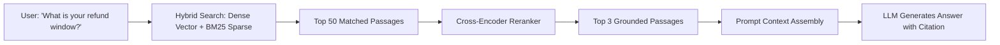

# Enterprise AI Customer Support Bot Architecture (e.g., Zendesk AI, Intercom Fin, Klarna AI Agent)

## 1. Overview
An **Enterprise Customer Support Bot System** automates tier-1 customer inquiries, resolves order/account issues using Retrieval-Augmented Generation (RAG) and transactional tool-calling agents, and seamlessly escalates complex or frustrated user conversations to human support agents with full conversation context.

---

## 2. Requirements

### Functional Requirements
- **Multi-Channel Ingestion**: Support web chat widget, mobile SDK, WhatsApp, Email, and SMS support channels.
- **Intent Recognition & Routing**: Categorize inquiries (Order Tracking, Refund Request, Technical Issue, Billing, General FAQ).
- **Knowledge Base RAG (Retrieval-Augmented Generation)**: Ingest help center articles, PDFs, policy docs, and product manuals into vector embeddings to provide factual, grounded answers with citations.
- **Transactional Actions (Tool Use / Function Calling)**: Execute verified business actions (e.g., cancel order, process refund, update shipping address) with authentication and CRM validation.
- **Human Handoff (Escalation)**: Detect user sentiment/frustration or policy thresholds and smoothly route the chat session to a live human agent with conversation summary.
- **Analytics & CSAT**: Track resolution rate, deflection rate, customer satisfaction (CSAT) score, and average resolution time.

### Non-Functional Requirements
- **Low Response Latency**: Response generation within < 1.5 seconds.
- **Hallucination Prevention**: Strict grounding in verified enterprise knowledge bases; refuse to answer off-topic or unverified questions.
- **High Availability & Scalability**: 99.99% uptime, handling 50,000+ concurrent support chats during peak sales.
- **Security & PII Redaction**: Automatic masking of credit cards, passwords, SSN, and sensitive personal information before LLM processing.

---

## 3. Capacity Estimation

### Assumptions
- **Daily Support Tickets / Inquiries**: 1 Million conversations/day.
- **Average Turns per Session**: 5 turns (10 messages total).
- **Daily Message Volume**: 10 Million messages/day $\implies \approx 120 \text{ msgs/sec}$ (Peak: 1,000 msgs/sec).
- **Enterprise Knowledge Base**: 100,000 documents/articles.
- **Vector Embeddings Storage**: 100,000 docs $\times$ 50 chunks $\times$ 1,536 dimensions (FP32) $\approx 30 \text{ GB}$ index in Vector DB.

---

## 4. High-Level Architecture (HLD)

```mermaid
graph TD
    Client[Customer (Web / Mobile / WhatsApp)] --> API_GW[Support Gateway & Rate Limiter]
    
    subgraph Conversation Orchestration
        API_GW --> PIIFilter[PII Masking & Sanitizer]
        PIIFilter --> DialogManager[Dialog Orchestrator & State Machine]
        DialogManager --> ConvDB[(Conversation State DB: PostgreSQL)]
    end

    subgraph RAG & Knowledge Base Pipeline
        DialogManager --> EmbeddingSvc[Embedding Service: text-embedding-3]
        EmbeddingSvc --> VectorDB[(Vector DB: Pinecone / Milvus / Qdrant)]
        VectorDB --> Reranker[Cross-Encoder Reranker]
        Reranker --> DialogManager
    end

    subgraph Agent Tool Calling & Action Execution
        DialogManager --> ToolEngine[Tool Calling & Business API Router]
        ToolEngine --> CRM[(CRM / ERP APIs: Salesforce / Zendesk / Shopify)]
        ToolEngine --> OrderSvc[Order & Billing Microservices]
    end

    subgraph LLM Generation & Guardrails
        DialogManager --> LLMEngine[LLM Agent: GPT-4o / Claude / Fine-Tuned Model]
        LLMEngine --> HallucinationGuard[Factuality & Grounding Guardrail]
        HallucinationGuard --> API_GW
    end

    subgraph Human Escalation & Agent Workspace
        DialogManager -->|Escalate / Frustration Detected| HandoffQueue[Human Agent Routing Queue: Kafka]
        HandoffQueue --> AgentDashboard[Live Human Agent Workspace: Zendesk/Intercom]
    end
```

---

## 5. Architectural Deep Dives

### 5.1 Retrieval-Augmented Generation (RAG) Pipeline



1. **Chunking Strategy**: Semantic chunking (300–500 tokens) with 50-token overlap to preserve context across paragraphs.
2. **Hybrid Search**: Combines keyword search (BM25 for exact product SKUs, error codes) with dense vector embeddings (cosine similarity for conceptual questions).
3. **Re-Ranking**: High-precision Cross-Encoder (e.g., Cohere Rerank / BGE-Reranker) narrows candidate chunks down to the top 3 most relevant passages.

### 5.2 Deterministic Tool Execution & Safety Loops
When a user asks: `"Can you refund order #9821?"`
1. **Authentication Check**: Verify user session token owns `order_id = 9821`.
2. **Intent Parsing / Tool Definition**: LLM outputs structured JSON function call:
   ```json
   {
     "tool": "process_refund",
     "arguments": { "order_id": "9821", "reason": "item_defective" }
   }
   ```
3. **Deterministic Business Policy Validation**: The backend executes deterministic rules (e.g., Is order within 30 days? Is amount $< \$500$?).
4. **Execution**: If passed, invoke Billing API and return confirmation; if criteria fail, trigger human agent review.

### 5.3 Sentiment Analysis & Dynamic Human Handoff
- **Handoff Triggers**:
  - User explicitly types `"agent"`, `"human"`, `"representative"`.
  - Sentiment analysis score drops below threshold (e.g., compound polarity $< -0.6$).
  - Bot fails to answer consecutively 2 times.
  - High-value customer flag or complex dispute category.
- **Context Preservation**:
  - LLM generates a 3-bullet-point conversation summary.
  - Human agent receives the full chat history, detected intent, and suggested resolution in their CRM dashboard.

---

## 6. Database Schema Design

```sql
CREATE TABLE support_sessions (
    session_id UUID PRIMARY KEY,
    customer_id UUID,
    channel VARCHAR(32) NOT NULL, -- 'WEB', 'WHATSAPP', 'EMAIL'
    status VARCHAR(32) NOT NULL, -- 'BOT_ACTIVE', 'ESCALATED', 'RESOLVED', 'CLOSED'
    assigned_human_agent_id UUID,
    summary TEXT,
    sentiment_score FLOAT DEFAULT 0.0,
    created_at TIMESTAMP WITH TIME ZONE DEFAULT NOW(),
    updated_at TIMESTAMP WITH TIME ZONE DEFAULT NOW()
);

CREATE TABLE support_messages (
    message_id UUID PRIMARY KEY,
    session_id UUID NOT NULL REFERENCES support_sessions(session_id),
    sender_type VARCHAR(16) NOT NULL, -- 'CUSTOMER', 'BOT', 'HUMAN_AGENT'
    content TEXT NOT NULL,
    tool_calls JSONB,
    citations JSONB, -- [ { "doc_id": "faq_42", "title": "Return Policy" } ]
    created_at TIMESTAMP WITH TIME ZONE DEFAULT NOW()
);
```

---

## 7. Key Takeaways
- Use **Hybrid Search (Dense Vector + BM25) and Re-Ranking** for high-precision, hallucination-free knowledge retrieval.
- Wrap LLMs around **Deterministic Tool Calling & Business Policy Enforcement** for transactional operations.
- Implement automated **Sentiment Tracking and Seamless Human Escalation** with LLM-generated context summaries.
