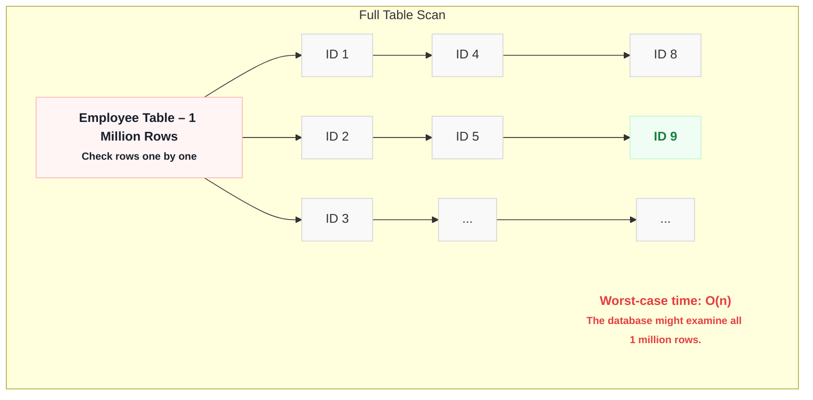
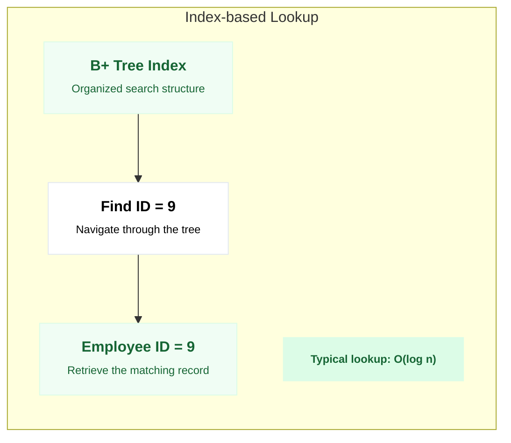
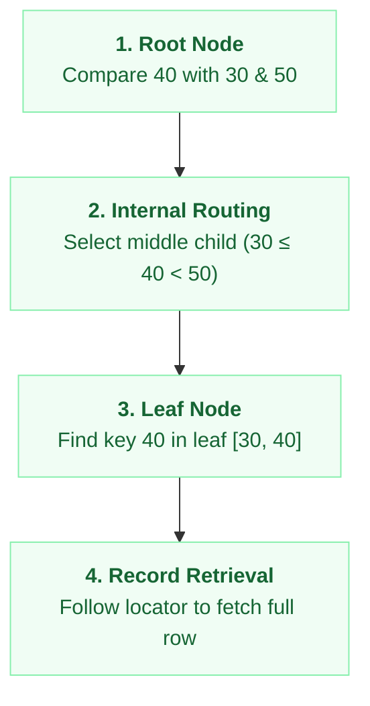
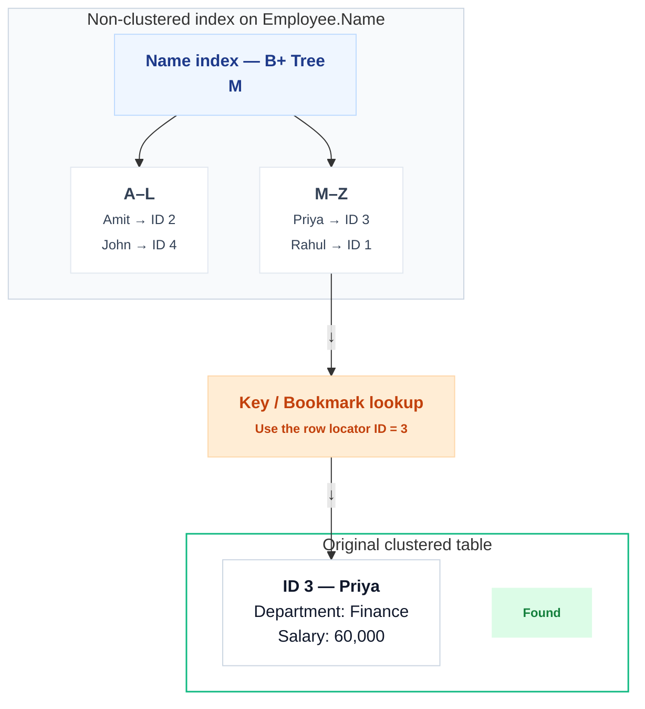
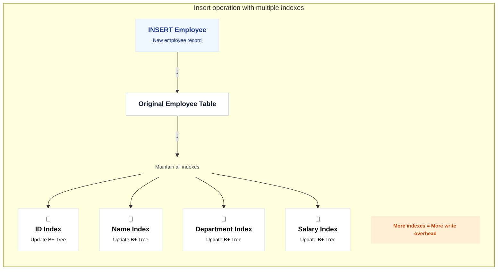
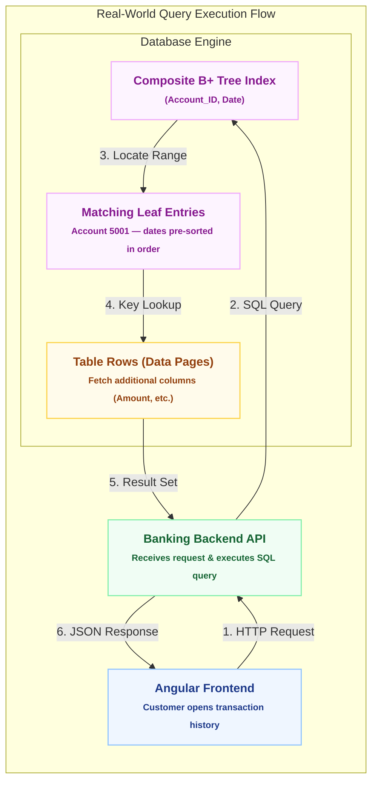

# Database Indexing: Architecture, B+ Trees, and Internals

> *A complete developer interview preparation guide covering what database indexes are, how B+ Trees work internally, Clustered vs. Non-Clustered Indexes, write overhead trade-offs, composite and covering indexes, real-world banking examples, interview Q&A, and self-assessment quizzes.*

---

## Table of Contents
1. [What is Database Indexing?](#1-what-is-database-indexing)
   - [The Telephone Directory & Book Analogies](#the-telephone-directory--book-analogies)
   - [Primary vs. Secondary Indexes](#primary-vs-secondary-indexes)
2. [Specialized Index Types](#2-specialized-index-types)
   - [B-Tree (Balanced Tree)](#a-b-tree-balanced-tree-index)
   - [GIN (Generalized Inverted Index)](#b-gin---generalized-inverted-index-for-columns-with-multiple-values)
   - [GiST (Generalized Search Tree)](#c-gist---generalized-search-tree)
   - [BRIN (Block Range Index)](#d-brin---block-range-indexes)
   - [Hash Indexes](#e-hash-indexes)
   - [Partial Indexes (Filtered Indexes)](#f-partial-indexes-filtered-indexes)
   - [Expression Indexes (Function-Based Indexes)](#g-expression-indexes-function-based-indexes)
3. [What is a B+ Tree?](#3-what-is-a-b-tree)
4. [Primary Indexing Methods & Multilevel Indexing](#4-primary-indexing-methods--multilevel-indexing)
   - [Clustered Index (Pros & Cons)](#clustered-index)
   - [Non-Clustered Index (Pros & Cons)](#non-clustered-index)
   - [Multilevel Indexing](#multilevel-indexing)
5. [Clustered vs. Non-Clustered Index Comparison](#5-clustered-vs-non-clustered-index-comparison)
6. [Why NOT Create Indexes on All Columns? (Trade-offs)](#6-why-not-create-indexes-on-all-columns-trade-offs)
7. [Real-World Example: Banking Application & Composite Indexing](#7-real-world-example-banking-application--composite-indexing)
8. [Top 10 Technical Interview Questions & Answers](#8-top-10-technical-interview-questions--answers)
9. [Test Your Understanding (Quiz & Walkthrough)](#9-test-your-understanding-quiz--walkthrough)
10. [Final Mental Model & System Design Roadmap](#10-final-mental-model--system-design-roadmap)

---

## 1. What is Database Indexing?

**Database Indexing** is a technique used to make data retrieval faster by creating an **additional data structure** that helps the database locate records without scanning the entire table.

An index is a way to efficiently retrieve a relatively small number of rows from a table. The primary advantage of indexing is the ability to speed up queries: when configured correctly, indexes drastically reduce the total number of **disk I/O operations** needed to retrieve data.

### The Telephone Directory & Book Analogies

* **The Telephone Directory (Phonebook):**
  Searching in a database index is like searching in a printed telephone directory. If you need to find the phone number for an individual, "John Smith", instead of scanning the entire book from page 1, you go straight to the middle of the phonebook (the 'S' section) and work your way from there. Because the phonebook is pre-ordered alphabetically, you save yourself hours of scanning through millions of records.

* **The Book Index:**
  * **Without an index:** You must read every page from start to finish (Sequential / Full Table Scan).
  * **With an index:** You flip to the back of the book, find the topic keyword alphabetically, and jump straight to its exact page number.

### Indexing Write Trade-off (The Performance Killer)

While indexes excel at speeding up data lookups, they can act as a query performance killer for write operations:
* Every `INSERT`, `UPDATE`, or `DELETE` requires the database engine to synchronously update and rebalance the index data structures.
* **Golden Rule:** If your tables are constantly modified with frequent inserts and updates (write-heavy workload where writes outnumber reads), creating multiple indexes will cause noticeable **performance degradation**.

### Primary vs. Secondary Indexes

```
+-------------------------------------------------------------------------------------------------+
|                                 PRIMARY VS. SECONDARY INDEXES                                   |
+-------------------------------------------------------------------------------------------------+

  PRIMARY INDEX (Fixed-length, 1-to-1 with Data Block)
  +-------------+---------------------+         +-----------------------------------------------+
  | Primary Key | Block Pointer (Disk)| ------> | Data Block (Physical Table Storage on Disk)   |
  +-------------+---------------------+         +-----------------------------------------------+

  SECONDARY INDEX (Points to Primary Key / Row Locator)
  +-------------+---------------------+         +------------------+         +------------------+
  | Non-PK Col  | Primary Key / RID   | ------> | Primary Index    | ------> | Physical Data    |
  | (e.g. Email)| (e.g. ID = 101)     |         | (B+ Tree Lookup) |         | Block            |
  +-------------+---------------------+         +------------------+         +------------------+
```

* **Primary Index:**
  * An ordered file with a fixed-length record size consisting of two fields: the **primary key** value and a pointer to the specific data block on disk.
  * In a primary index, there is a **one-to-one relationship** between the entries in the index and physical data blocks.
* **Secondary Index:**
  * A secondary index provides an efficient way to access table records by a piece of information other than the primary key (e.g., `email`, `username`, `phone_number`).
  * Secondary indexing allows queries to filter on any field in the database without performing a full sequential table scan.

---

### Example: Employee Table with 1 Million Records

Consider an `Employee` table containing **1,000,000 (10 Lakh) records**:

| ID | Name | Department | Salary |
| :--- | :--- | :--- | :--- |
| 1 | Rahul | IT | 50000 |
| 2 | Amit | HR | 45000 |
| 3 | Priya | Finance | 60000 |
| ... | ... | ... | ... |
| 1000000 | John | IT | 70000 |

You execute the following query:

```sql
SELECT * FROM Employee
WHERE ID = 9;
```

#### Scenario A: Without an Index (Full Table Scan)
The database must inspect every single row sequentially until it finds `ID = 9`.



```
+-----------------------------------------------------------------------------------+
|                        SCENARIO A: FULL TABLE SCAN                                |
+-----------------------------------------------------------------------------------+
|                                                                                   |
|  Employee Table - 1 Million Rows (Unsorted on disk)                               |
|                                                                                   |
|  [Check Row 1: ID=1] -> [Check Row 2: ID=2] -> ... -> [Check Row 9: ID=9]         |
|  (In worst-case, if ID is at the end or missing, scans all 1,000,000 rows)        |
|                                                                                   |
|  Time Complexity: O(N)                                                            |
|  Disk I/O: Reads thousands of data pages from disk into memory                    |
|                                                                                   |
+-----------------------------------------------------------------------------------+
```

#### Scenario B: With an Index (B+ Tree Lookup)
The database creates an index to locate the required record quickly.

The database searches through the index structure rather than scanning all rows.


```
+-----------------------------------------------------------------------------------+
|                      SCENARIO B: INDEX-BASED SEEK (B+ TREE)                       |
+-----------------------------------------------------------------------------------+
|                                                                                   |
|                            [ Root Node ]                                          |
|                              [ 50 | 500 ]                                         |
|                             /     |      \                                        |
|                     [ Node ]   [ Node ]   [ Node ]                                |
|                     [ 5 | 20 ]                                                    |
|                     /   |    \                                                    |
|                    v    v     v                                                   |
|             [ Leaf Node: ID=9 ] ---> Direct Record Access                         |
|                                                                                   |
|  Time Complexity: O(log N)                                                        |
|  Disk I/O: Only ~3 to 4 page reads for 1,000,000 records                          |
|                                                                                   |
+-----------------------------------------------------------------------------------+
```

---

## 2. Specialized Index Types

While B-Tree is the default and most widely used index type, modern relational databases (especially PostgreSQL) provide specialized indexing methods tailored for specific data types and query patterns:

```
+---------------------------------------------------------------------------------------------------------+
|                                    DATABASE INDEX TYPES AT A GLANCE                                     |
+-------------------+-------------------------------------------+-----------------------------------------+
| Index Type        | Best Used For                             | Core Characteristics                    |
+-------------------+-------------------------------------------+-----------------------------------------+
| B-Tree            | Numbers, Text, Timestamps, PKs            | Self-balancing, O(log N) equality/range |
| GIN               | Arrays, JSONB, Full-Text, Multi-values    | Inverted index mapping elements to rows |
| GiST              | Geolocation, Geometries, Overlapping Ranges| Extensible, lossy hierarchical tree     |
| BRIN              | Massive append-only ordered tables (Logs) | Block range min/max summaries, tiny size|
| Hash              | Exact equality lookups (Tokens, UUIDs)    | O(1) bucket-based lookup, no range scans|
| Partial Index     | Skewed status columns (WHERE clause)      | Indexes only a filtered subset of rows  |
| Expression Index  | Functions (LOWER(email), DATE(created_at))| Indexes the computed function result    |
+-------------------+-------------------------------------------+-----------------------------------------+
```

---

### A. B-Tree (Balanced Tree) Index

**B-Tree** is the default index type in SQL databases. If you run a standard `CREATE INDEX`, the database creates a B-Tree index for you.

* **Supported Operations:** Highly optimized for equality (`=`), range queries (`<`, `<=`, `>`, `>=`, `BETWEEN`), and sorting (`ORDER BY`).
* **Applicability:** Numbers, strings, dates, and timestamps.
* **Balancing:** Maintains balanced tree depth where the amount of data in every branch is roughly equal.
* **Decision Tree Concept:**
  In a search tree, every node partitions values. The left subtree contains values smaller than the parent node, while the right subtree contains values larger than the parent node.

```sql
CREATE INDEX idx_orders_customer_id ON orders (customer_id);
```

---

### B. GIN - Generalized Inverted Index (for Columns with Multiple Values)

**GIN (Generalized Inverted Index)** is designed for data types that contain **multiple elements within a single column value**, such as Arrays, JSONB documents, Range types, and Full-Text Search (tsvector).

* **How It Works (Inverted Index):**
  If you want to find sentences containing the word `"the"`, a standard scan requires inspecting every row. A GIN index acts like the index at the back of a book: it extracts every individual word/element and maps each word directly to a list of row locations (TIDs) that contain it.

```
+---------------------------------------------------------------------------------------------------+
|                                 GIN INVERTED INDEX STRUCTURE                                      |
+------------------------------------+--------------------------------------------------------------+
| Token / Element (Extracted Key)   | Row Pointers / Posting List (Row IDs where token exists)     |
+------------------------------------+--------------------------------------------------------------+
| 'database'                         | Row 1, Row 45, Row 102, Row 980                              |
| 'indexing'                         | Row 1, Row 12, Row 45                                        |
| 'postgresql'                       | Row 3, Row 45, Row 850                                       |
+------------------------------------+--------------------------------------------------------------+
```

```sql
-- Indexing an array column in PostgreSQL
CREATE INDEX idx_user_tags ON users USING gin (tags);

-- Querying with array containment operator (@>)
SELECT * FROM users WHERE tags @> ARRAY['system-design', 'backend'];
```

---

### C. GiST - Generalized Search Tree

**GiST (Generalized Search Tree)** is an extensible, template-based indexing infrastructure used for complex, multi-dimensional, and hierarchical data that cannot be naturally ordered in a standard 1-D B-Tree.

* **Key Characteristics:**
  * **Lossy Nature:** GiST indexes can be *lossy*, meaning the index may produce candidate matches that contain false positives. The database engine automatically visits the actual heap table rows to filter out false matches.
  * **Natural Clustering:** Ideal when data exhibits spatial or geometric clustering (e.g., PostGIS points, polygons, 2D coordinates).
  * **Overlapping Ranges:** Excellent for range types where you need to check for overlapping intervals (`&&`).
  * **Unbalanced Distributions:** For example, US telephone area codes where some prefixes have significantly higher saturation than others.

```sql
-- Indexing geometric points with GiST
CREATE INDEX idx_places_location ON places USING gist (geom_location);

-- Checking for range overlaps
SELECT * FROM room_reservations
WHERE during && tsrange('2026-11-10 14:00', '2026-11-10 16:00');
```

---

### D. BRIN - Block Range Indexes

**BRIN (Block Range Index)** is designed for **massive tables (hundreds of millions or billions of rows)** where column values naturally correlate with their physical storage order on disk (e.g., auto-incrementing IDs, log timestamps, postal/zip codes).

```
+---------------------------------------------------------------------------------------------------+
|                                      BRIN INDEX STRUCTURE                                         |
+------------------------------------+--------------------------------------------------------------+
| Physical Disk Block Range          | Summary Metadata (Minimum Value & Maximum Value)             |
+------------------------------------+--------------------------------------------------------------+
| Pages 0 - 127                      | Min: 2026-11-01 00:00:00  |  Max: 2026-11-01 23:59:59        |
| Pages 128 - 255                    | Min: 2026-11-02 00:00:00  |  Max: 2026-11-02 23:59:59        |
| Pages 256 - 383                    | Min: 2026-11-03 00:00:00  |  Max: 2026-11-03 23:59:59        |
+------------------------------------+--------------------------------------------------------------+
```

* **How It Works:**
  * BRIN does **not** store pointers to individual rows (it does not contain Row TIDs).
  * Instead, it stores only the **minimum and maximum value** for contiguous ranges of disk pages (typically blocks of 128 disk pages).
  * When a query executes (`WHERE created_at >= '2026-11-03'`), BRIN immediately skips all physical disk pages whose range metadata does not overlap, reading only the relevant disk blocks.
* **Advantages:**
  * **Microscopic Footprint:** Consumes a fraction (often <1%) of the RAM/disk space of a B-Tree index.
  * **Ultra-Low Maintenance:** Very fast `INSERT` speeds since only page range summaries are updated.

```sql
-- Creating a BRIN index on a multi-terabyte timeseries/audit table
CREATE INDEX idx_audit_logs_created ON audit_logs USING brin (created_at);
```

---

### E. Hash Indexes

**Hash Indexes** use an in-memory or on-disk hash table structure comprising $N$ buckets.

* **How It Works:**
  A 32-bit hash function converts the search key into a bucket address containing pointers to matching heap table rows.
* **Pros:**
  * Offers pure $O(1)$ constant time lookup for direct equality queries (`=`).
  * Bypasses the overhead of traversing multi-level internal B-Tree nodes to reach leaf blocks.
* **Cons:**
  * Does **not** support range queries (`<`, `>`, `BETWEEN`), prefix searches, or sorting (`ORDER BY`).
* **Ideal Use Cases:** Fast lookups by exact match tokens, API keys, session tokens, or UUIDs.

```sql
CREATE INDEX idx_user_api_key ON api_tokens USING hash (token_value);
```

---

### F. Partial Indexes (Filtered Indexes)

A **Partial Index** is an index that covers only a **subset of rows** in a table by appending a `WHERE` clause to the index definition.

* **Why Use Partial Indexes?**
  * **Saves Disk & RAM:** Avoids indexing unqueried, historical, or inactive records.
  * **Accelerates Reads:** A smaller index tree has fewer levels and fits entirely in the database buffer pool cache.
  * **Low Write Overhead:** Inserts or updates on rows that don't match the `WHERE` predicate do not touch the index.

```sql
-- Example: 95% of users are 'deleted', only 5% are 'active' or 'inactive'
CREATE INDEX idx_users_active_status
ON users (status)
WHERE status IN ('active', 'inactive');
```

---

### G. Expression Indexes (Function-Based Indexes)

An **Expression Index** (or function-based index) indexes the computed result of an expression, function call, or modification rather than raw column values.

* **Why Needed?**
  A standard index on `email` is completely bypassed if you query using `WHERE LOWER(email) = 'test@example.com'`. An expression index precomputes and indexes `LOWER(email)`.

```sql
-- Case-insensitive search optimization
CREATE INDEX idx_users_lower_email ON users (LOWER(email));

-- Unique constraint ensuring emails are unique regardless of casing
CREATE UNIQUE INDEX idx_users_unique_email ON users (LOWER(email));

-- Indexing a boolean expression
CREATE UNIQUE INDEX idx_users_not_null_email ON users ((email IS NOT NULL));
```

---

## 3. What is a B+ Tree?

A **B+ Tree** is a self-balancing tree data structure universally employed by relational databases (MySQL InnoDB, PostgreSQL, SQL Server, Oracle) to implement indexes for fast search, insertion, and deletion.

```
                              [ Root Node ]
                                [ 20 | 50 ]
                               /     |     \
                             /       |       \
               [ Internal ]     [ Internal ]    [ Internal ]
                [ 5 | 10 ]       [ 30 | 40 ]     [ 60 | 80 ]
                /   |    \       /   |     \     /   |     \
               v    v     v     v    v      v   v    v      v
Leaf Nodes:  [1-4]<->[5-9]<->[10-19]<->[20-29]<->[30-39]<->... (Doubly-Linked List)
```

### Core Components of a B+ Tree:
1. **Root Node:** The single entry point where index searches begin.
2. **Internal (Routing) Nodes:** Contain key ranges and pointers to guide the search path toward the appropriate child node.
3. **Leaf Nodes:** Contain the indexed keys along with pointers/references to the actual table rows (or the full row data in clustered tables).

### Why Leaf Node Linking Matters for Range Queries:
Unlike standard Binary Search Trees, all leaf nodes in a B+ Tree are **connected via a bidirectional linked list**.

```sql
SELECT * FROM Employee
WHERE ID BETWEEN 10 AND 100;
```

* **Execution:** The engine traverses $O(\log N)$ down the tree to locate the starting key (`ID = 10`), then sequentially scans across the linked leaf nodes until reaching `ID = 100`.
* **Efficiency:** Eliminates the need to re-traverse the root or internal nodes for every subsequent matching key.

> **Key Rule:** B+ Tree search complexity is **$O(\log N)$**, not $O(1)$.

---

### B+ Tree Searching, Insertion, and Deletion Step-by-Step

Now let's learn the most important internal operations of a B+ Tree.

> **Teaching Rules for our Example:**
> - Each leaf node can store a **maximum of 3 keys**.
> - Each non-root leaf must normally have at **least 2 keys**.
> - Internal nodes store separator keys and child pointers.
> - Leaf nodes are linked in sorted order.
> - When a leaf splits, its first key in the right-hand leaf is copied up as a separator.
>
> *(Note: These are simplified teaching rules for our walkthrough, not universal settings for every database engine).*

Think of each node as a small box with limited space:

```
[ 10 | 20 | 30 ]  <-- 3 keys (Full capacity). Inserting a 4th key causes a split.
```

---

#### 1. B+ Tree Searching — Step by Step

Suppose our tree looks like this:

```
                 [30 | 50]
                /    |    \
               /     |     \
              /      |      \
          [10,20] <-> [30,40] <-> [50,60]
```

We want to find key **40**.

* **Step 1 — Start at the Root `[30 | 50]`:**
  * The root contains separator keys `30` and `50`.
  * We compare our search key `40` with these values.
* **Step 2 — Choose the Correct Child:**
  * `40` is $\ge 30$ and $< 50$.
  * Therefore, follow the **middle child**.
  ```
                [30 | 50]
                   |
                   | 40 belongs here (30 <= 40 < 50)
                   v
                [30, 40]
  ```
* **Step 3 — Search the Leaf:**
  * The leaf contains `[30, 40]`. We find `40`.
* **Step 4 — Retrieve the Row:**
  * If this is a non-clustered index, the leaf entry provides a row locator. The database then fetches the full row if necessary.



> **Search Summary:** Lookup always starts at the root and descends $O(\log N)$ levels down to one leaf node.

---

#### 2. B+ Tree Insertion — Step by Step

Let's start with an empty tree and insert: `10, 20, 30, 40, 50, 60`.

* **Step 1 — Insert 10:** Tree is empty. Create the first leaf (which is also the root):
  ```
  [10]
  ```
* **Step 2 — Insert 20:** $20 > 10$.
  ```
  [10, 20]
  ```
* **Step 3 — Insert 30:**
  ```
  [10, 20, 30]  <-- Leaf has reached maximum capacity (3 keys).
  ```
* **Step 4 — Insert 40 (Leaf Split):**
  * Adding `40` temporarily produces `[10, 20, 30, 40]` (overflow).
  * **Split** into two leaves: `[10, 20]` and `[30, 40]`.
  * Copy the first key of the right leaf (`30`) up into a **new root** as a separator.
  ```
                 [30]
                /    \
           [10, 20] <-> [30, 40]
  ```
  *(Note: `30` remains in the right leaf and is copied into the root as a routing separator).*

* **Step 5 — Insert 50:**
  * Search from root: $50 \ge 30$, go right to leaf `[30, 40]`.
  * Insert `50` (capacity is 3, so no split needed):
  ```
                 [30]
                /    \
           [10, 20] <-> [30, 40, 50]
  ```

* **Step 6 — Insert 60 (Second Leaf Split):**
  * $60$ belongs in right leaf `[30, 40, 50, 60]` (overflow).
  * Split right leaf into `[30, 40]` and `[50, 60]`.
  * Copy `50` into the root as another separator.

```
Final tree after inserting 10, 20, 30, 40, 50, 60:

                 [ 30 | 50 ]              <-- Root Node
                /     |     \
               /      |      \
          [10, 20] <-> [30, 40] <-> [50, 60]   <-- Leaf Nodes (Data)
```

##### What if the root also becomes full? (Cascading Split)
When the root reaches its maximum separator capacity and a child split pushes up another separator:
1. The root overflows and splits into two internal nodes.
2. A middle separator key is **promoted** to a new root level.
3. The tree height increases by 1 while remaining **perfectly balanced** (all leaves stay at the same depth).

```
Before Root Split:
          [20 | 40 | 60]
          /    |   |   \
         ...  ... ...  ...

After Root Split (Tree grows 1 level):
               [40]               <-- New Root
              /    \
          [20]      [60]          <-- Internal Nodes
          / \        / \
         ... ...    ... ...       <-- Leaves
```

| Step | Insertion Action Summary |
| :---: | :--- |
| **1** | Start at the root node. |
| **2** | Follow child pointers to find the correct leaf node. |
| **3** | Insert the key in sorted order. |
| **4** | If there is space, finish. |
| **5** | If the leaf is full (overflow), split the leaf into two nodes. |
| **6** | Copy the first key of the right leaf into the parent as a separator. |
| **7** | If the parent overflows, split the parent (cascading split). |

---

#### 3. B+ Tree Deletion — Step by Step (Borrowing / Redistribution)

Insertion makes the tree grow; deletion must keep the tree balanced without violating minimum occupancy rules.

Suppose we start with this tree:
```
                 [30]
                /    \
           [10, 20] <-> [30, 40, 50]
```
*(Rules: Maximum 3 keys per leaf, Minimum 2 keys per non-root leaf).*

Let's **delete key 10**:

* **Step 1 — Search for 10:** $10 < 30 \rightarrow$ go left to `[10, 20]`.
* **Step 2 — Delete key 10:** Leaf becomes `[20]` (only 1 key $\rightarrow$ **Underflow**).
* **Step 3 — Check Sibling:** The right sibling `[30, 40, 50]` has 3 keys (more than the minimum of 2).
* **Step 4 — Borrow / Redistribute:**
  * Move the smallest key from the right sibling (`30`) to the left leaf.
  * Left leaf becomes `[20, 30]`.
  * Right leaf becomes `[40, 50]`.
  * Update parent separator from `30` to `40` (since the right leaf now starts at 40).

```
Final Tree after deleting 10 and borrowing 30:

                 [40]
                /    \
           [20, 30] <-> [40, 50]
```

---

#### 4. What if the Sibling Cannot Lend a Key? (Merging)

Suppose we have this tree:
```
                 [30]
                /    \
           [10, 20] <-> [30, 40]
```

Now let's **delete key 10**:

* **Step 1 — Remove 10:** Left leaf becomes `[20]` (**Underflow**).
* **Step 2 — Check Sibling:** Right sibling `[30, 40]` has only 2 keys (exact minimum). It cannot lend a key.
* **Step 3 — Merge the Leaves:** Combine `[20]` and `[30, 40]` into a single merged leaf `[20, 30, 40]`.
* **Step 4 — Remove Obsolete Separator:** Since only one leaf remains, separator `30` is removed from the root. The merged leaf becomes the new root (tree height shrinks by 1).

```
Before Deletion:
                 [30]
                /    \
           [10, 20] <-> [30, 40]

After Deleting 10 and Merging:
           [20, 30, 40]  <-- Merged Node (New Root & Leaf)
```

##### What if an internal node becomes underfull?
1. Try to borrow a separator/key and child pointer from a sibling via the parent.
2. If borrowing is not possible, merge the internal node with a sibling.
3. Update/remove the corresponding separator in the parent.
4. If the root is left with only one child, that child becomes the new root (tree shrinks).

---

#### 5. Insertion vs. Deletion Summary

| Concept | Insertion | Deletion |
| :--- | :--- | :--- |
| **Main Action** | Add key | Remove key |
| **Condition Problem** | Node **overflow** (too many keys) | Node **underflow** (too few keys) |
| **First Resolution** | **Split** node into two | **Borrow** (redistribute) from sibling |
| **If Sibling Full / Min** | Split parent too (cascading split) | **Merge** with sibling & adjust parent |
| **Tree Height Impact** | May grow taller | May shrink shorter |

```
   ┌─────────────────────────────────────────────────────────┐
   │             THE 4 ESSENTIAL B+ TREE OPERATIONS          │
   ├────────────────────────────┬────────────────────────────┤
   │  INSERT -> SPLIT           │  DELETE -> BORROW          │
   │  (When a node is full)     │  (When sibling has extra)  │
   ├────────────────────────────┼────────────────────────────┤
   │  INSERT -> PROMOTE         │  DELETE -> MERGE           │
   │  (Copy separator to parent)│  (When borrowing cannot be)│
   └────────────────────────────┴────────────────────────────┘
```

---

## 4. Primary Indexing Methods & Multilevel Indexing

Relational databases organize indexing architectures into three primary methods:
1. **Clustered Indexing**
2. **Non-Clustered (Secondary) Indexing**
3. **Multilevel Indexing**

---

### Clustered Index

A **Clustered Index** determines the **physical and logical storage order** of actual data rows on disk based on the key value. In any database table, there can be **only one clustered index** because data rows can be physically stored in only one sorted order.

```sql
CREATE CLUSTERED INDEX idx_employee_id
ON Employee(ID);
```

```
                     B+ Tree (Clustered Index on Employee ID)
                                   [ Root Node ]
                                      [ 500 ]
                                     /       \
                   (ID <= 500)      /         \      (ID > 500)
                            [ Internal ]   [ Internal ]
                               [ 250 ]        [ 750 ]
                               /     \        /     \
                              v       v      v       v
 Leaf Nodes:            [ ID: 1..249 ] <----> [ ID: 250..499 ] <----> [ ID: 500..749 ] <----> [ ID: 750..1000 ]
 (Actual Table Rows)    (Full Row Data)       (Full Row Data)         (Full Row Data)         (Full Row Data)
```

#### Important Characteristics:
* **Data Organization:** The table's data rows are stored directly at the **leaf level** of the B+ Tree.
* **Only ONE per Table:** Physical rows on disk can only be stored in one sorted sequence.
* **Primary Key Default:** In most RDBMS engines (e.g., MySQL InnoDB), the `PRIMARY KEY` automatically forms the clustered index.
* **Optimal Use Cases:** Primary key point lookups (`WHERE ID = 9`) and range queries (`WHERE ID BETWEEN 100 AND 200`).

#### Pros of Clustered Index:
* **Ideal for Range Queries & Aggregations:** Excellent for range scans (`BETWEEN`), `GROUP BY`, and aggregate functions (`MIN()`, `MAX()`, `COUNT()`).
* **Sequential Disk Read:** A query locates the start of a range using the index, then reads contiguous pages sequentially on disk.
* **Maximizes Cache Hits & Minimizes I/O:** Minimizes page transfers from disk to RAM because entire row records are co-located in physical index leaves.

#### Cons of Clustered Index:
* **Expensive Non-Sequential Inserts (Page Splits):** Inserting records with random non-sequential keys forces constant page splits in both data pages and index pages.
* **Heavy Write Overhead:** Updates that modify the clustered key column require physically moving the row to a new page.
* **Leaf Node Space Consumption:** The leaf nodes store the entire table row data, requiring massive contiguous memory allocations.

---

### Non-Clustered Index

A **Non-Clustered Index (Secondary Index)** does not alter the physical table order. It creates a **completely separate auxiliary B+ Tree structure** containing the indexed key and a pointer (row locator or clustered key) back to the actual table row.

```sql
CREATE NONCLUSTERED INDEX idx_employee_name
ON Employee(Name);
```

```
 Query: SELECT * FROM Employee WHERE Name = 'Priya';

 [Step 1: Non-Clustered Index B+ Tree on 'Name']
                       [ Root Node ]
                          [ 'M' ]
                         /       \
     (Names <= 'M')    /           \   (Names > 'M')
              [ 'D' ]                 [ 'S' ]
              /     \                 /     \
             v       v               v       v
         ['Amit']  ['John']      ['Priya']  ['Rahul']
                                  (ID = 3)   (ID = 1)
                                     |
                                     | (Step 2: Key / Bookmark Lookup)
                                     v
                       [Clustered Table / Base Data Page]
                       [ ID: 3 | Priya | Finance | 60000 ] ===> Returns full record to client
```



#### Step-by-Step Retrieval:
For `SELECT * FROM Employee WHERE Name = 'Priya';`:
1. Search the **Name** Non-Clustered B+ Tree ($O(\log N)$).
2. Locate the leaf node entry for `'Priya'` and extract its row locator (`ID = 3`).
3. Follow the row locator to the clustered table/data heap (known as **Key Lookup / Bookmark Lookup**).
4. Retrieve non-indexed fields (`Department`, `Salary`) and return the record.

#### Pros of Non-Clustered Index:
* **Fast Data Retrieval on Secondary Fields:** Speeds up queries filtering on non-primary key columns without rearranging the table data physically.
* **Multiple Indexes per Table:** A table can have dozens of non-clustered indexes on different columns.
* **Avoids Table-Level Reorganization:** Creating or dropping a secondary index does not require physically rewriting the table's data pages.

#### Cons of Non-Clustered Index:
* **Key Lookup / Random I/O Overhead:** Requires a two-step lookup (index traversal + base table fetch) unless it is a Covering Index.
* **Cascading Update Cost:** When the table's clustering key (e.g. Primary Key) is modified, all non-clustered indexes referencing that key must be updated.
* **Additional Storage Overhead:** Each non-clustered index consumes separate disk and RAM cache memory.

---

### Multilevel Indexing

**Multilevel Indexing** is employed when a primary single-level index becomes too large to fit in main memory (RAM).

```
+---------------------------------------------------------------------------------------------------+
|                                  MULTILEVEL INDEX ARCHITECTURE                                    |
+---------------------------------------------------------------------------------------------------+

   OUTER LEVEL (Top Level Sparse Index - Fits in Main Memory RAM)
   +-----------+---------------------+
   | Key Range | Inner Block Pointer | --------+
   +-----------+---------------------+         |
                                               v
   INNER LEVEL (Intermediate Level Index - Loaded into Memory on Demand)
   +-----------+---------------------+         +-----------+---------------------+
   | Key Value | Leaf Block Pointer  | ------> | Data Block Pointer              |
   +-----------+---------------------+         +-----------+---------------------+
                                                           |
                                                           v
   DATA LEVEL (Physical Database Records on Disk)
   +-----------------------------------------------------------------------------+
   | Data Block 1 | Data Block 2 | Data Block 3 | ... | Data Block N             |
   +-----------------------------------------------------------------------------+
```

* **Why Multilevel Indexing is Needed:**
  * As table size grows to millions of rows, the index file itself grows into hundreds of megabytes or gigabytes.
  * If a single-level index cannot fit in RAM, searching the index itself requires multiple sequential disk accesses, defeating the purpose of indexing.
* **How It Works:**
  * The database creates a hierarchy: the main index block is broken down into smaller blocks.
  * The **Outer Index (Sparse Base)** is small enough to stay resident in main memory.
  * The outer block pointers navigate to the **Inner Index Blocks**, which in turn point directly to the physical **Data Blocks** on disk.
  * This hierarchical division drastically reduces disk page transfers and forms the foundational concept behind B-Tree and B+ Tree structures.

---

## 5. Clustered vs. Non-Clustered Index Comparison

| Feature | Clustered Index | Non-Clustered Index |
| :--- | :--- | :--- |
| **Organization** | Organizes and sorts the actual table data | Separate independent index structure |
| **Actual Data Location** | Stored directly at the leaf level of the index | Located through a row locator (pointer or PK value) |
| **Quantity per Table** | Exactly **1** per table | **Multiple** (up to engine limits, e.g. 64–999) |
| **Storage Overhead** | Built into the base table data pages | Requires additional disk space for each index tree |
| **Lookup Mechanism** | Single traversal retrieves entire row directly | Requires B+ Tree traversal + potential Key Lookup |
| **Best Used For** | Primary Key, sequential IDs, range queries | Frequently filtered/joined columns (`WHERE`, `JOIN`) |

> **Engine Note:** Implementation details vary across DBMS engines. For example, in **MySQL InnoDB**, secondary indexes store the Primary Key value as their row locator, whereas in **SQL Server Heap tables** (without a clustered index), secondary indexes store physical Row Identifiers (RID: File# : Page# : Slot#).

---

## 6. Why NOT Create Indexes on All Columns? (Trade-offs)

> *"If indexing makes reading faster, why not index every single column?"*

Indexes dramatically improve **Read** performance (`SELECT`), but introduce significant overhead for **Write** operations (`INSERT`, `UPDATE`, `DELETE`).

```
+-----------------------------------------------------------------------------------+
|                        WRITE OVERHEAD WITH MULTIPLE INDEXES                       |
+-----------------------------------------------------------------------------------+
|                                                                                   |
|  INSERT INTO Employee VALUES (10, 'Amit', 'IT', 60000);                          |
|                                                                                   |
|                       [ Base Employee Table ]                                     |
|                       (Insert row into data page)                                 |
|                                  |                                                |
|         +------------------------+------------------------+                       |
|         |                        |                        |                       |
|         v                        v                        v                       |
|    [ ID Index ]            [ Name Index ]           [ Dept Index ]                |
|  (Insert key 10 &       (Insert key 'Amit' &      (Insert key 'IT' &              |
|   rebalance B+ Tree)      rebalance B+ Tree)       rebalance B+ Tree)             |
|                                                                                   |
|  ===> 1 INSERT query triggers 4 separate disk write & rebalancing operations!     |
|                                                                                   |
+-----------------------------------------------------------------------------------+
```

### Without indexes
When you insert a new employee:
```
INSERT INTO Employee
VALUES (10, 'Amit', 'IT', 60000);
```

The database primarily needs to insert the record into the table and maintain its existing constraints and structures.

### With multiple indexes
Imagine you have indexes on:
- ID
- Name
- Department
- Salary

Now when a new employee is inserted, the database must:
1. Insert the record into the table.
2. Update the ID index.
3. Update the Name index.
4. Update the Department index.
5. Update the Salary index.

Each index must maintain its own structure and ordering.



| Operation	| Effect of indexes |
| :--- | :--- |
| SELECT	| Usually faster |
| INSERT	| Usually slower |
| UPDATE	| May be slower |
| DELETE	| May be slower |
| Storage| Requires additional disk space |

Therefore, indexes should be created strategically on columns frequently used in:
- WHERE conditions
- JOIN conditions
- ORDER BY
- GROUP BY
Not every column needs an index.


### Operation Impact Summary:

| Operation | Effect of Indexes | Underlying Reason |
| :--- | :--- | :--- |
| **`SELECT`** | **Faster** | Replaces full table scans with logarithmic $O(\log N)$ seeks. |
| **`INSERT`** | **Slower** | Must insert into base table and update/rebalance every B+ Tree. |
| **`UPDATE`** | **Slower** | If indexed columns change, the corresponding B+ Trees must be re-sorted. |
| **`DELETE`** | **Slower** | Removing records requires finding and deleting entries across all index trees. |
| **Storage** | **Higher** | Each index consumes extra disk and RAM buffer pool space. |

### Strategic Indexing Rule:
Indexes should be created only on columns frequently present in:
* `WHERE` filter conditions
* `JOIN` clauses
* `ORDER BY` sorting
* `GROUP BY` aggregations

---

## 7. Real-World Example: Banking Application & Composite Indexing

### How Indexing Fits into a Real Application Architecture

Consider a modern tiered banking system where customers query their account transaction histories:
- **Angular Frontend:** User interface displaying the transaction ledger.
- **Banking Backend API:** Spring Boot / Node.js / .NET microservice receiving requests.
- **Transactions Database:** Relational database storing millions of financial transactions.



> **System Design Takeaway:** When a new transaction is inserted, the database also maintains all relevant indexes. Index design is a **system-design architectural decision**, balancing read velocity against write overhead.

---

### Transaction Table Data Example

Imagine a banking system with a `Transactions` table containing millions of records:

| Transaction ID | Account ID | Amount | Date |
| :--- | :--- | :--- | :--- |
| 101 | 5001 | 5000 | 2026-11-01 |
| 102 | 5002 | 2000 | 2026-11-02 |
| 103 | 5001 | 1000 | 2026-11-03 |
| 104 | 5003 | 3000 | 2026-11-04 |

### Case 1: Single-Column Index
If your application frequently filters by account:

```sql
SELECT * FROM Transactions
WHERE Account_ID = 5001;
```

A single-column index is created:
```sql
CREATE INDEX idx_account_id ON Transactions(Account_ID);
```

---

### Case 2: Multi-Column Filter and Sort (Composite Index)
Now suppose user dashboards query recent transactions sorted by date:

```sql
SELECT * FROM Transactions
WHERE Account_ID = 5001
ORDER BY Date DESC;
```

With only `idx_account_id`, the database finds matching rows via the index but must perform an expensive **in-memory file sort (`Sort` / `filesort`)** on disk/memory for the `ORDER BY Date DESC`.

To optimize both filtering and sorting simultaneously, create a **Composite Index**:

```sql
CREATE INDEX idx_account_date ON Transactions(Account_ID, Date);
```

```
                    Composite Index (Account_ID, Date)
                                   [ Root ]
                        [ (5001, 'Nov 2') | (5002, 'Nov 1') ]
                                 /                     \
       [ (5001, 'Nov 1'), (5001, 'Nov 3') ]    [ (5002, 'Nov 2'), (5003, 'Nov 4') ]
```

### Critical Interview Insight: The Leftmost Prefix Rule
Column order in composite indexes is paramount:
* `(Account_ID, Date)` can satisfy queries filtering on `Account_ID` alone, or `Account_ID` **AND** `Date`.
* `(Account_ID, Date)` **CANNOT** be used for queries filtering on `Date` alone!
* An index on `(Account_ID, Date)` is **not equivalent** to an index on `(Date, Account_ID)`.

---

## 8. Top 10 Technical Interview Questions & Answers

### Q1. What is database indexing?
> **Answer:** Database indexing is a performance optimization technique that maintains an auxiliary data structure (typically a B+ Tree) to locate specific rows quickly without scanning every row in a table.

### Q2. Which data structure is commonly used for database indexing and why?
> **Answer:** B+ Tree. It maintains balanced depth for consistent $O(\log N)$ lookups, features high fan-out to minimize disk I/O, and links leaf nodes sequentially to provide optimal range queries.

### Q3. What is the difference between clustered and non-clustered indexes?
> **Answer:** A clustered index determines the physical/logical sort order of the table data itself, storing full rows at leaf nodes (1 per table). A non-clustered index is an auxiliary B+ Tree storing indexed keys and row pointers back to the base table (multiple per table).

### Q4. Why can a table have only one clustered index?
> **Answer:** Because physical table records on disk can only be stored in one physical order at any given time.

### Q5. Can we create multiple non-clustered indexes on a single table?
> **Answer:** Yes. You can create multiple non-clustered indexes on different individual columns or composite column combinations.

### Q6. Why shouldn't we create indexes on every column?
> **Answer:** Every additional index increases disk storage and introduces write latency overhead. Every `INSERT`, `UPDATE`, and `DELETE` must rebalance and update every associated index structure.

### Q7. What is the time complexity of an index lookup?
> **Answer:** For a B+ Tree index, point search and range start lookups have a time complexity of **$O(\log N)$**.

### Q8. Does indexing always improve query performance?
> **Answer:** No. Full table scans are faster for small tables (avoiding extra index page I/O). Indexes also provide low benefit for low-selectivity columns (e.g. boolean flags) or queries returning >20–30% of the entire table.

### Q9. What is a Composite Index?
> **Answer:** An index defined on two or more columns (e.g., `CREATE INDEX idx_emp ON Employee(Department, Salary)`). It optimizes multi-column filters, joins, and sorts based on the leftmost prefix rule.

### Q10. What is a Covering Index?
> **Answer:** An index that includes all columns referenced in the query's `SELECT`, `WHERE`, `JOIN`, and `ORDER BY` clauses. The database retrieves the entire result set directly from the index leaf nodes without performing a secondary key/bookmark lookup to the base table.

---

## 9. Test Your Understanding (Quiz & Walkthrough)

### Question 1
**You have 1 million employee records and no index on `Employee_ID`. What occurs when querying `WHERE Employee_ID = 900000`?**
- A) $O(1)$ Hash lookup
- B) Full table scan – $O(N)$
- C) B+ Tree lookup – $O(\log N)$

> **Correct Answer: B**  
> *Explanation:* Without an index, the database engine has no pre-sorted structure and must scan pages sequentially from the beginning of the table until the matching record is found ($O(N)$).

---

### Question 2
**You already have a clustered index on `Employee_ID`. You need fast searches on `Employee_Name`. What should you create?**
- A) Another clustered index
- B) A non-clustered index on `Employee_Name`
- C) Delete and recreate the table

> **Correct Answer: B**  
> *Explanation:* A table can only have one clustered index. To accelerate searches on a secondary column, create a non-clustered index on `Employee_Name`.

---

### Question 3
**Why can having too many indexes be harmful to a database?**
- A) They slow down every `SELECT` query
- B) They increase write overhead (`INSERT`/`UPDATE`/`DELETE`) and consume extra disk storage
- C) They cause permanent data loss

> **Correct Answer: B**  
> *Explanation:* Every write operation must synchronously update and rebalance all associated index B+ Trees, degrading write throughput and ballooning disk/memory consumption.

---

### Question 4
**Which index design is most effective for `WHERE Account_ID = 5001 ORDER BY Date DESC`?**
- A) Composite index on `(Account_ID, Date)`
- B) Single index on `Date`
- C) Index on an unrelated column

> **Correct Answer: A**
> *Explanation:* A composite index on `(Account_ID, Date)` allows the engine to seek directly to `Account_ID = 5001` and retrieve records in pre-sorted date order without an additional in-memory sort.

---

### Question 5
**You insert a fourth key into a leaf node that can hold only three keys. What happens?**
- A) The database deletes the oldest key
- B) The leaf splits
- C) The entire index is deleted

> **Correct Answer: B**
> *Explanation:* The leaf overflows its maximum capacity, so it splits into two smaller leaves and a separator key is copied/promoted up to the parent node.

---

### Question 6
**You delete a key and the leaf node falls below its minimum size (underflow). What should the database try first?**
- A) Borrow from a sibling if possible
- B) Delete the root immediately
- C) Scan the entire table

> **Correct Answer: A**
> *Explanation:* Redistribution/borrowing a key from a sibling node with extra keys fixes the underflow while avoiding the overhead of merging nodes.

---

### Question 7
**A sibling cannot lend a key during deletion underflow. What is the next operation?**
- A) Create a hash index
- B) Merge the nodes
- C) Perform a full table scan

> **Correct Answer: B**
> *Explanation:* If borrowing is not possible because siblings are at minimum occupancy, the underfull node merges with a sibling and the obsolete parent separator is removed.

---

### Question 8
**Why are linked leaf nodes useful in a B+ Tree?**
- A) They encrypt the records
- B) They make range scans efficient
- C) They eliminate all disk reads

> **Correct Answer: B**
> *Explanation:* After reaching the starting key in $O(\log N)$ time, the database can traverse horizontally across the doubly linked list of leaf pages in sorted order without re-traversing the root or internal nodes.

---

## 10. Final Mental Model & System Design Roadmap

### Remember These Five Core Principles:
1. **Index:** A shortcut data structure that helps the database locate records without scanning the entire table.
2. **B+ Tree:** The universal balanced tree data structure used to organize most database indexes.
3. **Clustered Index:** Organizes and physically stores table data sorted by its key in engines supporting clustered storage (1 per table).
4. **Non-Clustered Index:** A separate helper search structure containing indexed keys and row locators (pointers or Primary Keys) back to the base data.
5. **Composite Index:** A multi-column index where column ordering matters strictly (governed by the Leftmost Prefix Rule).

### Summary of B+ Tree Operations:
* **Search $\rightarrow$** Start at root $\rightarrow$ compare separator keys $\rightarrow$ follow child pointer down $\rightarrow$ reach the leaf node ($O(\log N)$).
* **Insert $\rightarrow$** Traverse to target leaf $\rightarrow$ insert key in sorted order $\rightarrow$ **split node** and copy separator up if full.
* **Delete $\rightarrow$** Traverse to leaf $\rightarrow$ remove key $\rightarrow$ **borrow** from sibling if underfull, otherwise **merge** nodes.

```
+-----------------------------------------------------------------------------------+
|                        DATABASE INDEXING MENTAL MODEL                             |
+-----------------------------------------------------------------------------------+
|                                                                                   |
|   CLUSTERED INDEX        NON-CLUSTERED INDEX            B+ TREE                   |
|   Organizes table        Separate helper tree +         Balanced search tree      |
|   data by key.           row locator pointer.           O(log N) lookup speed.    |
|   (1 per table)          (Multiple per table)           Linked leaf nodes.        |
|                                                                                   |
+-----------------------------------------------------------------------------------+
|                                    TRADE-OFFS                                     |
+-----------------------------------------------------------------------------------+
|   READ PERFORMANCE       WRITE PERFORMANCE              STORAGE                   |
|   Usually Improves       Decreases                      Increases                 |
|   (O(log N) vs O(N))     (Maintains N trees)            (Disk + RAM buffer pool)  |
|                                                                                   |
+-----------------------------------------------------------------------------------+
```

> **Technical Caution for Interview Preparation:**
> B+ Trees are the predominant indexing model across relational engines (InnoDB, SQL Server, PostgreSQL, Oracle). However, real-world databases can also use specialized index structures (e.g., Hash indexes, GiST/GIN, BRIN, Bitmap indexes, LSM Trees). Implementation details such as clustered storage, separator handling, page split fill factors, and index-only reads vary across database engines. These examples teach the fundamental mechanics universally tested in engineering interviews.

---

### Next Topics for System Design Preparation:
To master database internals for Senior Backend and System Design interviews, proceed to:
1. **Index Selectivity & Cardinality:** Understanding how unique values affect whether the optimizer chooses an index seek vs. scan.
2. **Index Seek vs. Index Scan:** Difference between navigating tree branches (Seek) and reading through leaf pages (Scan).
3. **Covering Indexes & Index-Only Scans:** Eliminating table lookups entirely.
4. **Execution Plans (`EXPLAIN / EXPLAIN ANALYZE`):** Analyzing query execution cost, index usage, and bottlenecks.
5. **LSM Trees vs. B+ Trees:** How write-heavy NoSQL databases (Cassandra, RocksDB, ScyllaDB) trade read latency for blazing write throughput.

---

*Document compiled for Developer Interview Preparation.*
