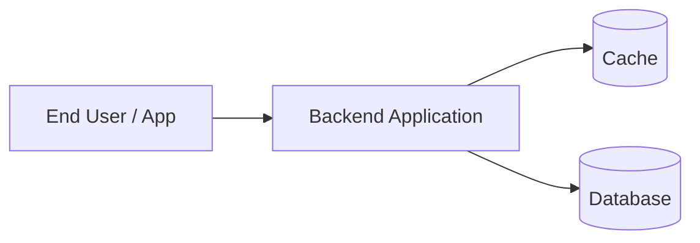
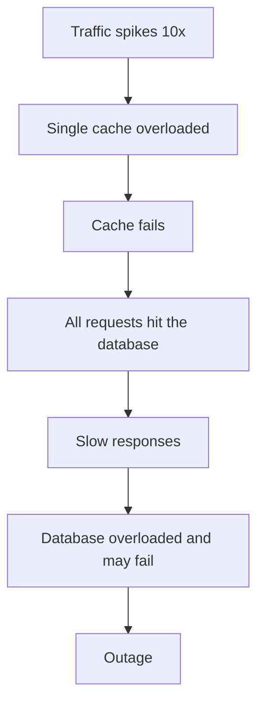
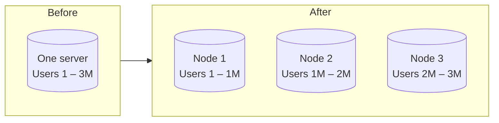
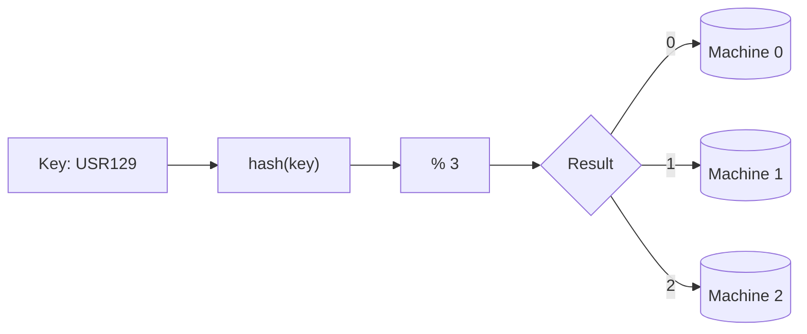
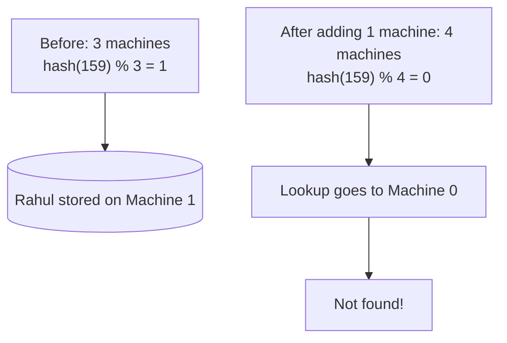
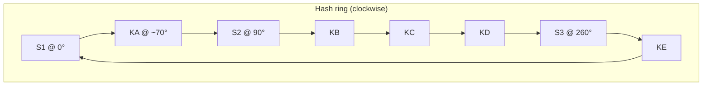
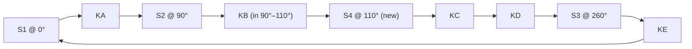
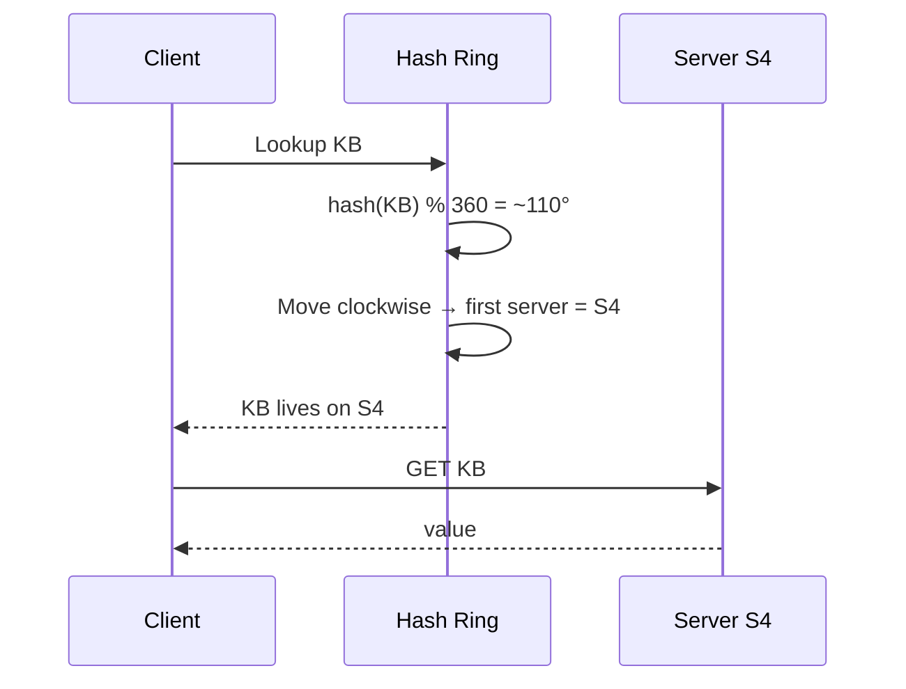
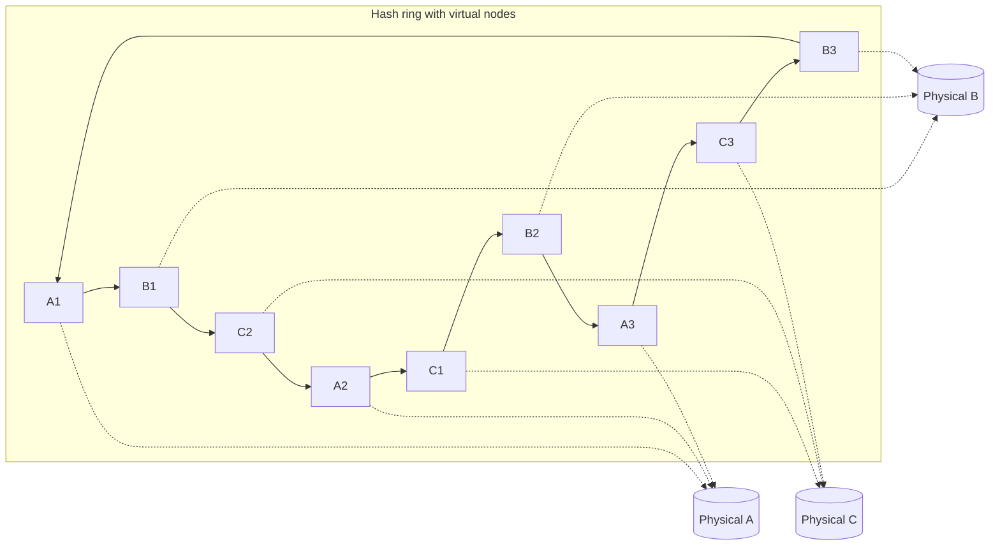
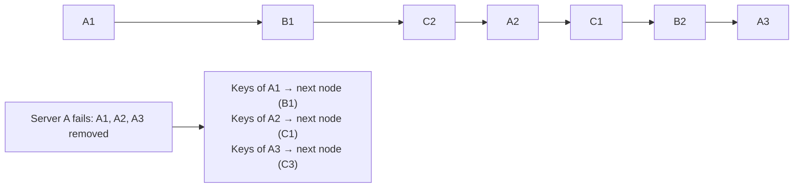

# Distributed Cache – Partitioning & Consistent Hashing

> *Part of the System Design series on designing a **Distributed Cache**. Previous topics: functional requirements, non-functional requirements, and eviction strategies. This topic is independent, so it can be read on its own.*

## Table of Contents

1. [Introduction](#1-introduction)
2. [The Problem (Instagram Example)](#2-the-problem-instagram-example)
3. [What Is Partitioning?](#3-what-is-partitioning)
4. [Range-Based Partitioning](#4-range-based-partitioning)
5. [Hash-Based (Modulo) Partitioning](#5-hash-based-modulo-partitioning)
6. [Challenge of Hash-Based Partitioning](#6-challenge-of-hash-based-partitioning)
7. [Consistent Hashing](#7-consistent-hashing)
8. [Adding and Removing Servers](#8-adding-and-removing-servers)
9. [Lookup in Consistent Hashing](#9-lookup-in-consistent-hashing)
10. [Challenge of Consistent Hashing](#10-challenge-of-consistent-hashing)
11. [Consistent Hashing with Virtual Nodes](#11-consistent-hashing-with-virtual-nodes)
12. [Server Failure Handling](#12-server-failure-handling)
13. [Comparison of Partitioning Techniques](#13-comparison-of-partitioning-techniques)
14. [Quick Revision – Interview Notes](#14-quick-revision--interview-notes)

---

## 1. Introduction

We are designing a **Distributed Cache**. Having covered the functional and non-functional requirements and the **eviction strategies**, this session covers a very important interview concept:

- **Partitioning** – what it means and how to do it.
- **Consistent Hashing** – the advanced, better version of partitioning.

Consistent hashing is used heavily at companies like Google and Meta, and in many databases and distributed systems.

---

## 2. The Problem (Instagram Example)

Consider an app like Instagram. Behind the app there is a backend application running on a server, a database holding the data, and a **cache** in between.



Instagram is **read-heavy** (many more readers than writers), so hot profiles, hot stories and hot events are stored in the cache.

### What if traffic suddenly spikes?

Suppose Virat Kohli posts a controversial reel or likes someone's photo, and people share it and make stories. Traffic jumps to **10x** the normal load.

1. The load on the **cache** increases.
2. A cache can respond only up to a certain capacity, so it **can fail**.
3. If the cache fails, every request goes straight to the **database**, so everything becomes **slow**.
4. If the database is overloaded, **the database itself can fail**, which causes an **outage**. Instagram goes down.



### The idea to fix it

Instead of storing data in **just one cache**, store it across **two or three (or more) caches** on different machines. If one goes down, the others are still available and the load is shared. This concept is called **partitioning**.

---

## 3. What Is Partitioning?

> **Partitioning** means breaking a large dataset into smaller parts and distributing them across multiple servers, instead of storing everything in one place.

### Example

Suppose all user records (IDs 1 to 3 million) are stored on **one** server. Problems:

| Problem | Why |
| :--- | :--- |
| High load | Every request hits the same machine |
| Slow queries | The data is large, so scanning takes longer |
| **Single point of failure** | If it goes down, **all** the data is gone |

Instead, split the data across three servers:



Partitioning can be applied to **caches** and to **databases**. To partition, you need a **partitioning logic**. The main ones are:

1. Range-based
2. Hash-based (modulo)
3. Consistent hashing
4. Consistent hashing with virtual nodes

---

## 4. Range-Based Partitioning

Each user has an ID, and each node owns a **range** of IDs.

| User ID | Goes to |
| :--- | :--- |
| 1,000 | Node 1 (below 1M) |
| 1,500,000 | Node 2 (1M – 2M) |
| 2,500,000 | Node 3 (2M – 3M) |

This is the **simplest** approach and spreads the load across nodes.

### Challenge

It works only when the key is **numeric** (and evenly spread). What if the ID is **alphanumeric**, such as `USR1059`? You cannot easily define ranges. This leads to the next technique.

---

## 5. Hash-Based (Modulo) Partitioning

Use a **hash function** and the **modulo** operator to choose a node.

```
node = hash(key) % N        (N = number of machines)
```

### Example

Three machines with IDs `0`, `1`, `2`.

**Write:**

- Record `USR1239` → `hash(USR1239) % 3 = 2` → stored on **Machine 2**.
- Record `USR129` → `hash(USR129) % 3 = 1` → stored on **Machine 1**.

**Read:** apply the **same logic**. For `USR129`, `hash(USR129) % 3 = 1`, so read from **Machine 1**.



### Benefits

- Works for **any key type** (numeric or alphanumeric).
- Data is spread **evenly** if the hash function is good.
- Reads and writes are both **fast**, with a clear lookup mechanism.
- Very common and easy to build yourself.

> Interviewers will almost certainly ask this one. The **next** question is always: *"What is the challenge?"*

---

## 6. Challenge of Hash-Based Partitioning

Everything works until you need to **scale**: add or remove a machine. The formula depends on **N**.

### Example

- Initially 3 machines: `hash(id) % 3`.
- A record **Rahul** with ID `159` → `hash(159) % 3 = 1` → stored on **Machine 1**.
- Now add a 4th machine. The formula becomes `hash(id) % 4`.
- Read Rahul again: `hash(159) % 4 = 0` → look on **Machine 0** → **not found!** The data is still on Machine 1.



### Consequence

Whenever the number of partitions changes, **almost all the data has to be redistributed**:

- Redistribution is **expensive**.
- It takes a long time and the system becomes **slow**.
- It consumes a lot of **network bandwidth**.
- Without redistribution you effectively **lose data** (cache misses).

> This is an **extremely important interview question.** The fix is a new kind of hashing: **consistent hashing**.

---

## 7. Consistent Hashing

Use consistent hashing when your system is **scalable** and you will **frequently increase or decrease** the number of partitions, without hurting performance or redistributing all the data.

### Core idea

There are two things: **keys** (data) and **servers** (where data is stored).

1. Build a **hash ring** (a circle, 0° to 360°).
2. **Hash each server** and place it on the ring.
3. **Hash each key** and place it on the ring.
4. A **key belongs to the first server found moving clockwise** from the key's position.

```
position = hash(value) % 360
```

### Worked example

Servers: `S1`, `S2`, `S3`.

| Server | Hash % 360 | Position on ring |
| :--- | :--- | :--- |
| S1 | 0 | 0° |
| S2 | 90 | 90° |
| S3 | 260 | 260° |

Keys: `KA`, `KB`, `KC`, `KD`, `KE`.

| Key | Position | Next server clockwise | Stored on |
| :--- | :--- | :--- | :--- |
| KA | ~70° | S2 (90°) | **S2** |
| KB | between 90° and 260° | S3 (260°) | **S3** |
| KC | between 90° and 260° | S3 (260°) | **S3** |
| KD | between 90° and 260° | S3 (260°) | **S3** |
| KE | between 260° and 360° | wraps around to S1 (0°) | **S1** |



Result:

- `S1` → `KE`
- `S2` → `KA`
- `S3` → `KB`, `KC`, `KD`

### Steps to place a key

1. Compute `hash(key) % 360` to get its degree on the ring.
2. Move **clockwise** from that point.
3. The first server encountered is where the key is stored.

---

## 8. Adding and Removing Servers

### Adding a server

Existing: `S1` (0°), `S2` (90°), `S3` (260°). Add **S4**, whose hash lands at about **110°**.



| Key | Impact |
| :--- | :--- |
| KA | None, still goes to S2 |
| KC, KD | None, still go to S3 |
| KE | None, still goes to S1 |
| **KB** (between S2 and S4) | **Moves from S3 to S4** |

> **Only the keys that fall between the previous server (S2) and the new server (S4) need to move.** In normal hashing the entire dataset had to be redistributed. Here only a **small chunk** moves.

### Removing a server

Remove **S2** (remaining: `S1`, `S4`, `S3`).

- `KA` was on S2. Moving clockwise it now meets **S4** first, so `KA` moves to **S4**.
- Only the keys that belonged to the removed server (the range between S1 and S2) move to the next server.

> Redistribution is **limited**, so it is **fast** and **cheap**.

| Operation | Normal hashing (`% N`) | Consistent hashing |
| :--- | :--- | :--- |
| Add a server | Almost all keys move | Only keys between the new server and its predecessor move |
| Remove a server | Almost all keys move | Only the removed server's keys move to the next server |

---

## 9. Lookup in Consistent Hashing

To find a key, repeat exactly what was done when storing it:

1. **Hash the key** (`hash(key) % 360`).
2. Find that point on the **ring**.
3. Move **clockwise** to the next server.
4. Read the data from that server.

### Example: search for `KB`

- `hash(KB) % 360` ≈ **110°**
- Move clockwise → next server is **S4**
- Fetch the data from **S4**



---

## 10. Challenge of Consistent Hashing

In the example, `KB`, `KC`, `KD` all landed on **S3** while S1 and S2 held one key each.

> **Uneven distribution of load.** Some servers may become **overloaded** while others hold very little data.

This happens because hash positions of servers on the ring are random, so the gaps between servers can differ a lot.

> **Engineering mindset:** always ask *"when will this fail?"* Every system you write will fail somewhere, so you design to **fail gracefully**. The fix for this problem is **virtual nodes**.

---

## 11. Consistent Hashing with Virtual Nodes

### Idea

Instead of placing each **physical** server **once** on the ring, create multiple **virtual replicas** of every server and place all of them on the ring.

- Physical servers: `A`, `B`, `C`
- Virtual nodes: `A1, A2, A3`, `B1, B2, B3`, `C1, C2, C3`

Each virtual node is hashed (`hash(A1) % 360`, etc.) and placed on the ring. If a key lands on **any** virtual node, it is actually stored on the **physical server** that virtual node represents.



### Why it helps

- Servers are spread **more evenly** around the ring.
- The probability of a key going to each server becomes **almost equal**.
- This gives an **even distribution of data**.

### Adding a new server `D`

1. Create virtual nodes `D1`, `D2`, `D3`.
2. Hash each and place it on the ring.
3. Each one only affects a **small region** (between itself and the previous node). Only that small slice of keys is redistributed.

### Lookup

1. Hash the key to a point on the ring.
2. Move clockwise.
3. The **first virtual node** encountered tells you which **physical server** holds the key.

**Example:** key `K` hashes to ~280°. Moving clockwise, the first node is `A3`. `A3` represents physical server `A`, so the data is on server **A**.

---

## 12. Server Failure Handling

If a physical server fails, all its virtual nodes disappear from the ring. The keys that belonged to each virtual node automatically go to the **next virtual node clockwise**.

- Because those next nodes belong to **different physical servers**, the failed server's load is **spread across several servers** instead of dumped on just one neighbour.
- This is similar to classic consistent hashing, but with a more even redistribution.



---

## 13. Comparison of Partitioning Techniques

| Technique | How it works | Pros | Cons |
| :--- | :--- | :--- | :--- |
| **Range-based** | Key range → node (e.g. 1–1M → Node 1) | Simplest, easy range queries | Needs ordered/numeric keys, can create hotspots |
| **Hash-based (`hash % N`)** | `hash(key) % N` | Any key type, even spread, fast read/write | Changing N remaps nearly **all** keys |
| **Consistent hashing** | Servers and keys on a ring; first server clockwise | Only a small fraction of keys move on add/remove | Can give **uneven** load |
| **Consistent hashing + virtual nodes** | Each server placed many times on the ring | Even distribution, smooth failure handling, minimal movement | More complexity and metadata to manage |

### When to use consistent hashing

Use it when:

- The system is **highly scalable**.
- You **frequently add or remove** partitions/servers.
- You do **not** want to hurt performance or redistribute lots of data.

### Where it is used

Distributed caches (Memcached/Redis clients), distributed databases (Cassandra, DynamoDB), load balancers, CDNs, and large systems at Google, Meta and others.

---

## 14. Quick Revision – Interview Notes

### Partitioning
Splitting data and storing it across **multiple nodes** instead of one. It improves performance, load distribution and availability, and removes the single point of failure. It can be applied to **caches** and **databases**.

### Techniques (in order of evolution)
1. **Range-based:** simple, works for numeric/ordered keys only.
2. **Hash-based (`hash(key) % N`):** works for any key and spreads data evenly, but **adding or removing a node remaps nearly everything**.
3. **Consistent hashing:** servers and keys on a **ring**; a key goes to the **first server clockwise**. Adding or removing a server only moves a **small chunk** of keys.
4. **Consistent hashing with virtual nodes:** each physical server has **many positions** on the ring, giving **even distribution** and smoother failure handling.

### Key interview questions
| Question | Answer |
| :--- | :--- |
| What is partitioning? | Breaking data into smaller parts and distributing them across multiple servers |
| Why not `hash % N`? | When N changes, most keys map to a different node, so data must be redistributed (expensive, cache misses) |
| How does consistent hashing fix it? | Only the keys between the new/removed node and its neighbour move |
| What is the problem with plain consistent hashing? | Uneven distribution; some servers get overloaded |
| How do virtual nodes help? | Each server appears many times on the ring, so load becomes nearly uniform |
| How do you look up a key? | Hash the key, locate it on the ring, move clockwise to the first server |
| What happens when a server fails? | Its keys go to the next node(s) clockwise; with virtual nodes the load is shared across several servers |

> **One-liner:** *Consistent hashing maps both servers and keys onto a ring so that adding or removing a server only affects a small neighbouring slice of data, and virtual nodes make that distribution even.*
