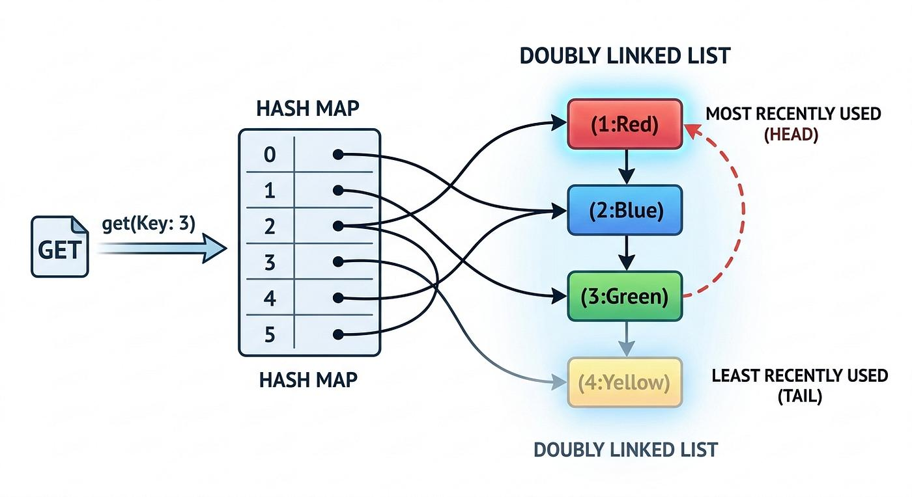

# Cache Eviction Policies

> Structured study notes on cache eviction policies for distributed systems and system design interviews.  
> Includes corrected technical details, production examples, and interview-ready explanations.

---

## Table of Contents

1. [Why Do We Need Cache Eviction?](#1-why-do-we-need-cache-eviction)
2. [Important Cache Terminologies](#2-important-cache-terminologies)
3. [Cache Eviction Policies](#3-cache-eviction-policies)
   - [3.1 FIFO – First In, First Out](#31-fifo--first-in-first-out)
   - [3.2 LRU – Least Recently Used](#32-lru--least-recently-used)
   - [3.3 LFU – Least Frequently Used](#33-lfu--least-frequently-used)
   - [3.4 Random Eviction](#34-random-eviction)
   - [3.5 TTL – Time To Live](#35-ttl--time-to-live)
   - [3.6 Combined / Hybrid Policies](#36-combined--hybrid-policies)
4. [Real-World Use Cases](#4-real-world-use-cases)
5. [Comparison of All Eviction Policies](#5-comparison-of-all-eviction-policies)
6. [Important Redis Production Concepts](#6-important-redis-production-concepts)
7. [Interview Questions and Answers](#7-interview-questions-and-answers)
8. [Test Your Understanding](#8-test-your-understanding)

---

## 1. Why Do We Need Cache Eviction?

### Typical Application Architecture

```
Users / Clients
       │
       ▼
Application / Backend
       │
       ├──► Redis Cache  (Limited RAM – Fast data access)
       │
       └──► Persistent Database  (PostgreSQL / MySQL)
```

### How It Works

1. User requests data.
2. Application checks Redis first.
3. If data exists → Redis returns it directly (**cache hit**).
4. If data does not exist → Application fetches from the database (**cache miss**).
5. Application may populate Redis with the fetched data.

### The Problem: Redis Memory is Limited

| Parameter             | Value  |
|-----------------------|--------|
| Redis memory capacity | 4 GB   |
| Existing cached data  | 4 GB   |
| New data to insert    | 100 MB |

Redis needs to make room for new data. If cached entries are not removed, new cache entries may not be stored, increasing database traffic and response latency.

### Solution: Cache Eviction Policy

> **Cache eviction** is the strategy used to remove existing cached data to make room for new data when memory is limited.

> **Note:** Eviction is not the only reason for cache misses. Misses also occur when a key has never been cached, has expired, or has been explicitly deleted.

---

## 2. Important Cache Terminologies

### 2.1 Cache Hit

When the requested data **is available** in the cache.

```
Application  ──GET user:101──►  Redis Cache
                                     │
                               Data found!
                                     │
Application  ◄──Return data──────────┘
```

The database is **not** queried.

---

### 2.2 Cache Miss

When the requested data is **not available** in the cache.

```
Application  ──GET user:101──►  Redis Cache
                                  Not found
                                     │
Application  ──Fetch data──────►  Database
Application  ◄──Return data──────────┘
             ──Populate cache──►  Redis Cache
```

A cache miss results in additional database I/O and higher latency.

---

### 2.3 Cache Hit Ratio

Measures how often requested data is found in the cache.

$$
\text{Hit Ratio} = \frac{\text{Cache Hits}}{\text{Total Requests}}
$$

**Example:**
- Total requests = 100
- Cache hits = 42
- Cache misses = 58

$$
\text{Hit Ratio} = \frac{42}{100} = 0.42 = 42\%
$$

A higher hit ratio means fewer requests reach the database.

$$
\text{Miss Ratio} = 1 - \text{Hit Ratio}
$$

> **Production tip:** Measure hit ratio per cache, per workload, and per key category — do not rely on a single overall number.

---

## 3. Cache Eviction Policies

Six important strategies:

| # | Policy | Evicts |
|---|--------|--------|
| 1 | **FIFO** | Oldest inserted entry |
| 2 | **LRU** | Least recently accessed entry |
| 3 | **LFU** | Least frequently accessed entry |
| 4 | **Random** | Random entry |
| 5 | **TTL** | Entry past its expiration time |
| 6 | **Combined / Hybrid** | Based on multiple criteria |

---

### 3.1 FIFO – First In, First Out

> The first item inserted into the cache is the first item removed.

**Example** — Cache capacity = 4 items:

```
Before insertion:   [A (oldest)]  [B]  [C]  [D]

Insert E  →  A is evicted:        [B]  [C]  [D]  [E]
```

#### Implementation

- **Data structure:** Queue (linked list with head and tail pointers).
- Insert new items at the **tail**.
- Remove items from the **head**.

| Operation | Time Complexity |
|-----------|----------------|
| Insert    | O(1)           |
| Eviction  | O(1)           |

#### Advantages
- Simple implementation.
- Low computational overhead.

#### Disadvantages
- Does not consider access frequency or recency.
- Frequently accessed old data may be evicted.

#### Real-World Example

> Instagram caches user profiles. Virat Kohli's profile was inserted first and remains extremely popular.  
> FIFO might remove it simply because it is the oldest entry, causing unnecessary database load for a highly popular profile.

---

### 3.2 LRU – Least Recently Used

> ⭐ **Important for system design interviews**

LRU removes the item that has **not been accessed for the longest time**.

**Example** — Cache capacity = 4:

| Item | Last Accessed |
|------|--------------|
| A    | 10:00        |
| B    | 10:15        |
| C    | 10:25        |
| D    | 10:30        |

New item **E** arrives → **A** is evicted (accessed least recently).



#### Implementation

Use two data structures together:

1. **HashMap** – O(1) lookup of cache entries (key → node reference).
2. **Doubly Linked List** – Maintains access order.

```
HashMap: key → node reference

Doubly Linked List:
[LRU / Tail] ← A ↔ B ↔ C ↔ D → [MRU / Head]
```

| Operation | Action                                   | Complexity |
|-----------|------------------------------------------|------------|
| GET A     | Find node in HashMap, move to head (MRU) | O(1)       |
| PUT E     | Insert new node at head                  | O(1)       |
| Eviction  | Remove tail node (LRU)                   | O(1)       |

> The **head** = most recently used. The **tail** = least recently used.

#### Advantages
- Protects recently accessed data.
- Good for workloads with **temporal locality**.
- Widely used in production caching systems.

#### Disadvantages
- More complex than FIFO.
- Requires additional memory for linked-list pointers.
- Temporarily inactive hot data can still be evicted.

#### Real-World Example

> Instagram — Every access to a popular profile updates its recency. LRU keeps recently accessed profiles in cache instead of blindly removing the oldest inserted profile.

---

### 3.3 LFU – Least Frequently Used

> ⭐ **Important for system design interviews**

LFU removes the item with the **lowest access frequency**.

**Example** — Cache capacity = 3:

| Item | Access Frequency |
|------|-----------------|
| A    | 100             |
| B    | 1               |
| C    | 3               |

New item **D** arrives → **B** is evicted (lowest frequency).

#### Implementation (O(1) LFU)

- **HashMap:** Key → Node.
- **Frequency map:** Frequency → Doubly linked list of nodes with that frequency.
- **Minimum frequency tracker** — to find the eviction candidate in O(1).

#### Advantages
- Retains frequently accessed data.
- Useful for workloads with stable access patterns.
- Protects popular content even if it has not been accessed very recently.

#### Disadvantages
- More complex implementation than LRU.
- Requires frequency counters.
- Old popular items may remain in cache even after their popularity has declined.
- New items may struggle to stay in cache because their frequency starts at 1.

#### Real-World Example

> **Netflix** — Movie recommendation cache:
> - Movie A: 100 requests
> - Movie B: 1 request
> - Movie C: 3 requests
>
> When memory becomes full, LFU removes Movie B.

---

### 3.4 Random Eviction

> Removes a **randomly selected** cache entry — no consideration of access time or frequency.

**Example:**

```
Cache: [A]  [B]  [C]  [D]  [E]

New item arrives → C selected randomly for eviction.

Result: [A]  [B]  [D]  [E]
```

#### Advantages
- Simple.
- Very low bookkeeping overhead.
- Acceptable in some high-scale workloads where approximate eviction is sufficient.

#### Disadvantages
- May remove popular or critical data.
- No awareness of access patterns.
- Can cause unpredictable cache miss spikes.

> **Recommendation:** Random eviction is not automatically bad, but it should only be chosen based on workload analysis and performance testing. Do not use it as a default.

---

### 3.5 TTL – Time To Live

> Determines how long a cache entry remains valid. When inserting data, an expiration duration is associated with it.

| Data              | TTL        |
|-------------------|------------|
| OTP               | 5 minutes  |
| Login session     | 30 minutes |
| Temporary token   | 10 minutes |
| Instagram story   | 24 hours   |
| Product info      | 1 hour     |

**Redis example:**

```redis
SET otp:123456 987654 EX 300
```

Stores an OTP with a TTL of **300 seconds (5 minutes)**. After expiry, the key is no longer available.

#### Advantages
- Prevents stale temporary data from remaining indefinitely.
- Automatically expires data.
- Ideal for sessions, OTPs, tokens, and time-sensitive content.

#### Disadvantages
- Incorrect TTL settings can cause unnecessary cache misses.
- Mass expiry of keys at the same time can create load spikes on the database.
- Expiry does not necessarily mean **immediate** physical memory reclamation at the exact expiry instant.

> **Important distinction:** TTL is an **expiration mechanism**, not the same as an LRU/LFU capacity eviction algorithm. Redis can combine TTL expiration with memory eviction policies.

---

### 3.6 Combined / Hybrid Policies

Production systems often combine multiple strategies depending on the data type and workload.

**Common combinations:**
- LRU + TTL
- LFU + TTL
- Application-specific priority + TTL

**Example — Instagram-like application:**

| Cache Content           | Suitable Strategy | Reason                         |
|-------------------------|-------------------|--------------------------------|
| Recently viewed profiles | LRU               | Temporal locality              |
| Frequently accessed profiles | LFU           | Frequency-based retention      |
| Stories                 | TTL               | Stories expire after 24 hours  |
| Trending content        | TTL + LFU         | Freshness + popularity         |

> These are illustrative design choices, not claims about Instagram's actual internal implementation.

---

## 4. Real-World Use Cases

### 4.1 Instagram

| Component | Possible Cache Strategy | Reason                                |
|-----------|------------------------|---------------------------------------|
| Feed      | LRU                    | Keep recently accessed feeds          |
| Profile   | LRU / LFU              | Recently or frequently accessed profiles |
| Stories   | TTL                    | Stories expire after 24 hours         |

---

### 4.2 YouTube Trending

| Strategy | Reason                                            |
|----------|---------------------------------------------------|
| TTL      | Trending data changes over time; old data should not remain indefinitely |
| LFU      | Frequently viewed trending items deserve cache retention |

> A trending list is dynamic. LFU retains frequently accessed content while TTL controls freshness.

---

### 4.3 Amazon Product Page

| Component        | Possible Strategy | Reason                            |
|------------------|-------------------|-----------------------------------|
| Product details  | LRU               | Recently viewed products          |
| Popular products | LFU               | Frequently accessed products      |
| Temporary offers | TTL               | Offers have defined expiration times |

---

## 5. Comparison of All Eviction Policies

| Policy   | Removes                    | Main Advantage              | Main Disadvantage                          |
|----------|----------------------------|-----------------------------|---------------------------------------------|
| FIFO     | Oldest inserted            | Simple                      | Ignores popularity and recency              |
| LRU      | Least recently accessed    | Protects recent data        | Temporarily inactive hot data may be removed |
| LFU      | Least frequently accessed  | Protects popular data       | Old popular data may linger; new data disadvantaged |
| Random   | Random item                | Simple bookkeeping          | Unpredictable misses                        |
| TTL      | Expired item               | Controls data lifetime      | Requires careful expiry tuning              |
| Hybrid   | Combination of criteria    | Flexible and adaptive       | Higher implementation complexity            |

---

## 6. Important Redis Production Concepts

> Redis does **not** use textbook FIFO, LRU, or LFU directly. It supports configurable eviction policies and uses **approximate** LRU/LFU algorithms rather than maintaining a perfectly ordered global key list.

### Redis `maxmemory-policy` Options

| Redis Policy       | Meaning                                                              |
|--------------------|----------------------------------------------------------------------|
| `noeviction`       | Reject writes that would require additional memory                   |
| `allkeys-lru`      | Approximate LRU across **all** keys                                  |
| `allkeys-lfu`      | Approximate LFU across **all** keys                                  |
| `allkeys-random`   | Randomly evict any key                                               |
| `volatile-lru`     | LRU among keys **with an expiry set**                                |
| `volatile-lfu`     | LFU among keys **with an expiry set**                                |
| `volatile-random`  | Randomly evict keys with an expiry set                               |
| `volatile-ttl`     | Prefer evicting keys with the **shortest remaining TTL**             |

> **Production note:** Redis memory planning must also account for replication, persistence, memory fragmentation, and operating-system overhead — not just the configured `maxmemory` value.

---

## 7. Interview Questions and Answers

**Q1. Why do we need cache eviction?**  
Cache memory is limited. Eviction removes existing entries to make space for new data.

---

**Q2. FIFO vs LRU?**  
FIFO removes the oldest **inserted** item. LRU removes the **least recently accessed** item.

---

**Q3. LRU vs LFU?**  
LRU considers **recency** of access. LFU considers **frequency** of access.

---

**Q4. How do you implement LRU in O(1)?**  
Using a **HashMap** (for O(1) lookup) and a **Doubly Linked List** (for O(1) move and eviction).

---

**Q5. How do you implement LFU in O(1)?**  
Using a HashMap, frequency buckets backed by doubly linked lists, and a minimum-frequency tracker.

---

**Q6. What is temporal locality?**  
If an item has been accessed recently, it is likely to be accessed again soon. LRU exploits temporal locality.

---

**Q7. What is TTL?**  
Time To Live defines how long a cache entry remains valid before expiration.

---

**Q8. What happens if Redis memory becomes full and the policy is `noeviction`?**  
Redis **rejects write commands** that require additional memory. Read commands can continue.

---

**Q9. Does a cache hit always mean the data is correct?**  
No. A cache hit only means the key exists. The cached value could be **stale** if cache invalidation or freshness checks are not handled properly.

---

## 8. Test Your Understanding

Try these five questions before moving to the next distributed caching topic.

---

**Q1.** Cache contains A, B, C, D. A was inserted first. Under FIFO, which item is removed?

<details>
<summary>Show Answer</summary>

✅ **A**  
FIFO removes the oldest inserted entry, regardless of access frequency.

</details>

---

**Q2.** Which data structure combination is commonly used to implement O(1) LRU?

- Array + Stack  
- HashMap + Doubly Linked List  
- Queue + Tree  
- Heap + Set  

<details>
<summary>Show Answer</summary>

✅ **HashMap + Doubly Linked List**  
HashMap provides O(1) lookup; the doubly linked list supports O(1) node movement and tail eviction.

</details>

---

**Q3.** A = 100 accesses, B = 1 access, C = 3 accesses. Which item does LFU evict?

<details>
<summary>Show Answer</summary>

✅ **B**  
B has the lowest access frequency.

</details>

---

**Q4.** An OTP should automatically become unavailable after five minutes. Which mechanism is most suitable?

- FIFO  
- LRU  
- TTL  
- Random  

<details>
<summary>Show Answer</summary>

✅ **TTL**  
TTL assigns a defined expiration duration to the OTP entry.

</details>

---

**Q5.** Redis uses the `noeviction` policy and reaches its configured memory limit. What happens?

<details>
<summary>Show Answer</summary>

✅ **Writes requiring more memory are rejected.**  
`noeviction` causes Redis to return an error for memory-consuming write commands instead of evicting existing keys.

</details>

---

> **Preparation focus for system design interviews:**  
> Prioritise **LRU implementation** (HashMap + Doubly Linked List), **LFU implementation**, **Redis eviction policy configuration**, and **TTL design**. These concepts connect directly to distributed caching architecture and production Redis deployments.

---

*Next: Connect these eviction policies to a Redis + FastAPI + Docker architecture and implement a working LRU cache in Python.*
