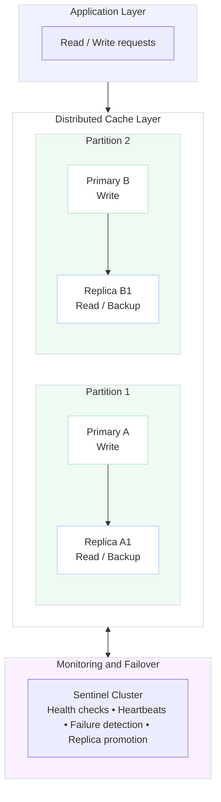

# Distributed Cache – High Availability
Now let's combine everything we have learned.

**Our architecture contains:**
1. Application Layer
2. Distributed Caching Layer
3. Partitioned Cache Nodes
4. Primary and Secondary Replicas
5. Sentinel Cluster
Each partition has two replicas in this example.

**Replication is introduced to improve availability.**

