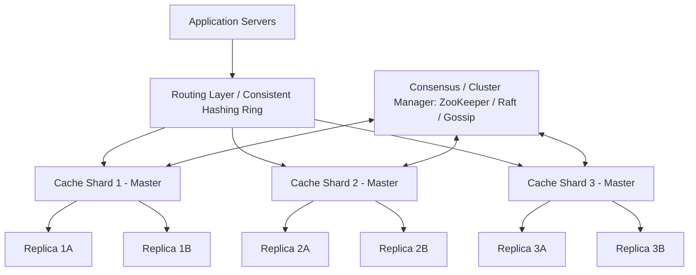

# Distributed Cache System Design (e.g., Redis / Memcached Cluster)

## 1. Overview
A **Distributed Cache** is an in-memory, highly available, distributed data store that sits between application servers and persistent storage (databases) to reduce latency, offload read/write pressure from persistent databases, and provide sub-millisecond retrieval times for frequently accessed data.

---

## 2. Requirements

### Functional Requirements
- **Put(key, value, ttl)**: Store an object under a specific key with an optional Time-To-Live (TTL).
- **Get(key)**: Retrieve the value associated with the key.
- **Delete(key)**: Invalidate/evict a key-value pair immediately.
- **Eviction Strategy**: Automatically evict keys when cache memory limit is reached (e.g., LRU, LFU, FIFO).
- **TTL Expiration**: Expire and clean up keys after their designated TTL.

### Non-Functional Requirements
- **Ultra-Low Latency**: Sub-millisecond reads (< 5ms p99) and writes (< 10ms p99).
- **High Availability**: 99.999% uptime with failover mechanisms.
- **High Scalability**: Horizontally scale to handle millions of QPS and terabytes of in-memory data.
- **Consistency**: Tunable consistency (eventual consistency across replicas, strong consistency within master node).

---

## 3. Capacity Estimation & Calculations

### Assumptions
- **Total Keys**: 1 Billion active keys.
- **Average Key Size**: 32 bytes.
- **Average Value Size**: 1 KB (1,024 bytes).
- **Metadata Overhead per entry**: ~64 bytes.
- **Total Entry Size**: ~1.12 KB.

### Memory & Throughput
- **Storage Needed**: $10^9 \times 1.12 \text{ KB} \approx 1.12 \text{ TB}$.
- **With 3x Replication**: $1.12 \text{ TB} \times 3 \approx 3.36 \text{ TB}$ of RAM.
- **Node Size**: 64 GB RAM per node $\implies 3.36 \text{ TB} / 64 \text{ GB} \approx 54$ nodes.
- **Read/Write Ratio**: 90:10 (Read Heavy).
- **QPS**: 1 Million Requests/sec (900K Reads/sec, 100K Writes/sec).

---

## 4. High-Level Architecture (HLD)



---

## 5. Core Components & Deep Dive

### 5.1 Consistent Hashing & Virtual Nodes
- **Problem**: Plain modulo hashing (`hash(key) % N`) causes $O(Keys)$ remapping when nodes are added or removed.
- **Solution**:
  - Hash ring mapped across $2^{32} - 1$ points.
  - Nodes and keys are mapped to positions on the ring using cryptographic or non-cryptographic hashes (e.g., MurmurHash3, MD5).
  - To prevent hotspots and non-uniform distribution, each physical node is assigned multiple **Virtual Nodes (vnodes)** (typically 100–256 vnodes per server).

```
        [ Node A_v1 (0) ]
        /               \
 [ Node C_v2 ]        [ Node B_v1 ]
      |                      |
 [ Node B_v2 ]        [ Node C_v1 ]
        \               /
        [ Node A_v2 ]
```

### 5.2 Eviction Policies
1. **LRU (Least Recently Used)**:
   - Data structure: Doubly Linked List + Hash Map ($O(1)$ lookup, $O(1)$ eviction).
   - Redis optimization: Approximated LRU (samples random $k$ keys to save pointer memory overhead).
2. **LFU (Least Frequently Used)**:
   - Evicts items with lowest access count; uses logarithmic decay to prevent stale frequent items from lingering.
3. **TTL Clean-up**:
   - **Passive Expiration**: Checked and expired upon read access.
   - **Active Expiration**: Periodic background sampling (e.g., 20 random keys every 100ms) to purge expired keys.

### 5.3 Cache Invalidation Patterns
- **Cache-Aside (Lazy Loading)**: App reads cache; if miss, reads DB and updates cache. App updates DB then invalidates cache.
- **Write-Through**: App writes to cache; cache synchronously writes to DB before returning.
- **Write-Behind (Write-Back)**: App writes to cache; cache asynchronously writes to DB in batches (high throughput, risk of data loss on crash).
- **Refresh-Ahead**: Cache predicts data access and refreshes before expiration.

### 5.4 Replication & High Availability
- **Primary-Replica Replication**:
  - Writes always go to Primary; Reads can be served by Primary or distributed to Replicas.
  - Replication can be asynchronous (low latency) or semi-synchronous (durability).
- **Cluster Heartbeat & Failure Detection**:
  - Gossip Protocol or centralized coordinator (ZooKeeper/etcd) detects failed primaries and promotes replicas using Raft/Paxos.

---

## 6. Cache Penetration, Breakdown & Avalanche

| Problem | Cause | Mitigation |
| :--- | :--- | :--- |
| **Cache Penetration** | Requests for non-existent keys bypass cache and hit DB directly. | **Bloom Filter** before cache lookup; Cache null/empty values with short TTL. |
| **Cache Breakdown** (Hotspot Key Expired) | A heavily accessed key expires; concurrent requests flood DB at once. | **Mutex/Distributed Lock** on cache miss so only one worker queries DB; Refresh asynchronously before expiry. |
| **Cache Avalanche** | Large batch of keys expire at the same time, causing DB overload. | Add **Random Jitter** to TTLs; Distributed multi-region caching; Circuit breakers. |

---

## 7. Data Structure & Code Outline

```python
import time
from collections import OrderedDict
from typing import Any, Optional

class LRUCacheWithTTL:
    def __init__(self, capacity: int):
        self.capacity = capacity
        self.cache = OrderedDict()  # key -> (value, expiry_time)

    def get(self, key: str) -> Optional[Any]:
        if key not in self.cache:
            return None
        value, expiry = self.cache[key]
        if expiry and time.time() > expiry:
            del self.cache[key]
            return None
        self.cache.move_to_end(key)
        return value

    def put(self, key: str, value: Any, ttl: Optional[float] = None) -> None:
        expiry = time.time() + ttl if ttl else None
        if key in self.cache:
            self.cache.move_to_end(key)
        self.cache[key] = (value, expiry)
        if len(self.cache) > self.capacity:
            self.cache.popitem(last=False)  # Evict oldest (LRU)
```

---

## 8. Summary Checklist for Interviews
- [x] Memory capacity & node counts calculated.
- [x] Consistent hashing with virtual nodes explained.
- [x] Cache invalidation vs eviction strategies compared.
- [x] Resiliency strategies (Penetration, Breakdown, Avalanche) addressed.
