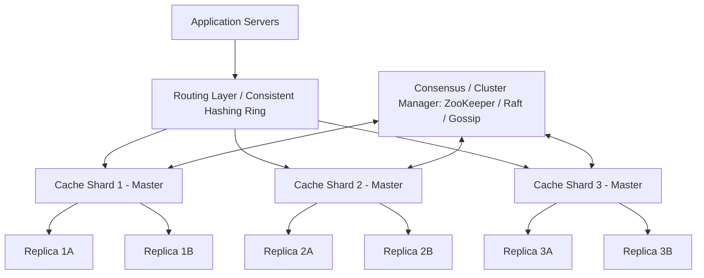

# Distributed Cache System Design (e.g., Redis / Memcached Cluster)

---

## 0. Problem Statement

> **Interview Question**: *"Design a Distributed Cache that can handle millions of requests per second for large-scale applications like Instagram, LinkedIn, or Facebook."*

### Why Not Just Query the Database Directly?

Consider Instagram: every profile load, like count, comment fetch, or image metadata is a data read. If every single request hits the database directly, two inherently slow operations stack up:

| Bottleneck | Why It's Slow |
| :--- | :--- |
| **Disk I/O** | Data on disk takes orders of magnitude longer to read than RAM |
| **Network I/O** | Round-trip latency between app server and DB adds up at scale |

This leads to a cascade of problems:

1. **Slow response times** → poor user experience (Instagram-class apps live or die by speed).
2. **High DB load** → a single viral event (e.g., Virat Kohli posts a Reel) can spike traffic and crash the database.
3. **Cascading failures** → one slow DB causes timeouts, which cause retries, which cause more load — the system collapses.

Instagram (and every major platform) is **heavily read-skewed**: a Reel is uploaded once but viewed millions of times. The solution is to avoid hitting the database for repeated reads by keeping hot data closer to the application.

---

## 0.1 What Is Caching?

### The Sweet Shop Analogy

Rahul is addicted to sweets. The sweet shop is 1 hour away. He visits 3 times a day → wastes **6 hours/day** just commuting.

His friend Simran's advice: *"When you go in the morning, bring enough sweets for the whole day and store them at home."*

Result: Rahul now goes **once a day** instead of three times → saves **4 hours/day**.

**This is caching.** Instead of making an expensive trip (disk/network I/O to the database) every time, store the result locally (in memory) so future requests are served instantly.

```
Without Cache:              With Cache:
App ──── (slow) ──→ DB      App ──→ Cache (fast, in-memory)
App ──── (slow) ──→ DB           └─(cache miss only)──→ DB
App ──── (slow) ──→ DB
```

### Technical Definition

A **Distributed Cache** is a **high-speed, temporary storage layer** that:
- Stores data in **RAM** (not disk) → constant-time O(1) reads.
- Is **spread across multiple machines** → scales horizontally and avoids a single point of failure.
- Acts as a **buffer** between application servers and the persistent database.

> **Distributed** = cache data is partitioned and replicated across more than one machine, enabling scale and fault tolerance.

---

## 1. Overview
A **Distributed Cache** is an in-memory, highly available, distributed data store that sits between application servers and persistent storage (databases) to reduce latency, offload read/write pressure from persistent databases, and provide sub-millisecond retrieval times for frequently accessed data.

---

## 2. Requirements

### Functional Requirements

These are the **core use-cases** the system must support — what the user demands:

| # | Requirement | Detail |
| :--- | :--- | :--- |
| FR1 | **Put(key, value, ttl)** | Store data as key-value pairs. The key-value structure ensures O(1) read/write (like a HashMap / Python dict). |
| FR2 | **Get(key)** | Retrieve data by key. **Must be O(1) time complexity** — caching only makes sense if reads are faster than DB. |
| FR3 | **Delete(key)** | Explicitly remove a key-value pair immediately. |
| FR4 | **TTL Support** | Every entry can carry a Time-To-Live. Expired data (stale data) auto-deletes. Example: a movie's cache entry is relevant for weeks, not years. |
| FR5 | **Eviction Strategy** | Cache has limited memory (unlike a DB). When full, old/less-used data must be removed automatically via LRU, LFU, or FIFO. |
| FR6 | **Distributed Storage** | Data must be partitioned across multiple nodes to support scale (millions of RPS). |
| FR7 | **High Throughput + Concurrency** | Must handle many concurrent read/write operations without contention. |
| FR8 | **Replication Support** | Data must be replicated across nodes to ensure availability even if a node fails. |

> **Key Insight**: The storage model is **key → value** (like a HashMap), chosen specifically because it guarantees O(1) average-case lookup — the fundamental guarantee of any cache.

### Non-Functional Requirements

These drive **quality of experience** — not what the system does, but *how well* it does it:

| # | Requirement | Detail |
| :--- | :--- | :--- |
| NFR1 | **Low Latency** | O(1) read times. Sub-millisecond in-memory reads (< 5ms p99). |
| NFR2 | **High Availability** | 99.999% uptime. No single point of failure (SPOF). |
| NFR3 | **Scalability** | Horizontally scalable — add nodes to handle more traffic. |
| NFR4 | **Fault Tolerance** | If one cache node goes down, traffic re-routes to replicas. The DB must not be suddenly overwhelmed (Cache Stampede risk). |
| NFR5 | **Consistency Trade-off** | Per **CAP Theorem**: in a distributed system with Partition Tolerance (required), we choose **high availability over strong consistency**. Cache can serve slightly stale data — that's acceptable. |
| NFR6 | **Memory Efficiency** | Cache RAM is expensive. Eviction, TTL, and compact data structures are critical. |
| NFR7 | **High Throughput** | Sustain high requests/second per unit time. |

> **CAP Theorem Recap**: A distributed system can guarantee at most 2 of {Consistency, Availability, Partition Tolerance}. Since Partition Tolerance is non-negotiable in distributed caches, we trade off some consistency to keep availability high.

---

## 3. Capacity Estimation & Calculations

### Base Assumptions (Global-Scale App)

| Parameter | Value | Rationale |
| :--- | :--- | :--- |
| Daily Active Users (DAU) | 10 Million | Global-scale application (Instagram/LinkedIn tier) |
| Requests per user per day | 10 | Profile loads, like counts, feed fetches, etc. |
| **Total requests/day** | **100 Million** | = 10M × 10 |
| Cache Hit Ratio | 80% | 80M requests served from cache, 20M hit DB |
| Read/Write Ratio | 90:10 | Read-heavy (upload once, read millions of times) |

### Throughput Calculation

```
Total requests/day      = 100,000,000
Requests/second (avg)   = 100,000,000 / 86,400 ≈ 1,200 RPS
Peak traffic (5× spike) = 1,200 × 5 = 6,000 RPS
```

> At **6,000 RPS peak**, a single cache node (Redis can handle ~100K RPS) is sufficient in theory — but distribution is required for **fault tolerance**, **geographic locality**, and **data volume**.

### Memory Estimation

| Parameter | Value |
| :--- | :--- |
| Total Keys | 1 Billion active keys |
| Average Key Size | 32 bytes |
| Average Value Size | 1 KB |
| Metadata Overhead | ~64 bytes/entry |
| **Total per entry** | **~1.12 KB** |
| **Raw storage needed** | **1.12 TB** |
| With 3× Replication | ~3.36 TB RAM |
| RAM per node | 64 GB |
| **Nodes required** | **~54 nodes** |

### Why Caching Dramatically Helps

With an 80% cache hit rate on 100M daily requests:
- **80M requests** → served from in-memory cache (< 1ms latency each)
- **20M requests** → hit the database (10–50ms each)
- DB load reduction: **80%** — preventing overload and cascading failures

---

## 4. High-Level Architecture (HLD)



---

## 5. Core Components & Deep Dive

### 5.1 Consistent Hashing & Virtual Nodes
- **Problem**: Plain modulo hashing (`hash(key) % N`) causes $O(Keys)$ remapping when nodes are added or removed.
- **Solution**:
  - Hash ring mapped across $2^{32} - 1$ points.
  - Nodes and keys are mapped to positions on the ring using cryptographic or non-cryptographic hashes (e.g., MurmurHash3, MD5).
  - To prevent hotspots and non-uniform distribution, each physical node is assigned multiple **Virtual Nodes (vnodes)** (typically 100–256 vnodes per server).

```
        [ Node A_v1 (0) ]
        /               \
 [ Node C_v2 ]        [ Node B_v1 ]
      |                      |
 [ Node B_v2 ]        [ Node C_v1 ]
        \               /
        [ Node A_v2 ]
```

### 5.2 Eviction Policies
1. **LRU (Least Recently Used)**:
   - Data structure: Doubly Linked List + Hash Map ($O(1)$ lookup, $O(1)$ eviction).
   - Redis optimization: Approximated LRU (samples random $k$ keys to save pointer memory overhead).
2. **LFU (Least Frequently Used)**:
   - Evicts items with lowest access count; uses logarithmic decay to prevent stale frequent items from lingering.
3. **TTL Clean-up**:
   - **Passive Expiration**: Checked and expired upon read access.
   - **Active Expiration**: Periodic background sampling (e.g., 20 random keys every 100ms) to purge expired keys.

### 5.3 Cache Invalidation Patterns
- **Cache-Aside (Lazy Loading)**: App reads cache; if miss, reads DB and updates cache. App updates DB then invalidates cache.
- **Write-Through**: App writes to cache; cache synchronously writes to DB before returning.
- **Write-Behind (Write-Back)**: App writes to cache; cache asynchronously writes to DB in batches (high throughput, risk of data loss on crash).
- **Refresh-Ahead**: Cache predicts data access and refreshes before expiration.

### 5.4 Replication & High Availability
- **Primary-Replica Replication**:
  - Writes always go to Primary; Reads can be served by Primary or distributed to Replicas.
  - Replication can be asynchronous (low latency) or semi-synchronous (durability).
- **Cluster Heartbeat & Failure Detection**:
  - Gossip Protocol or centralized coordinator (ZooKeeper/etcd) detects failed primaries and promotes replicas using Raft/Paxos.

---

## 6. Cache Penetration, Breakdown & Avalanche

| Problem | Cause | Mitigation |
| :--- | :--- | :--- |
| **Cache Penetration** | Requests for non-existent keys bypass cache and hit DB directly. | **Bloom Filter** before cache lookup; Cache null/empty values with short TTL. |
| **Cache Breakdown** (Hotspot Key Expired) | A heavily accessed key expires; concurrent requests flood DB at once. | **Mutex/Distributed Lock** on cache miss so only one worker queries DB; Refresh asynchronously before expiry. |
| **Cache Avalanche** | Large batch of keys expire at the same time, causing DB overload. | Add **Random Jitter** to TTLs; Distributed multi-region caching; Circuit breakers. |

---

## 7. Data Structure & Code Outline

```python
import time
from collections import OrderedDict
from typing import Any, Optional

class LRUCacheWithTTL:
    def __init__(self, capacity: int):
        self.capacity = capacity
        self.cache = OrderedDict()  # key -> (value, expiry_time)

    def get(self, key: str) -> Optional[Any]:
        if key not in self.cache:
            return None
        value, expiry = self.cache[key]
        if expiry and time.time() > expiry:
            del self.cache[key]
            return None
        self.cache.move_to_end(key)
        return value

    def put(self, key: str, value: Any, ttl: Optional[float] = None) -> None:
        expiry = time.time() + ttl if ttl else None
        if key in self.cache:
            self.cache.move_to_end(key)
        self.cache[key] = (value, expiry)
        if len(self.cache) > self.capacity:
            self.cache.popitem(last=False)  # Evict oldest (LRU)
```

---

## 8. Key Challenges in Distributed Caching

Understanding these challenges is what separates a junior from a senior engineer in a system design interview:

| # | Challenge | Root Cause | Solution Direction |
| :--- | :--- | :--- | :--- |
| C1 | **Limited Memory** | Cache is RAM-based, not disk — capacity is finite and expensive | Implement Eviction Policies (LRU, LFU); tune TTLs aggressively |
| C2 | **Single Point of Failure (SPOF)** | One cache node going down collapses the entire cache layer | Distribute cache across multiple nodes; add replicas |
| C3 | **Partitioning** | How to split data across nodes fairly and minimise reshuffling when nodes join/leave? | Consistent Hashing + Virtual Nodes |
| C4 | **Redundancy / Node Failure** | A cache node crashes → its data is lost → DB gets flooded | Replication (Primary-Replica); data re-hashing |
| C5 | **Stale Data / Cache Invalidation** | DB data changes but cache still holds old values | Write-Through / Write-Behind / Cache-Aside patterns; TTL |
| C6 | **Hot Keys** | One key (e.g., "Ronaldo" on Instagram, "Dhurander" on BookMyShow) gets hammered by millions of concurrent requests, overloading a single shard | Local in-memory micro-caches; read replicas for hot key shards |
| C7 | **Cache Stampede** | Cache suddenly goes down; all traffic floods the DB simultaneously | Mutex/distributed lock on cache miss; circuit breakers; gradual warm-up |
| C8 | **Scalability** | Single-machine cache can't handle millions of RPS | Horizontal partitioning; cluster management (ZooKeeper / Raft / Gossip) |

> These challenges are the topics of deep-dive sessions in subsequent parts of this series.

---

## 9. Summary Checklist for Interviews
- [x] Problem statement clearly articulated (why caching exists).
- [x] Caching concept explained with analogy (Rahul & sweet shop).
- [x] Functional Requirements: key-value store, O(1) get/put/delete, TTL, eviction, distribution, replication.
- [x] Non-Functional Requirements: low latency, high availability, scalability, fault tolerance, CAP trade-off.
- [x] Capacity estimation: DAU → RPS → peak RPS → memory → node count.
- [x] Cache hit/miss ratio quantified and DB load reduction calculated.
- [x] Memory capacity & node counts calculated.
- [x] Consistent hashing with virtual nodes explained.
- [x] Cache invalidation vs eviction strategies compared.
- [x] Key challenges listed: SPOF, partitioning, hot keys, stampede, stale data.
- [x] Resiliency strategies (Penetration, Breakdown, Avalanche) addressed.
