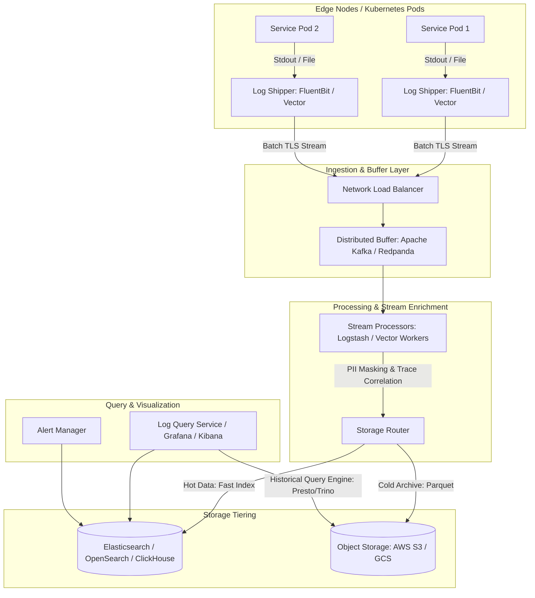
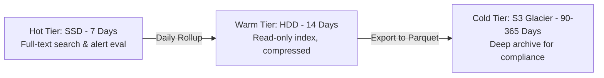

# Distributed Logging & Observability System (e.g., ELK Stack, Grafana Loki, ClickHouse Log Engine)

## 1. Overview
A **Distributed Logging System** collects, ships, ingests, indexes, and queries high-volume log streams generated across thousands of microservices, containers, and edge servers to enable real-time debugging, alerting, and security analytics.

---

## 2. Requirements

### Functional Requirements
- **Log Ingestion**: Ingest structured (JSON) and unstructured log lines from multiple languages and platforms.
- **Log Processing & Enrichment**: Parse, filter, sanitize (PII scrubbing), and enrich logs with metadata (trace_id, host, service_name, region, git_commit).
- **Search & Querying**: Sub-second full-text search, regex filtering, and aggregation over time ranges.
- **Alerting**: Real-time evaluation of alert rules (e.g., error rate > 5% over 5 minutes) sending notifications to Slack, PagerDuty, etc.
- **Retention & Tiering**: Hot (searchable), Warm (read-only), and Cold (compressed S3 archive) tiers.

### Non-Functional Requirements
- **High Throughput Ingestion**: Hundreds of thousands to millions of log events per second.
- **Low Ingestion Latency**: Logs visible for searching within < 5 seconds of creation.
- **High Durability**: Zero log loss during traffic bursts (backed by resilient queues).
- **Zero Impact on Application Performance**: Asynchronous, non-blocking log shipping from application hosts.

---

## 3. Capacity Estimation

### Assumptions
- **Servers/Pods**: 5,000 application microservices.
- **Log Rate**: 100 log lines/second per pod $\implies 500,000 \text{ logs/sec}$.
- **Average Log Size**: 500 bytes.
- **Throughput**: $500,000 \times 500 \text{ B} = 250 \text{ MB/sec} = 2 \text{ Gbps}$.
- **Daily Raw Log Volume**: $250 \text{ MB/sec} \times 86400 \approx 21.6 \text{ TB/day}$.
- **Retention**:
  - Hot Storage (SSD / Elasticsearch / ClickHouse): 7 Days $\implies \approx 150 \text{ TB}$.
  - Cold Storage (Compressed Parquet / S3): 90 Days $\implies \approx 400 \text{ TB}$ (with 5x compression).

---

## 4. High-Level Architecture (HLD)



---

## 5. Architectural Deep Dives

### 5.1 Log Collection Strategies
1. **Sidecar / DaemonSet Agent (Recommended)**:
   - Run lightweight daemon (Vector / Fluent Bit) on each node reading standard container output (`/var/log/pods`).
   - App is decoupled; zero SDK lock-in; app crashes don't lose buffered logs.
2. **Direct Socket / Async Appender**:
   - App pushes via gRPC/TCP directly. Higher risk of backpressure blocking application worker threads if connection stalls.

### 5.2 Storage Engine Paradigms: Inverted Index vs. Grep-Over-Index (Loki)

| Strategy | Inverted Index (Elasticsearch/OpenSearch) | Label-Indexed (Grafana Loki) | Columnar (ClickHouse) |
| :--- | :--- | :--- | :--- |
| **Indexing Approach** | Indexes every word in every log line. | Indexes only metadata labels (`app`, `env`, `pod`). | Columnar compression + sparse min/max primary keys. |
| **Ingestion Cost** | High CPU & High RAM. | Very Low CPU & RAM. | High throughput, balanced resource use. |
| **Search Speed** | Extremely fast arbitrary text search. | Fast by label filter, slower on raw grep. | Extremely fast aggregated queries & regex scans. |
| **Cost** | Expensive ($$$). | Very Cost-Effective ($). | Extremely Cost-Effective ($). |

### 5.3 Distributed Tracing Correlation
- Inject standard OpenTelemetry headers:
  - `trace_id`: Globally unique identifier for an end-to-end user request.
  - `span_id`: Identifier for the local unit of execution.
- Enables 1-click jump from a failed HTTP request in APM directly to the exact log lines emitted by downstream microservices.

```json
{
  "timestamp": "2025-01-15T10:30:00.123Z",
  "level": "ERROR",
  "service": "payment-service",
  "trace_id": "4bf92f3577b34da6a3ce929d0e0e4736",
  "span_id": "00f067aa0ba902b7",
  "message": "Payment gateway timeout for transaction tx_9921",
  "user_id": "usr_8820",
  "http_status": 504,
  "duration_ms": 3004
}
```

### 5.4 Data Retention & Compaction (Lifecycle Management)


---

## 6. High Availability & Backpressure Handling
- **Local Disk Buffering**: Agents buffer logs locally if the central Kafka ingestion cluster is temporarily unreachable.
- **Rate Limiting & Sampling**: Drop debug logs during severe load while always prioritizing `ERROR` and `FATAL` logs.
- **Partitioning**: Kafka topics partitioned by `service_name` or `hash(tenant_id)`.

---

## 7. Key Takeaways
- Always decouple app execution from log delivery using asynchronous logging / sidecars.
- Use a distributed queue (Kafka) as a buffer to protect storage engines from sudden traffic spikes.
- Tier storage to optimize costs between expensive real-time indexing and inexpensive cold archives.
