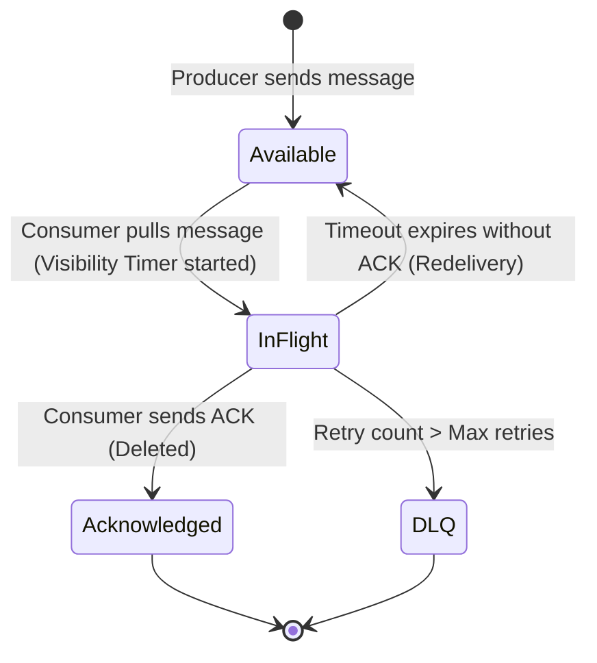

# Distributed Messaging Queue (e.g., RabbitMQ, SQS, RocketMQ)

## 1. Overview
A **Distributed Messaging Queue** is an asynchronous communication backbone that decouples message producers from consumers, buffers workloads during traffic spikes, guarantees message delivery semantics, and ensures reliable processing across distributed services.

---

## 2. Requirements

### Functional Requirements
- **Enqueue (Produce)**: Producer sends a message to a named queue.
- **Dequeue (Consume)**: Consumer polls/pulls or receives pushed messages from the queue.
- **Message Acknowledgment (ACK/NACK)**: Consumer confirms successful processing or returns message for retry.
- **Message Persistence & Durability**: Messages are persisted to disk to survive server crashes.
- **Dead Letter Queue (DLQ)**: Poison messages failing processing after $N$ attempts are routed to DLQ.
- **Ordering**: FIFO ordering guarantees (per partition or strictly across queue).
- **Delayed / Scheduled Messages**: Delay message visibility for a specified interval.

### Non-Functional Requirements
- **High Throughput**: Capable of processing 100K+ msgs/sec.
- **Low Latency**: Sub-10ms delivery latency for real-time consumers.
- **Fault Tolerance**: Replication across brokers with zero message loss (RPO = 0).
- **Scalability**: Seamless horizontal scaling of queue partitions and consumer groups.

---

## 3. Capacity Estimation

### Assumptions
- **Messages / Day**: 100 Million.
- **Average Message Size**: 2 KB.
- **Average Ingestion QPS**: $\approx 1,200 \text{ msgs/sec}$ (Peak: 10,000 msgs/sec).
- **Daily Storage**: $100 \times 10^6 \times 2 \text{ KB} = 200 \text{ GB/day}$.
- **Retention Period**: 7 days $\implies 1.4 \text{ TB}$ raw storage.
- **With 3x Replication**: $1.4 \times 3 \approx 4.2 \text{ TB}$.

---

## 4. High-Level Architecture (HLD)

```mermaid
graph TD
    P1[Producer 1] --> LB[Load Balancer / Gateway]
    P2[Producer 2] --> LB
    
    LB --> Broker1[Queue Broker 1 - Leader]
    LB --> Broker2[Queue Broker 2 - Leader]
    
    subgraph Cluster Replication
        Broker1 --> Rep1A[Broker 1 Replica A]
        Broker1 --> Rep1B[Broker 1 Replica B]
        Broker2 --> Rep2A[Broker 2 Replica A]
    end
    
    Coordinator[Metadata & Coordinator: ZooKeeper / KRaft / etcd] <--> Broker1
    Coordinator <--> Broker2
    
    Broker1 --> CGroup1[Consumer Group 1 (Worker Pool)]
    Broker2 --> CGroup2[Consumer Group 2]
    Broker1 --> DLQ[(Dead Letter Queue)]
```

---

## 5. Core Architectural Deep Dives

### 5.1 Push vs. Pull Model
| Feature | Push Model (e.g., RabbitMQ) | Pull Model (e.g., SQS, Kafka) |
| :--- | :--- | :--- |
| **Mechanics** | Broker pushes messages over open TCP connection to consumers. | Consumer polls broker with batch requests (`long-polling`). |
| **Pros** | Ultra-low latency; immediate delivery. | Consumer controls its consumption rate; prevents overwhelming workers. |
| **Cons** | Risk of overwhelming slow consumers (requires prefetch limits). | Slight polling latency overhead; empty poll calls. |

### 5.2 Delivery Guarantees
1. **At-Least-Once (Most Common)**:
   - Message is redelivered if ACK is not received before timeout (Visibility Timeout).
   - Requires consumers to be **idempotent** (e.g., deduplication using idempotency key in Redis/DB).
2. **At-Most-Once**:
   - Message is removed immediately upon delivery; no redeliveries on consumer crash.
3. **Exactly-Once**:
   - Requires combination of transactional producer, idempotent consumer, and 2-Phase Commit / atomic ACK state.

### 5.3 Storage Engine: Append-Only Log vs. Memory Index
- **Segmented Append-Only Log**: Sequential disk writes achieve high throughput (> 100 MB/s per disk).
- **Page Cache & Zero-Copy (`sendfile`)**: OS page cache avoids context switches between kernel and user space when transferring data to network sockets.

```
Log Segment File:
[Msg1: Offset 0, Size 200B] -> [Msg2: Offset 200, Size 150B] -> [Msg3: Offset 350, Size 300B] ...
Index File:
[Offset 0 -> Byte Pos 0], [Offset 100 -> Byte Pos 21500] (Sparse Index)
```

### 5.4 Message Lifecycle & Visibility Timeout


---

## 6. Fault Tolerance & Partitioning
- **Partitioning**: Queues are divided into multiple partitions/shards.
- **Leader-Follower Consensus**: Each partition has 1 Leader broker and $N$ Follower brokers (synchronous or ISR - In-Sync Replicas).
- **Failure Recovery**: If Leader fails, Coordinator triggers election to promote an in-sync follower.

---

## 7. Python Implementation Mock (In-Memory Queue with Visibility Timeout)

```python
import time
import heapq
import threading
from typing import Optional, Dict

class Message:
    def __init__(self, msg_id: str, payload: str):
        self.msg_id = msg_id
        self.payload = payload
        self.retry_count = 0

class DistributedQueue:
    def __init__(self, visibility_timeout: int = 30, max_retries: int = 3):
        self.visibility_timeout = visibility_timeout
        self.max_retries = max_retries
        self.available_queue = []
        self.in_flight: Dict[str, tuple[Message, float]] = {}  # id -> (msg, expire_time)
        self.lock = threading.Lock()

    def enqueue(self, msg: Message):
        with self.lock:
            self.available_queue.append(msg)

    def dequeue(self) -> Optional[Message]:
        with self.lock:
            self._reclaim_expired()
            if not self.available_queue:
                return None
            msg = self.available_queue.pop(0)
            self.in_flight[msg.msg_id] = (msg, time.time() + self.visibility_timeout)
            return msg

    def ack(self, msg_id: str):
        with self.lock:
            self.in_flight.pop(msg_id, None)

    def _reclaim_expired(self):
        now = time.time()
        expired_ids = [m_id for m_id, (msg, exp) in self.in_flight.items() if exp <= now]
        for m_id in expired_ids:
            msg, _ = self.in_flight.pop(m_id)
            msg.retry_count += 1
            if msg.retry_count <= self.max_retries:
                self.available_queue.append(msg)
            else:
                print(f"Message {msg.msg_id} moved to Dead Letter Queue (DLQ)")
```
