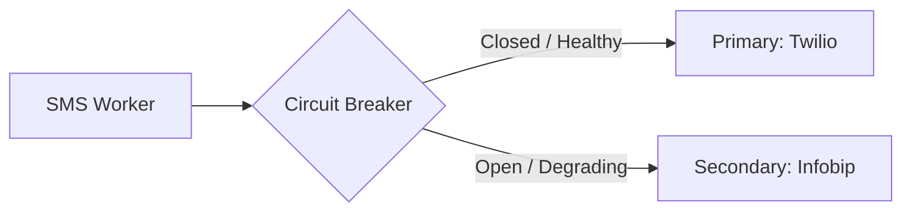

# Distributed Notification System Architecture (e.g., Apple APNs, Firebase FCM, Twilio, SendGrid)

## 1. Overview
A **Distributed Notification System** is a mission-critical platform service responsible for delivering transactional, promotional, and real-time alerts across multiple channels (Mobile Push Notifications, Web Push, SMS, Email, In-App Inbox, and Webhooks) to billions of users globally with high reliability, deduplication, rate limiting, and priority management.

---

## 2. Requirements

### Functional Requirements
- **Multi-Channel Dispatch**: Send notifications via iOS (APNs), Android (FCM), SMS (Twilio/Infobip), Email (SendGrid/SES), and In-App Feed.
- **Template Management & Personalization**: Dynamic localization and placeholder variable replacement (`"Hello {{name}}, your order {{order_id}} has shipped"`).
- **User Preference Management**: Honor user opt-outs, quiet hours, and channel preferences per notification category (marketing, security, account).
- **Deduplication & Rate Limiting**: Prevent duplicate notifications during retries; enforce frequency capping (e.g., max 3 promotional notifications per day).
- **Delivery Analytics & Tracking**: Track status: Sent $\to$ Delivered $\to$ Opened $\to$ Clicked $\to$ Bounced.

### Non-Functional Requirements
- **High Throughput**: Capable of sending 100,000+ notifications per second during breaking news or flash sales.
- **Low Latency**: Critical alerts (OTP, Security) delivered within < 2 seconds.
- **High Availability**: 99.999% availability.
- **Fault Tolerance**: Automatic fallback to alternative third-party gateways on vendor outage.

---

## 3. Capacity Estimation

### Assumptions
- **Daily Active Users**: 500 Million.
- **Notifications per Day**: 2 Billion notifications.
- **Average QPS**: $2 \times 10^9 / 86400 \approx 23,000 \text{ notifications/sec}$.
- **Peak QPS**: 150,000 notifications/sec (flash sales, breaking news).
- **Average Payload**: 1 KB (template + payload + device tokens).
- **Daily Storage**: $2 \times 10^9 \times 1 \text{ KB} = 2 \text{ TB/day}$ delivery history.

---

## 4. High-Level Architecture (HLD)

```mermaid
graph TD
    subgraph Internal Services
        OrderSvc[Order Service] --> API_GW[Notification API Gateway]
        AuthSvc[Auth Service - OTP] --> API_GW
        MarketingSvc[Marketing Campaign Engine] --> API_GW
    end

    subgraph Core Validation & Routing
        API_GW --> Validator[Rate Limiter & User Preferences Engine]
        Validator --> UserPrefDB[(User Preferences & Device Tokens DB)]
        Validator --> PriorityRouter[Priority & Channel Router]
    end

    subgraph Channel-Specific Priority Queues (Kafka)
        PriorityRouter -->|High Priority / OTP| HighQueue[High Priority Queue]
        PriorityRouter -->|Push Notifications| PushQueue[Push Queue: APNs / FCM]
        PriorityRouter -->|SMS Messages| SMSQueue[SMS Queue]
        PriorityRouter -->|Email Messages| EmailQueue[Email Queue]
    end

    subgraph Distributed Dispatch Workers
        PushQueue --> PushWorkers[APNs / FCM Workers]
        SMSQueue --> SMSWorkers[SMS Gateway Workers]
        EmailQueue --> EmailWorkers[Email Gateway Workers]
    end

    subgraph External Gateways
        PushWorkers --> APNs[Apple APNs]
        PushWorkers --> FCM[Google FCM]
        SMSWorkers --> Twilio[Twilio / Sinch]
        EmailWorkers --> SES[AWS SES / SendGrid]
    end

    subgraph Event Tracking
        APNs -.-> CallbackGW[Webhook Event Collector]
        FCM -.-> CallbackGW
        Twilio -.-> CallbackGW
        CallbackGW --> AnalyticsDB[(Delivery & Click Analytics Store)]
    end
```

---

## 5. Architectural Deep Dives

### 5.1 Priority Queueing (OTP vs. Promotional Campaigns)
- Critical notifications (OTP, fraud alerts, password resets) must **never** be blocked behind a 50-million marketing broadcast.
- **Strict Queue Isolation**:
  - `Queue_Critical`: Low batch size, instant concurrency, dedicated worker pool.
  - `Queue_Transactional`: Medium priority (Order confirmation, flight status).
  - `Queue_Promotional`: Large batching, rate-limited to avoid draining third-party provider quotas.

### 5.2 Deduplication Engine
- Network retries or multiple upstream events can trigger duplicate notifications.
- **Distributed Lock / Cache Check**:
  - Compute `dedup_key = hash(user_id + notification_type + unique_event_id)` (e.g., `user123_order_shipped_ord889`).
  - Redis check: `SET dedup_key 1 NX EX 86400`.
  - If key already exists $\to$ discard duplicate.

### 5.3 Multi-Vendor Fallback & Circuit Breaking
- Third-party vendors (Twilio, SendGrid) experience periodic outages or rate limits.
- System implements **Circuit Breakers (e.g., Resilience4j / Envoy)**:
  - If Twilio failure rate $> 10\%$ over 1 minute $\to$ trip circuit breaker $\to$ dynamically route SMS traffic to secondary vendor (e.g., Infobip/Sinch).



### 5.4 Token Invalidation & Device Token Management
- APNs / FCM return feedback when a user uninstalls the app or rotates device tokens (`Error: UnregisteredDeviceToken`).
- Workers emit invalid token events to Kafka; Device Token Management Service purges the dead token from the database to prevent wasted bandwidth.

---

## 6. Database Schema Design

```sql
CREATE TABLE user_notification_preferences (
    user_id UUID PRIMARY KEY,
    allow_push BOOLEAN DEFAULT TRUE,
    allow_sms BOOLEAN DEFAULT TRUE,
    allow_email BOOLEAN DEFAULT TRUE,
    allow_marketing BOOLEAN DEFAULT FALSE,
    quiet_hours_start TIME,
    quiet_hours_end TIME,
    timezone VARCHAR(64) DEFAULT 'UTC'
);

CREATE TABLE user_devices (
    device_token VARCHAR(255) PRIMARY KEY,
    user_id UUID NOT NULL,
    platform VARCHAR(16) NOT NULL, -- 'IOS', 'ANDROID', 'WEB'
    is_active BOOLEAN DEFAULT TRUE,
    updated_at TIMESTAMP WITH TIME ZONE DEFAULT NOW()
);

CREATE TABLE notification_logs (
    notification_id UUID PRIMARY KEY,
    user_id UUID NOT NULL,
    channel VARCHAR(16) NOT NULL, -- 'PUSH', 'SMS', 'EMAIL'
    template_id VARCHAR(64) NOT NULL,
    status VARCHAR(32) NOT NULL, -- 'SENT', 'DELIVERED', 'FAILED', 'OPENED'
    error_message TEXT,
    created_at TIMESTAMP WITH TIME ZONE DEFAULT NOW()
);
```

---

## 7. Key Takeaways
- Decouple traffic using channel-specific **Isolated Priority Queues** to protect critical OTPs.
- Implement **Deduplication Keys** and **Frequency Capping** to prevent user spamming.
- Use **Circuit Breakers** and multi-vendor adapters for high resiliency against third-party outages.
