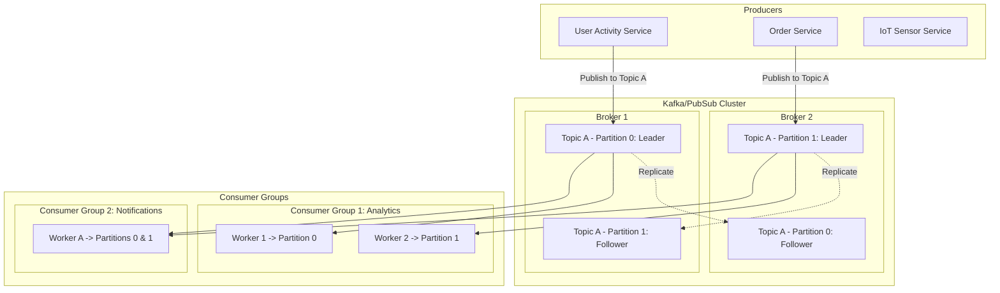

# Distributed Publisher-Subscriber System (e.g., Apache Kafka, Pulsar, Cloud Pub/Sub)

## 1. Overview
A **Distributed Publisher-Subscriber (Pub/Sub) System** provides a fan-out, many-to-many messaging architecture where message producers (**publishers**) publish messages to **Topics** without knowing who the receivers (**subscribers**) are, and subscribers receive messages matching their subscriptions.

Unlike standard point-to-point queues (where 1 message is consumed by exactly 1 worker), Pub/Sub delivers each message to multiple independent consumer groups.

---

## 2. Requirements

### Functional Requirements
- **Create / Manage Topics**: Allow dynamic creation and configuration of topics and partitions.
- **Publish Message**: Publishers send structured records (key, value, headers, timestamp) to a topic.
- **Subscribe & Fanout**: Multiple consumer groups subscribe to topics independently; each receives a complete copy of the stream.
- **Message Retention**: Configurable time-based or size-based retention (e.g., 7 days or 100 GB per partition) regardless of whether messages have been consumed.
- **Replayability / Seek**: Consumers can replay events from any offset/timestamp.

### Non-Functional Requirements
- **Extremely High Throughput**: Millions of events per second with multi-gigabyte/sec bandwidth.
- **Low End-to-End Latency**: Sub-10ms delivery latency.
- **High Scalability & Partitioning**: Horizontal scaling by partitioning topics across nodes.
- **Fault Tolerance & Durability**: Replicated partitions across failure domains (zero data loss with `acks=all`).

---

## 3. Capacity Estimation

### Assumptions
- **Daily Events**: 10 Billion messages/day.
- **Average Event Size**: 1 KB.
- **Daily Storage**: $10^{10} \times 1 \text{ KB} = 10 \text{ TB/day}$.
- **Retention**: 7 days $\implies 70 \text{ TB}$.
- **Replication Factor**: 3 $\implies 210 \text{ TB}$ disk storage.
- **Throughput**: Average write throughput = $10^{10} / 86400 \approx 115,000 \text{ msgs/sec}$ (~115 MB/sec write).
- **Peak Throughput**: 300,000 msgs/sec (~300 MB/sec).

---

## 4. High-Level Architecture (HLD)



---

## 5. Core Architectural Deep Dives

### 5.1 Topic Partitioning & Ordering
- A **Topic** is split into $N$ **Partitions**.
- A partition is an immutable, ordered sequence of records appended continually.
- **Ordering Guarantee**: Strict order is guaranteed **within a single partition**, but not globally across different partitions.
- **Partition Assignment**:
  - `hash(message_key) % num_partitions` ensures all messages with the same key (e.g., `user_id`) land on the exact same partition in order.
  - Round-robin / sticky partitioning when no key is specified.

### 5.2 Consumer Groups & Rebalancing
- Consumers form **Consumer Groups**.
- Each partition in a topic is consumed by **at most one consumer** within a single consumer group.
- If consumers > partitions, idle consumers remain on standby.
- If consumers < partitions, consumers handle multiple partitions.
- **Rebalance Protocol**: Triggered on consumer join/leave/crash to redistribute partitions.

```
Topic A (4 Partitions)
Partition 0 ───────> Consumer 1 (Group A)
Partition 1 ───────> Consumer 2 (Group A)
Partition 2 ───────> Consumer 3 (Group A)
Partition 3 ───────> Consumer 4 (Group A)

Same Topic A consumed simultaneously by Group B:
Partition 0,1 ─────> Consumer X (Group B)
Partition 2,3 ─────> Consumer Y (Group B)
```

### 5.3 Storage Architecture: Segment Logs & Indexing
- Partitions are divided on disk into **Log Segments** (e.g., 1 GB per segment).
- Log file (`.log`): Raw binary serialized message batch.
- Offset index file (`.index`): Sparse index mapping logical offsets to physical byte offsets in the `.log` file.
- Time index file (`.timeindex`): Maps timestamps to offsets for point-in-time replay.

### 5.4 High-Performance Optimizations
1. **Zero-Copy Data Transfer (`sendfile` syscall)**: Data moves directly from OS page cache to network NIC buffer without entering user space.
2. **Sequential Disk I/O**: Sequential writes to rotational disks / SSDs match or exceed random RAM access speeds.
3. **Batching & Compression**: Producers batch records (by linger time / batch size) and compress (Snappy, Zstd, LZ4) before network transmission.

### 5.5 Replication & ISR (In-Sync Replicas)
- **High Watermark (HW)**: The highest offset that has been replicated to all members of the ISR. Only messages up to HW are visible to consumers.
- **Producer ACKs**:
  - `acks=0`: Fire and forget (fastest, least durable).
  - `acks=1`: Leader writes to local log and responds.
  - `acks=all (-1)`: All In-Sync Replicas must commit before ACK is returned.

---

## 6. Pub/Sub vs. Message Queue Comparison

| Aspect | Message Queue (RabbitMQ/SQS) | Distributed Pub/Sub (Kafka/Pulsar) |
| :--- | :--- | :--- |
| **Model** | Message is consumed and deleted upon ACK. | Log retention; immutable stream read via offset pointers. |
| **Fanout** | Requires separate queue per receiver. | Native fanout across unlimited consumer groups. |
| **Replay** | Cannot replay deleted messages. | Arbitrary replay by rewinding consumer offsets. |
| **Ordering** | FIFO on queue level. | Strict FIFO per partition. |
| **Throughput** | 10K - 50K msgs/sec per broker. | 100K - 1M+ msgs/sec per broker. |

---

## 7. Python Implementation Simulation (Topic, Partition, Offset Tracker)

```python
import collections
from typing import Dict, List, Optional

class Partition:
    def __init__(self, partition_id: int):
        self.partition_id = partition_id
        self.log = []

    def append(self, message: str) -> int:
        offset = len(self.log)
        self.log.append(message)
        return offset

    def read_from(self, offset: int, limit: int = 10) -> List[str]:
        return self.log[offset : offset + limit]

class Topic:
    def __init__(self, name: str, num_partitions: int):
        self.name = name
        self.partitions = [Partition(i) for i in range(num_partitions)]

    def publish(self, key: str, value: str) -> tuple[int, int]:
        partition_idx = hash(key) % len(self.partitions)
        offset = self.partitions[partition_idx].append(value)
        return partition_idx, offset

class ConsumerGroup:
    def __init__(self, group_id: str):
        self.group_id = group_id
        self.offsets: Dict[str, Dict[int, int]] = collections.defaultdict(lambda: collections.defaultdict(int))

    def poll(self, topic: Topic, partition_id: int, limit: int = 5) -> List[str]:
        current_offset = self.offsets[topic.name][partition_id]
        messages = topic.partitions[partition_id].read_from(current_offset, limit)
        self.offsets[topic.name][partition_id] = current_offset + len(messages)
        return messages
```
