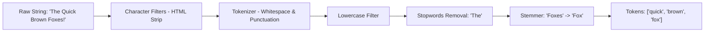

# Distributed Search Engine (e.g., Elasticsearch, OpenSearch, Lucene)

## 1. Overview
A **Distributed Search Engine** provides near-real-time full-text indexing, fuzzy search, filtering, and aggregation over billions of unstructured or semi-structured documents. It partitions documents across a distributed cluster while executing fast distributed query-and-merge algorithms.

---

## 2. Requirements

### Functional Requirements
- **IndexDocument(index, doc_id, JSON_data)**: Ingest, tokenize, normalize, and index documents.
- **SearchQuery(query_string, filters, sort, pagination)**: Execute full-text search with relevance ranking (BM25 / TF-IDF), fuzzy matching, and boolean logic.
- **Aggregations & Facets**: Compute real-time metric/bucket aggregations (counts, histograms, averages).
- **Auto-Suggest & Highlighting**: Return keyword suggestions and matching snippets.

### Non-Functional Requirements
- **Near Real-Time (NRT)**: Changes searchable within 1 second of indexing (`refresh_interval`).
- **Low Query Latency**: p95 search latency < 50ms across billions of records.
- **High Availability & Fault Tolerance**: No data loss or search downtime upon node failure.
- **Scalability**: Horizontal scaling of shards across hundreds of cluster nodes.

---

## 3. Capacity Estimation

### Assumptions
- **Total Documents**: 1 Billion.
- **Average Document Size**: 2 KB raw text.
- **Raw Storage**: $10^9 \times 2 \text{ KB} = 2 \text{ TB}$.
- **Index Expansion Factor**: Inverted index + doc values + positional data adds $\approx 1.5\times \implies 3 \text{ TB}$ index data.
- **With 1 Primary + 1 Replica**: $3 \text{ TB} \times 2 = 6 \text{ TB}$ storage.
- **Search Traffic**: 10,000 Queries/sec (QPS).
- **Ingestion Traffic**: 5,000 Documents/sec.

---

## 4. High-Level Architecture (HLD)

```mermaid
graph TD
    Client[Client App / Web / Mobile] --> LB[Load Balancer]
    LB --> CoordNode1[Coordinating / Gateway Node]
    LB --> CoordNode2[Coordinating / Gateway Node]

    subgraph Cluster Master Nodes
        Master[Elected Master Node (Raft Consensus)]
    end

    subgraph Data Nodes - Shard Distribution
        subgraph Data Node 1
            P0[Shard 0 Primary]
            R1[Shard 1 Replica]
        end
        subgraph Data Node 2
            P1[Shard 1 Primary]
            R2[Shard 2 Replica]
        end
        subgraph Data Node 3
            P2[Shard 2 Primary]
            R0[Shard 0 Replica]
        end
    end

    CoordNode1 -->|Scatter Query| P0
    CoordNode1 -->|Scatter Query| P1
    CoordNode1 -->|Scatter Query| P2
    
    P0 -->|Partial Results| CoordNode1
    P1 -->|Partial Results| CoordNode1
    P2 -->|Partial Results| CoordNode1
    CoordNode1 -->|Gather, Sort & Merge Top-K| Client
```

---

## 5. Core Architectural Deep Dives

### 5.1 The Inverted Index Data Structure
Instead of scanning documents line by line ($O(N)$), an **Inverted Index** maps each unique token/term to the sorted list of document IDs (Postings List) containing that term.

```
Document 1: "Distributed system design"
Document 2: "System caching design"

Inverted Index:
Term         | Postings List (Doc IDs & Term Frequencies)
─────────────┼──────────────────────────────────────────
distributed  | [Doc1: freq=1]
system       | [Doc1: freq=1, Doc2: freq=1]
design       | [Doc1: freq=1, Doc2: freq=1]
caching      | [Doc2: freq=1]
```

### 5.2 Text Analysis Pipeline


### 5.3 Distributed Query Execution: Scatter-Gather (Query-Then-Fetch)
1. **Scatter (Query Phase)**:
   - Coordinating node receives query (e.g., search for "system", page 1, size 10).
   - Broadcasts request to all shards (or shard replicas) in parallel.
   - Each shard executes local BM25 scoring and returns only its top 10 document IDs and scores.
2. **Gather & Merge**:
   - Coordinating node receives results from all shards (e.g., 5 shards $\times$ 10 = 50 docs).
   - Merges and global-sorts all scores to find the absolute Top 10 documents.
3. **Fetch Phase**:
   - Coordinating node requests the actual full JSON `_source` document only for those specific 10 winning IDs from their respective shards.
   - Returns merged final response to client.

### 5.4 Relevance Scoring: BM25 (Best Matching 25)
BM25 improves upon standard TF-IDF by addressing term saturation and document length normalization:
$$Score(D, Q) = \sum_{i=1}^{N} IDF(q_i) \cdot \frac{TF(q_i, D) \cdot (k_1 + 1)}{TF(q_i, D) + k_1 \cdot \left(1 - b + b \cdot \frac{|D|}{\text{avgdl}}\right)}$$
- $TF(q_i, D)$: Term frequency of query word $q_i$ in document $D$.
- $IDF(q_i)$: Inverse document frequency (rarity of the word across the whole corpus).
- $k_1$: Term frequency saturation parameter (default ~1.2).
- $b$: Document length penalty parameter (default ~0.75).

### 5.5 Sharding, Segments & Lucene Immutability
- Each Elasticsearch shard is a standalone **Apache Lucene Index**.
- Shards are composed of immutable **Segments**.
- Writes go into an in-memory buffer + Translog (Write-Ahead Log).
- Periodic **Refresh** (every 1s) creates a new searchable in-memory segment.
- Periodic **Flush** commits segments to disk.
- Background **Segment Merge** merges smaller segments into larger ones and purges deleted documents.

---

## 6. Sharding & Routing Strategies
- **Default Routing**: `shard = hash(routing_key or doc_id) % num_primary_shards`.
- **Custom Routing**: Route by `user_id` or `tenant_id` to localize search to a single shard, eliminating scatter-gather network overhead across unrelated shards.

---

## 7. Python Implementation Simulation (Inverted Index + Boolean Query)

```python
import collections
import math
import re
from typing import Dict, List, Set

class SimpleSearchEngine:
    def __init__(self):
        self.inverted_index: Dict[str, Set[int]] = collections.defaultdict(set)
        self.documents: Dict[int, str] = {}

    def _tokenize(self, text: str) -> List[str]:
        return [word.lower() for word in re.findall(r'\b\w+\b', text)]

    def index_document(self, doc_id: int, content: str):
        self.documents[doc_id] = content
        tokens = self._tokenize(content)
        for token in tokens:
            self.inverted_index[token].add(doc_id)

    def search_and(self, query: str) -> List[int]:
        tokens = self._tokenize(query)
        if not tokens:
            return []
        
        result_docs = self.inverted_index.get(tokens[0], set()).copy()
        for token in tokens[1:]:
            result_docs &= self.inverted_index.get(token, set())
        return list(result_docs)

# Example Usage
engine = SimpleSearchEngine()
engine.index_document(1, "Distributed cache system design")
engine.index_document(2, "Distributed search engine with inverted index")
engine.index_document(3, "Relational database indexing and cache")

print(engine.search_and("distributed cache"))  # Output: [1]
print(engine.search_and("distributed"))        # Output: [1, 2]
```
