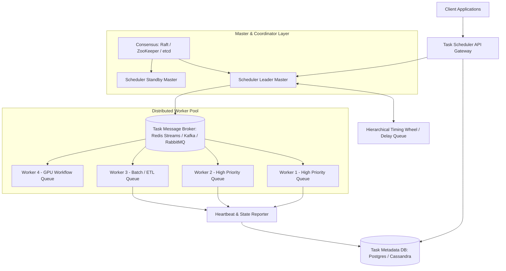

# Distributed Task Scheduler & Job Processing System (e.g., Temporal, Airflow, Celery)

## 1. Overview
A **Distributed Task Scheduler** coordinates, schedules, executes, and monitors millions of periodic (cron-based), delayed, or recurring background tasks and complex multi-step workflows (DAGs) across a dynamic cluster of distributed worker machines.

---

## 2. Requirements

### Functional Requirements
- **Schedule Task**: Submit one-off delayed tasks, recurring tasks (cron expressions), or dynamic Directed Acyclic Graph (DAG) workflows.
- **Task Execution**: Guarantee execution on distributed workers based on task types, priorities, and resource allocations (CPU/GPU/RAM).
- **Retry Mechanism**: Exponential backoff with configurable jitter for transient failures.
- **Task Cancellation & Pause**: Abort running tasks or pause periodic triggers dynamically.
- **Monitoring & Status Querying**: Check real-time progress, logs, and execution states (Pending, Running, Succeeded, Failed, Retrying).

### Non-Functional Requirements
- **High Reliability & Durability**: No job lost if master/worker crashes (At-least-once or Exactly-once execution).
- **Scalability**: Capable of executing 100,000+ tasks/sec across thousands of worker nodes.
- **Low Trigger Latency**: Sub-second precision for scheduled task invocation.
- **Fault Tolerance**: Master failover using leader election (Raft/Paxos).

---

## 3. Capacity Estimation

### Assumptions
- **Tasks per Day**: 50 Million tasks.
- **Average QPS**: $\approx 600 \text{ tasks/sec}$ (Peak: 5,000 tasks/sec).
- **Average Metadata Size per Task**: 1 KB (payload + execution log metadata).
- **Daily Storage**: $50 \times 10^6 \times 1 \text{ KB} = 50 \text{ GB/day}$.
- **Retention**: 90 days $\implies 4.5 \text{ TB}$ task history.

---

## 4. High-Level Architecture (HLD)



---

## 5. Core Architectural Deep Dives

### 5.1 Efficient Time Scheduling: Hierarchical Timing Wheels
- Storing sorted tasks in a standard database query (`SELECT * FROM tasks WHERE trigger_at <= NOW()`) causes heavy periodic table scans ($O(N \log N)$ or high DB load).
- **Timing Wheel**:
  - Circular array of slots representing time intervals (e.g., 60 slots = 60 seconds).
  - Current pointer advances 1 tick per unit time; all tasks in that slot are fired in $O(1)$ time.
  - **Hierarchical Wheel**: Second wheel (60s) $\to$ Minute wheel (60m) $\to$ Hour wheel (24h) $\to$ Day wheel.

```
       [Slot 0]
   [11]        [1]
  [10]           [2]
 [9]   ─► Tick ──► [3] (Fires tasks linked to 3rd second)
  [8]            [4]
   [7]         [5]
       [Slot 6]
```

### 5.2 Two-Phase Leader-Follower Master Architecture
- **Active Master**: Polls imminent tasks, populates memory timing wheels, and enqueues executable tasks to broker queues.
- **Standby Master**: Keeps metadata updated; takes over leadership in $< 2\text{s}$ via distributed lease lock (etcd/ZooKeeper) if active master fails.

### 5.3 Task Dependency & DAG Execution Engine
- Workflows are defined as DAGs where Task B depends on Task A.
- Master tracks topological sort in metadata:
  1. Root tasks (in-degree 0) are triggered first.
  2. Workers emit completion events upon finishing.
  3. Master decrements dependency counter of child tasks; when counter reaches 0, child task is enqueued.

### 5.4 Worker Heartbeats & Lease Renewal
- Each worker maintains an active heartbeat lease in Redis/etcd (e.g., 5-second TTL).
- If a worker crashes mid-task, its heartbeat expires.
- Scheduler detects dead lease, re-enqueues unfinished task, and marks worker offline.

### 5.5 Idempotency Key Handling
- To guarantee **At-least-once** delivery doesn't create duplicate side effects:
  - Client assigns an `idempotency_key` (UUID).
  - Worker wraps external API operations inside a distributed transaction or checks against an idempotency ledger table before executing side-effect operations.

---

## 6. Data Model

```sql
CREATE TABLE scheduled_tasks (
    task_id UUID PRIMARY KEY,
    idempotency_key VARCHAR(128) UNIQUE NOT NULL,
    task_type VARCHAR(64) NOT NULL,
    priority INT DEFAULT 1,
    status VARCHAR(32) NOT NULL, -- PENDING, RUNNING, COMPLETED, FAILED, RETRYING
    payload JSONB NOT NULL,
    schedule_cron VARCHAR(64),
    scheduled_at TIMESTAMP WITH TIME ZONE NOT NULL,
    started_at TIMESTAMP WITH TIME ZONE,
    finished_at TIMESTAMP WITH TIME ZONE,
    retry_count INT DEFAULT 0,
    max_retries INT DEFAULT 3,
    assigned_worker_id VARCHAR(64)
);

CREATE INDEX idx_tasks_schedule ON scheduled_tasks(scheduled_at, status);
```

---

## 7. Python Implementation Mock (Priority Delay Queue Scheduler)

```python
import heapq
import time
import threading
from typing import Callable, Any

class ScheduledJob:
    def __init__(self, run_at: float, task_id: str, func: Callable, args: tuple):
        self.run_at = run_at
        self.task_id = task_id
        self.func = func
        self.args = args

    def __lt__(self, other: 'ScheduledJob'):
        return self.run_at < other.run_at

class SimpleTaskScheduler:
    def __init__(self):
        self.task_heap = []
        self.lock = threading.Lock()
        self.running = True

    def schedule(self, delay_seconds: float, task_id: str, func: Callable, *args):
        run_at = time.time() + delay_seconds
        job = ScheduledJob(run_at, task_id, func, args)
        with self.lock:
            heapq.heappush(self.task_heap, job)

    def start(self):
        while self.running:
            with self.lock:
                now = time.time()
                while self.task_heap and self.task_heap[0].run_at <= now:
                    job = heapq.heappop(self.task_heap)
                    # Dispatch to worker thread
                    threading.Thread(target=job.func, args=job.args).start()
            time.sleep(0.1)

# Example Usage
scheduler = SimpleTaskScheduler()
scheduler.schedule(2.0, "task_1", lambda: print("Executed Task 1 after 2 seconds"))
```
