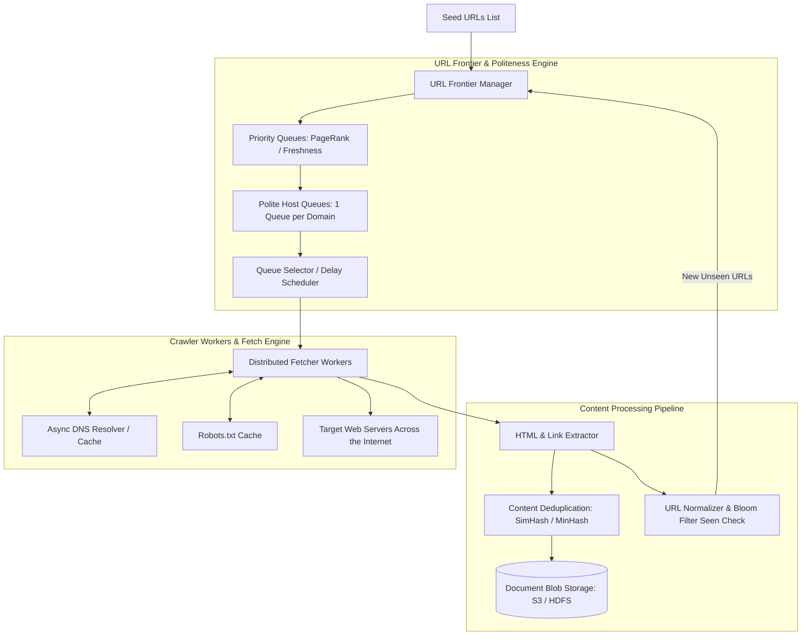

# Distributed Web Crawler System Design (e.g., Googlebot, Common Crawl)

## 1. Overview
A **Distributed Web Crawler** systematically browses and downloads billions of web pages from across the World Wide Web, parses and extracts hyperlinks, eliminates duplicates, and feeds structured web content into downstream search indexing and machine learning pipelines.

---

## 2. Requirements

### Functional Requirements
- **Web Crawling**: Given seed URLs, fetch HTML content, extract outgoing links, and enqueue new URLs recursively.
- **Politeness**: Strictly obey `robots.txt` protocol and rate-limit requests to individual host domains (avoid DDOSing websites).
- **Duplicate & Loop Prevention**: Detect and ignore previously visited URLs and duplicate page content (near-duplicates via SimHash).
- **Extensible Extraction**: Extract raw HTML, text, metadata, images, and links.

### Non-Functional Requirements
- **Massive Scalability**: Crawl 1 Billion web pages per month (~400 pages/sec continuous).
- **Fault Tolerance**: Worker nodes crash without losing frontier state or corrupting visited sets.
- **Robustness**: Gracefully handle broken links, slow servers, tarpits, infinite loops, and malformed HTML.
- **Freshness**: Periodically re-crawl dynamic pages based on change frequency.

---

## 3. Capacity Estimation

### Assumptions
- **Monthly Crawl Target**: 1 Billion web pages.
- **Average Ingestion Rate**: $10^9 / (30 \times 86400) \approx 400 \text{ pages/sec}$ (Peak: 2,000 pages/sec).
- **Average HTML Size**: 100 KB raw HTML (20 KB compressed).
- **Storage per Month**: $10^9 \times 20 \text{ KB} = 20 \text{ TB/month}$ compressed.
- **5-Year Raw Content Storage**: $20 \text{ TB} \times 60 \approx 1.2 \text{ Petabytes}$.

---

## 4. High-Level Architecture (HLD)



---

## 5. Architectural Deep Dives

### 5.1 URL Frontier Design: Politeness & Priority
A naive FIFO queue will flood individual websites with thousands of concurrent requests, violating politeness.

```
                    ┌─────────────────────────┐
                    │  Incoming Discovered URLs│
                    └───────────┬─────────────┘
                                │
                    ┌───────────▼─────────────┐
                    │ Priority Queues (F1..Fn)│  <-- Higher PageRank / High Value
                    └───────────┬─────────────┘
                                │
                    ┌───────────▼─────────────┐
                    │ Polite Host Queues      │
                    │ [Queue: cnn.com]        │  <-- Exactly 1 request per domain
                    │ [Queue: wikipedia.org]  │      with min delay (e.g. 500ms)
                    │ [Queue: github.com]     │
                    └─────────────────────────┘
```
1. **Priority Filter**: High PageRank domains (news, educational, verified sites) are prioritized over low-reputation blogs.
2. **Polite Host Mapping**:
   - Host hashes map to dedicated FIFO queues.
   - A heap tracks the earliest next allowed fetch time for each host queue.

### 5.2 Duplicate Elimination & Bloom Filters
- **URL Deduplication**:
  - URL Normalization (e.g., lowercase, remove `#fragment`, sort query params, strip tracking UTM tags).
  - Scalable **Bloom Filter** / Redis `BF.EXISTS` checks in $O(1)$ memory whether URL was already seen.
- **Content Deduplication (SimHash / MinHash)**:
  - Detect near-duplicate pages (e.g., same article with different ads/timestamps).
  - SimHash generates 64-bit fingerprints; Hamming distance $\le 3$ indicates duplicate content.

### 5.3 High-Performance DNS Resolving
- DNS lookups are the biggest bottleneck in web crawling (synchronous DNS calls take 50–300ms).
- **Custom Asynchronous DNS Cache**:
  - Local in-memory caching of DNS IP resolutions with pre-fetching.
  - Asynchronous DNS resolution library (e.g., `c-ares`, `dnspython`).

### 5.4 Spider Traps & Tarpit Mitigation
- **Infinite URL Loops**: e.g., `/calendar?year=2024&month=13...` or nested directories `/a/b/a/b/a/b/`.
- **Mitigations**:
  - Maximum path depth limit (e.g., max 10 subdirectories).
  - Max page limit per domain (e.g., max 10,000 pages per domain per crawl cycle).
  - Strict connection and read timeouts (e.g., 5 seconds timeout).

---

## 6. Data Model

```sql
CREATE TABLE crawled_documents (
    doc_id UUID PRIMARY KEY,
    url_hash VARCHAR(64) UNIQUE NOT NULL, -- SHA-256 of normalized URL
    original_url TEXT NOT NULL,
    domain VARCHAR(255) NOT NULL,
    http_status INT NOT NULL,
    content_simhash BIGINT NOT NULL,
    s3_storage_path VARCHAR(512) NOT NULL,
    crawled_at TIMESTAMP WITH TIME ZONE DEFAULT NOW(),
    last_modified_header TIMESTAMP WITH TIME ZONE
);

CREATE INDEX idx_domain_crawled ON crawled_documents(domain, crawled_at);
```

---

## 7. Key Takeaways
- Design a two-tier **URL Frontier** enforcing both high Priority (PageRank) and strict Politeness (`robots.txt` + host rate limits).
- Use **Bloom Filters** for URL seen checks and **SimHash** for near-duplicate content detection.
- Maintain an aggressive **Asynchronous DNS Resolver** to prevent network I/O blocking.
