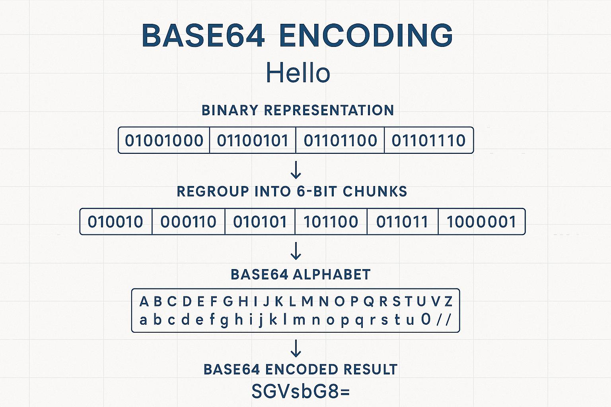
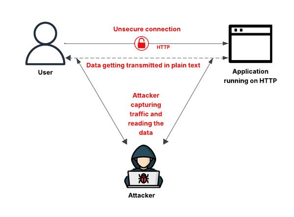
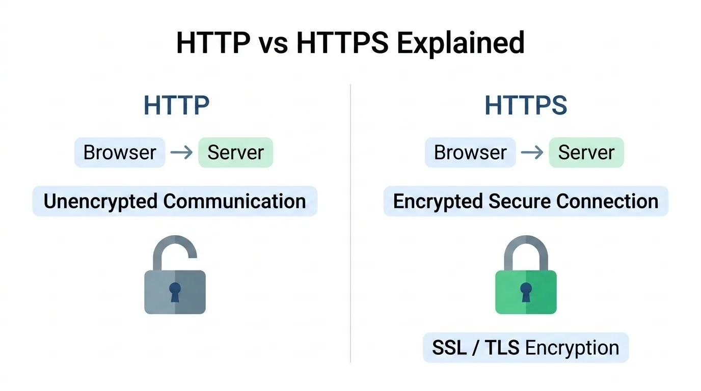
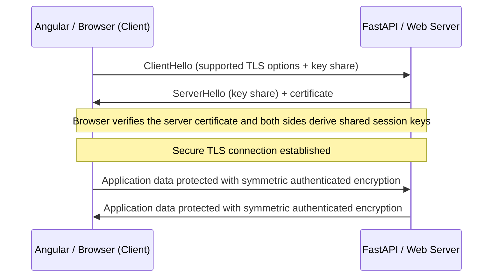
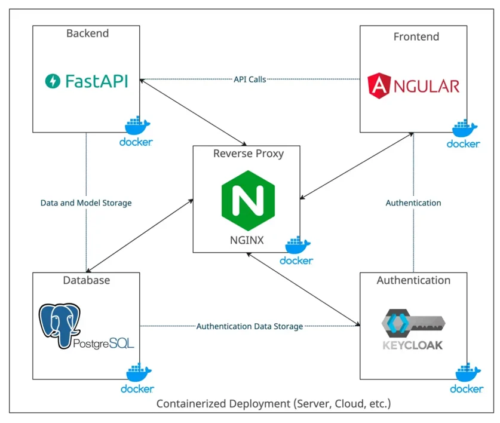

# Hashing vs Encryption vs Encoding

All three transform data, but they solve three different problems.

| Technique  | Question it answers                                         |
| ---------- | ----------------------------------------------------------- |
| Hashing    | How do I verify that data has not changed?                  |
| Encryption | How do I keep data secret?                                  |
| Encoding   | How do I represent data in a format another system understands? |


---

## 1. Hashing - one-way transformation

**Purpose:** data verification (integrity).

```
Hello123  --SHA-256-->  7d7a8f9e1b3e... (64 hex characters)
```

- Input of any length (8 characters or 1,000) always produces a fixed 256-bit hash (64 hex characters) with SHA-256.
- A hash cannot be reversed to get the original message.
- Changing one character produces a completely different hash.

### Real-world example: password storage

A bank must **never** store `MySecret123` directly. It stores a password hash using a dedicated algorithm such as **Argon2id** (or bcrypt, scrypt, PBKDF2).

**Registration**
1. User enters `MySecret123`.
2. Backend generates a random **salt**.
3. Password + salt are processed with Argon2id.
4. The resulting hash (and salt/parameters) is stored.

**Login**
1. User enters `MySecret123` again.
2. Backend retrieves the stored salt and hash.
3. It recomputes the hash with the same parameters.
4. It compares the result with the stored hash. Match = authenticated.

The application never needs to recover the original password.

### Where hashing is used
- Password storage
- File integrity verification
- Digital signatures
- Data integrity checks

> A plain hash does not prove **who** created the data. For authenticity use HMAC or digital signatures.

**Remember:** Hashing = verify the data without recovering the original data.

---

## 2. Encryption – Two-way transformation

**Purpose:** Data confidentiality

Imagine you want to send confidential information to someone. Your original message is:

```
AccountNumber123
```

You don't want anyone who intercepts the message to understand it. So you use encryption.

Encryption transforms readable data (**plaintext**) into unreadable data (**ciphertext**) using a cryptographic key.


### How does it work?

**Step 1: Original message**

```
AccountNumber123
```

This is called **plaintext**.

**Step 2: Encryption**

You use an encryption algorithm such as AES and a secret key.

**Step 3: Encrypted message**

```
u7F9xP2Wks5vZt9Q...
```

This is called **ciphertext**.

**Step 4: Decryption**

The receiver uses the correct decryption key to recover the original message.

```
u7F9xP2Wks5vZt9Q...
          |
       Decrypt
          |
AccountNumber123
```

The original information is recovered!

### Real-world example: Online banking

Imagine you are transferring ₹10,000 using a banking application.

Your application communicates with the bank's backend through HTTPS. TLS protects data during transmission using encryption.

- Without encryption, an attacker who intercepts network traffic might be able to read sensitive information.
- With properly configured HTTPS/TLS, the transmitted data is protected.

### Two important types of encryption

| Type       | Explanation                           | Example  |
| ---------- | ------------------------------------- | -------- |
| Symmetric  | Same secret key encrypts and decrypts | AES      |
| Asymmetric | Public/private key pair               | RSA, ECC |

**Symmetric encryption:**

```
Original data
     |
  AES + Key
     |
Encrypted data
     |
  AES + Same Key
     |
Original data
```

**Asymmetric encryption:**

```
Original data
     |
 Encrypt using public key
     |
Encrypted data
     |
 Decrypt using private key
     |
Original data
```

### Where is encryption used?
- HTTPS/TLS communication.
- Banking transactions.
- Database encryption.
- Confidential files.
- Secure messaging.

**Remember:** Encryption = I want to keep my data secret, but recover it later using the correct key.

---

## 3. Encoding – Changing representation

**Purpose:** Format conversion

Now imagine you have this message:

```
Hello
```

You want to convert it into a format that can safely travel through a system that expects text characters.

You use Base64 encoding. The output becomes:

```
SGVsbG8=
```

This is called **encoded data**.



### How does it work?

**Step 1: Original data**

```
Hello
```

**Step 2: Encoding**

Convert the original bytes into Base64 representation.

**Step 3: Encoded data**

```
SGVsbG8=
```

**Step 4: Decoding**

Convert it back into the original bytes.

```
SGVsbG8=
     |
   Decode
     |
   Hello
```

No secret key is required. Anyone who understands Base64 can decode it.

```
Hello  --Base64-->  SGVsbG8=  --decode-->  Hello
```

### Real-world example: REST API

Suppose your application needs to send an image or binary data through an API that expects text.

Base64 can represent those bytes as text. For example:

```json
{
  "username": "john",
  "document": "SGVsbG8="
}
```

The receiver can decode the Base64 value to get the original bytes.

### Where is encoding used?
- Base64 encoding.
- URL encoding.
- JSON serialization.
- Data transmission.
- Email attachments.

**Remember:** Encoding = I want to change the representation of data, not protect it.

---

## 4. Side-by-side comparison

| Aspect                    | Hashing                              | Encryption      | Encoding       |
| ------------------------- | ------------------------------------ | --------------- | -------------- |
| Purpose                   | Verification                         | Confidentiality | Representation |
| Reversible?               | No (designed to be one-way)          | Yes             | Yes            |
| Requires key?             | No                                   | Yes             | Usually no     |
| Original data recoverable?| No                                   | Yes             | Yes            |
| Security mechanism?       | Yes, for specific security purposes  | Yes             | No             |
| Example                   | SHA-256                              | AES             | Base64         |

---

## 5. All three in one banking application

Imagine you are building a banking application. A user logs in and transfers money. Let's see where each technique is used.

### Banking application example

**1. User creates a password**

```
MySecret123
```

Backend uses Argon2id hashing to store a password verifier.

**Technique: Hashing**

**2. User sends a banking request**

```
Transfer ₹10,000
```

HTTPS/TLS protects the communication using encryption.

**Technique: Encryption**

**3. Application sends data**

```json
{
  "amount": 10000,
  "currency": "INR"
}
```

JSON serialization represents application data in a standard format. Base64 could also be used if binary data needs a text representation.

**Technique: Encoding / Serialization**

---

## 6. Interview questions

**1. A bank wants to store a user's password without storing the original password. What should it use?**
Hashing (Argon2id) - not encryption, not Base64.

**2. A banking app sends confidential account information over the internet. What protects it?**
Encryption (TLS).

**3. You convert `Hello` into `SGVsbG8=`. What technique is this?**
Base64 encoding.

**4. Can you recover the original message from a SHA-256 hash?**
No. Hashing is designed to be one-way.

### Memory trick

| Letter | Technique  | Direction                | Goal       | Example |
| ------ | ---------- | ------------------------ | ---------- | ------- |
| H      | Hashing    | One-way                  | Verify     | SHA-256 |
| E      | Encryption | Two-way with key         | Protect    | AES     |
| E      | Encoding   | Reversible, no key       | Represent  | Base64  |

- Hashing: can I verify it?
- Encryption: can I keep it secret?
- Encoding: can I represent it differently?

---

# Practical examples with Python

## 1. SHA-256 hashing

Scenario: verify whether a document received from a customer has been modified.

```python
import hashlib

message = "Hello123"

hash_value = hashlib.sha256(message.encode("utf-8")).hexdigest()

print("Original:", message)
print("SHA-256:", hash_value)
```

The hash always has 64 hexadecimal characters.

Change the input slightly:

```python
import hashlib

hash1 = hashlib.sha256("Hello123".encode()).hexdigest()
hash2 = hashlib.sha256("Hello124".encode()).hexdigest()

print(hash1)
print(hash2)
print(hash1 == hash2)   # False
```

Even a one-character change gives a very different hash.

> SHA-256 is **not** encryption. There is no decryption function.

Uses: verifying downloads, detecting document changes, integrity checks, digital signature workflows.

---

## 2. Password hashing

Never store plaintext passwords. Use Argon2id, bcrypt, scrypt or PBKDF2. This example uses Python's built-in `hashlib.scrypt()`.

### Registration

```python
import hashlib
import os

password = "MySecret123"

# Random salt, unique per user
salt = os.urandom(16)

password_hash = hashlib.scrypt(
    password.encode(),
    salt=salt,
    n=2**14,
    r=8,
    p=1,
    dklen=32,
)

print("Salt:", salt.hex())
print("Password Hash:", password_hash.hex())
```

**What is a salt?** Random data added to the password-hashing process. If John and David both use `MySecret123`, unique salts still give them different stored hashes.

| User  | Stored in database   |
| ----- | -------------------- |
| John  | Salt + password hash |
| David | Salt + password hash |

### Login verification

```python
import hmac

entered_password = "MySecret123"

new_hash = hashlib.scrypt(
    entered_password.encode(),
    salt=salt,
    n=2**14,
    r=8,
    p=1,
    dklen=32,
)

if hmac.compare_digest(password_hash, new_hash):
    print("Login successful")
else:
    print("Invalid password")
```

- `MySecret123` -> `Login successful`
- `MySecret456` -> `Invalid password`

> Production note: this is a learning example. Production systems should use Argon2id with calibrated parameters and store the salt, algorithm parameters and hash together. The parameters above are illustrative only.

---

## 3. Base64 encoding and decoding

Scenario: a frontend must send binary data through an API that expects text.

```python
import base64

message = "Hello"

encoded = base64.b64encode(message.encode("utf-8"))
print(encoded.decode("utf-8"))        # SGVsbG8=
```

```python
import base64

decoded = base64.b64decode("SGVsbG8=")
print(decoded.decode("utf-8"))        # Hello
```

**Is Base64 secure? No.** Anyone can decode it.

> Base64 is encoding, not encryption. Never use it to protect passwords, account numbers or confidential information.

---

## 4. AES encryption and decryption using Python

**Reversible transformation using a key**

Now let's understand encryption.

**Scenario:** A banking application needs to store sensitive customer information, such as confidential account details.

We don't want the information to be readable if someone accesses the database.

We can use AES encryption. AES stands for **Advanced Encryption Standard**.

### Step 1: Install the Python library

We'll use the `cryptography` package.

```bash
pip install cryptography
```

### Step 2: Encrypt the original data

```python
from cryptography.hazmat.primitives.ciphers.aead import AESGCM
import os

# Original information
message = "AccountNumber123456"

# Generate a 256-bit encryption key
key = AESGCM.generate_key(bit_length=256)

# Create AES encryption object
aes = AESGCM(key)

# Generate a random 12-byte nonce
nonce = os.urandom(12)

# Encrypt the message
ciphertext = aes.encrypt(
    nonce,
    message.encode(),
    None
)

print("Original:", message)
print("Encrypted:", ciphertext.hex())
```

Here are the important things:

| Component  | Purpose                                |
| ---------- | -------------------------------------- |
| AES        | Encryption algorithm                   |
| 256-bit key| Secret encryption key                  |
| Nonce      | Unique value for an encryption operation |
| Ciphertext | Encrypted information                  |

### Step 3: Decrypt the information

Now imagine the banking application needs the original account information.

It uses the same AES key and nonce.

```python
# Decrypt the encrypted data
decrypted = aes.decrypt(
    nonce,
    ciphertext,
    None
)

print("Decrypted:", decrypted.decode())
```

Output:

```
Decrypted: AccountNumber123456
```


### Step 4: What if someone changes the ciphertext?

AES-GCM provides **authenticated encryption**.

It doesn't just encrypt the data; it also checks whether the encrypted data has been modified.

Try:

```python
tampered = bytearray(ciphertext)
tampered[0] ^= 1

try:
    aes.decrypt(nonce, bytes(tampered), None)
except Exception:
    print("Decryption failed: data was modified!")
```

Output:

```
Decryption failed: data was modified!
```

### Important production considerations
1. Never hardcode encryption keys in application source code.
2. Store keys in a secure key-management system, such as AWS KMS or Azure Key Vault.
3. Never reuse a nonce with the same AES-GCM key.
4. Store the nonce alongside the ciphertext. The nonce is not secret.
5. Protect and manage the encryption key separately from the encrypted data.

**Remember:** Encryption allows recovery of the original information, but only with the correct key.

---

## 5. HTTPS / TLS – How frontend and backend communicate securely

**Encryption in network communication**

This is particularly important when you build Angular frontend + FastAPI backend applications.

Imagine your banking application has:
- Angular frontend.
- FastAPI backend.
- PostgreSQL database.

The user enters:

```json
{
  "accountNumber": "123456789",
  "amount": 10000
}
```

How does this information travel securely from Angular to FastAPI?

The answer is **HTTPS**, which uses **TLS**.

### Step 1: HTTP vs HTTPS

| Protocol  | Status         | Explanation                                    |
| --------- | -------------- | ---------------------------------------------- |
| **HTTP**  | Not encrypted  | Data is transmitted without TLS protection.    |
| **HTTPS** | TLS protected  | Data is protected during transmission.         |



### Step 2: Understand the TLS handshake

Before sending application data, the browser and server establish a secure TLS connection.

A simplified TLS 1.3 process:



**What is happening internally?**
1. Browser requests a secure connection.
2. Server provides its digital certificate.
3. Browser verifies the certificate and server identity.
4. Both sides establish shared session keys using the TLS handshake.
5. They use symmetric authenticated encryption to protect application traffic.

TLS 1.3 commonly uses AES-GCM or ChaCha20-Poly1305 for application-data protection.

> **Important:** HTTPS is not simply AES. TLS combines certificates, public-key cryptography, key exchange and symmetric encryption.

### Step 3: Practical Python example

Install Requests:

```bash
pip install requests
```

Now call an HTTPS endpoint:

```python
import requests

response = requests.get(
    "https://example.com",
    timeout=10
)

print("Status:", response.status_code)
print("Response:", response.text[:100])
```

Requests verifies the server's TLS certificate by default.

You can also send banking-style JSON data:

```python
import requests

url = "https://api.example.com/transfer"

payload = {
    "accountNumber": "123456789",
    "amount": 10000
}

response = requests.post(
    url,
    json=payload,
    timeout=10
)

print(response.status_code)
```

This assumes the API exists and is configured with a trusted TLS certificate.

**Never do this in production:**

```python
requests.get(
    "https://example.com",
    verify=False
)
```

This disables certificate verification and exposes you to man-in-the-middle risks.

### Where does AES fit into HTTPS?

This is a common interview question.

The simplified answer:
- TLS uses cryptographic key exchange to establish shared session keys.
- AES-GCM can then encrypt and authenticate the actual application data.
- The browser and server do not need to encrypt every HTTP request using RSA.

---

## 6. Putting it together: banking application
Now let's combine all four techniques and HTTPS.

Imagine you're building a banking application using Angular, FastAPI and PostgreSQL.



| Application activity             | Technique                  | Python technology        |
| -------------------------------- | -------------------------- | ------------------------ |
| Register password                | Password hashing           | Argon2id / scrypt        |
| Verify password                  | Password hash verification | hashlib / argon2         |
| Verify document integrity        | Hashing                    | hashlib SHA-256          |
| Protect sensitive stored data    | Encryption                 | AES-GCM                  |
| Frontend to backend              | Encryption in transit      | HTTPS / TLS              |
| Represent binary data as text    | Encoding                   | Base64                   |

Let's walk through a user journey.

**1. User registers**

User enters their password. FastAPI uses Argon2id to create a salted password hash and stores the result in PostgreSQL.

**Technique: Hashing**

**2. User logs in**

FastAPI verifies the entered password against the stored password hash. It does not decrypt or recover the original password.

**Technique: Hashing**

**3. User transfers money**

Angular sends the transfer request to FastAPI through HTTPS. TLS protects the request during network transmission.

**Technique: Encryption – TLS**

**4. Backend stores confidential information**

Sensitive information that requires application-level encryption is encrypted using AES-GCM, with keys managed separately.

**Technique: Encryption – AES**

**5. Application transmits a binary document**

If a particular API requires text representation of binary data, the application can encode it using Base64.

**Technique: Encoding**

**6. Application verifies document integrity**

The application can calculate SHA-256 and compare it with a trusted checksum.

**Technique: Hashing**

## 7. Comparison through code

| Technique        | Python function            | Can recover original?          |
| ---------------- | -------------------------- | ------------------------------ |
| SHA-256          | `hashlib.sha256()`         | No                             |
| Password hashing | `hashlib.scrypt()`         | No                             |
| Base64           | `base64.b64encode()`       | Yes                            |
| AES              | `AESGCM.encrypt()`         | Yes, with correct key          |
| HTTPS            | `requests.get("https://")` | TLS protects data in transit   |

## 8. Common mistakes

| Mistake                                       | Correct approach                                  |
| --------------------------------------------- | ------------------------------------------------- |
| Using SHA-256 for password storage            | Use Argon2id                                      |
| Using Base64 to hide confidential information | Use encryption                                    |
| Storing AES keys in source code               | Use a key-management system                       |
| Disabling HTTPS certificate verification      | Keep certificate verification enabled             |
| Assuming HTTPS encrypts database records      | Use database/storage encryption where needed      |
| Assuming a SHA-256 hash proves authenticity   | Use HMAC or digital signatures                    |

> A SHA-256 checksum only verifies integrity when compared against a **trusted** checksum. An attacker who can change both the document and its checksum defeats the check.

## 9. Practice project: Python Security Playground

Build a small FastAPI project with five endpoints:

| Endpoint                | Functionality          |
| ----------------------- | ---------------------- |
| `POST /hash`            | Generate SHA-256       |
| `POST /password/register` | Hash a password      |
| `POST /password/login`  | Verify a password      |
| `POST /encode`          | Base64 encode/decode   |
| `POST /encrypt`         | AES encrypt/decrypt    |

```
security-playground/
├── main.py
├── security/
│   ├── hashing.py
│   ├── passwords.py
│   ├── encoding.py
│   └── encryption.py
├── requirements.txt
└── README.md
```

Suggested learning order:
1. SHA-256 and password hashing
2. Base64 encoding and decoding
3. AES-GCM encryption and decryption
4. HTTPS/TLS communication
5. Integrate everything into FastAPI

Don't just memorize the differences. Write the code, change the inputs, observe the outputs and understand what happens internally.
