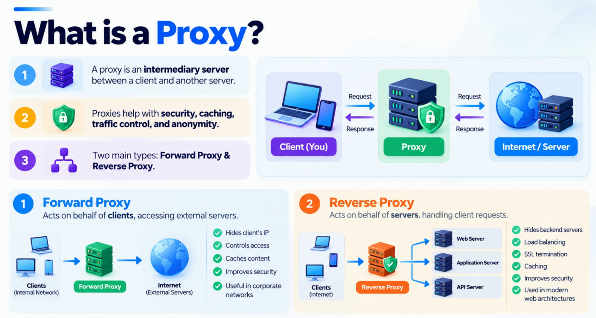
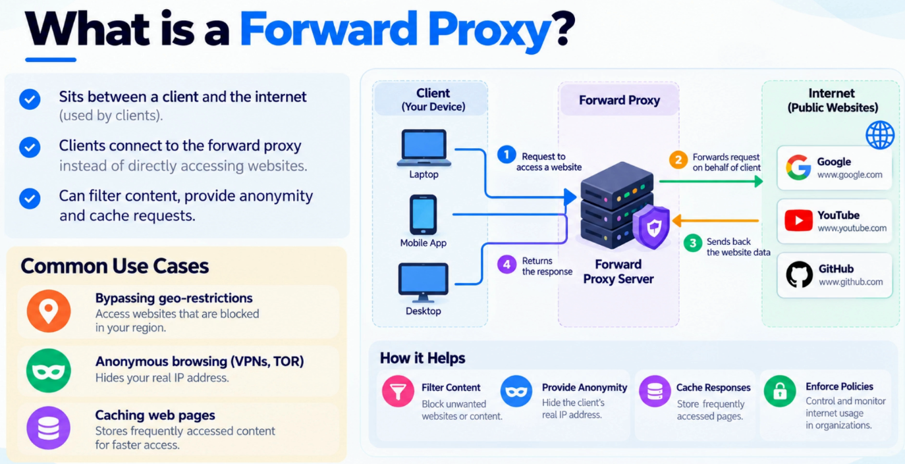
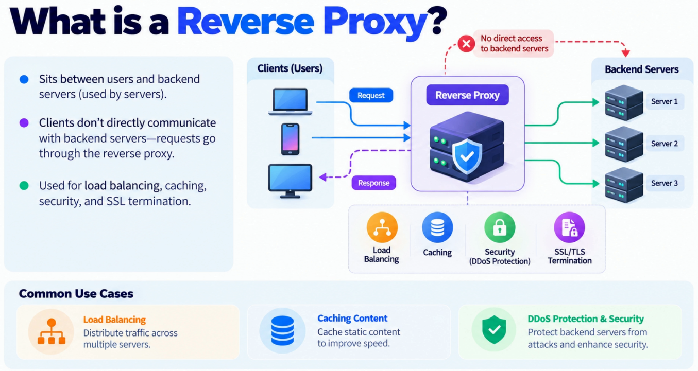
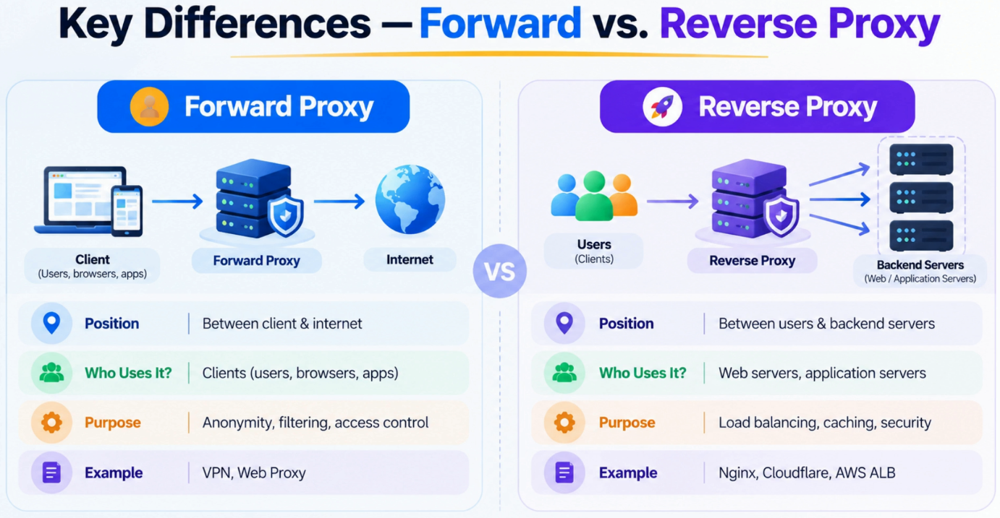

# Forward Proxy vs. Reverse Proxy

Forward proxies and reverse proxies are one of the most important traffic management patterns in modern architecture. The same core concept — an intermediary — solves completely different problems on the **client side** and the **server side**.

---

## What is a Proxy?

A **proxy** is an intermediary between two parties. Instead of a client talking directly to a server, the request first passes through the proxy, which can inspect, modify, route, cache, or secure that traffic before forwarding it.



```
Without Proxy                         With Proxy
─────────────                         ──────────
Client ──────────────► Server         Client ──► Proxy ──► Server
```

What makes proxies so valuable is that they become the **control point** in the architecture. As systems grow, capabilities like security enforcement, performance optimization, traffic management, and access control are needed — without changing either the client or the back-end application. A proxy provides that layer of abstraction.

Think of it as a **smart gatekeeper** sitting in the communication path. Depending on where it sits, it can either represent the client or represent the server. That distinction gives us two major proxy patterns:

| Proxy Type | Represents | Primary Purpose |
|---|---|---|
| **Forward Proxy** | The Client | Manages and protects outbound client traffic |
| **Reverse Proxy** | The Server | Improves scalability, reliability, and security of backend services |

---

## What is a Forward Proxy?

A forward proxy sits on the **client side**. The destination server doesn't see the original client directly — it sees the proxy acting on the client's behalf.



```
┌──────────────────────────────────────────────────────────────────┐
│  Internal Network / Client Side                                  │
│                                                                  │
│  ┌──────────┐                                                    │
│  │ Client A │──┐                                                 │
│  └──────────┘  │                  ┌───────────────┐             │
│                ├─────────────────►│ Forward Proxy │──────────── ─┼──► Internet / Server
│  ┌──────────┐  │                  │               │             │
│  │ Client B │──┘                  │ - Filtering   │             │
│  └──────────┘                     │ - Caching     │             │
│                                   │ - Anonymity   │             │
│                                   └───────────────┘             │
└──────────────────────────────────────────────────────────────────┘

Destination server sees the proxy's IP, not the client's IP.
```

### Use Cases

| Use Case | Description |
|---|---|
| **Content Filtering** | Block access to certain websites; enforce browsing policies |
| **Outbound Traffic Inspection** | Inspect or log all outbound requests from an organization |
| **Caching** | Cache frequently requested content to reduce bandwidth usage |
| **Privacy & Anonymity** | Requests appear to originate from the proxy, not the user |
| **VPN / Corporate Networks** | Route all corporate internet traffic through a controlled gateway |
| **Geo-restriction Bypass** | Route traffic through a proxy in a different geographical location |

### How it Works — Step by Step

```
Client                    Forward Proxy               Destination Server
  │                            │                              │
  │  1. Request to example.com │                              │
  │ ──────────────────────────►│                              │
  │                            │  2. Forward request          │
  │                            │  (client IP hidden)          │
  │                            │ ────────────────────────────►│
  │                            │                              │
  │                            │  3. Response                 │
  │                            │ ◄────────────────────────────│
  │  4. Response returned      │                              │
  │ ◄──────────────────────────│                              │
```

> **Key point:** The destination server sees the **proxy's IP address**, not the client's. The client's identity is hidden from the server.

---

## What is a Reverse Proxy?

A reverse proxy sits on the **server side**. To users, it appears to be the application itself, while the actual backend servers remain hidden behind it.



```
                                ┌──────────────────────────────────────┐
                                │  Internal Network / Server Side      │
                                │                                      │
                                │               ┌───────────┐          │
                                │          ┌───►│ Server A  │          │
┌──────────┐                    │          │    └───────────┘          │
│          │  ┌───────────────┐ │          │                           │
│  Client  │─►│ Reverse Proxy │─┼──────────┤    ┌───────────┐          │
│          │  │               │ │          ├───►│ Server B  │          │
└──────────┘  │ - Load Balance│ │          │    └───────────┘          │
              │ - SSL Termination          │                           │
              │ - Caching     │ │          │    ┌───────────┐          │
              │ - DDoS Filter │ │          └───►│ Server C  │          │
              └───────────────┘ │               └───────────┘          │
                                └──────────────────────────────────────┘

Client sees only the reverse proxy — backend servers are invisible.
```

### Use Cases

| Use Case | Description |
|---|---|
| **Load Balancing** | Spread traffic across multiple servers to improve availability |
| **SSL Termination** | Handle encryption/decryption centrally; backends serve plain HTTP |
| **Caching** | Serve cached content to reduce latency and backend load |
| **DDoS Protection** | Absorb malicious or excessive traffic before it reaches the application |
| **Compression** | Compress responses (gzip) before sending to clients |
| **Security Gateway** | Hide backend topology; enforce WAF rules and rate limiting |
| **Single Entry Point** | Unify multiple backend services behind one domain/IP |

### How it Works — Step by Step

```
Client                   Reverse Proxy               Backend Servers
  │                           │                      │
  │  1. GET example.com       │                      │
  │ ─────────────────────────►│                      │
  │                           │  2. Route to Server A│
  │                           │ ─────────────────────►  Server A
  │                           │                      │
  │                           │  3. Response         │
  │                           │ ◄─────────────────────  Server A
  │  4. Response returned     │                      │
  │ ◄─────────────────────────│                      │
```

> **Key point:** The client sees only the reverse proxy's IP address. Backend server topology is completely hidden.

---

## Key Differences: Forward vs. Reverse Proxy

At a high level, both sit between two parties and relay traffic. The important difference is not *what* they do, but **who they represent**.



```
Forward Proxy                              Reverse Proxy
─────────────                              ─────────────
Client ──► [Forward Proxy] ──► Server      Client ──► [Reverse Proxy] ──► Server(s)

Proxy represents the CLIENT.               Proxy represents the SERVER(s).
Server sees proxy, not client.             Client sees proxy, not server.
```

| Feature | Forward Proxy | Reverse Proxy |
|---|---|---|
| **Represents** | The client | The server |
| **Sits in front of** | Clients | Servers |
| **Hides** | Client identity from server | Server identity from client |
| **Configured by** | Client / organization | Server operator |
| **Primary goal** | Client control, privacy, access policies | Scalability, security, performance |
| **Common use cases** | VPN, content filtering, geo-routing | Load balancing, SSL termination, caching, DDoS protection |
| **Who knows about it?** | Client knows (traffic is routed through it) | Client is unaware (looks like the origin server) |
| **Examples** | Squid, corporate proxies, Tor | Nginx, HAProxy, AWS CloudFront, Cloudflare |

> 💡 **Easy way to remember:** A forward proxy helps **clients** manage access to the internet. A reverse proxy helps **servers** manage access to their applications.

---

## Comparison Diagram

```
─────────────────────────────────────────────────────────────────────────────

  FORWARD PROXY                          REVERSE PROXY

  [Client] ──►                           ──► [Server A]
              \                         /
               [Forward Proxy] ──► Internet ──► [Reverse Proxy]
              /                         \
  [Client] ──►                           ──► [Server B]

  Client side                            Server side
  Outbound control                       Inbound control
  Org/user configures it                 Operator configures it
  Hides client from server               Hides server from client

─────────────────────────────────────────────────────────────────────────────
```

---

## Forward Proxy vs. Reverse Proxy in Modern Architecture

In modern system design, **reverse proxies are far more common** because almost every large-scale application needs:
- Load balancing across multiple servers
- SSL/TLS termination
- Response caching
- DDoS and bot protection

**Forward proxies** still play an important role when organizations need:
- Control and policy enforcement on outbound traffic
- Privacy or anonymity for client requests
- Geo-routing and content filtering

Both solve opposite problems from opposite sides of the network, but both achieve the same underlying goal: **introducing a controlled intermediary that adds value without changing the applications themselves**.

---

## Interview Questions

Common interview questions on forward and reverse proxies:

1. What is a proxy and what role does it play in a system?
2. What is the difference between a forward proxy and a reverse proxy?
3. Who does a forward proxy represent, and who does a reverse proxy represent?
4. What are the common use cases for a forward proxy?
5. What are the common use cases for a reverse proxy?
6. How does SSL termination work at a reverse proxy?
7. How does a reverse proxy enable load balancing?
8. What is the difference between a reverse proxy and a load balancer?
9. How do proxies improve security without changing the application?
10. Can a server act as both a forward and reverse proxy? When might this happen?

---

## Summary and Key Takeaways

| Concept | Takeaway |
|---|---|
| **Proxy** | An intermediary that inspects, routes, or modifies traffic between two parties |
| **Forward Proxy** | Represents the client; hides client identity; used for privacy, filtering, and access control |
| **Reverse Proxy** | Represents the server; hides backend topology; used for load balancing, SSL, caching, security |
| **Control Point** | Both proxy types centralize cross-cutting concerns without touching applications |
| **Modern Usage** | Reverse proxies are ubiquitous (Nginx, Cloudflare, AWS ALB); forward proxies common in corporate/VPN contexts |

> Proxies are **architectural building blocks** that allow us to separate cross-cutting concerns — caching, traffic management, security, and access control — from application logic itself. That separation is a recurring theme throughout modern system design.

---

## What's Next

In the next lecture, we will focus on one of the most important capabilities commonly provided by reverse proxies — **Load Balancing**. We will explore how traffic is distributed across servers and why load balancers are essential for high availability and scalability.
