# Complete Guide: How Modern DevOps, Cloud & Backend Tools Work Together in One Real Application

## Table of Contents
1. [Understand the Complete Architecture](#1-understand-the-complete-architecture)
2. [Docker – Package Your Application](#2-docker--package-your-application)
3. [ECS vs Kubernetes – Who Manages Containers?](#3-ecs-vs-kubernetes--who-manages-containers)
4. [Terraform – Infrastructure as Code (IaC)](#4-terraform--infrastructure-as-code-iac)
5. [DNS and Load Balancer – How Customer Requests Reach the Backend](#5-dns-and-load-balancer--how-customer-requests-reach-the-backend)
6. [PostgreSQL and Redis – Database vs Cache](#6-postgresql-and-redis--database-vs-cache)
7. [OpenSearch – Advanced Product Search](#7-opensearch--advanced-product-search)
8. [Amazon S3 – Store Images and Files](#8-amazon-s3--store-images-and-files)
9. [SQS and RabbitMQ – Background Processing](#9-sqs-and-rabbitmq--background-processing)
10. [Kafka – Event Streaming vs Task Queues](#10-kafka--event-streaming-vs-task-queues)
11. [CI/CD – How New Code Reaches Production](#11-cicd--how-new-code-reaches-production)
12. [Helm – Manage Kubernetes Configuration](#12-helm--manage-kubernetes-configuration)
13. [Argo CD – GitOps for Kubernetes](#13-argo-cd--gitops-for-kubernetes)
14. [Prometheus and Grafana – Monitor Application Performance](#14-prometheus-and-grafana--monitor-application-performance)
15. [OpenTelemetry and Jaeger – Distributed Tracing](#15-opentelemetry-and-jaeger--distributed-tracing)
16. [Complete Real-Life Example – Customer Places an Order](#16-complete-real-life-example--customer-places-an-order)
17. [The Most Important Engineering Lesson: Every Tool Introduces a New Problem](#17-the-most-important-engineering-lesson-every-tool-introduces-a-new-problem)
18. [Important Differences to Remember for Interviews](#18-important-differences-to-remember-for-interviews)
19. [How I Recommend Learning These Technologies](#19-how-i-recommend-learning-these-technologies)
20. [Test Your Understanding](#20-test-your-understanding)

---

## 1. Understand the Complete Architecture

How do tech companies like **Amazon, Google, Microsoft, and Netflix** build, deploy, scale, and monitor real-world applications?

The central example is an **enterprise online shopping application** where one customer places an order. We follow that order from the moment the customer clicks **Place Order** until the order is saved, background tasks are completed, and the application is monitored in production.

> 💡 **The Most Important Concept:** Every technology in this architecture solves a **particular engineering problem**. You don't add tools simply because they are popular; you add them because the problem they solve is greater than the operational overhead they introduce.

Youtube Video : https://www.youtube.com/watch?v=h3St8AXYwCs

<div align="center">
  
</div>

The architecture is divided into **three major layers**:

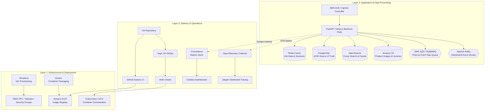

<div align="center">
  
  <p><em>Figure 1.1: Complete Enterprise DevOps & Microservices Architecture on AWS</em></p>
</div>

### The Three Major Layers Explained

| Layer | Technologies | Responsibility |
| :--- | :--- | :--- |
| **Layer 1: Infrastructure & Deployment** | Docker, Kubernetes / ECS, Terraform | Prepare cloud infrastructure, package applications into isolated images, and orchestrate containers with auto-scaling. |
| **Layer 2: Application & Data Processing** | PostgreSQL, Redis, OpenSearch, S3, SQS / RabbitMQ, Kafka | Handle business logic, relational ACID storage, in-memory caching, full-text search, media storage, async task queues, and event streams. |
| **Layer 3: Delivery & Operations** | CI/CD, ECR, Helm, Argo CD, Prometheus, Grafana, OpenTelemetry, Jaeger | Build, test, package, deploy configurations via GitOps, collect time-series metrics, visualize dashboards, and trace distributed requests. |

---

## 2. Docker – Package Your Application

### The Problem: "It Works on My Machine!"
Imagine you develop a Node.js application on your laptop:
* Your laptop has **Node.js 20**.
* The production server has **Node.js 18**.
* A required native C++ library or dependency is missing on production.
* Different dependency versions cause crashes.

Your application works locally but fails in production. This is the **"it works on my machine"** problem.

### Solution: Docker
Docker packages your application and its required dependencies into an **immutable image**.

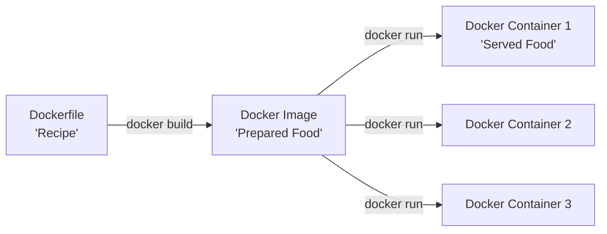

<div align="center">
  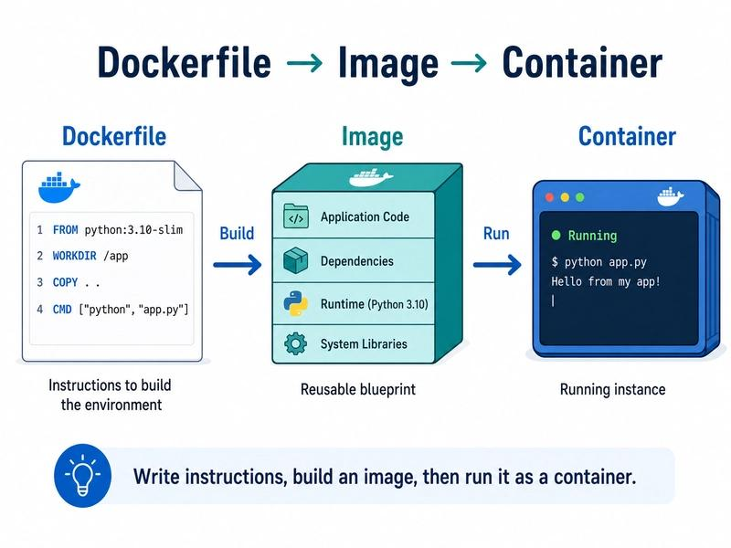
  <p><em>Figure 2.1: Dockerfile (Recipe) vs. Docker Image (Template) vs. Docker Container (Running Instance)</em></p>
</div>

| Concept | Meaning | Real-Life Analogy |
| :--- | :--- | :--- |
| **Dockerfile** | Instructions to build an image | Recipe |
| **Docker Image** | Packaged application template with dependencies | Prepared food |
| **Docker Container** | Running, isolated instance of an image | Served food |

### Production Dockerfile Example
```dockerfile
FROM node:20-alpine AS builder
WORKDIR /app
COPY package*.json ./
RUN npm ci
COPY . .
RUN npm run build

FROM node:20-alpine AS runner
WORKDIR /app
ENV NODE_ENV=production
COPY --from=builder /app/dist ./dist
COPY --from=builder /app/node_modules ./node_modules
EXPOSE 3000
CMD ["node", "dist/main.js"]
```

```bash
# Build and run container
docker build -t ecommerce-app .
docker run -p 3000:3000 ecommerce-app
```

> ⚠️ **CPU Architecture Note:** Docker does not change the underlying hardware architecture. An image built exclusively for ARM64 (e.g., Apple M-series) will not run natively on AMD64 x86_64 servers without multi-platform builds (`docker buildx`).

#### When to Use Docker?
* When you need consistent runtime environments across dev, staging, and prod.
* When you need reproducible, isolated application packaging.
* When scaling horizontally across container clusters.

---

## 3. ECS vs Kubernetes – Who Manages Containers?

Docker packages your application, but who handles:
* Starting and restarting crashed containers?
* Running multiple replicas across different physical servers?
* Distributing incoming HTTP traffic evenly?
* Managing container auto-scaling during traffic spikes?

That is the job of **container orchestration**.

```mermaid
graph TD
    K8sControl[Kubernetes Control Plane\nAPI Server + Scheduler + Controller]
    
    subgraph Worker Node 1
        P1[Pod: Backend Replica 1]
        P2[Pod: Backend Replica 2]
    end
    subgraph Worker Node 2
        P3[Pod: Backend Replica 3]
        Crash[❌ Pod Crashes] -.->|Auto-Detect & Recreate| P4[✅ Replacement Pod]
    end

    K8sControl --> Worker Node 1
    K8sControl --> Worker Node 2
```

### Amazon ECS
Amazon Elastic Container Service (ECS) is an AWS-native container orchestration service. You define task definitions (Docker image, CPU, memory, replicas), and AWS manages the orchestration engine.

### Kubernetes
Kubernetes is a cloud-agnostic, portable container orchestration platform. You declare desired state (e.g., `replicas: 3`), and Kubernetes continuously ensures that 3 healthy pods remain running. If one pod crashes, Kubernetes automatically creates a replacement pod.

### ECS vs Kubernetes Comparison

| Feature | Amazon ECS | Kubernetes (EKS / GKE / Self-Managed) |
| :--- | :--- | :--- |
| **Cloud Portability** | AWS-focused | Cloud-agnostic (AWS, GCP, Azure, On-Premises) |
| **Complexity** | Lower operational complexity | Higher learning curve and management overhead |
| **Control** | AWS-managed experience | Granular control over networking, storage, CRDs |
| **Ecosystem** | AWS service integrations | Vast CNCF ecosystem (Helm, Argo CD, Istio) |
| **Best Suited For** | AWS-centric applications | Complex, multi-cloud enterprise platforms |

> 📌 **Interview Point:** Managed Kubernetes services like **AWS EKS** and **Google GKE** manage the control plane for you, but worker-node management, networking add-ons, storage drivers, and cost optimization remain your team's responsibility.

---

## 4. Terraform – Infrastructure as Code (IaC)

### The Problem: Configuration Drift
Imagine manually creating cloud infrastructure across Development, Staging, and Production via the AWS web console:
* VPC, Subnets, Internet Gateways
* Security Groups and IAM Roles
* Managed RDS PostgreSQL database and S3 buckets

Someone manually updates a firewall rule in Staging but forgets Production. Now environments differ. This is called **configuration drift**.

### Solution: Terraform
Terraform allows you to declare infrastructure using version-controlled code (**HCL**).

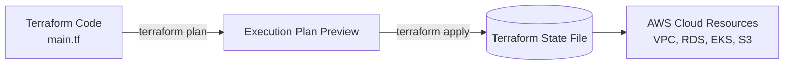

<div align="center">
  
  <p><em>Figure 4.1: Terraform Infrastructure as Code Workflow</em></p>
</div>

```hcl
# Example Terraform Configuration
resource "aws_s3_bucket" "orders" {
  bucket = "company-orders-storage-prod"

  tags = {
    Environment = "Production"
    ManagedBy   = "Terraform"
  }
}

resource "aws_db_instance" "postgres" {
  allocated_storage   = 100
  engine              = "postgres"
  engine_version      = "16.1"
  instance_class      = "db.r6g.xlarge"
  db_name             = "ecommercedb"
  skip_final_snapshot = false
}
```

#### Why is Terraform Useful?
* **Reproducible Infrastructure:** Spin up identical staging or disaster recovery environments in minutes.
* **Version Control:** Infrastructure changes go through Git Pull Requests and peer review.
* **Auditability & Drift Detection:** `terraform plan` shows exactly what will be created, updated, or destroyed before making changes.

> 📌 **Core Difference:** **Docker** manages application packaging. **Terraform** manages cloud infrastructure provisioning.

---

## 5. DNS and Load Balancer – How Customer Requests Reach the Backend

Now infrastructure is provisioned, containers are running, and the customer navigates to `https://shop.com` to place an order.

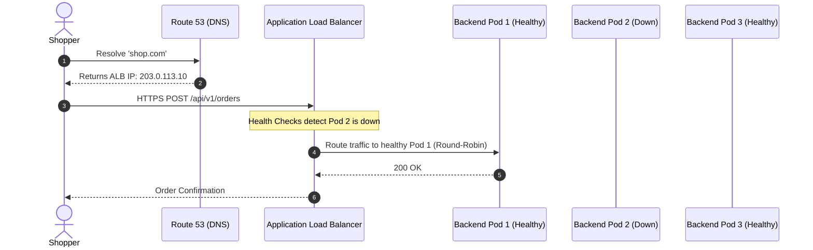

### Step 1: DNS (Domain Name System)
The browser knows the domain name `shop.com`, but requires an IP address to establish a TCP/TLS connection. DNS translates:
$$\text{shop.com} \xrightarrow{\text{DNS Lookup}} 203.0.113.10$$

### Step 2: Load Balancer (ALB)
The Application Load Balancer distributes incoming HTTP/HTTPS traffic across healthy backend container instances:
1. Performs continuous health checks (`GET /healthz`).
2. Stops routing traffic to failed containers immediately.
3. Distributes 10,000 concurrent user requests evenly to prevent single-instance overload.

---

## 6. PostgreSQL and Redis – Database vs Cache

### 6.1 PostgreSQL – The Main Database (Source of Truth)
When a customer places an order, the backend writes directly to PostgreSQL inside an ACID transaction:
```sql
BEGIN;

INSERT INTO orders (customer_id, product_id, quantity, status, total_price)
VALUES (101, 501, 2, 'PLACED', 140000);

UPDATE inventory SET stock = stock - 2 WHERE product_id = 501;

COMMIT;
```
PostgreSQL guarantees **ACID consistency**, relational integrity, and durable persistence.

### 6.2 Why Do We Need Redis?
Imagine **100,000 customers** opening the same iPhone 16 product page simultaneously. Every request executing `SELECT * FROM products WHERE product_id = 501;` would overload the PostgreSQL connection pool.

**Redis** is an in-memory data store providing sub-millisecond key-value lookups:

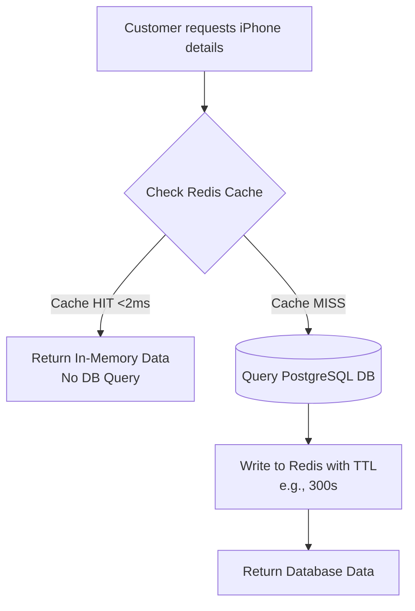

```python
# Cache-Aside Pattern in Python
product = redis.get("product:501")
if product is None:
    product = db.get_product(501)
    redis.setex("product:501", 300, product)  # Expires in 5 minutes
return product
```

### 6.3 Cache Invalidation – A Critical Problem
Suppose PostgreSQL has iPhone price = **₹70,000**, but Redis contains cached price = **₹65,000**. If an admin changes the price in the database, customers will see the outdated price. This is a **stale cache**.

#### Solution: Cache Eviction upon Mutation
```python
db.update_product_price(501, 70000)
redis.delete("product:501")  # Invalidate immediately
```
The next customer request triggers a Cache MISS and repopulates Redis with the fresh ₹70,000 price.

> 📌 **Takeaway:** PostgreSQL is the persistent source of truth. Redis is a high-speed temporary in-memory copy.

---

## 7. OpenSearch – Advanced Product Search

### The Problem: Typo Tolerance & Fuzzy Search
A customer intends to buy **"wireless headphone"**, but types:
```text
wirless headfone
```
* **SQL Query:** `SELECT * FROM products WHERE name LIKE '%wirless headfone%';` returns **0 results**.
* Relational databases struggle with fuzzy spelling tolerance, term boosting, and high-concurrency faceted search across millions of items.

### Solution: OpenSearch
OpenSearch is a distributed search engine based on Apache Lucene that uses **inverted indexes** and **Levenshtein edit-distance** matching.

<div align="center">
  
  <p><em>Figure 7.1: OpenSearch Typo Tolerance & Product Search Architecture</em></p>
</div>

```json
// OpenSearch Multi-Match Fuzzy Query
GET products/_search
{
  "query": {
    "multi_match": {
      "query": "wirless headfone",
      "fields": ["name^3", "category", "description"],
      "fuzziness": "AUTO"
    }
  }
}
```

### PostgreSQL vs OpenSearch

| Capability | PostgreSQL | OpenSearch |
| :--- | :--- | :--- |
| **Primary Role** | Main transactional database (Source of Truth) | Search & analytics engine (Derived Index) |
| **Data Nature** | Authoritative relational data | Searchable indexed JSON documents |
| **Transactions** | Strict ACID transactions | Not designed for multi-doc ACID transactions |
| **Typo Tolerance** | Limited (requires heavy extensions) | Native Levenshtein distance fuzzy queries |
| **Relevance Scoring** | Basic text ranking | BM25 algorithm with field boosting (`name^3`) |
| **Consistency** | Immediate / Strong consistency | Eventual consistency via indexing pipeline |

---

## 8. Amazon S3 – Store Images and Files

### The Problem: Storing Binary Files in SQL
Storing high-resolution product images, customer profile pictures, invoices, and videos inside PostgreSQL rows bloats database backups, wastes expensive SSD storage, and exhausts I/O bandwidth.

### Solution: Amazon S3 (Simple Storage Service)
S3 is scalable, high-durability object storage for unstructured binary data.

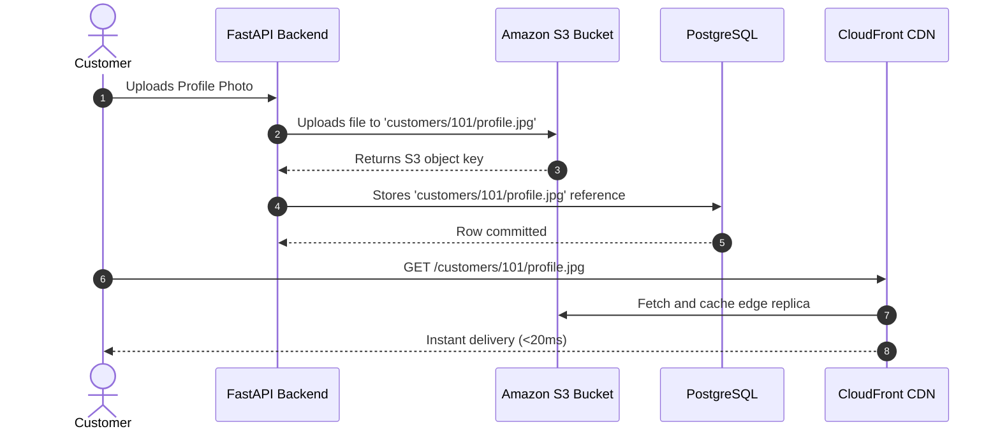

<div align="center">
  
  <p><em>Figure 8.1: Amazon S3 Offloading Unstructured Binary Files</em></p>
</div>

> 🔒 **Security Best Practice:** S3 buckets should remain private. Use short-lived **presigned URLs** (`s3_client.generate_presigned_url`) for secure, time-limited uploads and downloads.

---

## 9. SQS and RabbitMQ – Background Processing

### The Problem: Synchronous Blocking Calls
When a customer clicks "Place Order", the backend must:
1. Save the order in DB ($50\text{ ms}$)
2. Generate PDF invoice ($1,200\text{ ms}$)
3. Send confirmation email via SMTP ($800\text{ ms}$)
4. Notify warehouse dispatcher ($1,500\text{ ms}$)
5. Record analytics ($400\text{ ms}$)

Making the customer wait 4+ seconds leads to high cart abandonment and timeout errors.

### Solution: Asynchronous Message Queues
The API commits the order, enqueues background jobs into **SQS / RabbitMQ**, and returns `201 Created` immediately.

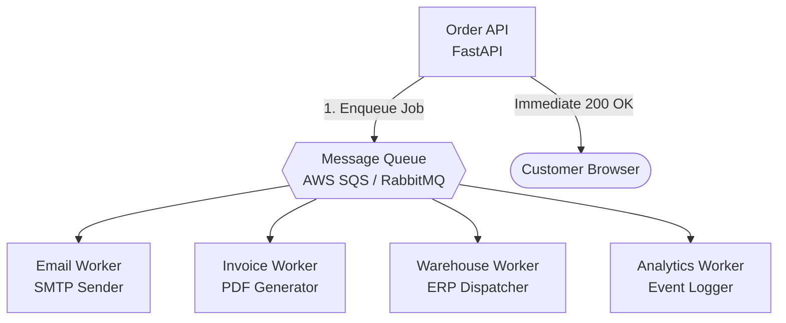

<div align="center">
  
  <p><em>Figure 9.1: Asynchronous Background Task Processing with Message Queues</em></p>
</div>

### Worker Crashes & Message Acknowledgement
1. Worker receives a message from the queue.
2. Worker processes the message.
3. Worker sends an **acknowledgement (ACK)** to the queue.
4. The queue removes the message.
If the worker crashes before sending an ACK, the message becomes visible again for another worker.

### Critical Concept: Idempotency
Because message queues may deliver messages more than once (*at-least-once delivery*), worker operations must be **idempotent**:

```python
def send_order_email(order_id: int):
    if email_already_sent(order_id):
        return  # Prevent duplicate email
    send_smtp_email(order_id)
    mark_email_as_sent(order_id)
```

### SQS vs RabbitMQ

| Feature | AWS SQS | RabbitMQ |
| :--- | :--- | :--- |
| **Management** | Fully AWS-managed cloud service | Self-hosted or managed message broker |
| **Routing** | Standard FIFO / Standard queue | Complex routing keys, topics, fanouts, exchanges |
| **Scaling** | Automatic, nearly unlimited scaling | Requires broker cluster management |

---

## 10. Kafka – Event Streaming vs Task Queues

### What is Apache Kafka?
Apache Kafka is a **distributed event-streaming platform** built on an immutable, partitioned append-only commit log.

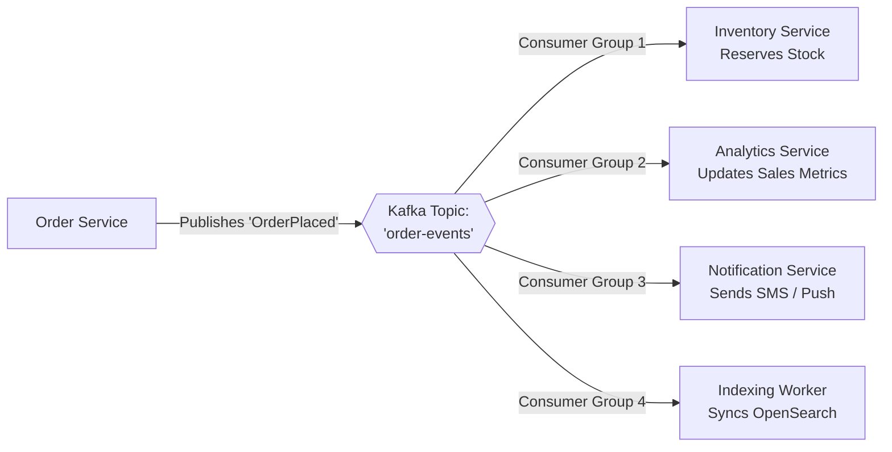

<div align="center">
  
  <p><em>Figure 10.1: Kafka Distributed Event Streaming Architecture</em></p>
</div>

### Why is Kafka Different from SQS?

| Feature | SQS / RabbitMQ (Task Queue) | Apache Kafka (Event Streaming) |
| :--- | :--- | :--- |
| **Primary Purpose** | Asynchronous task execution | Real-time event streaming & data pipelines |
| **Message Retention** | Deleted upon consumer acknowledgement | Retained for days/months based on retention policy |
| **Event Replay** | Cannot replay processed tasks | Any consumer can replay historical offsets |
| **Multiple Consumers** | One worker processes each task | Multiple independent consumer groups read the same stream |
| **Typical Use Cases** | Send email, generate invoice PDF | Order lifecycle events, clickstream, CDC sync |

---

## 11. CI/CD – How New Code Reaches Production

### The Old Problem
A developer manually SSHs into three production servers and updates only two. Server 1 and Server 2 run `v2`, while Server 3 runs `v1`. This produces **inconsistent production application versions**.

### Solution: CI/CD & Amazon ECR
* **Continuous Integration (CI):** Automatically runs tests and builds container images on every Git push.
* **Continuous Delivery (CD):** Deploys validated container images to staging and production.

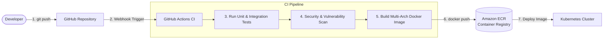

<div align="center">
  
  <p><em>Figure 11.1: Automated CI/CD Pipeline Flow from Git Push to ECR & Kubernetes</em></p>
</div>

### What is Amazon ECR?
Amazon Elastic Container Registry (ECR) is a secure, managed Docker container registry storing versioned, immutable image tags (`ecommerce-app:v2.4.1`, `ecommerce-app:sha-9f821a`).

---

## 12. Helm – Manage Kubernetes Configuration

### The Problem: YAML Duplication Sprawl
Managing separate hardcoded Kubernetes manifests for `development`, `staging`, and `production` results in hundreds of duplicated YAML files that easily drift.

### Solution: Helm (Package Manager for Kubernetes)
Helm allows you to create **reusable templates** and inject environment-specific values from `values.yaml`:

<div align="center">
  
  <p><em>Figure 12.1: Helm Chart Parameterization for Multi-Environment Deployments</em></p>
</div>

```yaml
# templates/deployment.yaml
apiVersion: apps/v1
kind: Deployment
metadata:
  name: {{ .Release.Name }}-backend
spec:
  replicas: {{ .Values.replicaCount }}
  template:
    spec:
      containers:
        - name: app
          image: "{{ .Values.image.repository }}:{{ .Values.image.tag }}"
```

```yaml
# values-dev.yaml
replicaCount: 1
image:
  repository: 123456789.dkr.ecr.us-east-1.amazonaws.com/shop
  tag: dev-latest

# values-prod.yaml
replicaCount: 8
image:
  repository: 123456789.dkr.ecr.us-east-1.amazonaws.com/shop
  tag: v2.4.1
```

#### Why Use Helm?
* Eliminates duplicate YAML files across environments.
* Parameterizes CPU/memory resources and replica counts.
* Enables easy version rollbacks (`helm rollback`).

---

## 13. Argo CD – GitOps for Kubernetes

### What is GitOps?
GitOps means **Git is the single source of truth** for your desired infrastructure and application deployment state.

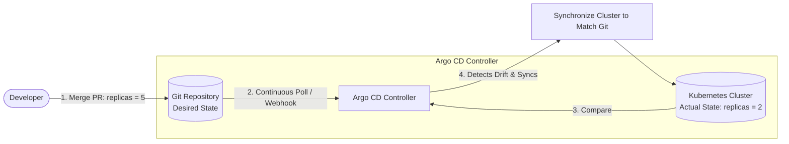

<div align="center">
  
  <p><em>Figure 13.1: Argo CD Automated GitOps Synchronization & Drift Detection</em></p>
</div>

### How Argo CD Works
1. A developer updates `values-prod.yaml` in Git to set `replicaCount: 5`.
2. Argo CD detects that the running Kubernetes cluster only has 3 replicas.
3. Argo CD triggers a synchronization to scale the cluster to 5 replicas.
4. If someone manually changes the cluster via `kubectl scale --replicas=2`, Argo CD detects the configuration drift and automatically reverts the cluster to match Git.

---

## 14. Prometheus and Grafana – Monitor Application Performance

### The Problem: Production Blindness
Placing an order suddenly takes 5 seconds instead of 500 ms. Why?
* Is PostgreSQL experiencing lock contention?
* Is Redis cache missing?
* Is CPU/Memory utilization pegged at 100%?

### Prometheus
Prometheus collects numeric time-series metrics from applications and infrastructure using a **pull-based scrape model**:

$$\text{Prometheus Server} \xrightarrow{\text{Scrape every 15s}} \text{GET https://backend-service/metrics}$$

```text
# Example Prometheus Metrics Exposed by Backend
http_requests_total{method="POST", handler="/orders", status="200"} 48192
http_request_duration_seconds_bucket{le="0.5"} 47201
http_request_duration_seconds_bucket{le="5.0"} 48190
```

### Grafana
Grafana connects to Prometheus as a data source to render visual real-time dashboards:
* API Latency (p50, p95, p99)
* HTTP Error Rates ($4\text{xx}, 5\text{xx}$)
* System CPU and Memory utilization
* Active database connections

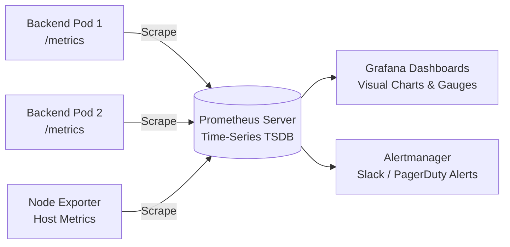

<div align="center">
  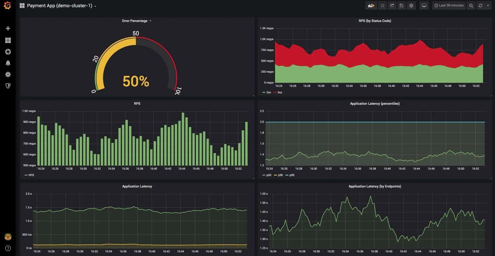
  <p><em>Figure 14.1: Real-Time Grafana Production Monitoring Dashboard</em></p>
</div>

> 📌 **Takeaway:** Prometheus **collects and stores** metrics; Grafana **visualizes** them.

---

## 15. OpenTelemetry and Jaeger – Distributed Tracing

### The Problem with Metrics Alone
Prometheus tells you **that** `POST /orders` took 5 seconds, but it cannot tell you **where** the delay occurred across multiple microservices.

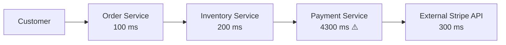

<div align="center">
  
  <p><em>Figure 15.1: Request Traversal Across Microservices in Distributed Tracing</em></p>
</div>

### Distributed Tracing to the Rescue
A **Distributed Trace** follows a request across network boundaries. Each unit of work is called a **Span**.

| Span Name | Service | Duration |
| :--- | :--- | :---: |
| `POST /orders` (Root Trace) | Order Service | $4,900\text{ ms}$ |
| `validate_cart()` | Order Service | $100\text{ ms}$ |
| `reserve_stock()` | Inventory Service | $200\text{ ms}$ |
| `process_payment()` | **Payment Service (Bottleneck)** | **$4,300\text{ ms}$** |
| `stripe.charges.create()` | External Stripe API | $300\text{ ms}$ |

<div align="center">
  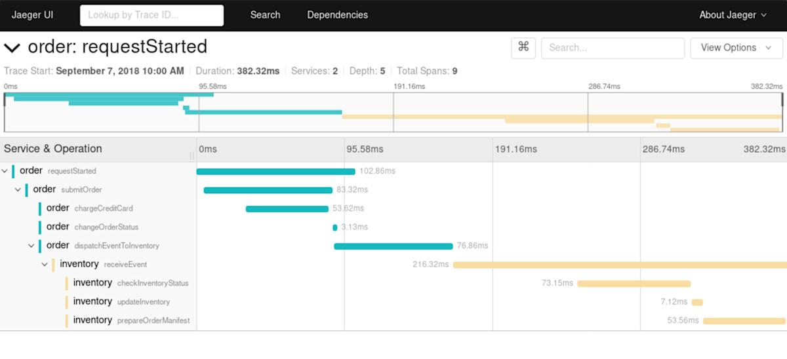
  <p><em>Figure 15.2: Jaeger Flame Graph Pinpointing Sub-Service Bottlenecks</em></p>
</div>

### Jaeger & OpenTelemetry Architecture

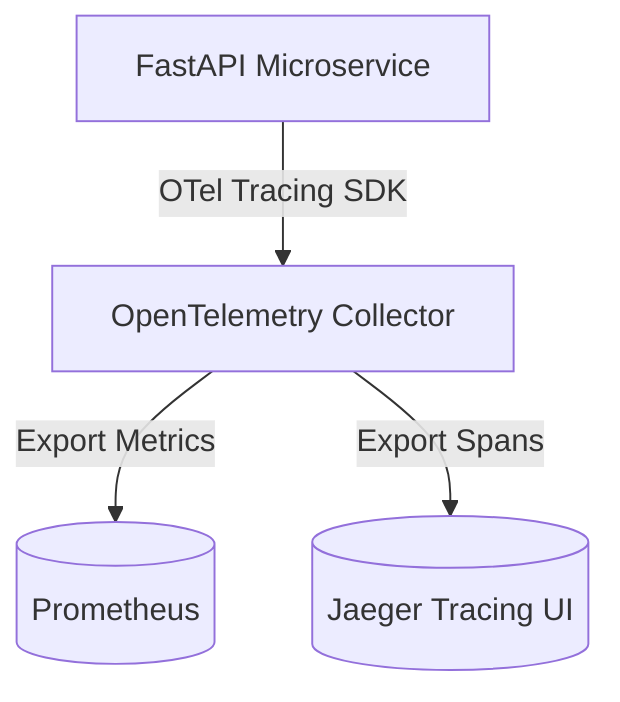

<div align="center">
  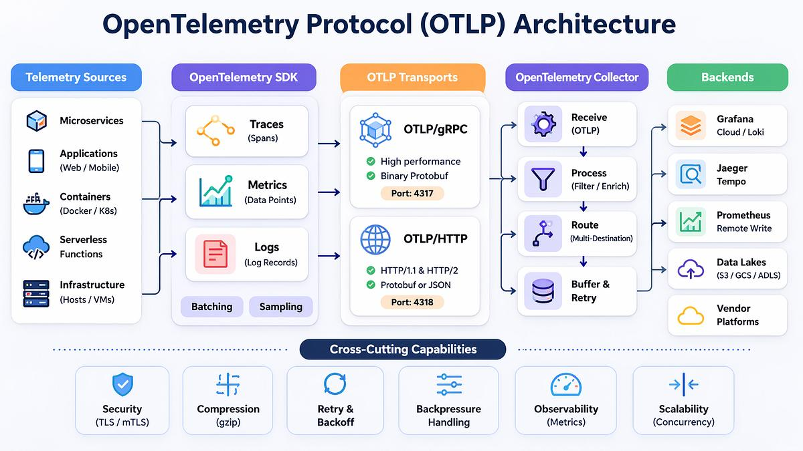
  <p><em>Figure 15.3: OpenTelemetry Framework (Metrics, Logs, Traces)</em></p>
</div>

* **OpenTelemetry (OTel):** Vendor-neutral framework of APIs and SDKs to instrument, generate, and collect telemetry data (**Metrics, Logs, Traces**).
* **Jaeger:** Visualization UI to inspect individual request timelines, flame graphs, and microservice call hierarchies.

---

## 16. Complete Real-Life Example – Customer Places an Order

Here is how all 16 technologies work together when a customer purchases an iPhone on `https://shop.com`:

```mermaid
sequenceDiagram
    autonumber
    actor Customer as Shopper
    participant DNS as Route 53 (DNS)
    participant ALB as Load Balancer
    participant K8s as Backend (Docker/K8s Pods)
    participant Redis as Redis Cache
    participant DB as PostgreSQL
    participant S3 as Amazon S3
    participant SQS as SQS Queue
    participant Kafka as Kafka Stream
    participant Prom as Prometheus & Jaeger

    Customer->>DNS: Resolves shop.com
    DNS-->>Customer: Returns ALB IP
    Customer->>ALB: HTTPS POST /api/v1/orders
    ALB->>K8s: Routes traffic to healthy backend pod
    
    Note over K8s,Prom: OpenTelemetry injects Trace ID into request context
    
    K8s->>Redis: Check stock cache
    Redis-->>K8s: Cache Hit (Stock: Available)
    
    K8s->>DB: BEGIN ACID Tx; INSERT order; UPDATE stock; COMMIT;
    DB-->>K8s: Order ID #104 Created
    
    K8s->>SQS: Enqueue Async Tasks (Email + PDF Invoice)
    K8s->>Kafka: Publish `OrderPlacedEvent` to topic 'order-events'
    
    K8s-->>Customer: 201 Created {"order_id": 104, "status": "CONFIRMED"}
    
    par Async Processing
        SQS->>K8s: Email Worker sends confirmation email
        SQS->>S3: Invoice Worker generates PDF & uploads to S3
        Kafka->>K8s: Analytics & Fraud services consume event
    and Observability
        K8s->>Prom: Scrape metrics (request_count++, latency=65ms)
        K8s->>Prom: Export traces to Jaeger
    end
```

<div align="center">
  
  <p><em>Figure 16.1: End-to-End Interaction Map When a Customer Places an Order</em></p>
</div>

### Comprehensive Step-by-Step Tool Mapping Table

| Step # | Event / Action in Order Journey | Primary Technology |
| :---: | :--- | :--- |
| **1** | Customer opens `https://shop.com` | **Amazon Route 53 / DNS** |
| **2** | Request reaches application infrastructure | **AWS ALB / Ingress** |
| **3** | Request arrives at backend container | **Docker + ECS / Kubernetes** |
| **4** | Customer searches for products with typos | **OpenSearch** |
| **5** | Product images and media loaded | **Amazon S3 + CloudFront CDN** |
| **6** | Frequently accessed product details retrieved | **Redis** |
| **7** | Order validated and committed inside ACID transaction | **PostgreSQL** |
| **8** | Immediate background tasks dispatched (emails, invoices) | **AWS SQS / RabbitMQ** |
| **9** | Business domain event broadcast to downstream services | **Apache Kafka** |
| **10** | Code changes tested and packaged into container images | **GitHub Actions CI** |
| **11** | Container images versioned with Git SHAs | **Amazon ECR** |
| **12** | Multi-environment deployment manifests templated | **Helm** |
| **13** | Git configuration automatically reconciled with cluster | **Argo CD (GitOps)** |
| **14** | Cloud infrastructure defined and provisioned | **Terraform** |
| **15** | Application performance metrics collected and alerted | **Prometheus + Grafana** |
| **16** | End-to-end request latency traced across microservices | **OpenTelemetry + Jaeger** |

---

## 17. The Most Important Engineering Lesson: Every Tool Introduces a New Problem

> ⚠️ **The System Architect's Law:** Adding a technology is not automatically an improvement. Every solution introduces operational complexity, maintenance burden, and new failure modes.

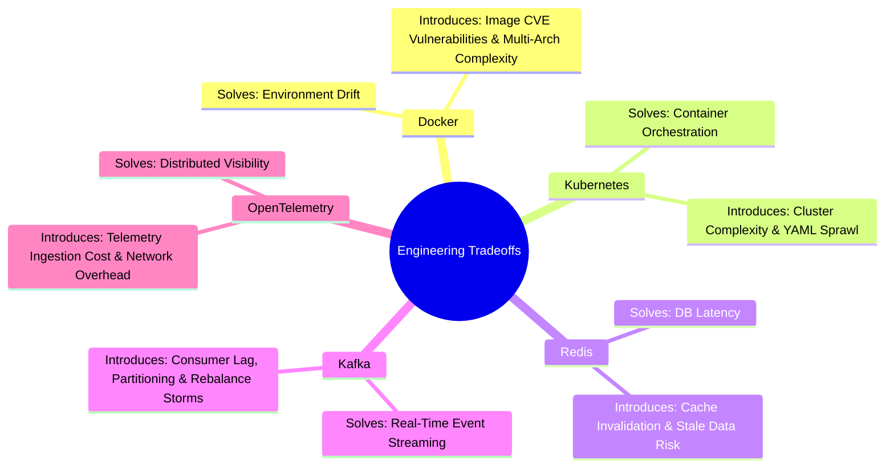

### Problem vs Tradeoff Matrix

| Technology | Problem It Solves | New Problem It Introduces | Mitigation Strategy |
| :--- | :--- | :--- | :--- |
| **Docker** | Environment inconsistency | Large image sizes, base image CVE vulnerabilities | Multi-stage builds, Alpine/Distroless bases, Trivy scans |
| **Kubernetes** | Container failover & auto-scaling | High cluster complexity, steep learning curve | Managed Kubernetes (EKS/GKE), standardized Helm charts |
| **Terraform** | Manual cloud configuration drift | State file locking, accidental resource destruction | S3 remote backend with DynamoDB state locking |
| **Redis** | Database query bottlenecks | Stale cached data, cache stampede | Explicit cache invalidation upon writes, random TTL jitter |
| **OpenSearch** | Typo search & faceted navigation | Asynchronous index replication lag | Transactional Outbox + Kafka sync; query DB at checkout |
| **Amazon S3** | Database storage bloat | Unintended public access leaks | S3 Block Public Access, IAM least-privilege, presigned URLs |
| **SQS** | Slow synchronous HTTP calls | Duplicate message processing | Idempotent worker consumers, Dead Letter Queues (DLQ) |
| **Kafka** | Event distribution & replayability | Out-of-order processing, consumer lag | Partitioning by entity ID, Prometheus consumer lag monitoring |
| **Helm** | Hardcoded duplicate YAMLs | Templating syntax errors, variable sprawl | `helm lint`, unit testing with `helm-unittest` plugin |
| **Argo CD** | Manual `kubectl` deployment mistakes | Bad Git commit breaks cluster instantly | Automated CI canary validation, automated rollback triggers |
| **Prometheus** | Blindness to production health | High memory usage from high metric cardinality | Drop unused labels, enforce metric retention policies |
| **OpenTelemetry** | Inability to locate slow spans | Telemetry network bandwidth & storage costs | Trace head/tail sampling (e.g., sample 5% of successful calls, 100% of errors) |

---

## 18. Important Differences to Remember for Interviews

| Technologies | Main Difference |
| :--- | :--- |
| **Docker vs Kubernetes** | Package an application into a container vs. Orchestrate and scale thousands of containers |
| **ECS vs Kubernetes** | AWS-native managed container service vs. Cloud-agnostic, extensible container platform |
| **Terraform vs Helm** | Provision cloud infrastructure (VPCs, RDS, EKS) vs. Manage application deployments inside Kubernetes |
| **PostgreSQL vs Redis** | Persistent ACID relational database on disk vs. High-speed in-memory key-value cache |
| **Redis vs OpenSearch** | Sub-2ms key-value exact cache vs. Distributed full-text fuzzy search engine with BM25 ranking |
| **S3 vs PostgreSQL** | Unstructured object storage for files/images vs. Structured relational database for transactional data |
| **SQS vs Kafka** | Point-to-point task/message queue (delete on read) vs. Distributed append-only event streaming log |
| **CI/CD vs Argo CD** | Build, test, and push container images vs. Continuously synchronize Git desired state into Kubernetes |
| **Prometheus vs Grafana** | Time-series database & metrics scraper vs. Visual dashboarding engine |
| **Metrics vs Logs vs Traces** | Numeric measurements ("how much?") vs. Text event records ("what happened?") vs. Distributed request timelines ("where was the delay?") |

---

## 19. How I Recommend Learning These Technologies

Instead of studying each tool in isolation, build **one practical enterprise project** incrementally:

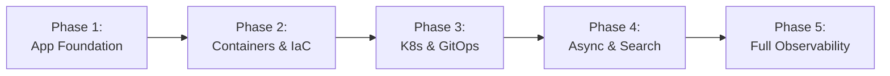

1. **Phase 1 – Application Development:** Build an e-commerce API using **Angular 19 + FastAPI + PostgreSQL** (product listing, shopping cart, orders).
2. **Phase 2 – Containerization & Infrastructure as Code:** Containerize services using **Docker & Docker Compose**, then write **Terraform** scripts to provision AWS VPC, RDS, and S3.
3. **Phase 3 – Container Orchestration & GitOps:** Deploy services to a local Minikube/Kind or EKS cluster using **Helm charts** and set up automated synchronization with **Argo CD**.
4. **Phase 4 – Caching, Search & Messaging:** Integrate **Redis** for caching, **OpenSearch** for typo-tolerant search, and **Kafka / SQS** for asynchronous event processing.
5. **Phase 5 – Production Observability:** Instrument services with the **OpenTelemetry SDK**, visualize traces in **Jaeger**, collect metrics with **Prometheus**, and build **Grafana** dashboards.

---

## 20. Test Your Understanding

### Question 1: Which technology packages an application and all its dependencies into an immutable artifact?
* **A)** Terraform
* **B)** Docker
* **C)** Kubernetes
* **D)** Prometheus
> **Correct Answer: B (Docker)**
> *Explanation:* Docker creates immutable container images containing the application code, runtime, system libraries, and dependencies.

---

### Question 2: Which technology prevents configuration drift in cloud infrastructure using declarative code?
* **A)** Redis
* **B)** Kafka
* **C)** Terraform
* **D)** Grafana
> **Correct Answer: C (Terraform)**
> *Explanation:* Terraform defines infrastructure as code, ensuring version-controlled, reproducible, and auditable cloud provisioning.

---

### Question 3: PostgreSQL is the main database. What is Redis primarily used for in this architecture?
* **A)** Object storage for product images
* **B)** In-memory caching to reduce database read load
* **C)** Container orchestration
* **D)** Distributed tracing
> **Correct Answer: B (In-memory caching)**
> *Explanation:* Redis stores frequently accessed data in RAM to deliver sub-2ms responses and prevent database connection exhaustion.

---

### Question 4: Which technology is designed for event streaming, log retention, and replayability across multiple consumer groups?
* **A)** AWS SQS
* **B)** Amazon S3
* **C)** Apache Kafka
* **D)** Helm
> **Correct Answer: C (Apache Kafka)**
> *Explanation:* Kafka retains immutable events in partitioned logs, allowing independent consumer groups to replay historical streams.

---

### Question 5: Which tool continuously compares Git configuration against the running Kubernetes cluster to correct drift?
* **A)** Argo CD
* **B)** Amazon ECR
* **C)** Docker Hub
* **D)** Grafana
> **Correct Answer: A (Argo CD)**
> *Explanation:* Argo CD implements GitOps by automatically reconciling differences between the desired Git state and the actual cluster state.

---

### Question 6: Which technology helps pinpoint the exact microservice responsible for a slow request?
* **A)** Terraform
* **B)** Jaeger (with OpenTelemetry)
* **C)** Amazon ECR
* **D)** Amazon S3
> **Correct Answer: B (Jaeger with OpenTelemetry)**
> *Explanation:* Jaeger visualizes distributed traces, breaking down a request into timed spans across network boundaries to identify bottlenecks.
