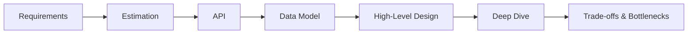
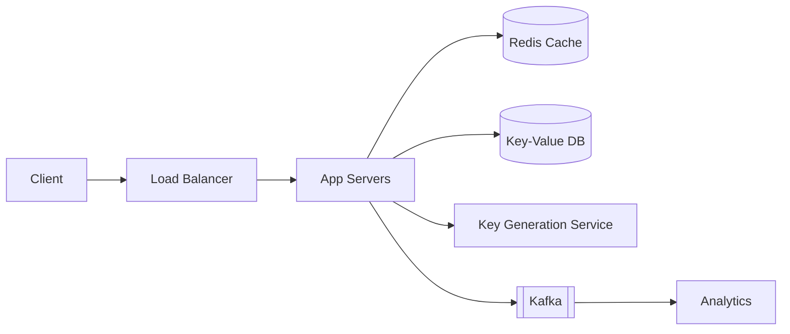
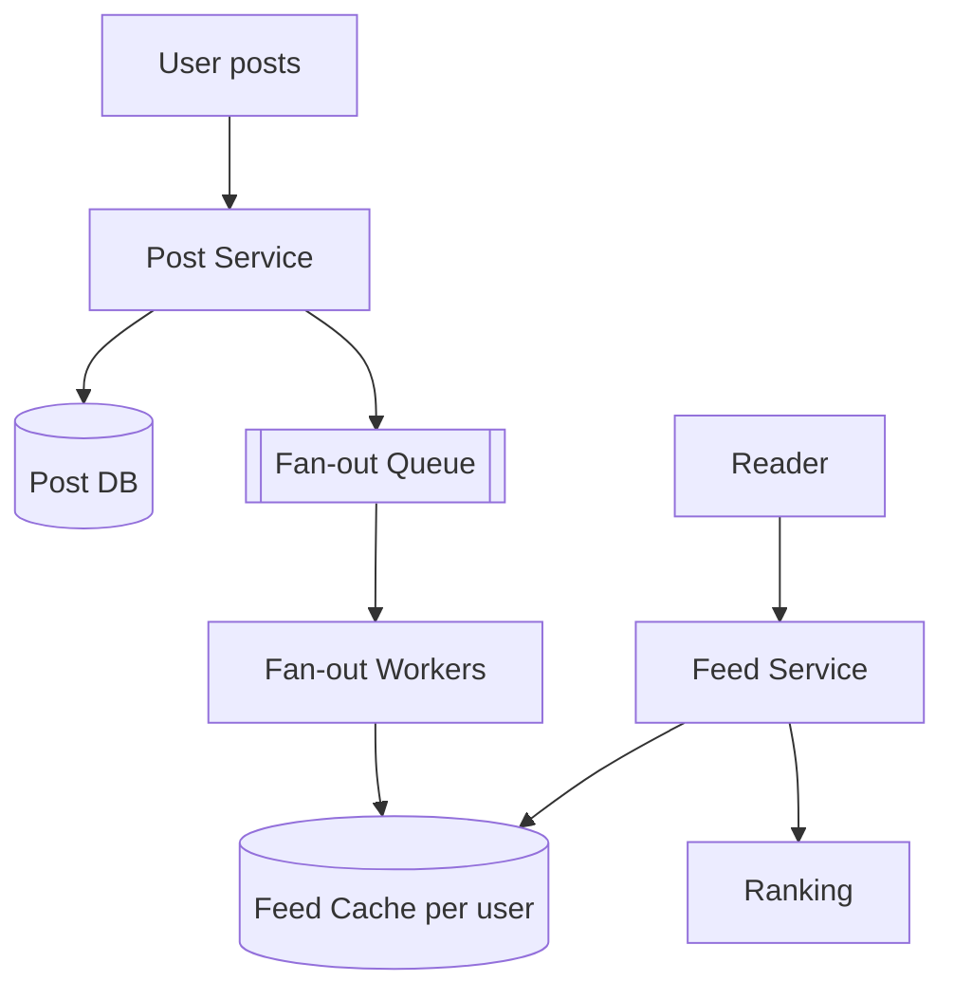

# System Design Interview Questions & Answers

A curated list of commonly asked system design interview questions, compiled from widely circulated interview prep material (Grokking, ByteByteGo, Educative, System Design Primer, Designing Data-Intensive Applications, company engineering blogs, etc.), with concise answers.

> **How to use:** Read the question, try answering in 2 minutes, then compare. For "Design X" questions, follow the framework in [Section 1](#1-how-to-approach-any-design-question).

## Table of Contents

1. [How to Approach Any Design Question](#1-how-to-approach-any-design-question)
2. [Fundamentals](#2-fundamentals)
3. [Networking & APIs](#3-networking--apis)
4. [Databases & Storage](#4-databases--storage)
5. [Caching](#5-caching)
6. [Messaging & Event-Driven Systems](#6-messaging--event-driven-systems)
7. [Distributed Systems Concepts](#7-distributed-systems-concepts)
8. [Reliability, Security & Observability](#8-reliability-security--observability)
9. [Classic "Design X" Questions](#9-classic-design-x-questions)
10. [Back-of-the-Envelope Numbers](#10-back-of-the-envelope-numbers)
11. [Common Mistakes](#11-common-mistakes)

---

## 1. How to Approach Any Design Question

**Framework (≈45 minutes):**

| Step | Time | What to do |
| :--- | :--- | :--- |
| 1. Clarify requirements | 5 min | Functional (what it does), non-functional (scale, latency, availability, consistency), out of scope |
| 2. Estimate scale | 5 min | Users, QPS, read/write ratio, storage, bandwidth |
| 3. API design | 5 min | Key endpoints, request/response, pagination, auth |
| 4. Data model | 5 min | Entities, relationships, SQL vs NoSQL, keys, indexes |
| 5. High-level design | 10 min | Clients, LB, services, DB, cache, queue, CDN |
| 6. Deep dive | 10 min | The 1–2 hardest components (sharding, ranking, fan-out, consistency) |
| 7. Bottlenecks & trade-offs | 5 min | SPOFs, failure modes, monitoring, future scaling |

---

## 2. Fundamentals

### Q1. What is the difference between horizontal and vertical scaling?
- **Vertical (scale up):** bigger machine (more CPU/RAM). Simple, no code change, but hardware ceiling, downtime on upgrade, and a single point of failure.
- **Horizontal (scale out):** add more machines behind a load balancer. Near-unlimited growth and fault tolerance, but requires stateless services, data partitioning, and handling distributed-systems complexity.

### Q2. What is the difference between latency, throughput, and bandwidth?
- **Latency:** time for one request (ms).
- **Throughput:** requests/operations per second the system completes.
- **Bandwidth:** maximum data transfer capacity of a link (e.g., Gbps).

A system can have high throughput and high latency (batch processing) or low latency and low throughput.

### Q3. What is the CAP theorem?
In the presence of a network **P**artition, a distributed system must choose between **C**onsistency (every read sees the latest write) and **A**vailability (every request gets a non-error response).
- **CP:** HBase, MongoDB (default), ZooKeeper, etcd – reject/stall requests during partition.
- **AP:** Cassandra, DynamoDB (default), Couchbase – serve possibly stale data, reconcile later.

Partitions are unavoidable, so the real choice is C vs A *during* a partition. **PACELC** extends it: *else* (no partition) you trade **L**atency vs **C**onsistency.

### Q4. Explain ACID vs BASE.
- **ACID:** Atomicity, Consistency, Isolation, Durability – relational DB transaction guarantees.
- **BASE:** **B**asically **A**vailable, **S**oft state, **E**ventually consistent – NoSQL trade-off for scale and availability.

### Q5. What are the types of consistency models?
- **Strong** (linearizable): reads always see the latest write.
- **Eventual:** replicas converge given no new writes.
- **Causal:** causally related operations are seen in order.
- **Read-your-writes / monotonic reads / session consistency:** per-client guarantees, commonly used in practice.

### Q6. What is the difference between availability and reliability?
- **Availability:** fraction of time the system is operational (e.g., 99.99% ≈ 52.6 min downtime/year).
- **Reliability:** probability the system performs *correctly* over time (no wrong results, no data loss).

| Availability | Downtime / year |
| :--- | :--- |
| 99% | 3.65 days |
| 99.9% | 8.76 hours |
| 99.99% | 52.6 minutes |
| 99.999% | 5.26 minutes |

### Q7. Monolith vs microservices – when to choose which?
- **Monolith:** simpler to build, test, deploy, and debug; best for early-stage products and small teams.
- **Microservices:** independent deployment and scaling, tech heterogeneity, team autonomy; costs are network latency, distributed transactions, observability, and operational overhead.

Rule of thumb: start with a **modular monolith**, split when team size or scaling needs justify it.

### Q8. What is a single point of failure (SPOF) and how do you remove it?
Any component whose failure brings down the system. Remove with **redundancy** (multiple instances, active-active/active-passive), **replication**, **health checks + failover**, and multi-AZ/multi-region deployment. Remember that load balancers, DNS, and databases can also be SPOFs.

---

## 3. Networking & APIs

### Q9. What happens when you type a URL into a browser?
1. Browser cache / OS cache / `hosts` check.
2. **DNS resolution** (recursive resolver → root → TLD → authoritative).
3. **TCP handshake** (SYN, SYN-ACK, ACK); **TLS handshake** for HTTPS.
4. HTTP request sent (possibly via CDN / load balancer / reverse proxy).
5. Server processes, queries cache/DB, returns response.
6. Browser parses HTML, fetches CSS/JS/images (more requests), renders the page.

### Q10. HTTP/1.1 vs HTTP/2 vs HTTP/3?
- **HTTP/1.1:** text, one request per connection at a time (head-of-line blocking), keep-alive.
- **HTTP/2:** binary, **multiplexing** over one TCP connection, header compression (HPACK), server push. TCP-level head-of-line blocking remains.
- **HTTP/3:** runs over **QUIC (UDP)**, per-stream loss recovery, faster handshakes (0-RTT), connection migration.

### Q11. REST vs gRPC vs GraphQL vs SOAP?
| | REST | gRPC | GraphQL | SOAP |
| :--- | :--- | :--- | :--- | :--- |
| Format | JSON over HTTP | Protobuf over HTTP/2 | JSON, single endpoint | XML |
| Strength | Simple, cacheable, universal | Fast, typed, streaming | Client picks fields, no over/under-fetching | Standards (WS-*), enterprise |
| Weakness | Over/under-fetching | Poor browser support, not human-readable | Caching and N+1 complexity | Heavy, verbose |
| Use | Public APIs | Internal microservice calls | Mobile/complex UIs | Legacy/banking |

### Q12. Polling vs long polling vs SSE vs WebSockets?
- **Polling:** client asks repeatedly; wasteful, simple.
- **Long polling:** server holds the request until data exists; fewer empty responses, still one request per event.
- **SSE:** one-way server → client stream over HTTP; auto-reconnect; good for feeds/notifications.
- **WebSockets:** full-duplex persistent connection; best for chat, games, collaboration.

### Q13. What makes an API idempotent and why does it matter?
An operation is idempotent if repeating it yields the same result as doing it once. `GET`, `PUT`, `DELETE` are idempotent; `POST` is not. For payments/orders, clients send an **Idempotency-Key** header; the server stores key → result and returns the stored result on retries, preventing duplicate charges.

### Q14. How do you design pagination?
- **Offset/limit:** simple, but slow for large offsets and unstable when data changes.
- **Cursor/keyset (`WHERE id > last_id LIMIT n`):** stable and fast; preferred for feeds and large datasets.

### Q15. What does an API Gateway do?
Single entry point for clients: routing, authentication/authorization, rate limiting, request/response transformation, SSL termination, caching, logging/metrics, and aggregation. Examples: Kong, AWS API Gateway, NGINX, Envoy.

### Q16. Forward proxy vs reverse proxy vs load balancer?
- **Forward proxy:** sits in front of *clients* (hides client identity, filtering, caching).
- **Reverse proxy:** sits in front of *servers* (hides servers, SSL termination, caching, compression).
- **Load balancer:** distributes traffic across servers; a specialised reverse proxy.

### Q17. Load-balancing algorithms and L4 vs L7?
- Algorithms: **round robin, weighted round robin, least connections, least response time, IP hash, consistent hashing**.
- **L4:** routes on IP/port (TCP/UDP); very fast, content-agnostic.
- **L7:** routes on HTTP data (path, headers, cookies); enables content-based routing, but costs more CPU.

### Q18. What is a CDN and when to use it?
A geographically distributed cache of static (and sometimes dynamic) content close to users. It reduces latency and origin load. Use for images, video, JS/CSS. Strategies: **pull** (fetch on first request) vs **push** (pre-upload). Invalidate via TTL, versioned URLs, or purge APIs.

---

## 4. Databases & Storage

### Q19. SQL vs NoSQL – how do you choose?
| Choose SQL when | Choose NoSQL when |
| :--- | :--- |
| Strong consistency, transactions, joins | Massive scale, flexible schema |
| Structured, relational data | High write throughput, simple access patterns |
| Ad-hoc queries/reporting | Key-value, document, wide-column, or graph shapes |

NoSQL types: **key-value** (Redis, DynamoDB), **document** (MongoDB), **wide-column** (Cassandra, HBase), **graph** (Neo4j).

### Q20. What is database indexing and its trade-off?
An index (usually a **B+ tree**, or **LSM tree** in write-heavy stores) speeds reads by avoiding full scans. Trade-off: extra storage and **slower writes** (index maintenance). Index columns used in `WHERE`, `JOIN`, `ORDER BY`; prefer composite indexes with the correct column order; avoid over-indexing.

### Q21. Replication vs sharding vs partitioning?
- **Replication:** copies of the same data on multiple nodes → availability and read scaling.
- **Partitioning:** splitting a table into parts (often within one DB).
- **Sharding:** horizontal partitioning across *multiple servers* → write scaling and capacity.

### Q22. Replication topologies?
- **Leader–follower:** writes to leader, reads from followers; replication lag causes stale reads.
- **Multi-leader:** writes in multiple regions; needs conflict resolution.
- **Leaderless (Dynamo style):** quorum reads/writes (`R + W > N`), read repair, hinted handoff.

### Q23. Sharding strategies?
- **Range-based:** simple range queries, risk of hotspots.
- **Hash-based:** even distribution, poor range queries, resharding is painful.
- **Consistent hashing:** adding/removing nodes moves only ~1/N of keys; use virtual nodes for balance.
- **Directory-based:** lookup service maps key → shard; flexible but extra dependency.

Challenges: cross-shard joins/transactions, rebalancing, hot keys, global unique IDs.

### Q24. What is consistent hashing?
Both nodes and keys are hashed onto a ring; a key belongs to the first node clockwise. When a node joins/leaves, only adjacent keys move. **Virtual nodes** spread each physical node around the ring for balanced load. Used by Cassandra, DynamoDB, memcached clients, CDNs.

### Q25. How do you generate unique IDs in a distributed system?
- **UUID:** no coordination, but 128-bit and not sortable (UUIDv7 is time-ordered).
- **DB auto-increment with ticket servers:** simple, SPOF/bottleneck.
- **Snowflake:** 64-bit = timestamp (41) + datacenter/machine (10) + sequence (12). Sortable, ~4096 IDs/ms/node.
- **ULID / KSUID:** sortable, random suffix.

### Q26. Normalization vs denormalization?
Normalization removes redundancy and anomalies (good for writes/consistency). Denormalization duplicates data to avoid joins (good for read performance and NoSQL). Large-scale systems denormalize deliberately for hot read paths.

### Q27. Isolation levels and the anomalies they prevent?
| Level | Dirty read | Non-repeatable read | Phantom |
| :--- | :--- | :--- | :--- |
| Read Uncommitted | Possible | Possible | Possible |
| Read Committed | Prevented | Possible | Possible |
| Repeatable Read | Prevented | Prevented | Possible (DB-specific) |
| Serializable | Prevented | Prevented | Prevented |

### Q28. Block vs file vs object storage?
- **Block (EBS, SAN):** raw volumes, low latency; databases, VMs.
- **File (NFS, EFS):** hierarchical shared filesystem.
- **Object (S3, GCS):** flat key → blob with metadata; cheap, durable (11 nines), HTTP API; media, backups, data lakes.

### Q29. OLTP vs OLAP?
OLTP: many small transactions, row stores, normalized (e.g., orders). OLAP: complex analytical queries over large data, column stores, denormalized/star schema (e.g., Redshift, BigQuery, Snowflake).

---

## 5. Caching

### Q30. Where can you cache?
Client/browser → CDN → API gateway/reverse proxy → application (in-process) → distributed cache (Redis/Memcached) → database buffer pool.

### Q31. Caching strategies?
| Strategy | How it works | Trade-off |
| :--- | :--- | :--- |
| **Cache-aside (lazy)** | App checks cache; on miss reads DB and fills cache | Simple; first read slow; stale data possible |
| **Read-through** | Cache itself loads from DB on miss | Cleaner app code |
| **Write-through** | Write to cache and DB synchronously | Consistent, higher write latency |
| **Write-back (behind)** | Write to cache, flush to DB asynchronously | Fast writes, risk of data loss |
| **Write-around** | Write to DB only, cache on read | Avoids cache pollution; read miss after write |

### Q32. Eviction policies?
**LRU** (least recently used – most common), **LFU**, **FIFO**, **TTL-based**, **random**. Redis supports `allkeys-lru`, `volatile-lru`, `allkeys-lfu`, etc.

### Q33. Cache stampede (thundering herd), penetration, and avalanche?
- **Stampede:** a hot key expires and many requests hit the DB. Fix: request coalescing / mutex lock, stale-while-revalidate, early refresh.
- **Penetration:** requests for non-existent keys bypass cache. Fix: cache null results, **Bloom filter**.
- **Avalanche:** many keys expire simultaneously. Fix: randomize TTL (jitter), multi-layer caches.

### Q34. How do you keep cache and DB consistent?
Short TTLs; invalidate (delete) cache on write, preferred over update; write-through; publish change events (CDC/Kafka) to invalidate caches. Perfect consistency is costly; accept eventual consistency where possible.

### Q35. Why is Redis fast, and what are its data structures?
In-memory, single-threaded command execution (no lock contention), efficient I/O multiplexing, optimized data structures. Types: strings, hashes, lists, sets, **sorted sets**, bitmaps, HyperLogLog, streams, geospatial. Persistence: RDB snapshots and AOF log. Scaling: replication + Sentinel (HA) + Cluster (sharding via 16384 hash slots).

---

## 6. Messaging & Event-Driven Systems

### Q36. Why use a message queue?
Decouple producers/consumers, absorb traffic spikes (buffering), enable async processing, improve reliability via retries, and scale consumers independently. Examples: RabbitMQ, SQS, Kafka, Pub/Sub.

### Q37. Kafka vs RabbitMQ?
| | Kafka | RabbitMQ |
| :--- | :--- | :--- |
| Model | Distributed commit log, pull-based | Broker with exchanges/queues, push-based |
| Retention | Messages retained (days/forever), replayable | Removed after ack |
| Throughput | Very high (millions msg/s) | Moderate |
| Ordering | Per partition | Per queue |
| Use | Event streaming, logs, analytics | Task queues, complex routing |

### Q38. Delivery semantics?
- **At-most-once:** may lose messages.
- **At-least-once:** may duplicate → consumers must be idempotent.
- **Exactly-once:** achieved via idempotent producers + transactions (Kafka) or idempotent consumers/deduplication.

### Q39. How does Kafka guarantee ordering and scale consumption?
Topics are split into **partitions**; ordering is guaranteed only within a partition (use the same key to route related events to one partition). A **consumer group** assigns each partition to one consumer, so parallelism = number of partitions. Replication factor + ISR provide durability.

### Q40. Pub/Sub vs queue?
A queue delivers each message to **one** consumer (competing consumers). Pub/Sub delivers each message to **all** subscribers.

### Q41. What is a dead-letter queue (DLQ)?
A queue for messages that repeatedly fail processing (after N retries). Enables inspection and replay without blocking the main flow.

### Q42. What is the Saga pattern?
A way to manage distributed transactions across services without 2PC: a sequence of local transactions, each with a **compensating action** on failure. Two styles: **choreography** (events) and **orchestration** (central coordinator).

### Q43. What are the outbox pattern and CDC?
Write the business change and an "outbox" event row in the **same DB transaction**; a relay (or CDC tool like Debezium) publishes the event to the broker. This avoids the dual-write problem between DB and queue.

### Q44. What is CQRS and Event Sourcing?
- **CQRS:** separate write model (commands) from read model (queries), allowing independent scaling and optimized views.
- **Event Sourcing:** store the sequence of state-changing events as the source of truth; derive current state by replay. Gives audit trail and time travel, adds complexity.

---

## 7. Distributed Systems Concepts

### Q45. How does leader election work?
Nodes agree on one leader using a consensus algorithm (**Raft**, **Paxos**, Zab) or a coordination service (ZooKeeper, etcd) with leases/ephemeral nodes. Leaders send heartbeats; if they stop, a new election occurs with terms/epochs and **fencing tokens** to prevent split brain.

### Q46. Explain Raft briefly.
Raft keeps a replicated log: a **leader** accepts writes, appends them, and replicates to followers; an entry is committed once a **majority** acknowledges. If the leader fails, followers time out and start an election; the candidate with an up-to-date log and a majority of votes wins.

### Q47. Quorum – what does `R + W > N` mean?
With N replicas, reading from R and writing to W nodes with `R + W > N` guarantees read and write sets overlap, so reads see the latest committed write. Example: N=3, W=2, R=2.

### Q48. How do you handle distributed transactions?
- **2PC:** coordinator asks prepare, then commit; blocking and fragile.
- **3PC:** reduces blocking, rarely used.
- **Saga:** eventual consistency with compensations (most common in microservices).
- **Avoid them:** design aggregates so one transaction is local to one service/shard.

### Q49. What is a gossip protocol?
Nodes periodically exchange state with a few random peers, so information spreads epidemically. Used for membership and failure detection (Cassandra, Consul, DynamoDB).

### Q50. Clocks in distributed systems?
Physical clocks drift and can't be perfectly synchronized. Use **logical clocks** (Lamport), **vector clocks** (detect concurrent updates), or **hybrid logical clocks**. Google Spanner uses **TrueTime** with bounded uncertainty.

### Q51. What is a Bloom filter?
A space-efficient probabilistic set: "definitely not present" or "possibly present" (false positives, no false negatives). Used to avoid disk/DB lookups (LSM trees, cache penetration, crawler URL dedup).

### Q52. What is a Merkle tree used for?
Hash tree enabling efficient comparison of large datasets: compare root hashes, then recurse into differing subtrees. Used in anti-entropy repair (Cassandra, Dynamo), Git, and blockchains.

### Q53. What are CRDTs?
Conflict-free Replicated Data Types merge concurrent updates deterministically without coordination (counters, sets, registers). Used in collaborative editing and multi-leader databases.

### Q54. Why does service discovery matter?
Instances are dynamic (autoscaling, failures), so clients need current addresses. **Client-side** discovery (Eureka, Consul) vs **server-side** (load balancer, Kubernetes Service + DNS). Backed by a registry with health checks.

---

## 8. Reliability, Security & Observability

### Q55. Rate-limiting algorithms?
| Algorithm | Idea | Notes |
| :--- | :--- | :--- |
| **Token bucket** | Tokens refill at fixed rate; request consumes one | Allows bursts; most popular |
| **Leaky bucket** | Requests drain at constant rate | Smooths traffic |
| **Fixed window counter** | Count per time window | Edge bursts at boundaries |
| **Sliding window log** | Store timestamps | Accurate, memory heavy |
| **Sliding window counter** | Weighted blend of two windows | Good accuracy and memory |

Distributed implementation: Redis with atomic Lua scripts / `INCR` + `EXPIRE`, keyed by user/IP/API key; return `429 Too Many Requests` with `Retry-After`.

### Q56. What resilience patterns should services use?
**Timeouts**, **retries with exponential backoff + jitter**, **circuit breaker** (stop calling a failing dependency), **bulkheads** (isolate resource pools), **fallbacks**, **load shedding**, **backpressure**, and **graceful degradation**.

### Q57. Authentication vs authorization; sessions vs JWT?
- **AuthN:** who you are. **AuthZ:** what you can do.
- **Sessions:** server stores state (easy to revoke; needs shared store).
- **JWT:** signed, self-contained token (stateless, scalable; hard to revoke → short expiry + refresh tokens + denylist).
- **OAuth 2.0:** delegated authorization; **OIDC** adds authentication.

### Q58. How should passwords be stored?
Never plaintext or fast hashes. Use a slow, salted, adaptive algorithm: **bcrypt, scrypt, Argon2**. Add per-user salt, optionally a pepper, MFA, and rate limiting on login.

### Q59. Encoding vs encryption vs hashing vs signing?
- **Encoding:** reversible format change (Base64) – no secrecy.
- **Encryption:** reversible with key (AES, RSA) – confidentiality.
- **Hashing:** one-way fingerprint (SHA-256) – integrity.
- **Signing:** hash + private key – authenticity and integrity.

### Q60. Common web security threats and defences?
XSS (output encoding, CSP), CSRF (SameSite cookies, CSRF tokens), SQL injection (parameterized queries), SSRF (allowlist), DDoS (CDN/WAF, rate limiting), MITM (TLS), CORS misconfiguration (explicit origins).

### Q61. What is observability?
Three pillars: **logs**, **metrics**, **traces**. Use structured logging, correlation/trace IDs (OpenTelemetry), dashboards (Prometheus/Grafana), alerts on SLOs. Key signals: **RED** (Rate, Errors, Duration) for services and **USE** (Utilization, Saturation, Errors) for resources.

### Q62. SLI, SLO, SLA?
- **SLI:** measured indicator (e.g., p99 latency, success rate).
- **SLO:** internal target (99.9% requests < 300 ms).
- **SLA:** contractual promise with penalties. Error budget = 100% − SLO.

### Q63. Deployment strategies?
**Rolling**, **blue-green** (instant switch/rollback, double capacity), **canary** (small % first), **feature flags** (decouple deploy from release), **shadow traffic**. Database changes via backward-compatible migrations (expand → migrate → contract).

---

## 9. Classic "Design X" Questions

Each entry gives requirements, core design, and key trade-offs.

### 9.1 Design a URL Shortener (TinyURL / bit.ly)
- **Requirements:** shorten URL, redirect, optional custom alias/expiry, analytics. Read-heavy (~100:1), low latency, high availability.
- **Scale example:** 100M new URLs/month ≈ 40 writes/s; 4B redirects/month ≈ 1.5K reads/s. 5 years ≈ 6B URLs × ~500 B ≈ 3 TB.
- **API:** `POST /shorten {longUrl, alias?, ttl?}` → `shortUrl`; `GET /{code}` → `301/302` redirect.
- **Key generation:** base62 of a unique ID (7 chars = 62⁷ ≈ 3.5T). Options: counter/Snowflake + base62 (no collisions), hash (MD5/SHA) + truncate with collision check, or pre-generated key service (KGS) handing out unused keys in batches.
- **Storage:** key-value store (DynamoDB/Cassandra) `code → longUrl, userId, createdAt, expiry`.
- **Scaling:** cache hot codes in Redis (LRU, ~20% of URLs serve 80% of traffic), CDN/LB, replicate DB, shard by code hash.
- **301 vs 302:** 301 is cached by browsers (less load, no analytics); 302 lets you count clicks.

### 9.2 Design a Rate Limiter
- **Where:** API gateway / middleware, per user / IP / API key / endpoint.
- **Algorithm:** token bucket or sliding window counter; counters in **Redis** with atomic Lua script for multi-instance consistency.
- **Rules:** stored in a config service, cached locally. Response `429` + `X-RateLimit-Remaining`, `Retry-After`.
- **Trade-offs:** strictness vs latency; race conditions (use atomic ops); multi-region (local limits + async sync); fail-open vs fail-closed when Redis is down.

### 9.3 Design a Distributed Cache (Redis / Memcached-like)
- **Core:** key → value in memory, `GET/SET/DELETE`, TTL, eviction (LRU).
- **Partitioning:** consistent hashing with virtual nodes; clients or a proxy route keys.
- **Availability:** primary–replica with automatic failover; optional persistence (snapshots/AOF).
- **Hot keys:** local in-process cache, key replication/suffixing.
- **Consistency:** cache-aside with invalidation; stampede protection.

### 9.4 Design a Key-Value Store (Dynamo-style)
- Consistent hashing for partitioning; replicate to N successors; **quorum** reads/writes (tunable R, W); **vector clocks** or last-write-wins for conflicts; **hinted handoff** and **Merkle-tree anti-entropy** for repair; **gossip** for membership; LSM-tree storage engine (memtable → SSTables, commit log, compaction, Bloom filters).

### 9.5 Design a News Feed (Facebook / Twitter timeline)
- **Entities:** users, posts, follow graph, feed.
- **Fan-out on write (push):** on post, push post ID to each follower's feed cache (fast reads; expensive for celebrities).
- **Fan-out on read (pull):** merge followees' posts at read time (cheap writes, slow reads).
- **Hybrid:** push for normal users; pull for celebrities and merge at read.
- **Components:** post service, graph service, fan-out workers via queue, feed cache (Redis lists/sorted sets), ranking service, media on object store + CDN, cursor pagination.

### 9.6 Design a Chat / Messaging System (WhatsApp / Messenger)
- **Connection:** WebSocket to chat servers; a **session service** maps `userId → server`.
- **1:1 flow:** sender → chat server → message ID (sequence/Snowflake) → persist → route to recipient's server → deliver; if offline, store and push via APNs/FCM; delivery states: sent / delivered / read via acks.
- **Groups:** fan-out to members via pub/sub topics (limit group size or use fan-out on read for large groups).
- **Storage:** write-heavy, time-ordered → Cassandra/HBase partitioned by `chatId`, clustered by message ID; Redis for presence.
- **Presence:** heartbeats with TTL.
- **Extras:** end-to-end encryption (Signal protocol), media via object store + CDN, ordering via per-conversation sequence numbers.

### 9.7 Design a Notification System
- **Channels:** push (APNs/FCM), SMS, email, in-app.
- **Flow:** event/API → notification service → validate + check user preferences/opt-outs + dedupe + rate-limit → template rendering → per-channel **queues** → workers → third-party providers → delivery status/retry with backoff → DLQ.
- **Reliability:** at-least-once with idempotency keys, priority queues (OTP > marketing), analytics on delivery/open.

### 9.8 Design YouTube / Netflix (Video Streaming)
- **Upload:** client → upload service → raw object storage → **transcoding pipeline** (DAG of workers; multiple resolutions/codecs/bitrates; split into chunks) → store segments + manifests.
- **Playback:** **adaptive bitrate streaming** (HLS / MPEG-DASH): player picks quality per segment based on bandwidth.
- **Delivery:** **CDN** (Netflix Open Connect inside ISPs); popular content pre-positioned.
- **Metadata:** SQL/NoSQL + search (Elasticsearch); recommendations separately; view counts via streaming aggregation (Kafka + Flink).

### 9.9 Design Instagram (Photo Sharing)
- Upload photos to object storage (S3) with metadata in DB; generate thumbnails async; serve via CDN.
- Feed via hybrid fan-out; follow graph in graph/sharded SQL; likes/comments with counters (sharded or eventually consistent); search by hashtags/users with Elasticsearch; unique IDs via Snowflake.

### 9.10 Design Uber / Ride-Sharing
- **Location ingestion:** drivers send GPS every ~4 s → location service (Kafka) → in-memory geospatial index (Redis GEO, **geohash**, **S2**, **H3** or quadtree).
- **Matching:** query nearby available drivers, rank by ETA/rating, send offer, handle timeouts and reassign; **dispatch** must avoid double-assigning (distributed lock / state machine).
- **Trip state machine:** requested → matched → arrived → started → completed; persisted in a strongly consistent store.
- **Others:** surge pricing (supply/demand per cell), ETA via routing graph, payments with idempotency, WebSockets for live tracking.

### 9.11 Design Google Maps
- Map data as **tiles** at multiple zoom levels (vector tiles) pre-rendered and served via CDN.
- Road network as a graph; routing via **Dijkstra/A\***, accelerated by **contraction hierarchies**, with precomputed shortest paths between hierarchical regions.
- Live traffic from aggregated anonymous GPS probes; ETA models; geocoding via search index.

### 9.12 Design a Web Crawler
- **Components:** seed URLs → **URL frontier** (priority + politeness queues per host) → fetchers (distributed workers; DNS cache) → parser → content dedupe (hash / SimHash) → URL dedupe (Bloom filter) → storage → back to frontier.
- **Concerns:** robots.txt, crawl-delay per domain, traps (depth limits), re-crawl freshness, BFS vs priority (PageRank), sharding frontier by host hash.

### 9.13 Design Typeahead / Autocomplete
- **Data structure:** **trie** with top-K suggestions cached at each node, or prefix → top-K in Redis/key-value store.
- **Pipeline:** query logs → aggregation (MapReduce/Flink, weighted by recency) → build new trie/index offline → deploy periodically; real-time trending updates optionally.
- **Serving:** client-side debounce, browser caching, CDN/edge caching of popular prefixes, shard by prefix range.
- **Latency target:** < 100 ms.

### 9.14 Design a Search System (Elasticsearch-like)
- **Inverted index:** term → posting list (doc IDs, positions). Analyze text (tokenize, stem, stop words).
- **Distribution:** shard the index; each shard has replicas; scatter-gather queries and merge top-K; ranking with TF-IDF/BM25 plus signals.
- **Indexing:** async via queue/CDC from the primary DB; near-real-time segments and merges.

### 9.15 Design Google Docs / Collaborative Editing
- Real-time sync with WebSockets; conflict handling via **Operational Transformation (OT)** or **CRDTs**.
- Server sequences operations per document, broadcasts to collaborators; periodic snapshots + operation log for history and recovery; presence/cursors via ephemeral channel.

### 9.16 Design a Distributed Task Scheduler / Job Queue
- Store jobs (id, payload, run time, status, retries) in DB; scheduler polls due jobs (index on `next_run`) or uses delay queues/time wheels; workers claim jobs using **leases / `SELECT … FOR UPDATE SKIP LOCKED`**; heartbeat to extend lease; retry with backoff; DLQ; idempotent jobs; leader election or partitioned schedulers avoid double-scheduling.

### 9.17 Design a Payment System (Stripe / UPI / GPay)
- **Principles:** idempotency keys, double-entry ledger, strong consistency for balances, audit log, reconciliation.
- **Flow:** payment request → risk/fraud checks → create payment intent → call PSP/bank → async webhook for result → ledger update → notify. State machine (created → pending → success/failed → refunded).
- **Reliability:** retries safe via idempotency, outbox pattern, saga for multi-step flows, reconciliation jobs against bank statements.
- **Security:** PCI-DSS, tokenization, TLS, HSM for keys.

### 9.18 Design a Ticket / Seat Booking System (BookMyShow / Ticketmaster)
- **Core problem:** no double-booking under high concurrency.
- Seat states: available → **held (temporary lock with TTL)** → booked. Use DB row locks / optimistic concurrency (`version` column) or Redis atomic `SET NX EX` for holds; payment confirms the hold, expiry releases it.
- Flash sales: virtual waiting room/queue, rate limiting, CDN for static content.

### 9.19 Design Pastebin / Dropbox / Google Drive
- **Pastebin:** like URL shortener; content in object store, metadata in DB, expiry via TTL.
- **Dropbox:** split files into **chunks** (~4 MB), hash each (dedupe, delta sync), upload only changed chunks; metadata service tracks file → chunk list/versions; sync clients notified via long-poll/WebSocket; blocks in object storage; sharing via ACLs.

### 9.20 Design a Distributed Logging / Metrics System
- Agents on hosts → collector/Kafka (buffer) → stream processors → storage (Elasticsearch for logs, time-series DB for metrics) → dashboards/alerts. Handle backpressure, sampling, retention tiers (hot/warm/cold), and index by time.

### 9.21 Design an Online Judge / Code Execution Platform
- Submission API → queue → sandboxed workers (containers/gVisor/Firecracker with CPU, memory, time limits and no network) → compare output with test cases → store verdict → notify. Scale workers horizontally; isolate untrusted code strictly.

### 9.22 Design a Leaderboard
- Redis **sorted set** (`ZADD`, `ZREVRANGE`, `ZRANK`) for top-N and rank queries; shard by score range or game for huge scale; periodic persistence to DB; approximate ranking for very large populations.

### 9.23 Design an Auth / Login System (including OTP)
- Credentials hashed with bcrypt/Argon2; login issues short-lived access JWT + refresh token (rotating, stored hashed); MFA via TOTP/OTP (OTP stored hashed in Redis with TTL 5 min, attempt and resend limits); rate-limit and lockout; device/session management; OAuth/OIDC for social login.

### 9.24 Design a Distributed Pub/Sub or Message Queue
- Topics → partitions (append-only logs) → replicated across brokers; producers choose partition by key; consumer groups track offsets; leader per partition with ISR replication; retention/compaction; metadata via ZooKeeper/KRaft; batching and zero-copy for throughput.

### 9.25 Design a Unique ID Generator
- Snowflake-style (timestamp + worker ID + sequence); handle clock skew (refuse to generate if clock goes backwards); assign worker IDs via ZooKeeper/config; ~k-sortable and roughly time-ordered.

---

## 10. Back-of-the-Envelope Numbers

### Latency numbers every engineer should know (approx.)
| Operation | Time |
| :--- | :--- |
| L1 cache reference | 0.5 ns |
| Main memory reference | 100 ns |
| SSD random read | 100 µs |
| Read 1 MB from memory | ~250 µs |
| Same-datacenter round trip | 0.5 ms |
| Read 1 MB from SSD | ~1 ms |
| Disk seek (HDD) | 10 ms |
| Cross-continent round trip | 100–150 ms |

### Handy conversions
- 1 day = 86,400 s ≈ **10⁵ s**; 1 month ≈ 2.5 M s; 1 year ≈ 31.5 M s.
- 1 M requests/day ≈ **12 QPS**; 100 M/day ≈ 1,200 QPS. Peak ≈ 2–5× average.
- 1 KB = 10³ B, 1 MB = 10⁶, 1 GB = 10⁹, 1 TB = 10¹², 1 PB = 10¹⁵.
- Typical sizes: tweet text ~300 B, metadata row ~1 KB, image ~200 KB–2 MB, 1 min HD video ~50–100 MB.
- A single modern server: ~10K–50K simple QPS for a web tier; Redis ~100K ops/s; a relational DB ~1K–10K QPS depending on queries.

### Example estimate – Twitter-like
- 300 M MAU, 100 M DAU, 2 tweets/user/day → 200 M tweets/day ≈ **2.3K writes/s** (peak ~7K).
- Each user reads 100 tweets/day → 10 B reads/day ≈ **115K reads/s**.
- Storage: 200 M × 1 KB ≈ 200 GB/day ≈ 73 TB/year (text/metadata only; media dominates).

---

## 11. Common Mistakes

1. Jumping to a solution without clarifying requirements and scale.
2. Ignoring non-functional requirements (latency, availability, consistency).
3. Drawing boxes with no data model, API, or numbers.
4. Over-engineering (Kafka + microservices + Kubernetes for 100 QPS).
5. Not discussing trade-offs ("why this DB, why not that one?").
6. Forgetting failure modes: node/region failure, retries, duplicates, hot keys, thundering herd.
7. Treating the cache as a source of truth or ignoring invalidation.
8. Skipping security, monitoring, and rollout/migration strategy.
9. Spending the whole time on the easy parts; not deep-diving the hardest component.
10. Not driving the conversation — talk through your reasoning and check in with the interviewer.

---

## References & Further Reading

- *Designing Data-Intensive Applications* – Martin Kleppmann
- *System Design Interview* Vol. 1 & 2 – Alex Xu (ByteByteGo)
- [The System Design Primer (GitHub)](https://github.com/donnemartin/system-design-primer)
- Grokking the System Design Interview (Educative)
- High Scalability blog – [highscalability.com](https://highscalability.com)
- Company engineering blogs: Netflix, Uber, Meta, Discord, Stripe, Cloudflare
- Papers: Google File System, MapReduce, Bigtable, Dynamo, Spanner, Raft, Kafka

> Note: The answers above are condensed summaries based on commonly published interview material, not verbatim copies of any single source. Always adapt designs to the requirements stated by your interviewer.
