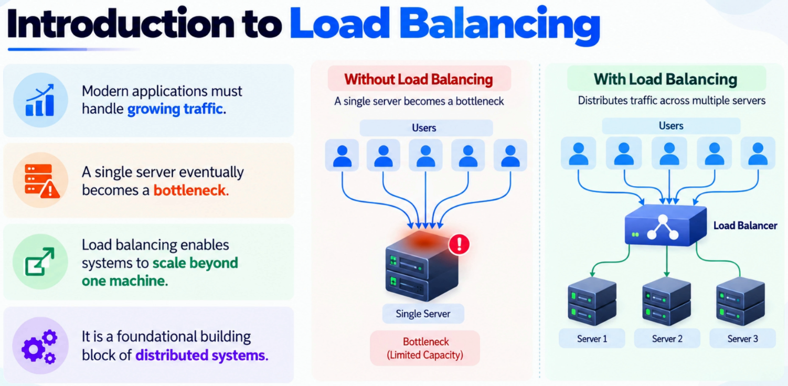
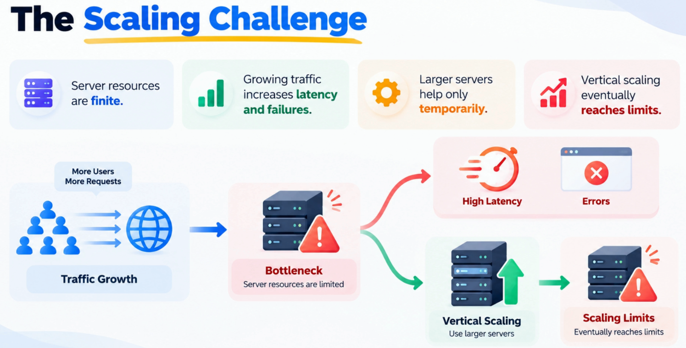
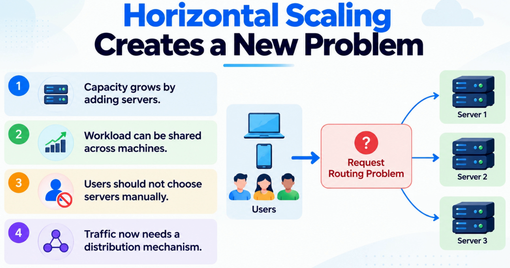
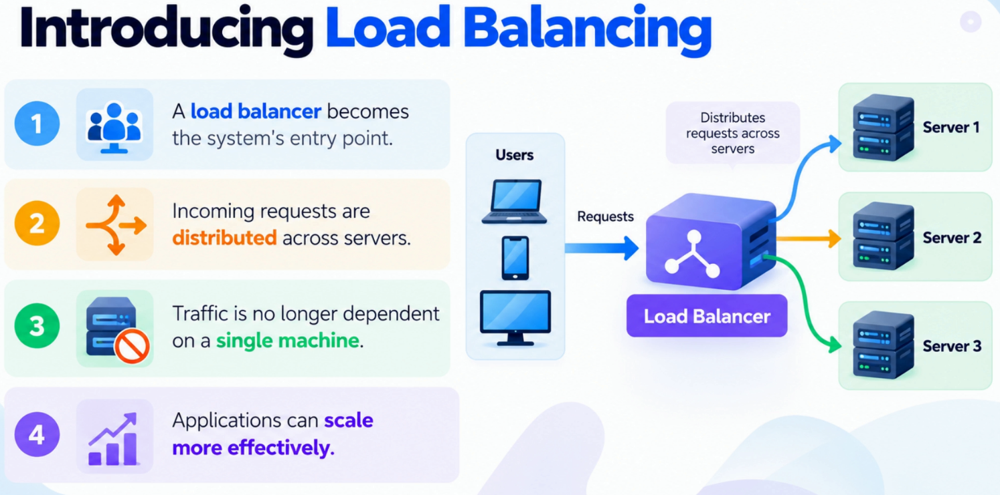
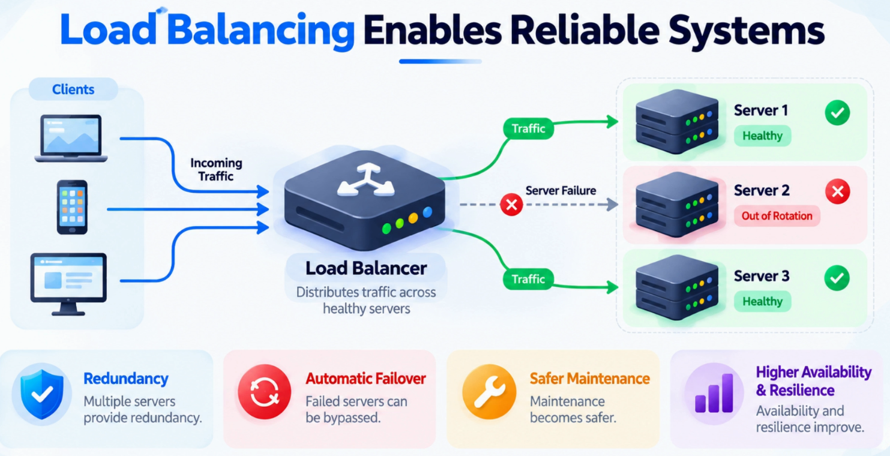

# Introduction to Load Balancing

Load balancing is one of the most important building blocks of scalable systems. This document explains why it becomes necessary as applications grow beyond a single server and how it transforms independent servers into a unified, reliable platform.

---

## The Journey from Single Server to Load Balancer



```
Stage 1: Single Server          Stage 2: Vertical Scaling        Stage 3: Horizontal Scaling + Load Balancer
───────────────────────         ──────────────────────────        ────────────────────────────────────────────
                                                                  
  [Client] ──► [Server]           [Client] ──► [Bigger Server]              ┌──► [Server A]
                                                                  [Client] ──► [Load Balancer] ──► [Server B]
  Simple. Works early on.         Buys time, but still a                     └──► [Server C]
                                  single point of failure.
                                                                  Scalable. Resilient. No single point of failure.
```

---

## Stage 1 — The Single Server Problem

Most systems start life on a single server and early on that works perfectly fine. The challenge appears when success arrives:

- More users
- More requests
- More data

Suddenly the architecture that felt simple starts showing its limits.

> **The critical insight:** The problem is not just performance. A single server becomes both a **capacity limit** and a **reliability risk**. If that machine slows down, everyone is affected. If it fails, the entire application is unavailable.

In other words, **growth turns a single server into a single point of failure**.

---

## Stage 2 — The Scaling Challenge: Vertical Scaling and Its Limits




A very common mistake in system design is assuming that scalability is simply a hardware problem. When an application starts struggling, the first instinct is often to add more CPU, more memory, or move to a larger server — and initially, that works.

```
Traffic Growth vs. Server Capacity
───────────────────────────────────

Demand  ▲
        │                              ╱ (demand)
        │                          ╱
        │                      ╱
        │          ┌───────────────────┐  ← vertical scaling ceiling
        │          │                   │
        │      ╱   │   Bigger Server   │
        │  ╱       └───────────────────┘
        │ ╱
        └─────────────────────────────────► Time

Eventually, buying larger machines delivers diminishing returns.
You increase capacity but you do not change the architecture.
```

**The problem with vertical scaling:**

| Issue | Description |
|---|---|
| **Non-linear growth** | Traffic growth is rarely linear; resource consumption accelerates |
| **Bottleneck moves, not disappears** | Eventually even the biggest machine becomes the bottleneck |
| **Increasing cost** | Larger machines become exponentially more expensive |
| **Still a single point of failure** | More capacity but no additional resilience |

> Vertical scaling can **buy time** but it does not remove the bottleneck. Eventually, the solution shifts from making one machine bigger to **distributing the workload across many machines**.

---

## Stage 3 — Horizontal Scaling Creates a New Problem



By adding more servers, we increase capacity and remove the single-machine limitation. But now a **coordination challenge** emerges:

```
Without Load Balancer                   Problem
─────────────────────                   ───────
[Client] ──► ??? ──► [Server A]         Which server should handle this request?
                     [Server B]         How does the client know where to send it?
                     [Server C]         We don't want clients making these decisions.
```

Clients should not be responsible for knowing which server is available, healthy, or least loaded. That **tightly couples users to infrastructure** and becomes difficult to manage as the system grows.

> This is a common pattern in system design: **solving a scaling bottleneck often introduces a coordination challenge**. Once we have multiple application instances, the real question is no longer *can we handle more traffic* — it becomes *how do we distribute traffic efficiently across all available capacity*.

---

## Stage 4 — Introducing the Load Balancer

Instead of exposing multiple application servers directly to users, we introduce a **dedicated layer** in front of them: the load balancer.



```
                          ┌─────────────────────────────────────────┐
                          │          Load Balancer                  │
                          │                                         │
                          │  - Single entry point for clients       │
                          │  - Routes requests to healthy servers   │
                          │  - Hides backend complexity             │
                          │  - Enables scaling without client change│
                          └─────────────────────────────────────────┘
                                    ▲               │
                                    │               │ routes to
                           Client request           │
                                    │        ┌──────▼──────┐
[Client] ──────────────────────────►│        │  Server A   │
                                    │        ├─────────────┤
[Client] ──────────────────────────►│        │  Server B   │
                                    │        ├─────────────┤
[Client] ──────────────────────────►│        │  Server C   │
                                    │        └─────────────┘
```

From the client's perspective, **there is only one destination**. The complexity of deciding where requests should go is moved away from users and centralized within the architecture itself.

### What the Load Balancer Enables

| Benefit | Description |
|---|---|
| **Scalability** | New servers can be added behind the load balancer without changing how clients access the application |
| **Stable interface** | Clients interact with one address; internal topology can change freely |
| **Capacity growth** | Traffic increases are handled by adding servers, not rearchitecting |
| **Unified platform** | Independent servers appear as a single cohesive system |

> **Key design principle:** Clients should interact with a stable interface while the system manages its own internal complexity.

---

## Load Balancing Enables Reliable Systems



One of the most valuable properties of load balancing is **reliability**.

```
Single Server — Failure = Outage          Load Balanced — Failure = Graceful Degradation
───────────────────────────────           ─────────────────────────────────────────────

[Client] ──► [Server] ✗                  [Client] ──► [Load Balancer] ──► [Server A] ✓
                                                                       ──► [Server B] ✗ (removed)
Application is DOWN.                                                   ──► [Server C] ✓
All users affected.
                                          Service continues. Users unaffected.
```

When an application runs on a single server, every outage becomes a system outage — whether caused by hardware failure, a software crash, or routine maintenance. Once traffic is distributed across multiple servers:

- Individual servers can come and go while the overall service continues operating
- The focus shifts from *keeping every server alive* to *keeping the system available*
- Deployments, upgrades, and infrastructure changes become far less risky — traffic can continue flowing through remaining healthy servers

> **Fundamental mindset shift in distributed systems:** Experienced architects don't design systems assuming components will never fail. They design systems **expecting failures** and ensuring those failures have limited impact.

### Reliability vs. Scalability — Two Benefits in One

```
Load Balancing
      │
      ├──► Scalability ──► Distribute load across many servers ──► Handle more traffic
      │
      └──► Reliability ──► Redundancy across many servers ──── ──► Tolerate failures
```

---

## The Evolution Path

```
┌─────────────────┐    Traffic      ┌─────────────────────┐    Bottleneck    ┌────────────────────────────┐
│  Single Server  │ ─── grows ────► │  Vertical Scaling   │ ─── reached ──► │  Horizontal Scaling        │
│                 │                 │  (bigger machine)   │                 │  + Load Balancer           │
│  Simple to      │                 │                     │                 │                            │
│  operate        │                 │  Buys time,         │                 │  Scalable, resilient,      │
│                 │                 │  still SPOF         │                 │  no single point of failure│
└─────────────────┘                 └─────────────────────┘                 └────────────────────────────┘
```

---

## Interview Questions

Common interview questions on load balancing fundamentals:

1. Why does a single server become a problem as systems scale?
2. What is the difference between vertical scaling and horizontal scaling?
3. Why is vertical scaling not a long-term solution for high-traffic systems?
4. What problem does a load balancer solve when you introduce horizontal scaling?
5. How does a load balancer improve both scalability and reliability?
6. What is a single point of failure and how does load balancing address it?
7. Why should clients not be responsible for choosing which server to connect to?
8. How does load balancing allow zero-downtime deployments?
9. What happens to traffic when one server behind a load balancer fails?
10. How does load balancing change the architecture from a single server to a distributed system?

---

## Summary and Key Takeaways

| Concept | Takeaway |
|---|---|
| **Single Server Limit** | A single server is both a capacity ceiling and a reliability risk |
| **Vertical Scaling** | Adds capacity but does not change the architecture; still a single point of failure |
| **Horizontal Scaling** | Adds capacity and resilience but introduces a coordination challenge |
| **Load Balancer** | Solves the coordination problem; presents multiple servers as a single system |
| **Reliability** | Load balancing enables systems to tolerate individual server failures gracefully |
| **Design Principle** | Clients interact with a stable interface; the system manages its own internal complexity |

> Scaling is rarely about making a server bigger. The real challenge is building **architectures that can continue growing without being constrained by a single machine**. Load balancing is the mechanism that makes this possible.

---

## What's Next

This lecture focused on **why** load balancing exists and how it helps systems scale beyond a single server. Load balancing will be revisited in much greater depth in the scalability section, covering:

- Load balancing algorithms (round-robin, least connections, IP hash, weighted, etc.)
- Different types of load balancers (L4 vs. L7, hardware vs. software vs. cloud)
- Cloud load balancer solutions (AWS ALB/NLB, GCP Load Balancing, Azure Load Balancer)
- High availability architectures

Next up: **API Gateways** — the centralized entry point for APIs handling routing, security, rate limiting, and request management in modern distributed architecture.
