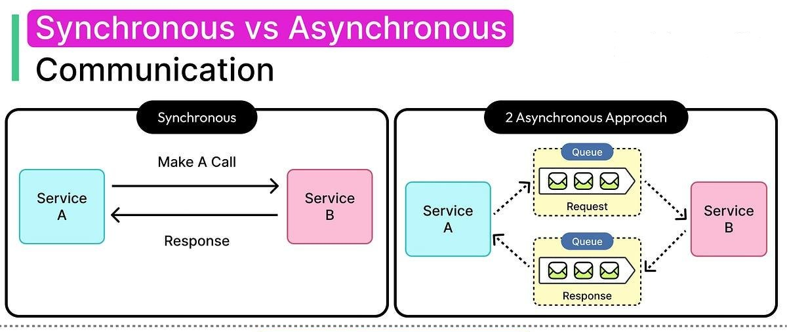
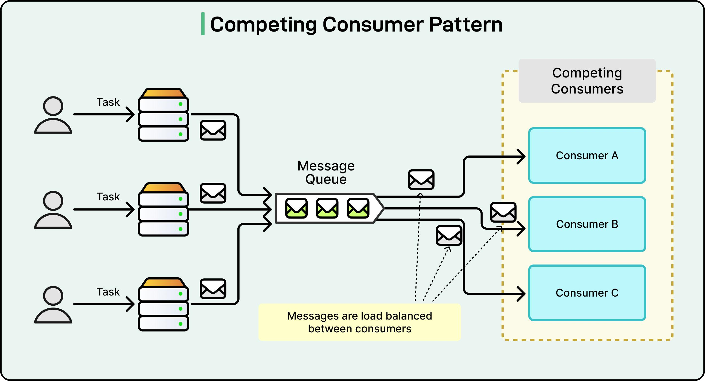
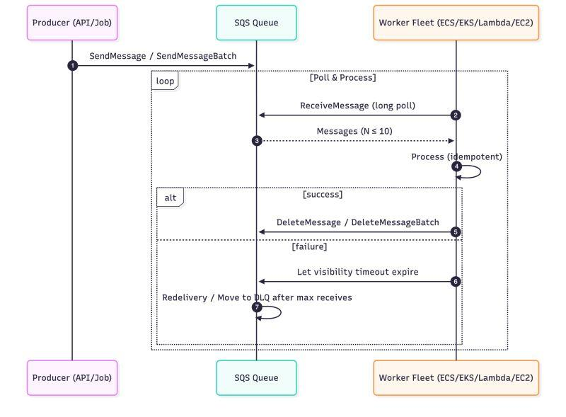
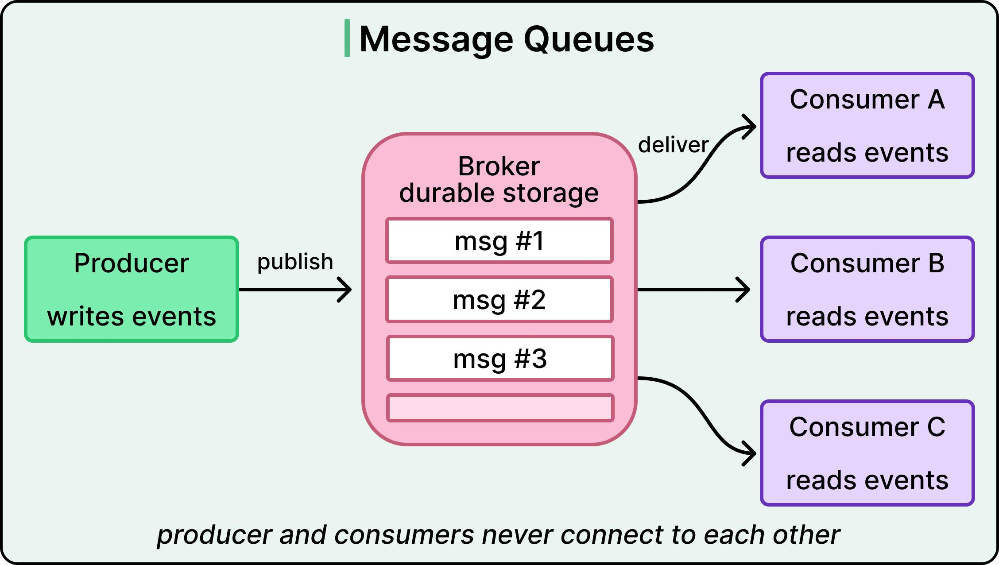

# Message Queue (MQ)

A Message Queue is an intermediary component that stores messages sent by producers and delivers them to consumers asynchronously.  
It decouples services, improves scalability, and increases fault tolerance.  

A Message Queue is an asynchronous communication mechanism that allows producers to send messages without waiting for immediate processing. 
Messages are stored in a queue until consumers are ready to process them. 
This decouples services, improves scalability, enables background processing, and increases fault tolerance because messages can be retried if a consumer fails. 
Common use cases include order processing, email notifications, payment processing, and log aggregation. 
Popular technologies include Apache Kafka, RabbitMQ, Amazon SQS, Redis Streams, and Azure Service Bus.

## Tutorials
1. System Design - Part 9 | Message Queue and CDN : https://www.youtube.com/watch?v=G2xEnPugNoo&list=PLFdAYMIVJQHOWJgRrjv_RH-ng95B2h3ON&index=9
2. Lec-13: Message Queue System | System Design : https://www.youtube.com/watch?v=sKXCTtGdxWo
3. What is a MESSAGE QUEUE and Where is it used? : https://www.youtube.com/watch?v=oUJbuFMyBDk
4. Message Queue in System Design | EP 09 : https://www.youtube.com/watch?v=kcfNW9VjLNQ

---

## Key Takeaways
- Producer creates messages.
- Message Queue stores them temporarily.
- Consumer processes them asynchronously.
- **Benefits:** decoupling, scalability, reliability, load leveling, and fault tolerance.
- **Trade-offs:** increased latency, message ordering challenges, and handling duplicate deliveries.
- Use MQ for background or asynchronous workloads, not for ultra-low-latency interactions that require an immediate response.

---

## Why do we need a Message Queue?

Imagine an online bookstore.

Without a Message Queue:
```
Customer 1 ─┐
Customer 2 ─┼──────► Web Server
Customer 3 ─┤
Customer 4 ─┘

If 10,000 users arrive together,
the server gets overloaded.
```
The server has to process every request immediately.

Problems:
- Server overload
- Slow response
- Request failures
- Poor scalability

### A. Decoupling



**Without a queue:**
- Service A directly calls Service B.
- Service A must wait for Service B.
- Both services are tightly connected during the operation.

**With a queue:**
- Service A publishes a message.
- Service B processes it independently.
- Service A does not need to maintain a continuous connection while processing happens.

**Real-world example:**
> **You place an online order. You don't need to wait until the warehouse packs your product. The system accepts your order and processes it in the background.**

### B. Scalability



Imagine 10,000 customers placing orders simultaneously.

Without a queue, the backend may become overloaded.

With a queue:
- Requests accumulate in the queue.
- Consumers process messages according to available capacity.
- You can add more consumer instances when the workload increases.

**Example:**
```
| Situation | Consumers |
| :--- | :--- |
| Normal traffic | 2 |
| Increased traffic | 5 |
| Peak traffic | 10 |
```
The queue absorbs temporary traffic spikes while consumers process the backlog.

### C. Fault Tolerance
Suppose Consumer A picks up an order but crashes during processing.

A properly configured message broker can make the message available for another consumer to retry.



This helps prevent messages from being lost when a consumer fails.

Important: This requires acknowledgment, retry and message-retention mechanisms. Simply adding a queue does not automatically guarantee fault tolerance.

### D. Independent Processing
The producer and consumer can operate at different speeds.

**For example:**
- Producer generates 1,000 messages per second.
- Consumers process 500 messages per second.
- The remaining messages wait in the queue.

The queue acts as a buffer between these two components.

---

## Real Life Analogy

Think of a busy restaurant.

**Without token system**
```
Customer
Customer
Customer
Customer
```
Everyone stands in one queue.

Cashier gets overwhelmed.

**With Token System**
```
Customers

      │
      ▼
+----------------+
| Token Counter  |
+----------------+
      │
      ▼
 Token Queue

101
102
103
104
```
Cashier serves one by one.

Exactly the same concept is used in software.

The token queue is the Message Queue.

## Message Queue Architecture



```
          Producer

     User Places Order
             │
             ▼

+---------------------------+
|     Message Queue         |
|---------------------------|
| Order #101               |
| Order #102               |
| Order #103               |
| Order #104               |
+---------------------------+

        │
        │
        ▼

+-------------------+
| Consumer Service  |
+-------------------+

Processes one message at a time.
```

```
| Component | Responsibility |
| :--- | :--- |
| **Producer** | Sends messages to the queue |
| **Message Queue** | Stores messages until they are processed |
| **Consumer** | Retrieves and processes messages |
```


**Popular implementations:**
- RabbitMQ
- Apache Kafka
- Amazon SQS

## Producers and Consumers
```
            Producers

 Website
 Mobile App
 API

      │
      │ Send Messages
      ▼

+------------------------+
|     Message Queue      |
+------------------------+

      ▲
      │ Read Messages

 Email Service
 Inventory Service
 Payment Service

      Consumers
```
Producer only sends messages. Consumer processes messages.

## How does it work? Step by step
1. Customer places an order - The frontend sends an order request to the backend.
2. Producer creates a message - The backend creates an order-processing message.
3. Message enters the queue - The message broker stores the message.
4. Consumer retrieves the message - An available worker picks up the order.
5. Consumer processes the order - The system validates payment, updates order status and performs the required operations.
6. Customer receives confirmation - The system sends an email or notification.

## Why is it called Asynchronous?

**Without MQ**
```
Client

Request

↓

Server

↓

Wait...

↓

Wait...

↓

Wait...

↓

Response
```
Client keeps waiting.

**With MQ**
```
Client

Request

↓

Queue

↓

"Accepted"

↓

Client is free

Meanwhile...

Queue

↓

Worker

↓

Process Later
```
The processing happens in the background.

## Advantages of Message Queue

**1. Decoupling**

**Without MQ**
```
Frontend
     │
     ▼
Backend
     │
     ▼
Email Service
```
Everything depends on everything.

**With MQ**
```
Frontend
      │
      ▼

 Message Queue

      │

Backend

      │

Email Service
```
Every service becomes independent.

**2. Scalability**

Suppose

100,000 orders arrive.

**Without Queue**
```
100000 Orders

↓

One Server

↓

Crash
```

**With Queue**
```
100000 Orders

↓

Queue

↓

Worker 1

Worker 2

Worker 3

Worker 4

Worker 5
```
Add more workers.

System scales easily.

**3. Fault Tolerance**

Suppose Worker 2 crashes.
```
Queue

Order #101

↓

Worker 2

X Crashed
```
The message isn't lost.

Queue sends it to another worker.
```
Queue

↓

Worker 3
```
Processes successfully.

**4. Load Balancing**

Instead of
```
One Worker

1000 Jobs
```
We can have
```
Queue

↓

Worker 1

Worker 2

Worker 3

Worker 4
```
Each processes part of the workload.

**5. Reliability**

Queue stores messages safely.

Even if a server restarts
```
Queue

Order #201

Order #202

Order #203
```
Messages remain.

## Challenges
**1. Ordering**

Sometimes
```
Message 1

Message 2

Message 3
```
must be processed exactly in this order.

Distributed systems make this difficult.

**2. Duplicate Messages**

Sometimes
```
Order #500

Order #500
```
appears twice.

Consumers should be idempotent (processing the same message multiple times should not cause incorrect results).

**3. Latency**

Without MQ
```
Client

↓

Server

↓

Response
```
With MQ
```
Client

↓

Queue

↓

Consumer

↓

Database

↓

Response
```
Extra hop means slightly higher latency.

## Where should we use Message Queue?

**Excellent use cases**
- Order Processing
- Payment Processing
- Email Sending
- SMS Sending
- Push Notifications
- Image Processing
- Video Encoding
- PDF Generation
- Log Processing
- Inventory Updates
- Background Jobs

**Not suitable for**
- Chat Applications
- Video Calls
- Live Gaming
- Stock Trading
- Real-time Navigation

These require immediate responses.

## Popular Message Queue Technologies
| Technology        | Best For                     |
| ----------------- | ---------------------------- |
| Apache Kafka      | Event Streaming, Analytics   |
| RabbitMQ          | Task Queues, Microservices   |
| Amazon SQS        | Cloud Applications           |
| Apache ActiveMQ   | Enterprise Messaging         |
| Redis Streams     | Lightweight Event Processing |
| Google Pub/Sub    | GCP Event Systems            |
| Azure Service Bus | Azure Applications           |

## Real-world Example: Amazon Order
```
Customer

Places Order

      │

      ▼

Order API

      │

      ▼

Message Queue

──────────────────────────────

Consumer 1

Payment

──────────────────────────────

Consumer 2

Inventory

──────────────────────────────

Consumer 3

Email

──────────────────────────────

Consumer 4

Shipping

──────────────────────────────

Consumer 5

Analytics
```


