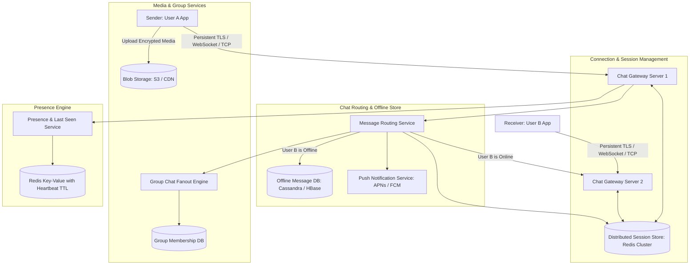
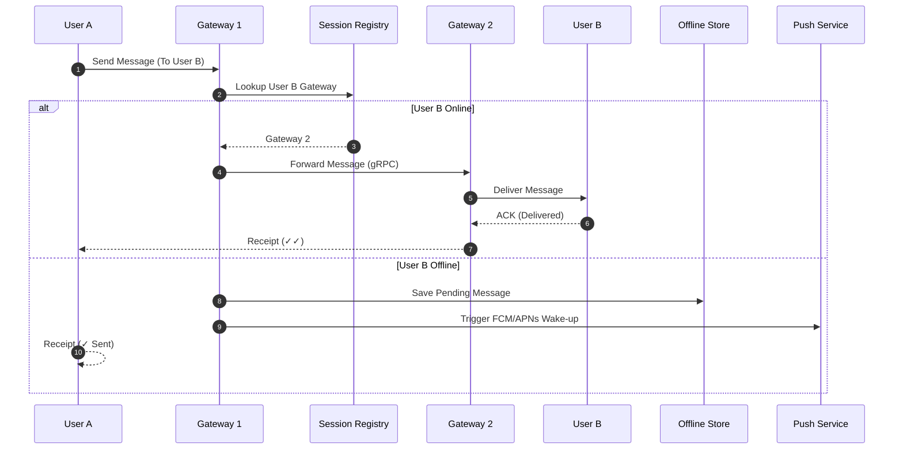

# Real-Time Instant Messaging Architecture (e.g., WhatsApp, Signal, Telegram)

## 1. Overview
A **Real-Time Instant Messaging System** supports one-on-one (1:1) and large group chat conversations, end-to-end encryption (E2EE), media sharing, delivery receipts (sent, delivered, read receipts), online presence tracking, and reliable offline message buffering across billions of connected mobile devices.

---

## 2. Requirements

### Functional Requirements
- **1:1 Chat**: Real-time peer-to-peer messaging with low latency.
- **Group Chat**: Messaging groups up to 1,024 members with message fanout.
- **Message Status Receipts**: Sent (✓), Delivered to Device (✓✓), Read by Recipient (Blue ✓✓).
- **Offline Messaging**: Store undelivered messages and push them immediately upon recipient reconnection.
- **End-to-End Encryption (E2EE)**: Messages encrypted on device (Signal Protocol); server cannot inspect message payloads.
- **Media Attachments**: Images, videos, voice notes, and documents.
- **Online Presence & Last Seen**: Real-time presence status (Online, Typing, Last Seen).

### Non-Functional Requirements
- **Ultra-Low Latency**: Sub-100ms end-to-end message delivery.
- **Massive Concurrency**: Support 500M+ concurrent persistent TCP / WebSocket / Erlang connections.
- **High Availability**: 99.999% uptime.
- **Zero Message Loss**: Messages must never be dropped even if servers crash.

---

## 3. Capacity Estimation

### Assumptions
- **Daily Active Users (DAU)**: 1 Billion.
- **Messages per Day**: 100 Billion messages/day $\implies \approx 1.15 \text{ Million msgs/sec}$ (Peak: 5 Million msgs/sec).
- **Average Text Message Size**: 100 bytes (encrypted payload + headers).
- **Daily Text Storage**: $100 \times 10^9 \times 100 \text{ B} = 10 \text{ TB/day}$.
- **Media Messages**: 5% of messages are media (average 1 MB) $\implies 5 \text{ Billion MB} = 5 \text{ PB/day}$ media.
- **Concurrent Connections**: 200 Million active WebSocket/TCP connections.

---

## 4. High-Level Architecture (HLD)



---

## 5. Architectural Deep Dives

### 5.1 Connection Management & Protocols
- **Transport Protocol**: Persistent bidirectional TCP connection using **WebSockets** or **TLS-encrypted custom binary protocol** (e.g., Erlang / XMPP / MQTT-based protocols).
- **Connection Gateways**:
  - Each gateway maintains hundreds of thousands of open socket file descriptors.
  - Gateway registers active connection mapping in Redis:
    `user_session:user_B -> { gateway_id: "gw_pod_42", socket_fd: 8812 }`.

### 5.2 1:1 Message Routing Flow
1. **User A** encrypts message with User B's public key (Signal Protocol) and sends it over WebSocket to `Gateway 1`.
2. `Gateway 1` queries `SessionRegistry` for `User B`:
   - **Case 1: User B is Online on `Gateway 2`**:
     - `Gateway 1` forwards message directly via gRPC to `Gateway 2`.
     - `Gateway 2` pushes message to User B over their active socket.
     - User B client replies with `DELIVERED_ACK`, routed back to User A.
   - **Case 2: User B is Offline**:
     - Message is persisted in `OfflineStore` (Cassandra/ScyllaDB).
     - Trigger background Push Notification (FCM/APNs) to wake up User B's device.
     - When User B connects, Gateway pulls all unread messages in order, pushes them, and deletes them from `OfflineStore`.



### 5.3 Group Chat Fanout: Server-Side vs. Client-Side
- For small groups ($\le 1000$ members), WhatsApp uses **Sender-Key Distribution**:
  - Sender encrypts message once with a symmetric Group Key and uploads ciphertext.
  - Server fans out the ciphertext to all group members' individual connection gateways.
  - Group fanout is processed asynchronously through Kafka message partitions to prevent blocking the sending client.

### 5.4 Presence & Heartbeats
- Mobile clients send lightweight ping/heartbeat packets every 20–30 seconds.
- Redis key: `presence:user_123` with 60-second TTL.
- When User A opens a chat with User B, client subscribes to User B's presence channel.
- If no heartbeat is received within 60s, status transitions from `ONLINE` to `LAST_SEEN: timestamp`.

---

## 6. Database Schema Design (Offline Store)

```sql
-- Cassandra / ScyllaDB NoSQL Table for Offline Messages
CREATE TABLE offline_messages (
    recipient_id UUID,
    message_id TIMEUUID, -- Guaranteed chronological order
    sender_id UUID,
    encrypted_payload BLOB,
    message_type VARCHAR(16), -- TEXT, IMAGE, AUDIO
    created_at TIMESTAMP,
    PRIMARY KEY (recipient_id, message_id)
) WITH CLUSTERING ORDER BY (message_id ASC);
```

---

## 7. Key Takeaways
- Decouple **Connection Gateways** (stateful TCP) from **Business Routing Services** (stateless).
- Store undelivered messages in a wide-column store (Cassandra) clustered by `recipient_id` and sorted by `TIMEUUID`.
- Use the **Signal Protocol** for client-side End-to-End Encryption (E2EE) so zero plain text resides on servers.
