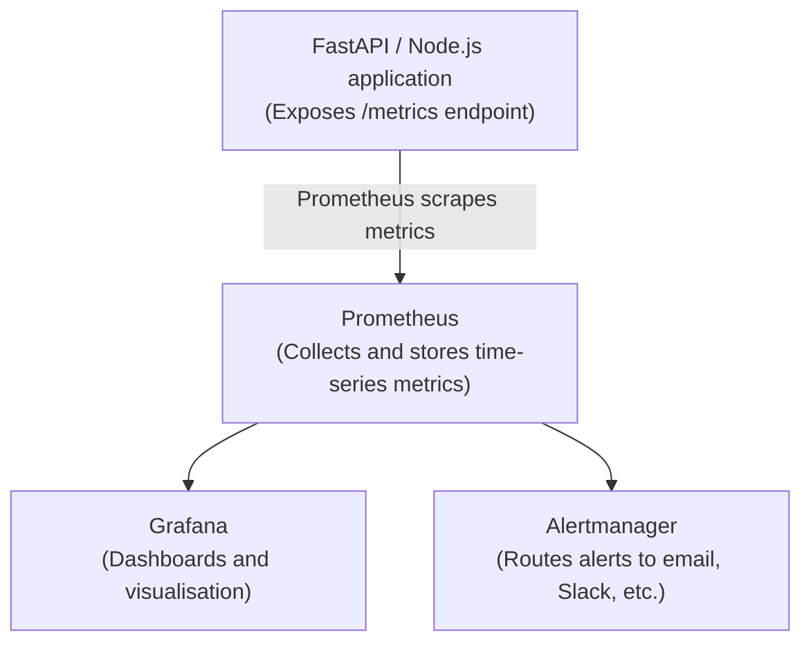
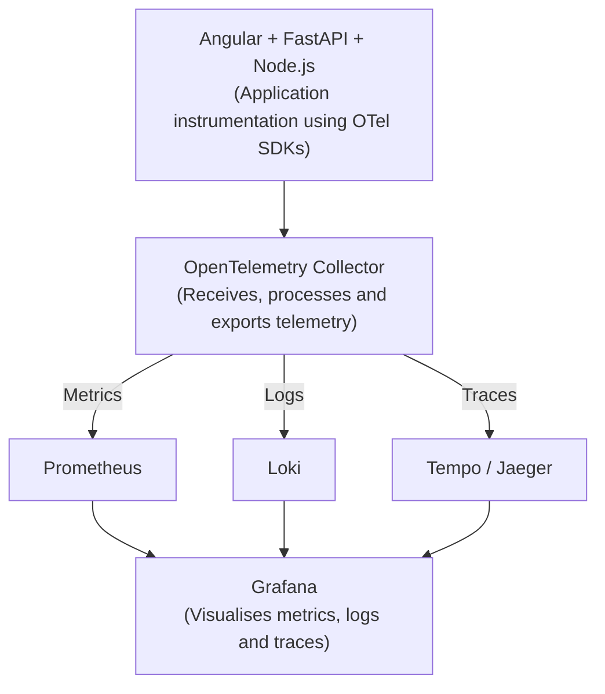

# Prometheus vs OpenTelemetry: Do We Need OpenTelemetry?

> **Question:** Prometheus is a complete metrics monitoring system. Do we need OpenTelemetry?
>
> **Answer:** **No.** You do not need OpenTelemetry to use Prometheus. Prometheus can work as a complete metrics monitoring system independently.
>
> However, OpenTelemetry and Prometheus solve different problems, and using them together can provide broader observability.

---

## 1. What does Prometheus do?

Prometheus is primarily a **metrics monitoring and alerting system**.

It collects numerical measurements from your applications and infrastructure.

**For example:**
- HTTP request count
- API response time
- CPU and memory usage
- Database connections
- Error rate
- Request throughput

### Prometheus-Only Architecture

You can expose metrics using Prometheus client libraries or exporters. OpenTelemetry is not mandatory.

---

## 2. Then why do we need OpenTelemetry?

OpenTelemetry (OTel) is a **vendor-neutral observability framework**.

It helps instrument applications and collect three types of telemetry:

| Telemetry | What it tells you |
| :--- | :--- |
| **Metrics** | How much / how often? |
| **Logs** | What happened? |
| **Traces** | Where did the request spend time? |

### Example Scenario
Imagine a banking login API takes 8 seconds:
- **Prometheus** tells you that API response time increased.
- **Logs** tell you that the database query timed out.
- **Distributed traces** show you exactly which service or operation consumed the time.

OpenTelemetry helps generate and transport this telemetry to compatible backends.

---

## 3. Prometheus vs OpenTelemetry

| Capability | Prometheus | OpenTelemetry |
| :--- | :--- | :--- |
| **Metrics** | Yes | Yes |
| **Logs** | Not its core purpose | Yes |
| **Distributed traces** | No | Yes |
| **Metrics storage** | Yes | No built-in backend |
| **Instrumentation** | Client libraries / exporters | SDKs and APIs |
| **Data collection** | Primarily pull / scrape | Multiple collection methods (Push & Pull) |
| **Vendor-neutral instrumentation** | Prometheus ecosystem | Yes |

---

## 4. How do they work together?

> **Note:** Prometheus can scrape metrics directly from an application or receive compatible metrics through an OpenTelemetry Collector pipeline. The Collector is not required in either case.

---

## 5. What should you choose?

| Your requirement | Recommendation |
| :--- | :--- |
| **Only metrics monitoring** | Prometheus + Grafana |
| **Metrics + alerting** | Prometheus + Grafana + Alertmanager |
| **Complete observability** | OpenTelemetry + Prometheus + Loki + Tempo + Grafana |
| **Enterprise multi-vendor environment** | OpenTelemetry is particularly useful |

---

## Key Takeaways & Recommendation

**Recommendation:** Since you are learning production system design with Angular, FastAPI, Node.js, PostgreSQL and Redis, learn **Prometheus first**, then add **OpenTelemetry**.

### Remember this distinction:
- **Prometheus** = Metrics monitoring and storage.
- **OpenTelemetry** = Instrumentation and telemetry collection/transport.
- **Grafana** = Visualisation.
- **Alertmanager** = Alert routing.

*They complement each other rather than replace each other.*
