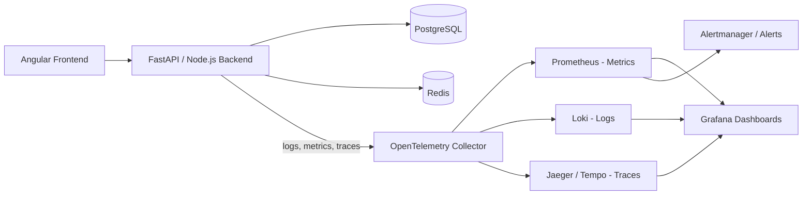
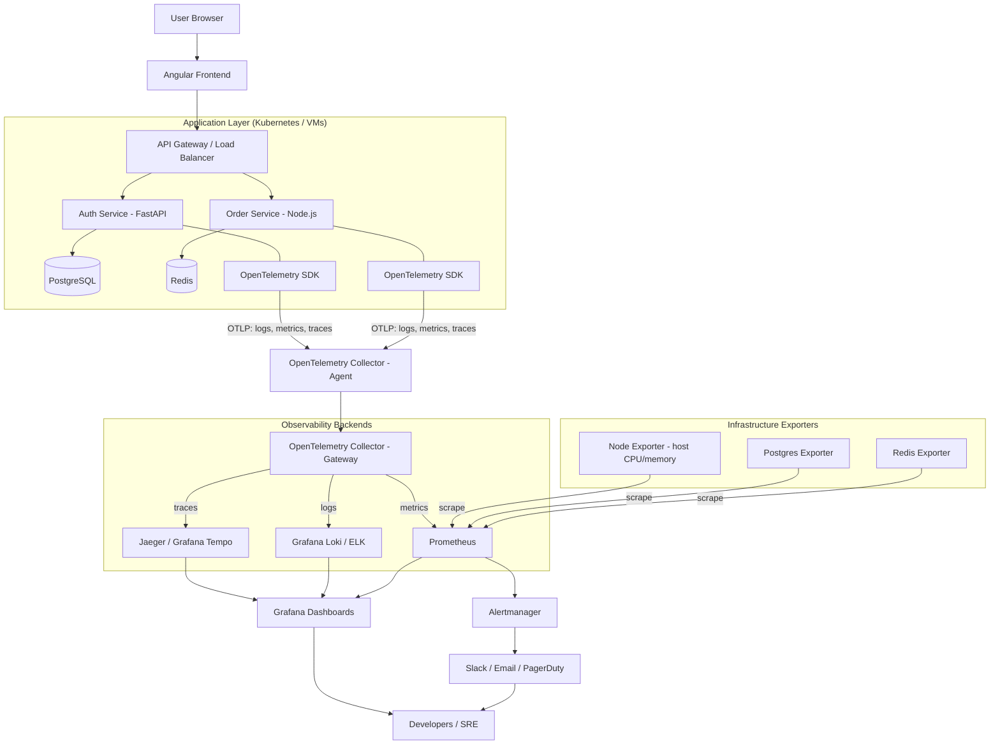
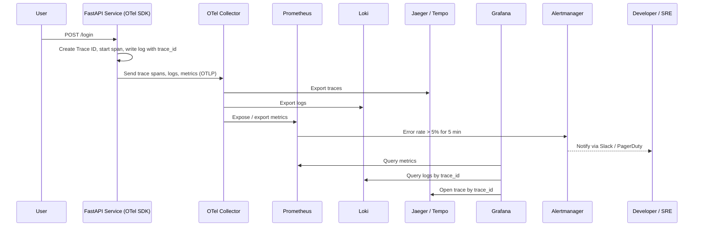
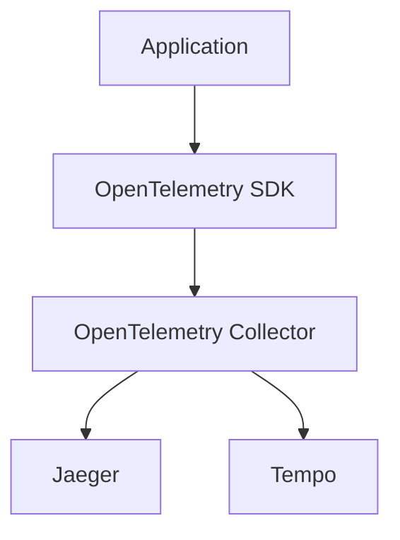
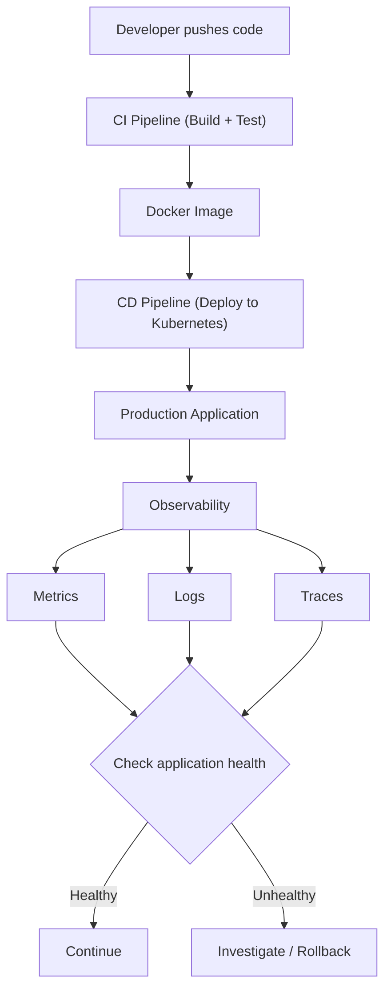

# The Three Pillars of Observability

In simple terms, Observability helps us understand what is happening inside an application, why it is happening, and where a problem is occurring.


Imagine you have an enterprise application with:

- Angular Frontend
- FastAPI / Node.js Backend
- PostgreSQL Database
- Redis Cache
- Multiple microservices

Suppose a user clicks the Login button, but the application takes 8 seconds to respond.

How do we identify the problem?

This is where the three pillars of observability help us.

---

## 1. Logs — What happened?

**Definition:** Logs are timestamped records of individual events occurring inside an application.

They tell us what happened at a particular moment.

**Example:**

```text
10:02:01 INFO  User clicked Login
10:02:02 INFO  Login API called
10:02:03 INFO  Database connection established
10:02:04 ERROR Invalid password
10:02:04 INFO  Login request completed
```

**Real-world example:**

A user reports that login is failing.

You check application logs and discover:

```text
ERROR: Database connection timeout
```

Now you know the backend could not connect to the database.

**Tools:**

- Splunk
- ELK Stack
- Grafana Loki

---

## 2. Metrics — How much / How often?

**Definition:** Metrics are numerical measurements collected over time to understand application and infrastructure performance.

They help us identify trends, performance degradation and abnormal behavior.

**Example:**

| Metric              | Value       |
|---------------------|-------------|
| CPU Usage           | 85%         |
| Memory Usage        | 75%         |
| API Response Time   | 2.5 seconds |
| Requests per second | 1,200       |
| Error Rate          | 8%          |

**Real-world example:**

Your application suddenly becomes slow.

You check metrics and discover:

- CPU usage = 95%
- Memory usage = 90%
- API response time = 5 seconds

This suggests the server may be overloaded.

**Tools:**

- Prometheus
- Grafana
- Datadog

---

## 3. Distributed Traces — Where did the request go?

**Definition:** Distributed tracing tracks the complete journey of a single request across multiple services.

It helps identify exactly which service or operation is consuming time.

Imagine this request: a user clicks Login.

```text
Angular Frontend
    User clicks Login
        |
        v
API Gateway
    Request routing — 20 ms
        |
        v
Authentication Service
    Authentication — 30 ms
        |
        v
PostgreSQL Database
    Slow operation — 2,000 ms
    User record lookup
        |
        v
Response returned
    Total request duration: approximately 2,050 ms
```

The distributed trace tells us:

- API Gateway took 20 ms.
- Authentication Service took 30 ms.
- Database query took 2,000 ms.

**Conclusion:** The database query is the bottleneck, not Angular or the API Gateway.

**Tools:**

- Jaeger
- Grafana Tempo
- OpenTelemetry

---

## 4. Difference between the three pillars

| Concept | Question answered   | Example                    |
|---------|---------------------|----------------------------|
| Logs    | What happened?      | Database connection failed |
| Metrics | How much / How often? | CPU usage is 95%         |
| Traces  | Where did it happen? | Database query took 2 seconds |

---

## 5. How they work together in a production application

Let's say your users report that the application is slow.

### Production troubleshooting workflow

1. **Metrics identify the problem**

   API response time increased from 200 ms to 3 seconds.

2. **Traces identify the bottleneck**

   Database query is taking 2.5 seconds.

3. **Logs explain the error**

   Database logs show a slow query caused by a missing index.

4. **Developer fixes the issue**

   Add an appropriate database index and verify the improvement.

---

## 6. Important tools to understand

One important concept is that OpenTelemetry is not the same as Prometheus, Grafana or Jaeger.

| Tool          | Responsibility                           |
|---------------|------------------------------------------|
| OpenTelemetry | Collects and exports telemetry data      |
| Prometheus    | Collects and stores metrics              |
| Grafana       | Visualizes metrics and dashboards        |
| Loki          | Stores and queries logs                  |
| Jaeger        | Visualizes distributed traces            |
| Splunk        | Log management and analysis              |

**Quick reference:**

- OpenTelemetry SDK = Generates telemetry.
- OpenTelemetry Collector = Receives, processes and exports telemetry.
- Prometheus = Metrics storage and querying.
- Loki = Log storage and querying.
- Tempo / Jaeger = Distributed trace storage and investigation.
- Grafana = Visualisation.
- Alertmanager = Alert notification routing.


---

## 7. Interview-ready answer

**Question:** What are the three pillars of observability?

**Answer:**

"The three pillars of observability are Logs, Metrics, and Distributed Traces.

1. Logs help us understand what happened inside an application.
2. Metrics help us measure application performance and identify abnormal behavior over time.
3. Distributed Traces help us track a request across multiple microservices and identify performance bottlenecks.

Together, they help developers monitor, troubleshoot, and maintain distributed applications in production."

---

## 8. Important concepts to make your understanding production-ready

### 8.1 Correlation ID / Trace ID

A unique identifier that helps connect logs and traces belonging to the same request across multiple microservices.

```text
10:02:01 INFO  trace_id=abc123 API Gateway received /login
10:02:02 INFO  trace_id=abc123 Auth Service validating user
10:02:03 ERROR trace_id=abc123 Database connection timeout
```

Searching for `abc123` returns every log line and trace span for that one request.

### 8.2 Alerting

Automatically notify developers when metrics cross predefined thresholds, such as API error rate exceeding 5%.

### 8.3 OpenTelemetry Collector

Receives, processes, and exports telemetry data to observability backends.

### Complete observability architecture



### One important distinction

| Concept       | Purpose                                         |
|---------------|-------------------------------------------------|
| Monitoring    | Tells you whether something is wrong            |
| Observability | Helps you investigate why it is wrong           |
| Alerting      | Notifies you when something needs attention     |

### Remember this for interviews

- Logs = What happened?
- Metrics = How much / How often?
- Traces = Where did the request spend its time?
- Trace ID = Which logs and operations belong to the same request?

---

## 9. How to set up observability tools in production

### 9.1 Production architecture



### 9.2 Step-by-step setup

| Step | What to do | Tools |
|------|------------|-------|
| 1 | Instrument the application code (auto + manual) so it emits logs, metrics and traces | OpenTelemetry SDK for Python / Node.js / Angular (browser) |
| 2 | Add a Trace ID to every log line and propagate it in HTTP headers (`traceparent`) between services | OpenTelemetry context propagation |
| 3 | Run an OpenTelemetry Collector next to each app (agent) and a central one (gateway) | OpenTelemetry Collector |
| 4 | Expose infrastructure metrics (host, database, cache) | Node Exporter, Postgres Exporter, Redis Exporter |
| 5 | Store each signal in a specialised backend | Prometheus (metrics), Loki / ELK (logs), Jaeger / Tempo (traces) |
| 6 | Build dashboards that combine all three signals | Grafana |
| 7 | Define alert rules and routing | Prometheus rules + Alertmanager → Slack / PagerDuty |
| 8 | Secure, size and tune (retention, sampling, access control) | See 9.4 |

### 9.3 Request flow with observability



### 9.4 Production best practices

- **Sampling:** do not store 100% of traces at high traffic. Use head or tail sampling (for example keep all error traces and 5-10% of normal ones).
- **Retention:** keep metrics longer (weeks/months), logs and traces shorter (days/weeks) to control cost.
- **Structured logs:** write JSON logs with `trace_id`, `service`, `level` and `timestamp` so they can be searched and correlated.
- **Low-cardinality labels:** avoid labels such as `user_id` or `request_id` on metrics; they explode Prometheus storage.
- **High availability:** run Prometheus, Alertmanager and the Collector gateway with replicas; use long-term storage (Thanos, Mimir or object storage) for metrics, logs and traces.
- **Security:** never log passwords, tokens or personal data; protect Grafana with SSO and role-based access; use TLS between components.
- **Alert on symptoms, not causes:** alert on error rate, latency and saturation that users feel, and keep alerts actionable to avoid alert fatigue.
- **Runbooks:** link every alert to a runbook that tells the on-call engineer what to check first.

### 9.5 Example alert rule (Prometheus)

```yaml
groups:
  - name: api-alerts
    rules:
      - alert: HighErrorRate
        expr: |
          sum(rate(http_server_requests_total{status=~"5.."}[5m]))
            / sum(rate(http_server_requests_total[5m])) > 0.05
        for: 5m
        labels:
          severity: critical
        annotations:
          summary: "API error rate is above 5% for 5 minutes"
```

### 9.6 Typical deployment options

There are three common ways to deploy observability infrastructure.

#### 1. Self-hosted open source

Prometheus + Grafana + Loki + Tempo + OpenTelemetry Collector.

- Full infrastructure control.
- No commercial licence required for the open-source components.
- Your team manages deployment, upgrades and storage.

#### 2. Managed observability

Examples: Grafana Cloud and Amazon Managed Service for Prometheus.

- Less infrastructure management.
- Managed storage and services.
- Usage-based pricing may apply.

#### 3. Commercial SaaS

Examples: Datadog, New Relic and Splunk.

- Integrated observability capabilities.
- Faster initial setup.
- Commercial pricing and vendor dependency.

### 9.7 Why use OpenTelemetry instead of integrating every tool directly?

This is an important system design question.

Imagine initially using Jaeger for distributed tracing. Your application sends traces directly to Jaeger. Later, your organisation decides to migrate to Grafana Tempo.

Without an abstraction layer, you may need to change application integration and configuration.

With OpenTelemetry:



You can change the telemetry backend largely through Collector configuration rather than rewriting application instrumentation.

**This is one of the biggest advantages of OpenTelemetry.**


---

## 10. Why Observability Matters in DevOps

Observability is important in DevOps because it helps development and operations teams understand, monitor, troubleshoot, and improve applications running in production.

In modern DevOps environments, applications are deployed frequently and run across multiple containers, servers, databases, and microservices.

When something goes wrong, developers need to identify:

- What went wrong?
- Where did the failure happen?
- Why did it happen?
- How many users are affected?
- How can we fix it quickly?

Observability provides the telemetry data needed to answer these questions.

### 10.1 Why do we need observability in DevOps?

Imagine you deploy a new version of your Angular + FastAPI application using a CI/CD pipeline.

The deployment succeeds, but after deployment:

- Login API becomes slow.
- CPU usage increases.
- Some users receive HTTP 500 errors.
- Database queries take longer than usual.

> **Important:** A successful deployment does not necessarily mean a healthy application.

This is where observability becomes essential.

### 10.2 Key reasons observability matters in DevOps

#### 1. Early problem detection

Observability helps identify application problems before they become major incidents.

**Example:** Your application starts consuming excessive CPU after a deployment.

- Metrics detect CPU usage increasing from 40% to 95%.
- An alert notifies the DevOps team.
- Developers investigate before the application becomes unavailable.

**Benefit:** Detect problems early and reduce downtime.

#### 2. Faster troubleshooting and recovery

In a distributed application, a failure in one service can affect multiple services.

```text
Angular Frontend
      |
      v
API Gateway
      |
      v
Order Service
      |
      v
Payment Service
      |
      v
PostgreSQL
```

Suppose users cannot complete payments. Observability helps the team:

- Check **logs** to identify errors.
- Check **metrics** to identify unusual response times.
- Check **distributed traces** to identify which service is failing.

**Benefit:** Reduce MTTR (Mean Time To Recovery).

MTTR is the average time required to recover from a failure.

#### 3. Improved application performance

Observability helps identify performance bottlenecks.

| Component       | Response time |
|-----------------|---------------|
| API Gateway     | 20 ms         |
| Order Service   | 50 ms         |
| Payment Service | 100 ms        |
| Database query  | 2,000 ms      |

The database query is taking most of the time. Developers can investigate SQL queries, indexing, connection pooling, and database performance.

**Benefit:** Improve application response time and user experience.

#### 4. Safer CI/CD deployments

DevOps teams continuously deploy new application versions using CI/CD pipelines. But a successful deployment does not guarantee that the application works correctly. Observability helps teams verify application health after deployment.



**Benefit:** Reduce deployment risks and enable safer releases.

#### 5. Improved system reliability and availability

Observability helps teams understand whether applications are meeting their reliability targets. For example:

- Application availability: 99.9%
- API error rate: below 1%
- API response time: P95 below 300 ms

If these targets are violated, teams can investigate and take corrective action.

**Benefit:** Improve reliability and maintain service availability.

#### 6. Better resource utilization and cost optimization

Observability helps DevOps engineers understand how much infrastructure resources applications consume.

| Resource | Usage |
|----------|-------|
| CPU      | 95%   |
| Memory   | 40%   |
| Network  | 30%   |
| Disk     | 60%   |

This information helps engineers decide whether to:

- Scale horizontally by adding more application instances.
- Scale vertically by increasing CPU or memory.
- Optimize application code.
- Reduce unnecessary infrastructure resources.

**Benefit:** Improve infrastructure efficiency and control cloud costs.

#### 7. Better security investigation

Observability can also help security and operations teams investigate suspicious activities, such as:

- Multiple failed login attempts.
- Unusual API request patterns.
- Unexpected access to protected resources.
- Sudden spikes in traffic.

Logs and metrics provide useful evidence for investigating these events.

**Benefit:** Improve security visibility and incident investigation.

### 10.3 How observability fits into the DevOps lifecycle

Observability is not just something we use after deployment. It supports the entire software delivery lifecycle, especially production operations and continuous feedback.

| DevOps stage | How observability helps                  |
|--------------|------------------------------------------|
| Plan         | Understand reliability requirements      |
| Code         | Add application instrumentation          |
| Build        | Validate telemetry configuration         |
| Test         | Identify performance and application errors |
| Release      | Monitor release health                   |
| Deploy       | Verify application health                |
| Operate      | Monitor production systems               |
| Monitor      | Analyze logs, metrics and traces         |

### 10.4 Observability vs Monitoring in DevOps

These two concepts are related but not identical.

| Monitoring                            | Observability                                |
|---------------------------------------|----------------------------------------------|
| Checks predefined conditions          | Helps investigate unknown problems           |
| Identifies that something is wrong    | Helps understand why it is wrong             |
| Uses dashboards and alerts            | Uses logs, metrics and traces                |
| Example: CPU usage is 95%             | Example: Which service caused CPU usage to increase? |

Both are necessary in production environments.

### 10.5 Important DevOps observability tools

| Tool          | Purpose                                   |
|---------------|-------------------------------------------|
| OpenTelemetry | Instrumentation and telemetry collection  |
| Prometheus    | Metrics collection and storage            |
| Grafana       | Dashboards and visualization              |
| Grafana Loki  | Log aggregation                           |
| Jaeger        | Distributed tracing                       |
| Splunk        | Log analysis and observability            |
| Alertmanager  | Sends alerts based on Prometheus rules    |

### 10.6 Interview-ready answer

**Question:** Why does observability matter in DevOps?

"Observability is important in DevOps because modern applications are distributed across multiple services, containers, databases, and infrastructure components.

It helps DevOps and development teams detect problems early, troubleshoot failures, identify performance bottlenecks, verify deployments, improve system reliability, and optimize infrastructure costs.

Using the three pillars of observability — Logs, Metrics, and Distributed Traces — teams can understand what is happening inside their production applications and respond to incidents faster.

Ultimately, observability reduces downtime, improves MTTR, and helps deliver reliable software continuously."

### 10.7 Important terms to remember for interviews

| Term  | Meaning                               |
|-------|---------------------------------------|
| MTTR  | Mean Time To Recovery                 |
| MTBF  | Mean Time Between Failures            |
| SLA   | Service Level Agreement               |
| SLI   | Service Level Indicator               |
| SLO   | Service Level Objective               |
| SRE   | Site Reliability Engineering          |
| CI/CD | Continuous Integration / Continuous Delivery |

### 10.8 Recommended learning sequence

1. Three pillars of observability.
2. OpenTelemetry architecture.
3. Prometheus and Grafana.
4. Centralized logging with Loki.
5. Distributed tracing with Jaeger.
6. Alerting and incident management.
7. Observability in Docker and Kubernetes.

**The most important takeaway:** DevOps does not end when code is deployed. We must continuously observe the running application to ensure it remains healthy, reliable, and performant.


---

## Recommendation

For your system design and full-stack learning: build a small Angular + FastAPI + PostgreSQL application and integrate OpenTelemetry, Prometheus, Grafana, and Jaeger. You will understand observability much better by seeing a real API request travel through the system and examining its logs, metrics, and trace.

For practical learning, your next step should be integrating OpenTelemetry into your Angular + FastAPI + PostgreSQL application.
